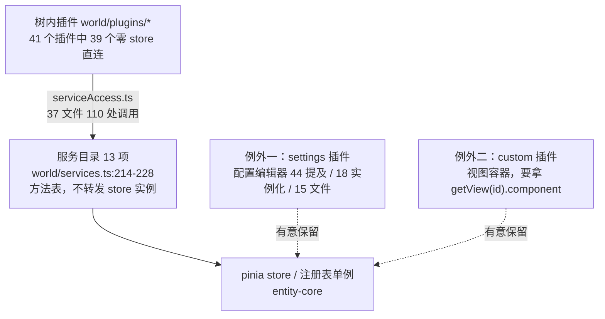

# 状态管理

> 回答「哪些 store、各管什么、持久化在哪、什么时候该经服务目录而不是直连 store」。

## 一、`entity-core` 的 15 个 pinia store

| store | 行数 | 管什么 | 持久化 |
|---|---:|---|---|
| `entityStore` | 358 | 实体表 + entityMap + 类型计数 | `FileStorageBackend` |
| `relationStore` | 151 | 关系表 | `FileStorageBackend` |
| `fileStore` | 131 | 项目文件元数据 | `FileStorageBackend` |
| `settingsStore` | 487 | **40+ 个用户偏好**（撤销上限 / 动画 / 高亮 / AI 供应商 / 时间线…） | localStorage（`persistedRef`） |
| `uiStore` | 292 | 当前视图 / 侧栏顺序 / 选中实体 / 表面（home / workspace）/ 启动态 | 部分 localStorage |
| `detailLayoutStore` | 125 | 详情载体 / 遮罩 / Tab 覆写 / 分组 | localStorage |
| `fieldOrderStore` | 115 | 字段顺序预设 | localStorage |
| `iconAssetStore` | 345 | 自定义图标资产（项目 / 全局双作用域） | 项目 DB + localStorage |
| `iconOverrideStore` | 269 | 图标覆写映射（项目 / 全局） | 项目 DB + localStorage |
| `pluginStore` | 55 | **视图镜像**（真源在 `pluginAPI`，这里是显示侧） | 无 |
| `trashStore` | 80 | 回收站条目 | localStorage |
| `artifactStore` | 178 | 随笔 / 工件 + 版本 | 项目 DB |
| `fontStore` | 180 | 六层字体族 + 缩放 | localStorage |
| `templateStore` | 74 | 实体模板 | 项目 DB |
| `personaStore` | 43 | 人设 | localStorage |

另有 2 个非 store 的辅助模块：`sproutPersistence`（211 行，芽开关 / 分组 / 外部插件的持久化函数）· `viewVisibility`（18 行，`isViewVisible(pluginId)` 单点判定）。

## 二、包外的 3 个 store

| store | 行数 | 管什么 | 持久化 |
|---|---:|---|---|
| `homeProfileStore` | 131 | 首页简介 | 读 `.worldsea/home.json` |
| `archiveStore` | 68 | 会话内累计语义 | sessionStorage |
| 4 个 re-export 壳 | 2–7 | `uiStore` / `settingsStore` / `fontStore` / `fontLibraryStore` 的转发 | 无（纯转发） |

## 三、store 直连 vs 服务目录

这是本仓插件解耦的核心边界。

**规则**：插件不直接 `useXxxStore()`，而是 `getWorldService('world.entities')` 取方法表。服务目录**转发方法，不转发 store 实例**——这样插件拿不到 store 的 `$state`，改不动别人的状态。

### 两个例外及理由

| 插件 | 直连量 | 为什么保留 |
|---|---|---|
| `settings` | 44 提及 / 18 实例化 / 15 文件 | 它写的是**配置本身**（`setCarrier` / `setProjectIcon` / `toggleSprout`）而非用户内容数据。服务目录的定位是统一取数口径，把配置写面做成公共 API 是扩大契约而非解耦 |
| `custom` | 2 提及 / 1 实例化 | 视图容器要拿 `getView(id).component`——**组件引用不跨服务边界** |

其余 **39 个插件零直连**。

### 守卫测试

`apps/tauri/src/world/plugins/__tests__/lightPluginDataPath.spec.ts`（290 行）：

- `MIGRATED` 清单 99 个文件 / 27 个插件目录
- `VIA_SHARED_ACCESSOR` 63 个文件
- 三条断言：不 import / call store、服务名必须真实存在、服务缺席必须 **throw**（不是静默降级）

第三条是关键：服务缺席时静默返回空数据，会让「插件没装好」表现成「没有数据」，排查成本极高。

## 四、`serviceAccess.ts` 的 10 份单点取值器

`characters` / `custom` / `data-tools` / `manuscript` / `mindmap` / `notebook` / `outline` / `tactical-board` / `theme-editor` / `timeline`

每份都是薄封装：`getWorldService(name)` + 类型断言 + 缺席抛错。看起来重复，但**每份的缺席报错信息带自己的插件名**，比共享一份更容易定位。

## 五、状态归属的四类判定

| 类 | 归属 | 例子 |
|---|---|---|
| A · 插件私有态 | Cordis 树（`ctx.effect` 回卷） | 视图内选中项、事件监听、定时器 |
| B · 共享领域数据 | 应用服务化（`world.entities` 等） | 实体、关系、schema |
| C · 用户偏好 | 服务化（`world.settings` 等） | 撤销上限、字体档位 |
| D · UI 瞬时态 | 插件禁访 | 当前打开的面板、拖拽中的坐标 |

判定线三条：**生命周期归属 / 是否共享 / 是否需隔离**。

## 六、持久化位置速查

| 数据 | 存哪 | 按项目隔离 |
|---|---|---|
| 实体 / 关系 / 文件 | 磁盘 `worlddata/` | 是 |
| 设置项 | localStorage | 否 |
| 回收站 | localStorage `ws_trash` | **否**（跨项目共享一个池，已知不一致） |
| 芽开关 / 分组 | localStorage + 项目 DB（读时项目 DB 优先） | 部分 |
| 图标覆写 / 资产 | 项目 DB + localStorage 双作用域 | 是 |
| 项目清单 | dsh workspace.json → IndexedDB 镜像 | — |
| 当前项目指针 | IndexedDB `WorldSea-Meta.appState` | — |

持久化细节见 [数据链路](../../架构/机制/数据链路.md) §五。
