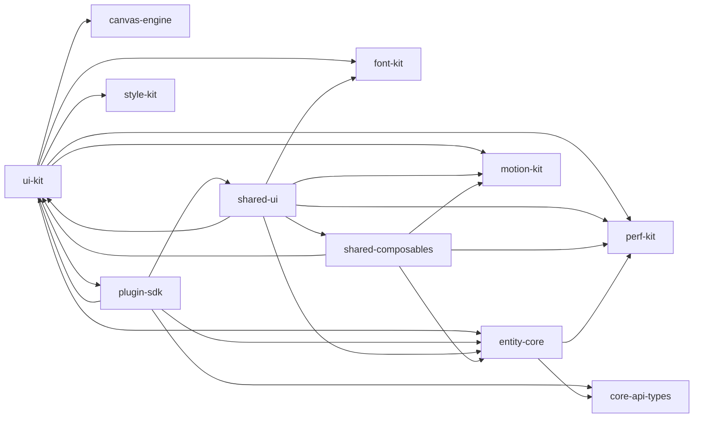

# 组件分层

> 回答「`ui-kit` / `shared-ui` / `plugin-sdk` / 本地组件四层怎么分工、依赖方向是什么」。
> 依据是代码与 `architecture-policy.json` 的依赖白名单，不是文档约定。

## 一、四层规模

| 层 | 文件 | 行数 | 导出面 |
|---|---:|---:|---|
| `packages/ui-kit` | 90（components）+ 18（composables） | 15,219 + 2,323 | 388 行 index，77 个 `export` |
| `packages/plugin-sdk` | 93（含测试） | 13,338 | 3 行 index：`export * from './components' \| './composables' \| './detail'` |
| `packages/shared-ui` | 7 | 1,079 | 只有 `markdown/`（codeHighlight + markdownStream + markdown.css） |
| 本地组件 | `apps/tauri/src/components/`（50）+ `ui/`（47） | 8,579 + 8,964 | 不经包导出，直接相对路径 import |

## 二、各层职责

### `ui-kit` = 自绘基础件 + 应用级面板

- `Ws*` 原子件（按钮 / 图标 / 骨架 / 空态 / tooltip / 搜索）
- `components/settings/*`（30 文件 4,363 行）：**设置面板全套**（Appearance / Editor / Layout / Relations / Shortcuts / Icons / Font / Background / Data / Home…）
- `components/entity/*`（16 文件 2,925 行）：区域地图、实体卡、关系面板
- `composables/`：`useShortcuts`（423）· `useResizable` · `useModalShortcuts` · `useScopedShortcuts` · `useConfirm` · `useToast` · `useAsyncTask`

**判据**：能跨插件复用的、与业务实体无关的 → `ui-kit`。

### `plugin-sdk` = 芽的「装配件」

- `components/GenericEntityView.vue`（840 行，冻结）——所有列表型芽的通用外壳（卡片 / 表 / 详情 / 筛选 / 分页 / 批量）
- `components/UniversalRelationPanel.vue`（712）· `SchemaRenderer.vue` · `EntityFormModal.vue`（411）· `AutoLinkSuggestions.vue` · `SmartFieldAdder.vue`
- `detail/`（44 文件 3,769 行）：**详情系统的实现层**——载体（carriers）· 内容形态（contentForms）· 字段访问器（fieldAccessor）· 表单（6 个 `forms/*`）· 字段控件（FieldControl 227）

`index.ts` 只有 3 行 `export *`——**它不隐藏内部结构，全部摊开**。

**判据**：多个芽共用同一套装配逻辑（列表外壳、详情面板）→ `plugin-sdk`。

### `shared-ui` = 单一题材包

只有 markdown 内核（渲染 + 流式 + 代码高亮），10 个消费点。

历史上还有 `src/agent/`（Agent 面），E8 已删。

**判据**：有独立主题域、但被多处消费的能力 → 单独包。

### 本地组件 = 只服务本应用

`apps/tauri/src/components/`：

- `files/*`（33 文件 5,439 行）：文件选择器 8 组件 + CodeEditor（477）+ 4 种格式预览
- `ui/Tui*`（12 文件 1,644 行）：10 个自绘基础件（Checkbox / Modal / Drawer / Select / Toast…）
- `editor/*`（3 文件 620 行）：斜杠菜单 / 提及 / MentionPopover
- `brand/*`（2 文件 271 行）

**判据**：依赖 Tauri 命令、或只在本应用有意义的 → 留本地。

## 三、依赖方向

**注意 `ui-kit → plugin-sdk` 与 `plugin-sdk → ui-kit` 双向依赖**——这是一个真实存在的包级环，`architecture-baseline.json` 的 `other` 段登记了豁免（`ts-cycle: cycle:plugin-sdk|ui-kit`）。

环的成因：`ui-kit` 的设置面板要展示芽的详情 tab（那在 `plugin-sdk/detail`），而 `plugin-sdk` 的通用视图要用 `ui-kit` 的按钮与卡片。拆开需要先把「详情系统」与「基础件」彻底分层，属于独立的批次。

## 四、双份基础件问题

`components/ui/Tui*.vue`（10 个）与 `ui-kit` 的 `Ws*.vue` 并存，**无迁移计划记录**。

| | `Ws*`（ui-kit） | `Tui*`（本地） |
|---|---|---|
| 位置 | `packages/ui-kit/src/components/` | `apps/tauri/src/components/ui/` |
| 跨包可用 | 是 | 否（相对路径） |
| 现状 | 新代码首选 | 历史遗留，仍在使用 |

**新增组件一律用 `ui-kit` 的 `Ws*`**；`Tui*` 不再扩张。

## 五、新增组件该放哪（决策表）

| 场景 | 落点 |
|---|---|
| 按钮、输入框、骨架、空态、tooltip 这类原子件 | `ui-kit`（用已有 `Ws*`，不新建） |
| 设置面板里的一块 | `ui-kit/components/settings/` |
| 列表型芽的通用外壳 | `plugin-sdk/components/GenericEntityView.vue`（扩展它，不复制） |
| 详情面板的一个字段控件 | `plugin-sdk/detail/` |
| 只服务一个插件的界面 | 该插件目录内 |
| 依赖 Tauri 命令（文件选择、预览） | `apps/tauri/src/components/` |
| 带独立主题域且多处消费 | 新建 `packages/<name>`，并在 `architecture-policy.json` 登记 |

新建包要在 `architecture-policy.json` 登记模块与依赖边，否则 `arch:check` 报「未登记模块」。
