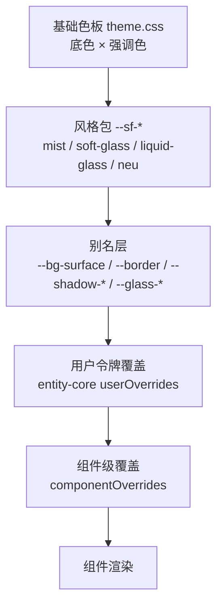

# UI 风格机制（产品域）

> 状态：现行（B1–B3 / P1–P2 已落地；2026-11-01 液化玻璃解锁为完整风格）。
> 计划：[2026-10-30-UI组件风格机制.md](../../plans/已完成/2026-10-30-UI组件风格机制.md) · 施工计划：[2026-10-30-UI组件风格机制-施工计划.md](../../plans/已完成/2026-10-30-UI组件风格机制-施工计划.md)
> 包内注释说明见 [style-kit/index.md](../注释/packages/style-kit/index.md)。

## 一、定位

风格 = **表面契约 + 风格包**。组件声明自己是什么表面角色，风格包只提供角色配方；现有通用令牌重指向角色层，让存量组件零改动跟随。

仅作用于产品域工作台窗（`/workspace/`），不进入壳 `prefs.json`、不影响 dsh。

## 二、分层与优先级

- 风格包负责表面质感；底色与强调色仍由原两轴控制。
- 用户令牌覆盖（圆角/密度）与组件覆盖优先级更高，不被风格包清除。
- 运行时由 `<html data-style>` 决定风格，`<html data-perf="on">` 决定性能模式；四维覆盖以行内 CSS 变量写在根元素。

## 三、表面角色

| 角色 | 变量前缀 | 主要覆盖 |
|---|---|---|
| canvas | `--sf-canvas-bg` | 应用底 |
| chrome | `--sf-chrome-*` | 窗口栏 / 标题栏 |
| nav | `--sf-nav-*` | 侧栏 / 导航轨 |
| panel | `--sf-panel-*` | 区域 / 面板 |
| card | `--sf-card-*` | 实体卡 / 内容卡 |
| control | `--sf-control-*` | 按钮 / 输入 / 分段器 / chip |
| overlay | `--sf-overlay-*` | 浮层 / 菜单 / 下拉 / 抽屉 |
| modal | `--sf-modal-bg` | 模态 |
| table | 复用 `--sf-panel-*` | 表头 / 行 / 网格 |
| accent-surface | `--sf-accent-surface-bg` | 强调面 |

契约变量全集在 `packages/style-kit/src/contract.ts`；每个风格包必须全覆盖，缺一即测试失败。

## 四、不可风格化红线

文字、图标、语义色（danger/success/warning/info）、焦点环、代码与 Markdown 高亮、强调色本体，一律不由风格包定义。表格网格、分隔线、滚动条允许适配但保留可读性下限：文字对比度 ≥ 4.5:1，控件边界 ≥ 3:1。

## 五、四维

| 维度 | 变量 | 作用 |
|---|---|---|
| 材质强度 | `--sf-material` | 配方强度系数（当前用于透明度/高光扩展位） |
| 实体深度 | `--sf-depth` | 阴影长度乘数，0 = 贴底无影 |
| 形变弹性 | `--sf-morph` | 角色圆角乘数，联动 `motion-kit` 弹性曲线 |
| 触感反馈 | `--sf-tactile` | 按压缩放系数，100 ≈ 0.96 |

公式集中在 `presets/base.css`：`--sf-depth-scale`、`--sf-radius-scale`、`--sf-press-scale`。

## 六、四套预设

| | mist（默认） | 磨砂巧克 | 液化玻璃 | neu |
|---|---|---|---|---|
| 表面 | 近不透明 | 半透明磨砂 | 低填充玻璃 + 边缘分层 | 与底色同色系 |
| 模糊 | 无 | 30–36px（tier A） | 20–26px（tier A），设置弹层另加边带层 | 无 |
| 边界 | 1px 实边 | 高光边 | 白边 + 暗焦散 + 锥形镜面 | 无边框 + 双向阴影 |
| 阴影 | 单级轻影 | 柔和扩散 | 深空阴影 + 高光边 | 双向外阴影 + 按压内陷 |
| 圆角 | 8–10 | 14–20 | 14–20 | 14–18 |
| 变体 | — | 常规 / 清透（clear） | — | — |

`soft-glass` 的 id 保持不变，展示名已改为「磨砂巧克」。`liquid-glass` 自 2026-11-01 起为可选风格：表面令牌覆盖 13 个角色；设置弹层在选中该风格时自动启用「边带 + 本体 + 白边 + 锥形镜面 + 暗焦散/眩光」的专属层结构（见研究文档 §十六）。

## 七、性能分级

- tier A（浮层/模态/导航/窗口栏）：真 `backdrop-filter`。
- tier B（卡片/面板/表格）：伪玻璃（半透明 + 高光边）。
- tier C（画布/白板）：不透明零模糊。
- 性能模式一键把 tier A 模糊归零；存量 25 处 `backdrop-filter` 在 B3 统一收编。
- 液化玻璃的设置弹层是唯一双 backdrop 层（边带 + 本体）；性能模式隐藏边带与眩光、关闭本体模糊，只保留填充、白边与暗焦散。

## 八、一致性门禁

`npm run style:check` 扫描 `packages/ui-kit/src` 与 `apps/tauri/src` 的样式块，禁止新增硬编码颜色、`box-shadow`、`backdrop-filter`；存量以 `scripts/style-conformance/baseline.json` 锁死，只许降不许升。消费 `var(--sf-*)` 的阴影与模糊视为合法，不计入硬编码。白名单：品牌资产、图标资产、图谱绘制。

B1 同时修复了桥接层 `--radius-sm/md/lg` 自引用导致的半径令牌失效（此前这些令牌以及派生的按钮/卡片/输入/弹窗圆角实际为 0）。

## 九、优化轮（B4）

- 控件边界统一加深到 ≥3:1（`--sf-control-edge`），由 `contrast.spec.ts` 对四套风格 × 明暗逐组校验。
- 模糊改为函数令牌 `--sf-overlay-filter / nav / chrome`：新拟态与性能模式为 `none`，不再创建模糊合成层。
- 柔玻璃新增 `--sf-highlight` 顶部高光，随材质强度缩放。
- 覆盖扩展到设置表单控件、详情载体、工具栏与下拉、共享弹层、列表行。
- 风格切换挂 `is-style-switching` 类做 150ms 过渡；侧栏 `contain` 放宽为 `layout paint` 以保留背景模糊。

## 十、质感轮（P1/P2）

- 玻璃升级为 30px 模糊 + `saturate(1.8)` + 噪声 + 染色渐变 + 镜面高光；灯箱使用 clear 变体（35% 暗化）。
- clear 变体已配置化：`useStyle.glassVariant`（`regular | clear`），持久化 `worldsea_ui_style_glass`，写入 `<html data-glass>`；性能模式同时关闭 `--sf-clear-filter`。
- 新拟态升级为 145° 表面渐变 + 四层阴影 + 强调色环境光晕（`--sf-ambient`）。
- 液化玻璃（2026-11-01）从研究槽位解锁为完整风格：`liquid-glass.css` 覆盖 13 个角色；设置弹层自动启用专属玻璃层。实体卡 / 模态 / 抽屉 / Toast 通过 `apps/tauri/src/styles/liquid-glass-surfaces.css` 追加单层锥形环，浅色下改用深色发丝边，不新增 backdrop 层。路线与参数见 [液化玻璃研究](../../plans/2026-10-30-液化玻璃研究.md)。
