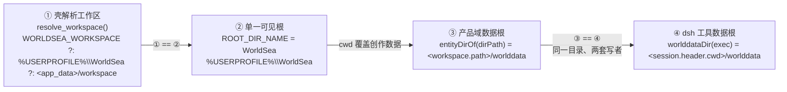

# 与 dsh 的接缝

> 回答「壳（Rust）与 dsh（Node 子进程）之间到底怎么接」。21 个 `dsh_*.rs` 模块、四个 ACL 文件、两窗各注入什么、两个写者如何共存。
> 装构起与排障配方见 [dsh 运行手册](dsh-运行手册.md)；我方改动边界见 [dsh fork 台账](dsh-fork台账.md)。

## 一、三个面与四个 ACL 文件

| 面 | 窗口 label | capability 文件 | permissions |
|---|---|---|---|
| 壳自身 | — | — | — |
| Agent 面 | `main` | `capabilities/default.json` | `allow-shell-bridge`(12) + `allow-stream-bridge`(4) + `allow-sse-bridge`(2) + `allow-capability-bridge`(5) |
| 产品域 | `workspace` | `capabilities/workspace.json` | `allow-shell-bridge`(12) + `allow-product-domain`(123) + `allow-capability-bridge`(5) |

`worldsea-shell.toml:9-10` 记了机制依据：应用级 permissions 目录一旦存在，Tauri 即对**所有**应用命令执行 ACL（tauri-2.11.5 `webview/mod.rs` 的 `has_app_acl_manifest` 分支）。这解释了为什么「有实现但无权」的命令在页面上表现成「命令不存在」。

**两窗 ACL 互斥是唯一硬边界**：工作台窗有产品域命令、没有流桥；main 窗有流桥、没有产品域命令。拒绝信息会点名 `allowed on: [windows: "…"]`。

## 二、传输：IPC 管道

dsh 以 Node 子进程运行，与壳之间走 **IPC 管道帧隧道**，零 TCP。

| 模块 | 行数 | 管什么 |
|---|---:|---|
| `dsh_pipe.rs` | 339 | 管道帧协议（请求 / 响应 / 流三 lane） |
| `dsh_pipe_io.rs` | 349 | 帧的读写与编解码 |
| `dsh_stream.rs` | 62 | 页面流桥（`cmd_stream_*` 四条命令） |
| `dsh_sse.rs` | 69 | SSE 端点分流（`cmd_sse_*` 两条命令） |
| `dsh_proxy.rs` | 373 | 宿主请求代理 |
| `dsh_relay.rs` | 263 | 中继 |

**方向固定**：Rust 是管道客户端，连接 host。所以「Rust 主动推给 host」成立，「host 主动推给 Rust」不成立——需要反向通信时，host 只能起一条自己的通道（能力桥的回环端点正是这个原因）。

## 三、页面注入面

两窗各注入什么（`dsh_inject.rs:29-136` 为 dsh 页，`:168-182` 为工作台页，`:143-162` 为错误页）：

| 注入项 | main 窗 | workspace 窗 |
|---|---|---|
| 主题常量 `__WORLDSEA_THEME__` / `__WORLDSEA_DARK__` | ✓ | ✓ |
| `__WORLDSEA_DSH_HOME__` | ✓ | — |
| 传输面 `__DSH_TRANSPORT__`（none / streamBaseUrl / openStream 三态） | ✓ | — |
| 流桥 `__WORLDSEA_STREAM__` + SSE `__WORLDSEA_SSE__` | ✓ | — |
| 安全网 watchdog | ✓ | ✓（挂载点 `#app`，`__WORLDSEA_BOOT_ROOT__='app'`） |
| 壳桥 `__WORLDSEA_SHELL__` | ✓（可关） | — |
| 空间切换遮罩 `__wsSpaceVeil` | ✓ | ✓ |
| 窗口栏 `dsh_titlebar.js` | ✓（可关） | —（自带旧 TitleBar） |
| 诊断 `WORLDSEA_SHELL_DIAG=1` | ✓ | — |
| 能力伺服 `dsh_capabilities.js` | ✓（可关） | —（自带 `shell/capabilities.ts`） |
| 工作区不可供给横幅 | ✓ | — |
| `__WORLDSEA_SPACE_SWITCH__` | — | ✓ |
| `__WORLDSEA_SET_THEME__` | — | ✓ |

错误页只装 3 件（主题、安全网、遮罩），因为它要在宿主起不来时也能显示。

## 四、21 个 `dsh_*.rs` 模块

按职责分组（`src-tauri/src/`，非测试文件）：

| 族 | 模块 | 行数 | 职责 |
|---|---|---:|---|
| **进程生命周期** | `dsh_shell` | 334 | spawn / 就绪探测 / 退出回收 / env 注入 |
| | `dsh_restart` | 281 | 崩溃后退避重启（1s / 2s / 4s，最多 3 次） |
| | `dsh_bootstrap` | 78 | 启动引导 |
| | `dsh_ready` | 86 | 就绪状态查询（`cmd_dsh_ready_state`） |
| | `dsh_error` | 157 | 错误页伺服 |
| | `dsh_crash_attribution` | 229 | 崩溃归因（补写 `last route:` 指名插件命名空间） |
| **传输** | `dsh_pipe` / `dsh_pipe_io` | 339 / 349 | 管道帧隧道 |
| | `dsh_stream` / `dsh_sse` | 62 / 69 | 页面流桥 / SSE |
| | `dsh_proxy` / `dsh_relay` | 373 / 263 | 宿主请求代理 / 中继 |
| **页面** | `dsh_inject` | 214 | 两窗注入 |
| | `dsh_nav` | 80 | 导航围栏 |
| | `dsh_gate` | 79 | Release 变更门（宿主重启后 `__DSH_BOOT__` 全变，拒绝旧页应用新图） |
| | `dsh_bridge` | 367 | 页面 ↔ 壳桥 |
| **账号与凭据** | `dsh_oauth` | 338 | OAuth 浏览器回调（常驻 loopback，仅 `GET /oauth/callback`，单路由 120s） |
| | `dsh_credentials` | 102 | 凭据存取 |
| **插件管理** | `dsh_plugin_control` | 242 | 插件启停控制 |
| | `dsh_plugin_remedy` | 170 | 插件故障补救 |
| **数据** | `dsh_workspace` | 165 | 工作区清单（`cmd_dsh_workspace_list`） |

另有 8 个 `*_tests.rs` 与 `dsh_pipe_test_host.rs`（测试辅助），不计入 21。

## 五、两个写者对同一份数据

| | 产品域（webview） | dsh 插件（node） |
|---|---|---|
| 实体写 | `FileStorageBackend.putEntity/updateEntity` → `cmd_fs_write`（原子 rename） | `writeFileSync` 直写 |
| 关系写 | `flushRelations`（`requestIdleCallback` 防抖，**无锁**） | `mutateRelations`（`.worldsea/relations.lock` 目录锁 + pid 探活） |
| 实体删 | `deleteEntityAtomic`（先删关系再删实体，先等 in-flight 写完） | `world_entity_delete`（读关系索引 → 过滤 → 写回，锁内） |
| 目录 | `<workspace>/worlddata` | `<session.cwd>/worlddata`（同一目录） |

**竞态窗口**：主窗侧不持锁。理论上「用户正在界面编辑关系」+「Agent 同时写关系」会互相覆盖。缓解只有时间上的（500ms 超时的 idle 回调，落盘窗口很小）。这是插件 README 明确登记的**已知边界**。

## 六、目录口径：四个常量必须咬合

因为 ①=② 且 ③=④，**dsh 沙箱的 cwd（= 工作区根）覆盖产品域的创作数据**——`write_file` 可以直写 `worlddata/`。这是「单一可见根」的技术含义。

写前守卫 `requireWorkspaceRoot`：会话 cwd 必须**正好等于**某个已登记工作区的根，否则报 `WORLDSEA_NOT_A_WORKSPACE`；cwd 在工作区内部但非根也拒。读操作不拦。

**这条口子带来的两个已知边界**：

- 文件级直写绕过工作台数据层校验（schema 校验、AutoLink 索引、撤销栈都不参与）
- 工作台对 `worlddata/` 内的外部写入**会**经 FsWatcher 1s 防抖后 reload（实体与关系会刷新）；但 schema 覆盖与外部插件走独立通路

## 七、与 dsh 仓的耦合面

`fork:check` 台账登记我方对 `dsh/` 的每一处改动（当前 13 条）：`host/webserver` · `bundle/web-app` 6 个文件 · `pnpm-lock.yaml` · 4 个测试 · `credentials/deepseek-account`。

**内部格式耦合**：`dsh_workspace.rs:78` 的 `cmd_dsh_workspace_list` 直读 `storages/workspace.json` 的 `global.workspaceIds` + `tables.workspaces.<id>{path,title}` 结构。这是 dsh 内部存储格式，**追版后须真机回归**。

## 八、排障入口

| 症状 | 先看 |
|---|---|
| 宿主起不来 | `dsh_shell` 的 spawn 日志；`DSH_HOME` 是否隔离；空 `DSH_HOME` 会让 dsh 静默退出 |
| 页面白屏 | `dsh_error` 的错误页；`dsh_gate` 是否拒绝了旧页 |
| 页面能开但请求 502 | 管道帧是否通（`dsh_pipe`）；SSE 是否走了 `sse:` 前缀分流 |
| 命令「不存在」 | ACL：`permissions/*.toml` 是否放行该窗口 |
| 登录卡住 | `dsh_oauth` 的 loopback 是否在监听；120s 单路由超时 |
| 插件没生效 | 产品域侧的 `[world-tree]` 日志（见 [装载与启停](../插件系统/装载与启停.md) §六） |
