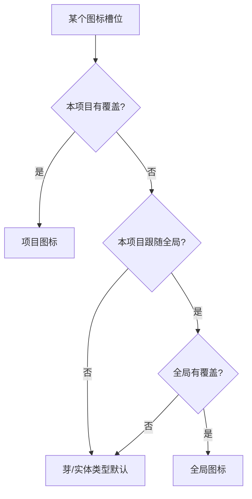

# 图标系统

> 产品域图标槽位与覆盖层。计划与施工批次见 [2026-10-27-图标库与图标槽位-批计划](../../plans/已完成/2026-10-27-图标库与图标槽位-批计划.md)。

## 一、要解决的问题

图标名在各注册点硬编码，且同一语义散在多处：

- 芽：视图注册 `registerView({ icon })`、默认芽清单 `DEFAULT_SPROUTS[].icon`、实体类型注册 `registerEntityV2({ icon })`。
- 显示：侧栏读 `view.icon`；设置/首页读 `sprout.icon`；实体卡片走静态 `TYPE_ICON`。
- 后果：改一处不会全界面同步；实体类型注册的 icon 在主流显示链路被忽略；用户无法按自己的世界语义换图标。

## 二、优先级



- 项目覆盖恒最高；「跟随全局」只控制未覆盖时的回退。
- 关闭「跟随全局」：当前生效的全局图标快照进项目覆盖，避免视觉跳变。
- 「应用到全局」：全局 + 项目同时落一份。
- 「回到芽默认」：清空项目覆盖 + 停止跟随全局。

## 三、数据

**全局层**（localStorage，跨项目）：

```json
{
  "version": 1,
  "overrides": { "sprout:official.concepts": "lightbulb" }
}
```

**项目层**（`project_settings` key = `icon_overrides`；localStorage 回退按 projectId 分键）：

```json
{
  "version": 1,
  "followGlobal": true,
  "overrides": { "entityType:concept": "book" }
}
```

槽位 key：

- `sprout:<pluginId>`
- `entityType:<type>`
- `domain:<id>`：8 个语义域；「全部」「未分类」不是域，不可覆盖。
- `detailTab:*:<tabId>`：跨实体类型共享的通用页（信息 / 形象 / 视频 / 关联）。
- `detailTab:<type>:<tabId>`：芽声明的自定义 / 附加页（按实体类型）。
- `regionType:<value>`：区域类型全集（`regionConfig.typeIconMap` 的 18 个值）。

未知槽位保留（外部芽临时禁用不丢覆盖），渲染时只解析当前存在的槽位。

**自定义图标（三期）**

- 覆盖值：`custom:<id>`；资产登记与文件分开存放。
- 项目：`{entityDataDir}/.worldsea/icons/<id>.<ext>`，`project_settings.icon_assets` + 分键 localStorage 回退。
- 全局：`<home>/WorldSea/icons/<id>.<ext>`，`worldsea_icon_assets_global`。
- 格式：SVG / PNG / WebP；SVG ≤ 256KB，位图 ≤ 512KB；SVG 拒绝 DOCTYPE / script。
- 资产 id 只允许字母数字/下划线/连字符，导入包不能借文件名路径穿越。
- 渲染：`WsIcon` 通过 `registerCustomIconResolver` 取运行时 URL，用单色蒙版跟随 `currentColor`；SVG 不内联。
- 导出：项目文件夹 `icons/` + `settings/icon-assets.json` + `settings/icon-overrides.json`；WorldSeaPack 的 `icon-assets` 分区内嵌 base64；导入后自定义图标落为项目本地。

**详情页解析顺序**：精确键 → 通用通配键（仅通用 4 页）→ 声明图标。芽自定义页不继承通配键，避免「改角色家谱影响别的类型同名页」。

## 四、解析收口

| 收口点 | 影响面 |
|---|---|
| `viewOrder.allVisibleViewsInSidebarOrder` | 侧栏轮盘/平铺/分栏、快捷访问、首页可见视图 |
| `EntitySchemaRegistry.getIconName` | 卡片、关联、提及、详情头 |
| `buildHomeData` | 首页资产地图芽 chip、8 域图标 |
| `buildSproutInsights` | 设置芽详情图标 |
| `buildSproutNavigation` | 侧栏轮盘 / 列表 / 双栏 / 页签的域图标 |
| `groupSproutsByDomain` | 设置芽管理的域分组头 |
| `resolveDetailTabs` | 五种详情载体的页签图标；Tab 管理行图标 |
| `regionConfig.regionTypeIcon` | 区域树 / 卡片 / 子区域 / 飞地 |
| `SproutsCardContent` + `IconsPanel` | 设置芽管理、图标中心 |

不在每个 Vue 组件里各自解析，避免漏面和重复逻辑。

**不变量**：`hasIcon` 门面必须与 `WsIcon` 可解析集合一致（自定义路径注册表 + Lucide/Tabler 混编）。否则消费方会误判为“未知图标”并回退成图标名文本（2026-10-27 真机走查修复点）。

## 五、模块

- `packages/entity-core/src/core/iconOverrides.ts`：有效覆盖注册表 + 槽位 key；无 Pinia 依赖，供 `getIconName` 读取。
- `packages/entity-core/src/stores/iconOverrideStore.ts`：全局/项目状态、持久化、快照、清除、导入导出状态。
- `packages/entity-core/src/core/customIcons.ts`：格式/体积/魔数校验、`custom:` 值与 base64 工具。
- `packages/entity-core/src/core/iconAssetIO.ts`：图标资产持久化与文件读写。
- `packages/entity-core/src/stores/iconAssetStore.ts`：项目/全局资产、上传、提升全局、引用统计、删除、导出集合。
- `packages/ui-kit/src/assets/iconCatalog.ts`：世界观精选图标目录（名称/中文名/关键词/域）。
- `packages/ui-kit/src/components/customIconResolver.ts`：自定义图标运行时解析位；`WsIcon` 蒙版渲染。
- `apps/tauri/src/world/iconSlots.ts`：芽 / 实体类型 / 语义域 / 详情页 / 区域类型槽位构建。
- `apps/tauri/src/world/iconAssetUpload.ts`：文件选择 → 项目资产（可选提升全局）。
- `apps/tauri/src/world/plugins/settings/panels/IconPicker.vue`：选择器（含「我的图标」）。
- `apps/tauri/src/world/plugins/settings/panels/IconSlotCard.vue`：图标中心的可搜索分组卡（5 类槽位复用）。
- `apps/tauri/src/world/plugins/settings/panels/IconAssetsCard.vue`：自定义图标上传/管理/删除守卫。
- `apps/tauri/src/world/plugins/settings/panels/IconsPanel.vue`：设置图标中心（六类槽位 + 自定义图标 + 作用范围）。

## 六、边界

- 图标库是静态精选，不做 Lucide 动态全集；保持 tree-shaking 与离线可用。
- 自定义 SVG/PNG/WebP 已随三期接入：项目内为主，`<home>/WorldSea/icons` 为可选全局目录。
- 语义域、详情 Tab、区域类型已随二期接入，沿用同一槽位与存储结构。
- 详情页只有通用 4 页读取通配键；芽自定义页按实体类型精确键。
- 自定义图标一律经图片/蒙版渲染，不 innerHTML；SVG 内容做 DOCTYPE / script 拒绝。
- Agent 写入图标不在三期范围。
- 图标只改呈现，不改变芽/实体类型的行为与数据。
