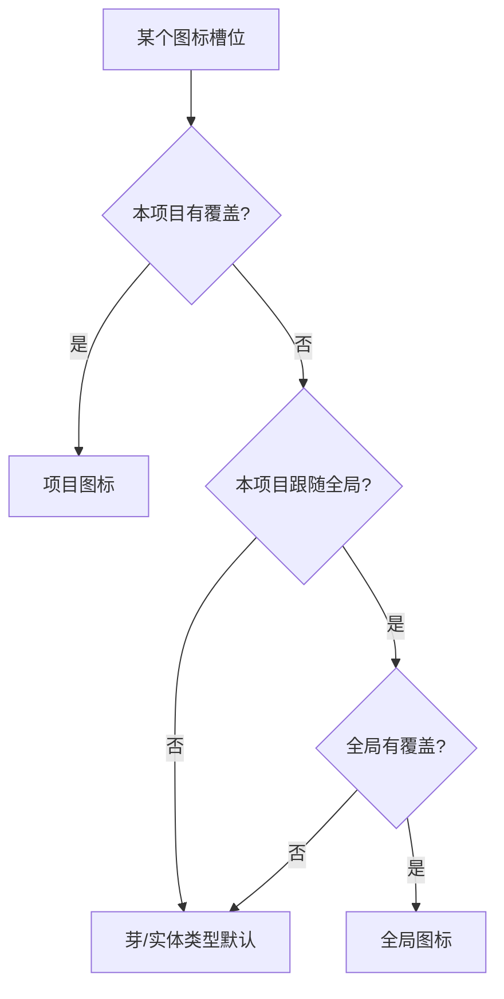

# 图标系统

> 产品域图标槽位与覆盖层。计划与施工批次见 [2026-10-27-图标库与图标槽位-批计划](../../plans/已完成/2026-10-27-图标库与图标槽位-批计划.md)。

## 一、要解决的问题

图标名在各注册点硬编码，且同一语义散在多处：

- 芽：视图注册 `registerView({ icon })`、默认芽清单 `DEFAULT_SPROUTS[].icon`、实体类型注册 `registerEntityV2({ icon })`。
- 显示：侧栏读 `view.icon`；设置/首页读 `sprout.icon`；实体卡片走静态 `TYPE_ICON`。
- 后果：改一处不会全界面同步；实体类型注册的 icon 在主流显示链路被忽略；用户无法按自己的世界语义换图标。

## 二、优先级



- 项目覆盖恒最高；「跟随全局」只控制未覆盖时的回退。
- 关闭「跟随全局」：当前生效的全局图标快照进项目覆盖，避免视觉跳变。
- 「应用到全局」：全局 + 项目同时落一份。
- 「回到芽默认」：清空项目覆盖 + 停止跟随全局。

## 三、数据

**全局层**（localStorage，跨项目）：

```json
{
  "version": 1,
  "overrides": { "sprout:official.concepts": "lightbulb" }
}
```

**项目层**（`project_settings` key = `icon_overrides`；localStorage 回退按 projectId 分键）：

```json
{
  "version": 1,
  "followGlobal": true,
  "overrides": { "entityType:concept": "book" }
}
```

槽位 key：

- `sprout:<pluginId>`
- `entityType:<type>`
- 预留：`domain:<id>` / `detailTab:<type>:<tabId>` / `regionType:<value>`

未知槽位保留（外部芽临时禁用不丢覆盖），渲染时只解析当前存在的槽位。

## 四、解析收口

| 收口点 | 影响面 |
|---|---|
| `viewOrder.allVisibleViewsInSidebarOrder` | 侧栏轮盘/平铺/分栏、快捷访问、首页可见视图 |
| `EntitySchemaRegistry.getIconName` | 卡片、关联、提及、详情头 |
| `buildHomeData` | 首页资产地图芽 chip |
| `buildSproutInsights` | 设置芽详情图标 |
| `SproutsCardContent` + `IconsPanel` | 设置芽管理、图标中心 |

不在每个 Vue 组件里各自解析，避免漏面和重复逻辑。

**不变量**：`hasIcon` 门面必须与 `WsIcon` 可解析集合一致（自定义路径注册表 + Lucide/Tabler 混编）。否则消费方会误判为“未知图标”并回退成图标名文本（2026-10-27 真机走查修复点）。

## 五、模块

- `packages/entity-core/src/core/iconOverrides.ts`：有效覆盖注册表 + 槽位 key；无 Pinia 依赖，供 `getIconName` 读取。
- `packages/entity-core/src/stores/iconOverrideStore.ts`：全局/项目状态、持久化、快照、清除。
- `packages/ui-kit/src/assets/iconCatalog.ts`：世界观精选图标目录（名称/中文名/关键词/域）。
- `apps/tauri/src/world/iconSlots.ts`：从视图、芽、schema 构建槽位。
- `apps/tauri/src/world/plugins/settings/panels/IconPicker.vue`：选择器。
- `apps/tauri/src/world/plugins/settings/panels/IconsPanel.vue`：设置图标中心（芽 / 实体类型 / 作用范围三卡）。

## 六、边界

- 图标库是静态精选，不做 Lucide 动态全集；保持 tree-shaking 与离线可用。
- 自定义 SVG/PNG 属三期；全局自定义图标需要用户级文件目录，与项目级资产分开设计。
- 语义域、详情 Tab、区域类型属二期，沿用同一槽位与存储结构。
- 图标只改呈现，不改变芽/实体类型的行为与数据。
