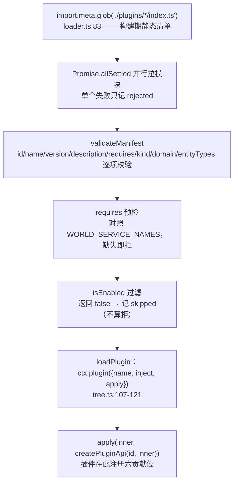

# 装载与启停

> 实现：`apps/tauri/src/world/loader.ts`（109 行，纯函数装载核心）· `tree.ts`（399 行，起树/启停）· `registry.ts`（52 行，兼容清理表）。
> 依赖自 vendor 的 cordis 4.0.4，**不依赖 `dsh/` 目录**。

## 一、从磁盘到运行：五步



**为什么清单是构建期静态**：`import.meta.glob` 让 rolldown 在打包时就知道有哪些插件，每个插件独立分包、按需拉取。好处是零运行时 IO、类型完整、构建期就能发现清单错误；代价是**不能运行时新增内置插件**——那是外部插件协议存在的理由。

**失败隔离**：单个插件模块导入失败 / 清单非法 / 依赖缺失，只记进 `report.rejected`（带可读原因），其余照常装载。树不会因为一个坏插件起不来。

## 二、依赖预检的两层

| 层 | 时机 | 机制 | 失败表现 |
|---|---|---|---|
| 装载前 | `assemblePlugins` | `manifest.requires` 对照 `WORLD_SERVICE_NAMES` | 该插件进 `rejected`，理由「本树未提供依赖服务：…」 |
| 运行时 | `ctx.plugin` | cordis 的 `inject` | 服务未就绪则不 `apply`，等服务 provide 后自动 apply |

两层是**同一份数据的两种用法**：`loadPlugin` 把 `plugin.manifest.requires` 直接塞进 `inject`（`tree.ts:113`）。所以清单写错服务名会在装载前被拦，写漏了则在运行时表现为「插件一直不 apply」——后者更难查，故有守卫测试强制 `requires` 与实际取用的服务一致（见 [插件开发纪律](插件开发纪律.md)）。

## 三、启停语义

`setPluginEnabled(id, enabled)` 是**真启停**，不是隐藏入口：

| 动作 | 实现 | 效果 |
|---|---|---|
| 启用 | `loadPlugin(plugin)` → `ctx.plugin(...)` | 插件 `apply` 执行，六贡献位登记 |
| 停用 | `unloadPlugin(id)`：`runPluginCleanups` → `unregisterFormsOfPlugin` → `fiber.dispose()` | 视图 / overlay / form / 能力回卷；**实体 / 关系 / Facet 类型保留** |

启停的**触发源**是芽清单：`world/index.ts` 里 watch `settings.sprouts`，用 `isViewVisible(id)` 做过滤，变化时动态装/卸。

### 三类插件在启停上的差异

| 类别 | 受启停控制 | 理由 |
|---|---|---|
| `kind: 'sprout'`（31 个） | 是 | 有侧栏入口，用户可关 |
| `kind: 'utility'`（10 个） | **否**（常驻） | 只贡献 overlay / 能力，没有「关掉入口」这个动作；关掉会让用户失去设置等管理面 |
| 外部插件 | 是，但走独立键 | `worldsea_external_plugins`，不并入内置清单（清单归一会把清单外 id 滤掉） |

`utility` 常驻的实现在 `tree.ts:212-223`：`forceLoad(id) = available.get(id)?.manifest.kind === 'utility'`，装载时无视 `isEnabled`，并从 `skipped` 里剔除。

## 四、卸载时发生什么

顺序是**固定的**，不能调换：

1. `runPluginCleanups(id)` —— 跑兼容清理表（未接 `ctx` 的调用方登记的回调）
2. `pluginAPI.unregisterFormsOfPlugin(id)` —— 撤该插件的形式登记（`form` 注册表不在 cordis effect 覆盖范围内，需显式撤）
3. `fibers.get(id)?.dispose()` —— cordis 拆 fiber，触发 `ctx.effect` 的 **LIFO** 回卷

为什么 `ctx.effect` 的回卷顺序是 LIFO 而兼容清理表是 FIFO，这在阶段 1A 有过专门取证：功能测试无法区分两条路径（结果等价），只能用**撤销顺序**当判据。见 [归档](../归档/README.md) 与 `docs/plans/已完成/2026-11-05-阶段1A-状态归属划分.md`。

### `ctx.effect` 的一个前提

`api.ts` 的 `tracked()` 依赖「`ctx.effect` 的回调**同步执行**」这一实测事实（cordis 4.1.0）。如果上游改成惰性执行，`tracked` 里的哨兵值会停在 `PENDING` 并**显式抛错**——因为注册结果类型多为 `void`，静默返回 `undefined` 极难察觉。

## 五、起树与拆树

| 函数 | 做什么 |
|---|---|
| `startWorldTree(options?)` | 幂等。建 `Context` → `provide` 13 项服务 → 寄存服务表给能力桥 → 装载内置 → 并入外部 → 逐个 `ctx.plugin` → 发布句柄 |
| `disposeWorldTree()` | 全拆：逐个 `unloadPlugin` → 拆服务 → 清服务表 |
| `reloadExternalPlugins()` | 只动外部插件圈：diff 源码指纹 → 新增装 / 消失卸 / 变更重装 / 未变不动 |

句柄镜像到 `globalThis.__WS_WORLD_TREE__`（JSON 安全，探针友好），字段 = `started / plugins / skipped / rejected / error` + `dispose / enable / disable`。

**四种状态词不要混**：持久化 `active`（用户开关）、运行时 `loaded` / `skipped` / `rejected`（装载结果）、身份 `builtin` / `external`（来源）、类型 `sprout` / `utility`（声明）。UI 目前只展示其中一部分。

## 六、装载日志

起树成功打一行汇总（`tree.ts:226-229`）：

```text
[world-tree] 已启动：装载 N 个插件（跳过 M 个）= a / b / c；服务=…；内置被拒 X；外部 Y（被拒 Z）
```

被拒条目另有 `console.warn` 明细。排查「某个插件为什么没生效」时，先看这行日志的 `skipped` 与 `rejected` 分别是多少——`skipped` 是用户关的，`rejected` 是坏了的。
