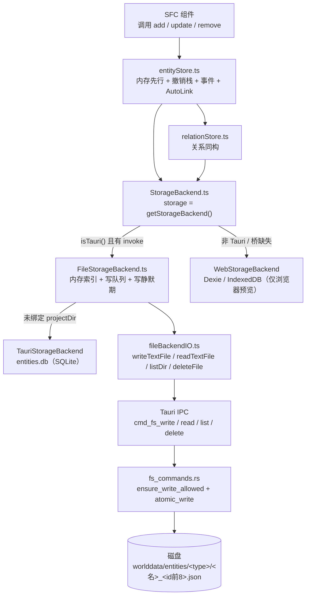
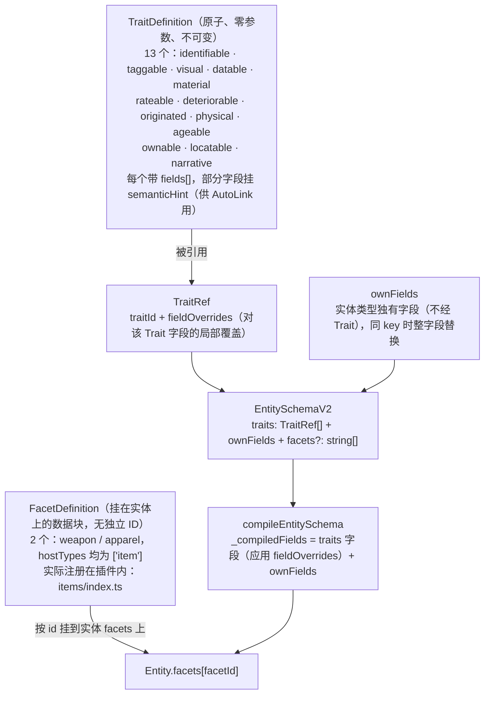
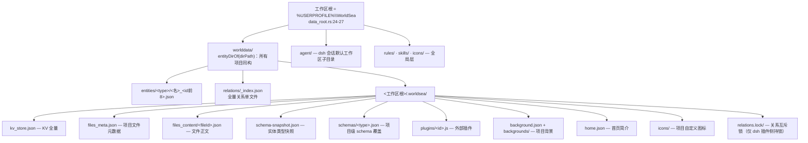

# 数据链路

> 回答「一条实体从界面到磁盘经过哪几跳、目录怎么排、项目模型各存哪、并发怎么防」。
> 实现：`packages/entity-core/src/stores/`（内存态）· `packages/entity-core/src/core/`（存储层）· `apps/tauri/src-tauri/src/fs_commands.rs`（磁盘）。

## 一、一条实体从界面到磁盘



关键跳与文件位置：

| 跳 | 文件 | 要点 |
|---|---|---|
| store 入口 `loadAll` | `entity-core/src/stores/entityStore.ts:55-68` | 首次加载建索引 |
| `add` | 同上 `:99-149` | 含 schema 校验、封面死值归一、AutoLink 索引 |
| `update` | 同上 `:156-217` | 写后异步持久化 + 两个事件 |
| `remove` | 同上 `:219-292` | 原子删除 + 级联关系入回收站 |
| 后端选择 | `entity-core/src/core/StorageBackend.ts:577-594` | 见 [存储后端](存储后端.md) |
| 索引全量扫描 | `FileStorageBackend.ts:263-332` | 起时扫盘建内存索引 |
| 实体落盘路径 | 同上 `entityFilePath` `:336-339` | `<type>/<名>_<id前8>.json` |
| 实体写 | 同上 `:405-431` | 异步 + 失败回滚内存 |
| 实体改 | 同上 `:433-475` | 读改写竞态防护 + 改路径时删旧文件 |
| 关系整表刷新 | 同上 `:642-670` | `requestIdleCallback` 防抖 |
| Rust 原子写 | `fs_commands.rs:74-87` | `.tmp` + rename |

## 二、两种数据的形状

**`Entity`**（`entity-core/src/types/entity.ts:109-131`）：

```text
id, type, name, description, properties: Record<string, unknown>, tags: string[]
avatar?, coverImage?, coverPosition?, coverZoom?
portrait?, portraitKind?('static'|'animated'|'lottie'|'model'), portraitMeta?{focus,model,motion}
videoAsset?, coverSource?('image'|'portrait'|'video')
facets?: Record<facetId, Record<field, unknown>>     ← 结构化数据块，不分配独立 ID
createdAt, updatedAt
```

**`Relation`**（`types/relation.ts:47-57`）：

```text
id, type, sourceId, targetId, label?, properties, pairId?, createdAt, updatedAt
```

`pairId` 是双向关系的配对键——`useBidirectional` 写一对关系时共用一个 `pairId`，`relationStore.getPairRelation` 据此取反向。

## 三、Trait / Facet / ownFields 三者关系

理解 schema 编译的关键，别被三套注册表绕晕。



一句话分工：**Trait 提供可复用的字段组 → fieldOverrides 做类型级微调 → ownFields 补该类型独有字段 → facets 另开一路挂数据块。**

`registerEntityV2` 一次注册**双写三处**（`entity-core/src/core/PluginAPI.ts:103-130`）：

1. `getSchemaOverlay(type)` 有项目级覆盖 → `applySchemaOverlay` 深合并
2. `compileEntitySchema` → `entitySchemaRegistryV2`
3. 兼容旧面：`entitySchemaRegistry`（旧版）+ `fieldRegistry.registerBuiltin(replaceBuiltin: true)`

**为什么必须双写**：`canvas-engine` 图数据标签、`field-matrix` 字段矩阵、`iconSlots` 取图标名都还在读旧注册表；`WorldView` 系读 V2。这是迁移未收尾的残留，不是设计。

## 四、`worlddata/` 目录布局



`.worldsea/` 的设计意义：**watcher 忽略它**。`useFsWatcher.processChanges` 只对 `entities/`、`relations/`、`.worldsea/plugins/`、`.worldsea/schemas/`、`.worldsea/files_content/` 五类路径做分发，`kv_store.json` / `files_meta.json` 两级过滤（Rust 端也滤一遍）。

## 五、项目模型：四件东西各存哪

| 件 | 真源 | 加载时机 |
|---|---|---|
| 项目清单 | dsh `$DSH_HOME/storages/workspace.json` → 壳 `cmd_dsh_workspace_list` → 镜像进 IndexedDB `WorldSea-Meta.projects` | `useProjectSwitcher.initialize()` |
| 当前指针 | IndexedDB `WorldSea-Meta.appState['currentProjectId']` | 同上（指针不在清单里则回落 default/first） |
| 实体 / 关系 / 文件 | `<workspace.path>/worlddata/` 磁盘 | 切项目时 `reloadStores()` |
| schema 注册表 | 内存（插件 `apply` 时注册） | 切项目时**全清 + 逐插件 unload→load 重播种** |

另有：芽开关 / 分组写 localStorage + 项目 DB 两处（读时项目 DB 优先，localStorage 是兜底副本）；设置项走 localStorage（`persistedRef`）；回收站走 localStorage `ws_trash`。

**两条不一致值得知道**：

- 实体数据在磁盘（按项目隔离），而**回收站在 localStorage**（跨项目共享一个池）——`trashStore` 没有按项目分键。
- 芽开关写两处，**读时项目 DB 优先**，所以 localStorage 那份不是真源。

## 六、写入并发的三条防护

| # | 机制 | 位置 | 修的是什么 |
|---|---|---|---|
| 1 | 同实体写串行化 | `FileStorageBackend.ts:81-92` | 「删除后 in-flight 写入把文件写回 → 实体复活」 |
| 2 | 自身写入静默期 | 同上 `:99-139` | 「自己写自己刷」：`isInSelfWriteWindow` 命中时 watcher 跳过 reload |
| 3 | 磁盘原子写 | `fs_commands.rs:74-87` | 「进程被强杀留下截断 JSON → 索引解析失败 → 静默丢实体」 |

**没有防护的：跨进程关系写。** 主窗写 `relations/_index.json` 走 `flushRelations`（无锁），而 dsh 插件侧走 `.worldsea/relations.lock` 目录锁（mkdir 原子性 + holder.pid 探活 + 8s 超时 + 60s 硬过期）。两套写者同时改关系时，主窗侧不知道锁的存在。

缓解只有时间上的：主窗侧 `flushRelationsAsync` 有 500ms 超时的 idle 回调，实际落盘窗口很小。这是已登记的**已知边界**，不是待修 bug。

## 七、启动竞态高发区

`FileStorageBackend` 每个方法开头都是 `if (!this.isReady) return this._fallback!.xxx(...)`。这个 `isReady` 分支在代码注释里记了两次实战事故：boot 竞态导致实体更新进 SQLite 而磁盘 JSON 保持旧值。

排查「数据莫名不一致」时，先确认 `isReady` 当时是真是假——它决定数据落在 JSON 还是 SQLite。
