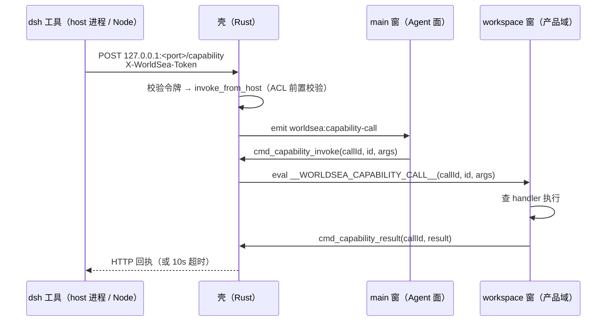

# 能力桥

> 作用：让 Agent 侧**触发产品域的界面动作**（打开面板、触发导出、执行布局算法），而不只是读写数据。
> 实现：`apps/tauri/src/shell/capabilities.ts`（产品域侧）· `src-tauri/src/capabilities.rs`（壳侧注册表与 ACL）· `capability_host_call.rs`（host 侧入口）· `apps/dsh-plugin-worldsea/lib/index.js`（Agent 侧工具）。

## 一、为什么需要它

两条跨面通路里，文件系统那条能传数据但**不能触发行为**：Agent 写一个 JSON 文件，产品域只会 reload 数据，不会「替用户打开大纲面板」。

能力桥补的就是这一段：Agent 说「调用 `world.views.open`」，产品域窗口执行对应 handler，把 UI 真的切过去。

## 二、完整链路

四段各有职责：

| 段 | 谁做 | 做什么 |
|---|---|---|
| ① host → 壳 | `capability_host_call.rs` | 只绑 `127.0.0.1`、只接受 `POST /capability`、校验随机令牌、请求体上限 64 KiB |
| ② 壳内部 | `capability_host_invoke.rs` | `invoke_from_host()` 走与页面侧相同的 `dispatch()` 内核（含 ACL 校验、callId 在途登记） |
| ③ 壳 → 主窗 | `dsh_capabilities.js` | 监听 `worldsea:capability-call`，代调 `cmd_capability_invoke` |
| ④ 主窗 → 提供方窗 | `capabilities.rs` | eval 派发；提供方执行后经 `cmd_capability_result` 回执认领 |

### 为什么走回环 HTTP 而不是现成通道

三条候选都不可行（`capability_host_call.rs` 头部注释有完整记录）：

| 候选 | 为什么不行 |
|---|---|
| `worldsea.localhost` 自定义协议 | 由 wry 伺服，**只有 webview 能访问**；host 的 HTTP 客户端够不到 |
| `dsh_pipe` | 方向固定为 Rust → host（Rust 是客户端），反向不成立 |
| 把 workspace 加进 ACL 让产品域自己调 | 那是自己调自己，没有意义 |

回环端点与 `dsh_oauth.rs` 的回调监听同一形态：本机其它进程无法借它做通用代理（有令牌 + 单路径 + 小载荷上限）。

## 三、能力清单

### 产品域内建（12 条，`shell/capabilities.ts`）

| 能力 | 语义 |
|---|---|
| `world.views.list` | 列出当前可用视图 |
| `world.project.current` | 当前项目 |
| `world.project.list` | 项目清单 |
| `world.schema.get` | 取某实体类型的 schema |
| `world.entity.list` / `get` / `put` / `update` / `delete` | 实体 CRUD |
| `world.relation.list` / `put` / `delete` | 关系 CRUD |

### 插件贡献（5 条，`world/plugins/mindmap/capabilities.ts`）

`world.mindmap.list` / `read` / `create` / `append` / `write`

这是**唯一一个用能力贡献位的插件**。它的存在证明了插件可以自建能力面，随装载登记、随卸载撤登记。

### Agent 面（1 条）

`agent.face.status`（`src-tauri/src/dsh_capabilities.js`，`acl=['workspace']`）——方向相反：产品域可以查 Agent 面状态。

### Agent 侧工具（2 条，2026-11-13 新增）

| 工具 | 作用 |
|---|---|
| `world_capability` | 触发一次能力调用 |
| `world_capability_list` | 发现面：列出当前已登记的能力 |

两者在端点不可用时 **fail loud**（抛错），不静默返回空数组——空数组会被误读成「没有能力」，那是完全不同的故障。

## 四、取数与变更通知

**取数策略**（`capabilities.ts:36-54`）：优先经树服务（`getWorldService`），服务表为空或写类抛错时回退直连 `storage`。这样能力桥在树未起时仍可用。

**变更通知**：`mutates: true` 的能力成功后派 `ws-capability-mutated` → `plugins/boot.ts:29-41` 防抖 300ms 重载实体 / 关系 store。含义是「Agent 改完数据，工作台即见」——这条曾经是 D2 基线登记的缺陷（无反向事件通道），现已由这个事件补齐。

## 五、ACL 粒度

`capabilities.rs` 的 `PROVIDERS: [&str; 2] = ["main", "workspace"]`——**ACL 粒度 = 窗口 label**。

三个后果：

1. 无法区分 dsh 内哪个会话 / Agent 在调
2. 无法给某个外部插件单独授权
3. `acl: []` = 无人可调（显式 deny，不是默认放行）——`check_acl` 的实现是对的

**提供方身份不可冒名**：provider 是注册时的窗口 label，不是调用时传的参数。所以产品域登记的能力只能由产品域窗口提供。

## 六、断链历史（已修）

2026-11-13 之前的状态：Rust 侧 5 条命令 + ACL + 超时 + 审计齐全，产品域登记 17 条能力，**但全仓零调用 `cmd_capability_invoke`**——唯一提到它的地方是注释和 Rust 单测。

含义是「Agent 让产品域执行动作」的整条通路断着。这条路后来按路径 A 接通（新增回环端点 + 两个 Agent 工具），机制部分本来就已经建好，只差一根电线。

**未验证的一跳**：端到端往返需要真机（本会话起不了 Tauri 窗口）。Rust 端点单测已覆盖安全口径与 handler 契约，但「主窗注入脚本收到 emit 后成功代发」这一跳只有代码审查，无运行时证据。真机走查方法：让 Agent 调一次 `world_capability_list`，能看到能力清单即说明全链路通。

## 七、已知边界

| 边界 | 说明 |
|---|---|
| 超时固定 10s，无取消、无进度回执 | 长任务（如大规模导出）只能等或失败 |
| 载荷走 eval 字符串 | 参数是 JSON 序列化后拼进 JS，不适合大对象 |
| 无背压 | 并发调用没有排队机制 |
| ACL 粒度 = 窗口级 | 见 §五 |
