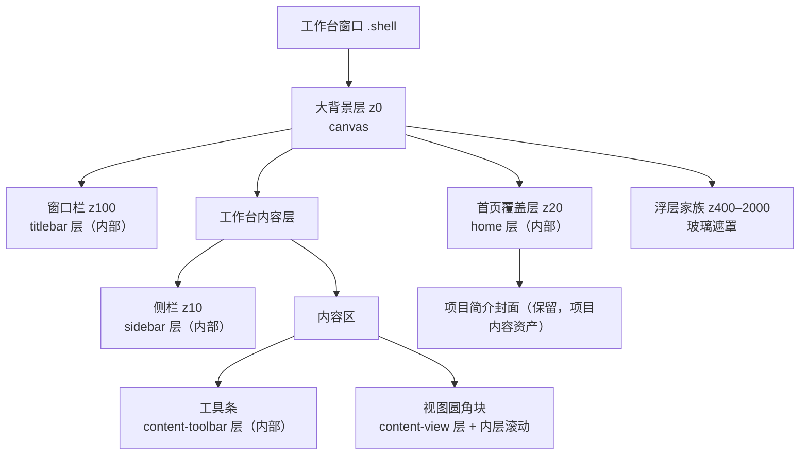
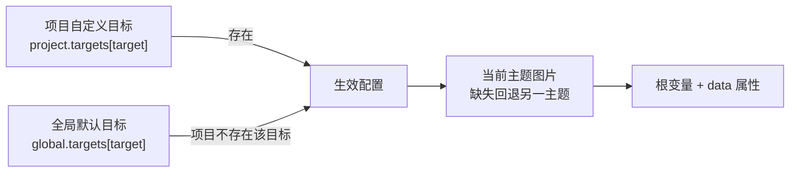

# 界面背景机制 v2.1（产品域）

> 状态：v2.1 已通过真机走查（2026-11-02）；六目标、工作台/首页映射、视图滚动下沉、工具条 bar 挂载已完成；相关测试 118/118、typecheck 0、产品域 workspace-dist 构建通过。
>
> 关联：[v1 基线](界面背景机制.md) · [UI 风格机制](UI风格机制.md) · [style-kit 注释](../注释/packages/style-kit/index.md) · [全局设计令牌](../注释/tauri/theme.md)。
>
> 定位：在 v2 的「全局默认 + 项目覆盖、亮/暗两套图」之上，把五个目标细分为六个，并用「界面映射」替代设置卡里的目标分段按钮。背景仍是玻璃表面的 backdrop，不是新的一层面板皮肤。

## 零、v2.1 变更摘要

1. 内容区拆成 `content-toolbar`（工具条）与 `content-view`（视图）两个目标；工作台画布 `canvas` 改名为「大背景」，key 不变。
2. 背景卡改为「界面映射 + 上下文编辑」：工作台映射里直接点窗口栏/侧栏/工具条/视图四区；首页有独立的第二张映射；大背景以卡片放在地图下方。
3. 旧 `content` 配置只迁移到 `content-view`，工具条留空；避免两个目标共用同一个文件后删一个把另一个弄坏。
4. 工具条目标只在随流工具条（bar）形态生效；overlay 悬浮胶囊与 none 折叠不套背景。
5. 视图区背景层放在 `.view-content` 外框，滚动下沉到内层 `.view-scroll`，壁纸不随内容滚走；`.view-content` 仍不加 `z-index`，视图内 fixed 浮层不被钳制。
6. 首页仍只有一个 `home` 目标；首页映射只做空间化选图，项目封面在「编辑简介」维护，映射里仅作参照。

## 一、范围

### 1.1 v2.1 做

- 六个背景目标：大背景、首页、窗口栏、侧栏、内容区·工具条、内容区·视图。
- 每个目标可独立启用；亮/暗主题各一张图，共用一套参数。
- 全局用户级默认 + 按项目整目标覆盖（跟随全局 / 本项目自定义）。
- 项目背景文件存 `{projectDir}/.worldsea/backgrounds/`，随项目导出/导入。
- 首页页面底图；项目简介封面保留，两者独立。
- 单张背景卡：范围、工作台/首页映射切换、大背景卡片、上下文编辑区。
- 旧 `content` 全局/项目配置迁移到 `content-view`。

### 1.2 v2.1 不做

- 视频、GIF、动态图、幻灯片。
- 交互式裁切/拖动构图（继续用九宫格焦点）。
- 亮/暗各一套独立参数。
- 工具条/侧栏/视图的填充与焦点配置（固定 `cover` / 居中）。
- 首页子目标（hero 背景、封面背景等），以及在地图里直接编辑封面。
- 地图区域拖放图片；选图仍走文件选择器。

## 二、目标与层级

### 2.1 六个目标

| 目标 | key | 宿主 | 可见范围 | 可配参数 |
|---|---|---|---|---|
| 大背景 | `canvas` | `.shell` 根 | 全窗口，所有区域之下 | 启用、亮/暗图、填充、焦点、暗化、模糊 |
| 首页 | `home` | `.shell-home-layer` | 首页内容层 | 启用、亮/暗图、填充、焦点、暗化、模糊 |
| 窗口栏 | `titlebar` | `.titlebar` | 窗口栏内部 | 启用、亮/暗图、暗化、模糊 |
| 侧栏 | `sidebar` | `.sidebar` / `.ws-sn-sidebar` | 侧栏内部 | 启用、亮/暗图、暗化、模糊 |
| 内容区·工具条 | `content-toolbar` | `.view-toolbar` | 随流工具条（bar）内部 | 启用、亮/暗图、暗化、模糊 |
| 内容区·视图 | `content-view` | `.view-content` | 视图圆角块内部 | 启用、亮/暗图、暗化、模糊 |

分区目标的填充固定 `cover`、焦点固定居中；配置仍存 `fit` / `focusX` / `focusY` 字段，归一化时强制为 `cover` / `50` / `50`，设置界面不展示这两项。

### 2.2 层级树



### 2.3 分区与大背景的关系

- 大背景是底图，始终在所有区域之下；分区图只在对应区域内绘制，不改变布局。
- 分区未启用或没有可用图片时，该区域维持表面色/玻璃采样画布。
- 首页是覆盖层：首页启用时大背景不参与首页显示；首页底图只作用于首页层，不影响工作台。
- 工具条与视图各自在自己的圆角块内出图；块间缝隙仍透出大背景/区域底色，不再由一张内容区图横贯两块。
- 首页封面与首页底图相互独立；封面是项目内容资产，不在背景映射里编辑。

## 三、配置契约

### 3.1 类型

放在 `packages/style-kit/src/composables/useBackground.ts`：

```ts
export type BackgroundTarget =
  | 'canvas'
  | 'home'
  | 'titlebar'
  | 'sidebar'
  | 'content-toolbar'
  | 'content-view'
export type BackgroundTheme = 'light' | 'dark'
export type BackgroundFit = 'cover' | 'contain' | 'tile'
export type FocusStep = 0 | 50 | 100

export interface BackgroundImageRef {
  path: string
  src: string
}

export interface BackgroundTargetConfig {
  enabled: boolean
  paths: { light: string; dark: string }   // 全局为绝对路径；项目为相对路径
  fit: BackgroundFit
  focusX: FocusStep
  focusY: FocusStep
  dim: number                              // 0–80
  blur: number                             // 0–30
}

export interface BackgroundGlobalConfig {
  version: 2
  targets: Record<BackgroundTarget, BackgroundTargetConfig>
}

export interface BackgroundProjectConfig {
  version: 1
  targets: Partial<Record<BackgroundTarget, BackgroundTargetConfig>> // 出现即自定义
}
```

schema 版本号保持不变：`content` 是旧键，只在归一化时作迁移输入，不再作为目标出现。

### 3.2 默认值与归一化

| 字段 | 默认 | 允许值 |
|---|---|---|
| `enabled` | `false` | boolean |
| `paths.light` / `paths.dark` | `''` | 合法路径 |
| `fit` | `cover` | `cover` / `contain` / `tile` |
| `focusX` / `focusY` | `50` | `0` / `50` / `100` |
| `dim` | `35` | 0–80，整数 |
| `blur` | `8` | 0–30，整数 |

归一化规则：

- 未知 `fit` 回 `cover`；焦点取最近合法值；`dim` / `blur` 夹取并取整。
- `titlebar` / `sidebar` / `content-toolbar` / `content-view` 的 `fit` 强制 `cover`，焦点强制 `50/50`。
- 旧 `content` 键：新 `content-view` 键不存在时，用 `content` 的值初始化 `content-view`；不复制到 `content-toolbar`。
- 缺失或损坏的 JSON 回该目标默认值；版本不匹配按当前版本归一化，不抛错。
- 项目配置中未知 key 忽略；未知 target 丢弃；旧 `content` 按上一条迁移。

### 3.3 主题解析

同一目标的亮/暗图共用 `enabled`、`fit`、`focusX`、`focusY`、`dim`、`blur`，只替换图片。

- 当前主题的图片路径为空时，回退到另一主题的图片。
- 两套都为空时，该目标显示为无背景（不写 `data-ws-bg-<target>`）。
- 主题由 `<html data-theme="light|dark">` 驱动；不新增 JS 主题监听。

### 3.4 作用域与覆盖



- 项目配置里出现某目标 = 该目标整目标覆盖；不存在 = 跟随全局。
- 项目自定义目标即使 `enabled: false`，也不会回退全局（显式关闭）。
- 项目自定义的亮/暗图都不可用时，不回退全局，显示缺失提示。
- 「恢复跟随全局」删除项目目标，并删除该目标引用的项目图片文件。

### 3.5 全局持久化与迁移

- 新键：`worldsea_background_v2`，单条 JSON，含 `version: 2`。
- 旧键：`worldsea_workspace_background`（v1）。首次加载时若 v2 不存在且 v1 存在：
  - `path` → `canvas.paths.light`；`src` 丢弃，由启动引导重新解析。
  - `enabled` / `fit` / `focusX` / `focusY` / `dim` / `blur` 原样迁移。
  - `canvas.paths.dark` 留空（暗色回退亮色图）。
  - 旧键保留，不删除；v2 写入后不再读取旧键。
- v2 的旧 `content` 键在读取时迁移到 `content-view`；下次写盘自然丢弃旧键。
- 全局配置不写项目目录、不写壳 `prefs.json`。

### 3.6 项目配置格式与路径规则

文件：`{projectDir}/.worldsea/background.json`

```json
{
  "version": 1,
  "targets": {
    "content-view": {
      "enabled": true,
      "paths": {
        "light": ".worldsea/backgrounds/content-view-light-1730592000000.webp",
        "dark": ""
      },
      "fit": "cover",
      "focusX": 50,
      "focusY": 50,
      "dim": 35,
      "blur": 8
    }
  }
}
```

- 路径必须是相对 POSIX 路径，且以 `.worldsea/backgrounds/` 开头。
- 拒绝绝对路径、`..` 段、反斜杠与空段；拒绝指向项目目录外的路径。
- 导入/加载时先校验再 `stat`；非法条目丢弃并告警，不阻断项目加载。
- 项目图片文件只由固定目录与固定文件名拼出，不接受任意用户输入拼接。
- 读写基准：`getFileStorageBackend().projectDir` 是实体存储根 `<workspace>/worlddata`（不是工作区根 `dirPath`），背景配置与图片路径都由它拼出；设置卡也必须用它读写。`useFileSystemProject()` 的项目目录状态只作切换触发器，不能当作背景读写基准。

## 四、运行时与 CSS

### 4.1 useBackground API

单例，模式同 `useStyle`。返回：

| 成员 | 说明 |
|---|---|
| `globalConfig` | 全局配置 ref |
| `projectConfig` | 项目配置 ref；`null` 表示无覆盖 |
| `effective` | 六个目标的生效配置（computed） |
| `srcs` | 运行时 URL：`target -> theme -> src` |
| `missing` | 运行时缺失：`target -> theme -> boolean` |
| `setProjectConfig(config)` | 项目切换/加载后注入；传 `null` 清空 |
| `setTargetSrcs(target, srcs, scope)` | 注入全局或项目解析后的 URL |
| `updateTarget(target, patch, scope)` | 修改全局或项目目标参数 |
| `setTargetImage(target, theme, image, scope)` | 设置图片路径 + 运行时 URL |
| `clearTargetImage(target, theme, scope)` | 清空图片 |
| `setTargetCustom(target, custom)` | 项目范围：切换自定义/跟随全局 |
| `apply()` | 写根属性与 CSS 变量 |
| `flushGlobal()` | 立即落盘全局配置 |

`scope` 为 `'global' | 'project'`。项目配置的持久化由设置卡经 entity-core 完成，style-kit 只持有运行时态；全局配置仍由 style-kit 持久化。

### 4.2 根属性与变量

每个目标写入：

| 名称 | 值 | 用途 |
|---|---|---|
| `data-ws-bg-<target>` | `on` / 移除 | 该目标透明化/层显示开关 |
| `--ws-bg-<target>-image-light` | `url("...")` / `none` | 亮色图 |
| `--ws-bg-<target>-image-dark` | `url("...")` / `none` | 暗色图 |
| `--ws-bg-<target>-size` | `cover` / `contain` / `auto` | 填充 |
| `--ws-bg-<target>-repeat` | `no-repeat` / `repeat` | 平铺 |
| `--ws-bg-<target>-position` | `x% y%` | 焦点 |
| `--ws-bg-<target>-dim` | 0–80 | 暗化 |
| `--ws-bg-<target>-blur` | 0–30 | 模糊 |

- `data-ws-bg-<target>` 只在生效目标 `enabled && (lightSrc || darkSrc)` 时存在。
- 任何一张图可用时，两个主题变量都写入：当前主题缺图时写另一主题的 URL，保证主题切换不出现空档。
- 目标 key 含连字符，写 `dataset` 时转 camelCase：`content-toolbar` → `wsBgContentToolbar`（DOM 属性仍为 `data-ws-bg-content-toolbar`）。
- v1 的 `data-workspace-bg`、`--ws-bg-image` 等变量退役，由 `canvas` 目标同名规则替换。

### 4.3 主题切换 CSS

```css
html { --ws-bg-content-toolbar-image: var(--ws-bg-content-toolbar-image-light, none); }
html[data-theme='dark'] { --ws-bg-content-toolbar-image: var(--ws-bg-content-toolbar-image-dark, none); }
/* canvas / home / titlebar / sidebar / content-view 同构 */
```

CSS 只做变量选择，不参与配置合并；合并与回退在 `useBackground` 完成。

### 4.4 各目标层实现

统一组件 `BackgroundLayer.vue`，接收 `target`、`preview` 与可选 `scope`。

| 目标 | 挂载点 | 层叠要点 |
|---|---|---|
| `canvas` | `Shell.vue` 第一个子节点 | 绝对定位 inset 0，z0；全窗底图 |
| `home` | `.shell-home-layer` 第一个子节点 | 层 z-1（首页层 z20 堆叠上下文）；首页背景开启时 `.home-surface` 透明；封面保留 |
| `titlebar` | `.titlebar` 第一个子节点 | 层 z-1（窗口栏 z100 堆叠上下文）；图片上叠半透明表面色 + 暗化 |
| `sidebar` | `.sidebar` / `.ws-sn-sidebar` 第一个子节点 | 层 z-1（侧栏 z10 堆叠上下文，`contain: paint` 裁剪） |
| `content-toolbar` | `.view-toolbar` 第一个子节点（仅 bar 形态挂载） | 宿主启用时 `position: relative; z-index: 1` 形成局部堆叠上下文；层 z-1 位于工具条底色之上、控件之下；overlay/none 不挂载层，保留胶囊/折叠 |
| `content-view` | `.view-content` 第一个子节点 | 宿主 `position: relative; overflow: hidden` 但不加 `z-index`；层 z0；内层 `.view-scroll` 负责滚动并排在层之后；视图内 fixed 浮层仍留在根层叠 |

分区层的图片盖住宿主底色，再以半透明表面色叠加，最后是宿主内容；表面色叠加比例取 v2 实验室结论 alpha 0.6。窗口栏/侧栏自身的 `backdrop-filter` 仍采样大背景，不采样分区图；分区图的模糊由图片层自身 `filter` 完成。

### 4.5 分区层叠约束

- 背景层祖先不得新增 `isolation`、`filter`、`contrast()`、`opacity < 1` 等会形成 backdrop root 的属性。
- 背景层的模糊只作用于图片元素自身；不在宿主或祖先加 `filter`。
- `content-toolbar` 的 `z-index: 1` 只在该目标启用且 bar 形态时成立；它只包含工具条内联控件与下拉菜单，不承载视图 fixed 浮层。
- `.view-content` 不得加 `z-index`；视图内 `position: fixed` 浮层（Gallery 预览、文档导出、模板管理、跳回菜单）必须留在根层叠，才能压过侧栏（z10）与窗口栏（z100）。
- `.view-content` 的滚动由内层 `.view-scroll` 承担，背景层不进入滚动内容；不得给 `.view-content` 加 `filter` / `transform` / `contain: paint`。
- 所有背景层 `aria-hidden="true"`、`pointer-events: none`，不参与焦点与读屏。
- 分区层不得改变宿主尺寸、内边距或滚动语义；`.view-scroll` 接管滚动后，视图根仍按 100% 高度工作。

### 4.6 性能与可访问性

- 图片长边 ≤2560，WebP q0.9，JPEG q0.85 回退；单张输入 ≤20MB。
- 只渲染启用且有图的目标；关闭的目标不创建背景层 DOM。
- 性能模式 `html[data-perf='on']` 下所有背景层 `filter: none; transform: none`；分区图保留，模糊关闭。
- 六个目标全部启用会同时解码最多 12 张图；设置卡提示「按需启用」，默认只启用大背景。
- 暗化用 `--bg-app` 混合，自动跟随亮/暗主题；默认 35%，设置卡提示过低会降低文字可读性。
- 图片加载失败回退目标底色/大背景，不阻塞界面。

## 五、图片资产、项目导出与缺失

### 5.1 导入

- 复用自绘文件选择器 / `pickLocalFiles`；过滤器 `png`、`jpg`、`jpeg`、`webp`。
- 全局目录：`await appDataDir()` + `worldsea/backgrounds/`。
- 项目目录：`{projectDir}/.worldsea/backgrounds/`。
- 文件名：`background-<target>-<theme>-<timestamp>.<ext>`；旧 `workspace-*` / `content-*` 文件继续有效。
- 流程：解码 → 长边归一化 → WebP/JPEG → `cmd_fs_mkdir` → `cmd_fs_write`（base64）→ `convertFileSrc`。
- 项目导入返回相对路径 + 绝对路径 + src；全局导入返回绝对路径 + src。
- 取消不报错；非图片/超限/损坏给行内原因，不写盘。

### 5.2 项目配置读写

- `loadProjectBackground(projectDir)`：读 `.worldsea/background.json`；缺失返回 `null`；损坏告警并按无覆盖处理。
- 逐目标校验路径与文件：缺失的文件清空运行时 src、记 `missing`，保留配置路径。
- `saveProjectBackground(projectDir, config)`：仅写自定义目标；目标为空时删除配置文件。
- 项目切换：先清空旧项目覆盖，再加载新项目；用 generation token 防止旧异步结果覆盖新项目。

### 5.3 导出 / 导入

在 `ProjectFS` 的图标步骤之后追加，失败不阻断主体：

- 导出：读项目配置；把每个被引用的文件从项目 `.worldsea/backgrounds/` 复制到导出目录同相对路径；配置文件原样复制。缺失文件跳过并告警。
- 导入：读源配置；校验相对路径；把文件复制到新项目 `.worldsea/backgrounds/`；配置写入新项目。缺失文件对应槽位清空并告警。
- 旧数据包没有 `.worldsea/background.json` 时静默跳过。
- 路径校验与 3.6 相同；导出/导入都拒绝目录穿越。
- `content` 旧键在导入后的项目配置归一化时迁移到 `content-view`。

### 5.4 替换 / 移除 / 缺失 / 孤儿

- 替换单张图：先写新文件并更新配置，成功后删除旧文件；删除失败只告警。
- 移除单张图：清路径与运行时 src，删除文件；删除失败仍清配置。
- 移除目标/恢复跟随全局：清目标并删除该目标引用的项目图片（项目范围）或全局图片（全局范围）。
- 启动/加载校验：`cmd_fs_stat` 失败只记 missing，不改持久化配置；瞬时失败重试 2 次（间隔 250ms），仍失败才显示缺失。
- 孤儿清理：全局 backgrounds 目录在启动时清理不被全局配置引用的 `background-*` / `workspace-*` 文件；项目目录在保存配置时清理该目标不再引用的文件。清理只删除固定前缀文件，不递归、不碰其他文件。

## 六、设置界面

### 6.1 单卡结构

外观面板仍为 6 张卡，「背景」卡保持第 2 张（索引 1），CardDeck、左列 rail 与搜索索引不变。v2.1 卡内顺序：

1. 范围：`全局` / `本项目`（无项目时禁用本项目并提示）。
2. 界面映射：标题栏右侧 `亮 / 暗` 预览切换 + `工作台 / 首页` 切换；点击以淡入/滑动过渡换图，减少动效时直切；亮暗预览只改设置卡，不写全局主题。
3. 工作台映射：窗口栏、侧栏、工具条、视图四个区域按钮；每区显示当前背景（亮暗随预览主题）、状态（开/关/未设置/缺图/跟随），选中区出强调描边；选图期间锁定。
4. 首页映射：按 HomeSurface 结构画 hero、KPI、资产地图、动态/写作区；整页是 `home` 一个目标；封面块标「项目封面，在编辑简介更换」，只作参照不可在此编辑；整图可点选 `home`。
5. 大背景卡片：放在地图下方，固定缩略条；点击选中 `canvas`；选中后编辑区顶部给 16:9 预览，不再让卡片展开顶走编辑区。
6. 项目范围额外一行：`当前跟随全局` + 「本项目自定义」，或 `本项目自定义中` + 「恢复跟随全局」。
7. 上下文编辑区：按当前选中目标显示亮色图/暗色图两行（缩略图 + 选择/替换/移除）、启用开关、暗化、模糊；大背景/首页另有填充与焦点。
8. 可达性：选中区域、切换地图或选中大背景后，编辑区自动滚到可见位置（尊重减弱动效）；地图舞台约 2:1、最大 220px，标签/状态绝对定位，窄宽状态收成颜色点并保留 `title`。
9. 工具条形态：读取当前工作区视图的 toolbar 模式；非 bar 时地图工具条区显示「悬浮 / 隐藏 / 无视图」徽标，编辑区明示背景是否生效。
10. 说明文案与工具条形态提示。

「本项目自定义」初始化该目标参数为全局值，图片留空，提示为本项目重新选图；不复制全局图片文件。

### 6.2 控件矩阵

| 控件 | 大背景 | 首页 | 窗口栏 | 侧栏 | 工具条 | 视图 |
|---|---|---|---|---|---|---|
| 启用 | 有 | 有 | 有 | 有 | 有 | 有 |
| 亮色图 | 有 | 有 | 有 | 有 | 有 | 有 |
| 暗色图 | 有 | 有 | 有 | 有 | 有 | 有 |
| 填充 | 有 | 有 | 固定 cover | 固定 cover | 固定 cover | 固定 cover |
| 焦点 | 有 | 有 | 固定居中 | 固定居中 | 固定居中 | 固定居中 |
| 暗化 | 有 | 有 | 有 | 有 | 有 | 有 |
| 模糊 | 有 | 有 | 有 | 有 | 有 | 有 |

### 6.3 映射交互

- 工作台映射四区都可点选；点击只改选中目标，不直接弹文件选择。
- 首页映射整图点选 `home`；封面块 `pointer-events: none`，不抢点击。
- 切换地图：切到首页自动选中 `home`；切回工作台恢复上次选中的结构目标（默认 `titlebar`）。
- 选中大背景卡片时地图保留当前页，但四区/首页取消选中描边；编辑区切到 `canvas`。
- 选图期间（`picking`）锁定范围、地图切换、区域、大背景卡片与槽位，保证结果落到发起时的目标。
- 每区状态：项目范围跟随全局显示「跟随」，自定义显示「开/关」；两主题都缺图显示「缺图」；无图显示「未设置」。单主题缺失由编辑区槽位提示。
- 亮/暗预览切换只改地图、大背景卡片和编辑区预览；真实界面主题不变，打开背景卡时默认当前主题。
- 工具条形态从当前工作区视图读取：bar 显示正常；overlay/none 在地图工具条区显示徽标，并在编辑区明示背景不生效；无视图显示「无视图」。
- 选中目标/切地图/选大背景后编辑区 `scrollIntoView({ block: 'nearest' })`；减弱动效时 behavior=auto。

### 6.4 项目范围交互

- 项目范围只编辑项目覆盖；跟随全局时控件只读并显示全局值，顶部提示「当前跟随全局」。
- 「本项目自定义」后控件可编辑；任何修改即时应用并防抖写 `.worldsea/background.json`（150ms，失焦/关闭立即 flush）。
- 「恢复跟随全局」清空该目标并删除项目图片文件；不弹二次确认，按钮文案明确。
- 无项目打开时切到本项目范围只显示提示，不写任何文件。
- 切换项目时设置卡保持打开不崩溃：重新加载项目配置，若当前范围为本项目且新项目无该目标，回到「跟随全局」显示。

### 6.5 文案与搜索

- 卡片标题：`背景`
- 地图标题：`界面映射`；切换：`工作台` / `首页`；大背景卡片：`大背景`
- 说明：`大背景在所有区域之下；分区背景只作用于对应区域。首页底图与项目封面相互独立。工具条背景仅在使用随流工具条的视图生效。暗化过低会降低文字可读性。`
- 工具条提示：`工具条背景仅在使用随流工具条（bar）的视图生效；悬浮胶囊与隐藏工具条不套背景。`
- 项目跟随提示：`当前跟随全局；改为本项目自定义后可单独选图。`
- 缺失：`背景文件不可用，请重新选择。`（按亮/暗槽位分别提示）
- 搜索关键词：`背景 壁纸 背景图 wallpaper 分区 窗口栏 侧栏 内容区 工具条 视图 首页 大背景 画布 亮色 暗色 填充 焦点 暗化 模糊`
- 分类关键词同步追加 `工具条 视图 大背景`。

### 6.6 启动与首帧

- `applyPersistedBackground()` 与 `applyPersistedStyle()` 同批执行；全局配置先写变量，apps 在挂载前用 `convertFileSrc` 注入全局 src，避免首帧空档。
- 项目配置在启动后端就绪后异步加载；项目切换遮罩覆盖该窗口，允许项目背景晚于首个工作台帧出现。
- 若真机出现全局背景首帧闪烁，再补启动占位层（v2.1），不改配置契约。
- 产品域产物由 `workspace-dist` 专用构建产出：`cd apps/tauri && node node_modules/vite/bin/vite.js build --config workspace/vite.config.ts`。`pnpm --filter @worldsea/tauri build` 只构建主 `dist`，不等价，不能用于验证产品域。
- release 壳从 **exe 同级 `workspace-dist/`** 读取产物；便携 exe 和已安装版本都需把新产物同步到 exe 同级目录后重启（保留旧副本），或重新打包安装，否则界面仍显示旧版本。

## 七、模块边界与接线

| 模块 | 职责 | 依赖 |
|---|---|---|
| `packages/style-kit/src/composables/useBackground.ts` | 六目标配置、归一化、旧 content 迁移、生效合并、根属性/CSS 变量 | 无 Tauri |
| `packages/entity-core/src/core/backgroundAsset.ts` | 选图、归一化、全局/项目落盘、删除、URL 解析；目标 key 与 style-kit 对齐 | Tauri API + FilePickerApi |
| `packages/entity-core/src/core/backgroundProject.ts` | 项目配置读写、路径校验、导出/导入、孤儿清理 | Tauri API + ProjectFS 工具 |
| `packages/entity-core/src/core/ProjectFS.ts` | 导出/导入链调用 backgroundProject | backgroundProject |
| `packages/ui-kit/src/components/layout/BackgroundLayer.vue` | 通用背景层 DOM/样式 | style-kit |
| `packages/ui-kit/src/components/layout/ViewToolbar.vue` | 工具条层挂载（bar 形态） | ui-kit |
| `packages/ui-kit/src/components/layout/ViewContainer.vue` | 视图层挂载、内层滚动容器 | ui-kit |
| `packages/ui-kit/src/components/settings/panels/BackgroundTargetMap.vue` | 工作台/首页映射、大背景卡片、区域状态 | style-kit + ui-kit |
| `packages/ui-kit/src/components/settings/panels/BackgroundCard.vue` | 单卡范围/映射/上下文编辑/项目配置读写 | style-kit + entity-core + 映射组件 |
| `apps/tauri/src/ui/layout/Shell.vue` | 大背景层挂载；启动/项目切换引导 | ui-kit + style-kit + entity-core |
| `apps/tauri/src/ui/layout/TitleBar.vue` | 窗口栏层挂载 | ui-kit |
| `apps/tauri/src/ui/layout/sidebar/*` | 侧栏层挂载（单栏/双栏两宿主） | ui-kit |
| `apps/tauri/src/ui/layout/ShellSurface.vue` / `apps/tauri/src/ui/home/*` | 首页层挂载与透明化 | ui-kit |
| `apps/tauri/src/styles/background-targets.css` | 六目标层样式、透明化、性能模式 | 无 |

依赖方向：`style-kit` 保持纯；`entity-core` 承担资产与项目文件；`ui-kit` 可依赖前两者；`apps` 装配。禁止 `ui-kit → apps`。

接线顺序：

1. `main.ts`：`applyPersistedStyle()` → `applyPersistedBackground()` → 注入全局 src → 挂载。
2. 启动后端就绪后：取当前项目目录 → `loadProjectBackground()` → `setProjectConfig()` + `setTargetSrcs()`。
3. `project:switched`：清空旧项目覆盖 → 加载新项目 → 注入；generation token 防竞态。
4. 设置卡保存项目配置后：更新 store → `saveProjectBackground()` → 重新解析受影响目标的 src。

## 八、风险与取舍

| 风险 | 处理 |
|---|---|
| 视图滚动容器改层导致滚动/吸顶行为变化 | `.view-content` 外框只做圆角/裁剪，`.view-scroll` 接管滚动；视图根 100% 高度；走查覆盖长列表滚动与 sticky |
| 工具条 z-index 影响下拉/fixed 浮层 | 只在目标启用且 bar 形态加 `z-index: 1`；工具条不含视图 fixed 浮层；下拉仍在其上下文内 z300 |
| `.view-content` 建堆叠上下文钳制 fixed 浮层 | 不给 `.view-content` 加 `z-index`；层 z0 + `.view-scroll` 树序盖住层 |
| 内容区旧配置丢失 | `content` 归一化迁移到 `content-view`；图片路径保留，不复制到工具条 |
| 工具条 overlay/none 下用户以为背景失效 | 映射与编辑区提示只 bar 形态生效；overlay 胶囊保留玻璃 |
| 六目标同时解码内存上涨 | 长边 2560、WebP；默认只开大背景；设置卡提示按需启用 |
| 首页映射让用户误以为封面可在此编辑 | 封面块标「在编辑简介更换」且不可点；文案说明两者独立 |
| 映射预览与真实界面差异 | 映射只表达层级与目标，不承诺 1:1 视觉；真实效果以工作台/首页为准 |
| 设置卡信息量变大 | 映射 + 大背景卡片 + 上下文编辑；卡片数量/rail/搜索索引不变 |
| 项目包体积变大 | 只复制被引用文件；WebP；导入导出进度与失败不阻断 |
| 恶意/损坏项目包路径穿越 | 强制 `.worldsea/backgrounds/` 前缀、拒绝绝对路径与 `..`、canonicalize 复核 |
| 项目切换异步竞态 | 清旧覆盖 + generation token + 设置卡重载 |
| 亮暗图只配一张时切换空档 | 运行时双主题变量回填另一主题 URL |
| style gate 预存 rgba 166/164 失败 | 他方提交遗留；本线只使用令牌，不修他人文件 |

## 九、测试与验收

### 9.1 自动测试

- `useBackground`：六目标默认值、归一化/钳制、分区固定 fit/focus、旧 `content` 全局/项目迁移、主题回退、项目覆盖优先/跟随、显式关闭不回退、变量与 `data` 属性（含 `content-toolbar` camelCase dataset）、缺失态、移除/清空。
- `backgroundAsset`：长边计算、文件名、全局/项目目录、目标/主题参数、路径校验、取消/超限/损坏；新目标 key 可导入。
- `backgroundProject`：配置读写、相对路径、路径穿越拒绝、缺失文件标记、导出/导入复制、旧包缺文件跳过、孤儿清理、旧 `content` 目标可被归一化读取。
- `BackgroundTargetMap`：工作台四区点选、首页地图切页、大背景卡片、状态文案、选图锁定、亮暗预览切换、工具条形态徽标。
- `BackgroundCard`：范围/映射/目标切换、跟随/自定义、参数矩阵、缺失提示、无项目态、保存调用、地图切换自动选中、大背景编辑区预览、编辑区自动滚动、工具条形态提示。
- `BackgroundLayer`：`previewTheme` 覆盖预览亮暗；不依赖 document 主题。
- `AppearancePanel`：卡片数仍 6、索引 1、搜索关键词、rail 数量。
- `ViewContainer` 源码守卫：`.view-content` 无 `z-index`、只用 `contain: style`、存在 `.view-scroll` 与 `content-view` 层。
- 回归：style-kit 全量、entity-core 全量、`vue-tsc` 0、产品域 `workspace-dist` 专用构建通过（`node node_modules/vite/bin/vite.js build --config workspace/vite.config.ts`）；主 `dist` 构建不等价。

### 9.2 真机走查

1. 工作台映射：窗口栏/侧栏/工具条/视图逐区选图，区域出现背景；关闭后恢复表面。
2. 视图滚动：选一个长列表视图滚动，壁纸固定、内容滚动；工具条与视图圆角/缝隙正常。
3. 工具条形态：bar 视图出现工具条背景；overlay 胶囊与 none 折叠不套背景、玻璃保留；背景卡的映射工具条区显示「悬浮/隐藏/无视图」徽标，编辑区明示是否生效。
4. 大背景卡片：固定缩略条；选中后编辑区顶部出现 16:9 预览；选图、启用、替换/移除正常。
5. 首页映射：切到首页地图（过渡动画），整页选图；首页底图生效，项目封面仍显示；封面块不可编辑并提示去「编辑简介」。
6. 首页/工作台地图切换：切首页自动选中首页，切回恢复上次结构目标；减少动效时直切。
7. 亮/暗预览：切换只改地图、大背景卡片与编辑区预览；真实界面主题不变。
8. 可达性与窄宽：选区域后编辑区自动可见；设置卡变窄时区域标签不裁切、状态收成颜色点，工具条形态徽标仍可见。
7. 项目覆盖：本项目自定义工具条/视图，切到另一项目回全局图；切回恢复项目图；跟随态显示「跟随」。
8. 项目导出：导出后在新位置导入，项目背景仍在；旧项目不受影响。
9. 缺失：删除一张亮色图，重启后该槽提示缺失，暗色图仍可用；删除两张后目标无背景且不崩。
10. 替换/移除：旧文件被删除；恢复跟随全局删除项目文件；旧 `content` 配置迁移后视图背景仍在。
11. 固定浮层：内容区视图背景开启时打开 Gallery 预览、文档导出、模板管理弹层，浮层覆盖并遮挡侧栏与窗口栏，不被 `.view-content` 钳制。
12. 设置搜索「大背景」「工具条」「视图」「首页」命中背景卡；rail 翻卡正确；六目标全开无卡顿/控制台错误。

### 9.3 验收标准

- 六目标、亮暗对、全局+项目覆盖全部生效且持久化。
- 设置卡用工作台/首页映射完成结构目标选图；大背景卡片独立可用。
- 视图区壁纸不随内容滚动；工具条三形态行为符合约定；fixed 浮层不被钳制。
- 首页底图与项目封面同时成立；首页地图切换与状态正确。
- 旧 `content` 配置迁移到视图；无控制台错误；性能模式无新增模糊成本。
- 自动测试、typecheck、构建通过；style gate 不新增裸色值。

## 十、实施拆分与文件清单

### 10.1 v2.1 批次

1. style-kit + entity-core：六目标 key、旧 `content` 迁移、dataset camelCase、目标 key 类型对齐、测试。
2. ui-kit + apps：`ViewToolbar` / `ViewContainer` 挂载、`.view-scroll`、六目标 CSS/透明化、源码守卫。
3. ui-kit：`BackgroundTargetMap` 组件（工作台/首页映射、大背景卡片、状态）、测试。
4. ui-kit + apps：`BackgroundCard` 接线（映射、上下文编辑、项目跟随/自定义）、搜索关键词、测试。
5. 文档、构建、最终评审与真机走查。

### 10.2 文件清单

新增：

- `packages/ui-kit/src/components/settings/panels/BackgroundTargetMap.vue`
- `packages/ui-kit/src/components/settings/panels/backgroundTargets.ts`
- `packages/ui-kit/src/components/settings/panels/__tests__/backgroundTargetMap.spec.ts`

修改：

- `packages/style-kit/src/composables/useBackground.ts`
- `packages/style-kit/src/__tests__/useBackground.spec.ts`
- `packages/entity-core/src/core/backgroundAsset.ts`
- `packages/entity-core/src/core/backgroundProject.ts`
- `packages/entity-core/src/core/__tests__/backgroundProject.spec.ts`
- `packages/ui-kit/src/components/layout/BackgroundLayer.vue`（类型/注释如有）
- `packages/ui-kit/src/components/layout/ViewToolbar.vue`
- `packages/ui-kit/src/components/layout/ViewContainer.vue`
- `packages/ui-kit/src/components/layout/__tests__/viewContainerPositioning.spec.ts`
- `packages/ui-kit/src/components/settings/panels/BackgroundCard.vue`
- `packages/ui-kit/src/components/settings/panels/__tests__/backgroundCard.spec.ts`
- `packages/ui-kit/src/components/settings/panels/AppearancePanel.vue`
- `apps/tauri/src/styles/background-targets.css`
- `apps/tauri/src/world/plugins/settings/settingsCategories.ts`
- `apps/tauri/src/world/plugins/settings/__tests__/settingsCategories.spec.ts`
- `docs/index/README.md`

## 十一、v2 实验室结论（继续有效）

> 来源：静态视觉实验室（纯静态、零网络，层类名/z-index/变量语义与产品逐条对应）；用户于 2026-11-02 确认，表面色叠加 alpha 取 **0.6**。实验室 HTML 为可再生成产物，走查通过后已清理；结论以本节与截图为准。v2.1 的映射是设置界面 UI，不改运行时层叠，故不另做实验室。

### 11.1 层叠方案

| 目标 | 最终层叠（产品实现） |
|---|---|
| `canvas` | `.ws-bg-layer--canvas` 为 `.shell` 内绝对定位 z0，全窗底图 |
| `home` / `titlebar` / `sidebar` | 分区层 `.ws-bg-layer` 在宿主堆叠上下文内 `z-index: -1`（首页层 z20 / 窗口栏 z100 / 侧栏 z10）；宿主启用时透明化 |
| `content-toolbar` | 层在 `.view-toolbar` 内 z-1；宿主 bar 形态启用时 `position: relative; z-index: 1`，overlay/none 不挂载层 |
| `content-view` | 层在 `.view-content` 内 z0；宿主不加 z-index；`.view-scroll` 相对定位、树序排在层上；视图 fixed 浮层留根层叠 |

- 目标 CSS 真源：`apps/tauri/src/styles/background-targets.css`。
- **固定浮层堆叠规则（硬约束）**：`.view-content` 不得加 `z-index`；视图内 `position: fixed` 浮层必须留在根层叠。
- 背景层祖先不加 `isolation` / `filter` / `contrast()` / `opacity < 1`，避免 backdrop root 断链。

### 11.2 表面色叠加比例

- `.ws-bg-layer__shade::before` 以整值表面令牌（`--sf-chrome-bg` / `--sf-nav-bg`）作 `background`，再以 `opacity: var(--layer-tint-alpha, 0.6)` 叠加。
- 用户确认 **alpha 0.6**：mist / neu 等不透明表面下分区图仍可见，liquid-glass 下保持通透与噪声。
- 大背景 / 首页 / 工具条 / 视图 `--layer-tint: transparent`，只受暗化影响。

### 11.3 内容区玻璃采样

v2 实验室确认内容层为定位 z0 子层、宿主与工具条/画布均不建堆叠上下文时无 backdrop root 断链。v2.1 拆分后分别采样工具条/视图圆角块内的背景；需在真机走查第 11 步复验工具条、视图卡片与右下玻璃浮层的采样。

### 11.4 性能模式

`html[data-perf='on']` 下背景图片 `filter: none; transform: none`（模糊关闭、外扩缩放撤销），玻璃风格滤镜同步退化为无模糊；图片保留，无布局位移。

### 11.5 对照截图

| 截图 | 场景 |
|---|---|
| [bgv2-lab-light-mist-all.png](../截图/bgv2-lab-light-mist-all.png) | 亮色 · mist · 五目标全开 |
| [bgv2-lab-dark-glass-all.png](../截图/bgv2-lab-dark-glass-all.png) | 暗色 · liquid-glass · 五目标全开 |
| [bgv2-lab-light-home.png](../截图/bgv2-lab-light-home.png) | 亮色 · 首页底图 + 项目封面并存 |
| [bgv2-lab-dark-home.png](../截图/bgv2-lab-dark-home.png) | 暗色 · 首页底图 + 项目封面并存 |
| [bgv2-lab-light-glass-perf.png](../截图/bgv2-lab-light-glass-perf.png) | 亮色 · liquid-glass · 性能模式（模糊关闭） |

> 实验室为工具可再生成产物（`misc/生成物/`），结论以本节为准；v2.1 真机走查通过后按计划归档流程处理。
