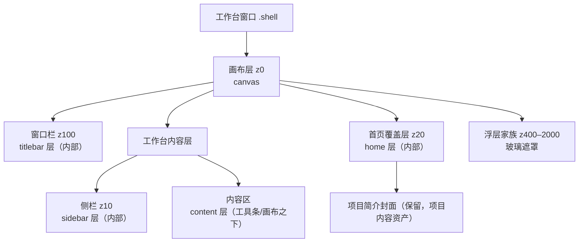
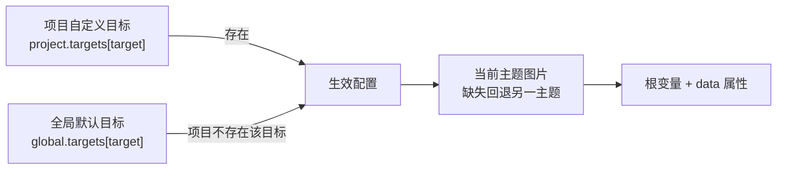

# 界面背景机制 v2（产品域）

> 状态：设计已确认（2026-11-02）；视觉实验室已确认（alpha 0.6），代码 Task 1–7 已落地，待真机走查。
>
> 关联：[v1 基线](界面背景机制.md) · [UI 风格机制](UI风格机制.md) · [style-kit 注释](../注释/packages/style-kit/index.md) · [全局设计令牌](../注释/tauri/theme.md)。
>
> 定位：把 v1 的「一张全局工作台壁纸」扩展为「全局默认 + 项目覆盖、亮/暗两套图、五个可独立配置的目标」。背景仍是玻璃表面的 backdrop，不是新的一层面板皮肤。

## 一、范围

### 1.1 v2 做

- 五个背景目标：工作台画布、首页、窗口栏、侧栏、内容区。
- 每个目标可独立启用；亮/暗主题各一张图，共用一套参数。
- 全局用户级默认 + 按项目整目标覆盖（跟随全局 / 本项目自定义）。
- 项目背景文件存 `{projectDir}/.worldsea/backgrounds/`，随项目导出/导入。
- 首页新增页面底图；现有项目简介封面保留，两者独立。
- 外观面板仍为单张「背景」卡，卡内用范围/目标/亮暗三级切换。
- v1 全局画布背景配置自动迁移到 v2 的「全局 · 画布」目标。

### 1.2 v2 不做

- 视频、GIF、动态图、幻灯片。
- 交互式裁切/拖动构图（继续用九宫格焦点）。
- 亮/暗各一套独立参数（填充/焦点/暗化/模糊按目标共用）。
- 窗口栏/侧栏/内容区的填充与焦点配置（固定 `cover` / 居中）。
- 按主题或按项目覆盖 UI 风格、字体、图标。
- 首页封面与首页底图合并。

### 1.3 与 v1 的关系

v1 的配置键、CSS 变量与 `data-workspace-bg` 属性在 v2 中退役，由 v2 的「全局 · 画布」目标承接。v1 已落盘的用户配置在首次启动时迁移；旧键保留一个版本，便于回退，不主动删除。v1 的设计文档保留为基线，不再追加 v2 内容。

## 二、目标与层级

### 2.1 五个目标

| 目标 | key | 宿主 | 可见范围 | 可配参数 |
|---|---|---|---|---|
| 工作台画布 | `canvas` | `.shell` 根 | 全窗口，所有区域之下 | 启用、亮/暗图、填充、焦点、暗化、模糊 |
| 首页 | `home` | `.shell-home-layer` | 首页内容层 | 启用、亮/暗图、填充、焦点、暗化、模糊 |
| 窗口栏 | `titlebar` | `.titlebar` | 窗口栏内部 | 启用、亮/暗图、暗化、模糊 |
| 侧栏 | `sidebar` | `.sidebar` / `.ws-sn-sidebar` | 侧栏内部 | 启用、亮/暗图、暗化、模糊 |
| 内容区 | `content` | `.view-container` | 工具条 + 视图画布的容器 | 启用、亮/暗图、暗化、模糊 |

分区目标的填充固定 `cover`、焦点固定居中；配置仍存 `fit` / `focusX` / `focusY` 字段，归一化时强制为 `cover` / `50` / `50`，设置界面不展示这两项。

### 2.2 层级树



### 2.3 分区与画布的关系

- 画布是底图，始终在所有区域之下；分区图只在对应区域内绘制，不改变布局。
- 分区未启用或没有可用图片时，该区域维持 v1 行为：表面色/玻璃采样画布。
- 首页是覆盖层：首页启用时画布不参与首页显示；首页底图只作用于首页层，不影响工作台。
- 内容区图覆盖 `.view-container` 的底色与缝隙，工具条/视图画布仍保留自身表面；玻璃表面可采样内容区图。

## 三、配置契约

### 3.1 类型

放在 `packages/style-kit/src/composables/useBackground.ts`：

```ts
export type BackgroundTarget = 'canvas' | 'home' | 'titlebar' | 'sidebar' | 'content'
export type BackgroundTheme = 'light' | 'dark'
export type BackgroundFit = 'cover' | 'contain' | 'tile'
export type FocusStep = 0 | 50 | 100

export interface BackgroundImageRef {
  path: string
  src: string
}

export interface BackgroundTargetConfig {
  enabled: boolean
  paths: { light: string; dark: string }   // 全局为绝对路径；项目为相对路径
  fit: BackgroundFit
  focusX: FocusStep
  focusY: FocusStep
  dim: number                              // 0–80
  blur: number                             // 0–30
}

export interface BackgroundGlobalConfig {
  version: 2
  targets: Record<BackgroundTarget, BackgroundTargetConfig>
}

export interface BackgroundProjectConfig {
  version: 1
  targets: Partial<Record<BackgroundTarget, BackgroundTargetConfig>> // 出现即自定义
}
```

运行时 `src` 不持久化：`useBackground` 另存每个目标/主题的运行时 URL，由 apps 经 `convertFileSrc` 注入。这样项目导出/导入到另一台机器后，不会残留旧机器的 asset URL。

### 3.2 默认值与归一化

| 字段 | 默认 | 允许值 |
|---|---|---|
| `enabled` | `false` | boolean |
| `paths.light` / `paths.dark` | `''` | 合法路径 |
| `fit` | `cover` | `cover` / `contain` / `tile` |
| `focusX` / `focusY` | `50` | `0` / `50` / `100` |
| `dim` | `35` | 0–80，整数 |
| `blur` | `8` | 0–30，整数 |

归一化规则：

- 未知 `fit` 回 `cover`；焦点取最近合法值；`dim` / `blur` 夹取并取整。
- `titlebar` / `sidebar` / `content` 的 `fit` 强制 `cover`，焦点强制 `50/50`。
- 缺失或损坏的 JSON 回该目标默认值；版本不匹配按当前版本归一化，不抛错。
- 项目配置中未知 key 忽略；未知 target 丢弃。

### 3.3 主题解析

同一目标的亮/暗图共用 `enabled`、`fit`、`focusX`、`focusY`、`dim`、`blur`，只替换图片。

- 当前主题的图片路径为空时，回退到另一主题的图片。
- 两套都为空时，该目标显示为无背景（不写 `data-ws-bg-<target>`）。
- 主题由 `<html data-theme="light|dark">` 驱动；不新增 JS 主题监听。

### 3.4 作用域与覆盖



- 项目配置里出现某目标 = 该目标整目标覆盖；不存在 = 跟随全局。
- 项目自定义目标即使 `enabled: false`，也不会回退全局（显式关闭）。
- 项目自定义的亮/暗图都不可用时，不回退全局，显示缺失提示。
- 「恢复跟随全局」删除项目目标，并删除该目标引用的项目图片文件。

### 3.5 全局持久化与迁移

- 新键：`worldsea_background_v2`，单条 JSON，含 `version: 2`。
- 旧键：`worldsea_workspace_background`（v1）。首次加载时若 v2 不存在且 v1 存在：
  - `path` → `canvas.paths.light`；`src` 丢弃，由启动引导重新解析。
  - `enabled` / `fit` / `focusX` / `focusY` / `dim` / `blur` 原样迁移。
  - `canvas.paths.dark` 留空（暗色回退亮色图）。
  - 旧键保留，不删除；v2 写入后不再读取旧键。
- 全局配置不写项目目录、不写壳 `prefs.json`。

### 3.6 项目配置格式与路径规则

文件：`{projectDir}/.worldsea/background.json`

```json
{
  "version": 1,
  "targets": {
    "canvas": {
      "enabled": true,
      "paths": {
        "light": ".worldsea/backgrounds/canvas-light-1730592000000.webp",
        "dark": ""
      },
      "fit": "cover",
      "focusX": 50,
      "focusY": 50,
      "dim": 35,
      "blur": 8
    }
  }
}
```

- 路径必须是相对 POSIX 路径，且以 `.worldsea/backgrounds/` 开头。
- 拒绝绝对路径、`..` 段、反斜杠与空段；拒绝指向项目目录外的路径。
- 导入/加载时先校验再 `stat`；非法条目丢弃并告警，不阻断项目加载。
- 项目图片文件只由固定目录与固定文件名拼出，不接受任意用户输入拼接。
- 读写基准：`getFileStorageBackend().projectDir` 是实体存储根 `<workspace>/worlddata`（不是工作区根 `dirPath`），背景配置与图片路径都由它拼出；设置卡也必须用它读写。`useFileSystemProject()` 的项目目录状态只作切换触发器，不能当作背景读写基准。

## 四、运行时与 CSS

### 4.1 useBackground API

单例，模式同 `useStyle`。返回：

| 成员 | 说明 |
|---|---|
| `globalConfig` | 全局配置 ref |
| `projectConfig` | 项目配置 ref；`null` 表示无覆盖 |
| `effective` | 五个目标的生效配置（computed） |
| `srcs` | 运行时 URL：`target -> theme -> src` |
| `missing` | 运行时缺失：`target -> theme -> boolean` |
| `setProjectConfig(config)` | 项目切换/加载后注入；传 `null` 清空 |
| `setTargetSrcs(target, srcs, scope)` | 注入全局或项目解析后的 URL（`srcs` 为 `{ light?: string; dark?: string }`） |
| `updateTarget(target, patch, scope)` | 修改全局或项目目标参数 |
| `setTargetImage(target, theme, image: BackgroundImageRef, scope)` | 设置图片路径 + 运行时 URL |
| `clearTargetImage(target, theme, scope)` | 清空图片 |
| `setTargetCustom(target, custom)` | 项目范围：切换自定义/跟随全局 |
| `apply()` | 写根属性与 CSS 变量 |
| `flushGlobal()` | 立即落盘全局配置 |

`scope` 为 `'global' | 'project'`。项目配置的持久化由设置卡经 entity-core 完成，style-kit 只持有运行时态；全局配置仍由 style-kit 持久化。

### 4.2 根属性与变量

每个目标写入：

| 名称 | 值 | 用途 |
|---|---|---|
| `data-ws-bg-<target>` | `on` / 移除 | 该目标透明化/层显示开关 |
| `--ws-bg-<target>-image-light` | `url("...")` / `none` | 亮色图 |
| `--ws-bg-<target>-image-dark` | `url("...")` / `none` | 暗色图 |
| `--ws-bg-<target>-size` | `cover` / `contain` / `auto` | 填充 |
| `--ws-bg-<target>-repeat` | `no-repeat` / `repeat` | 平铺 |
| `--ws-bg-<target>-position` | `x% y%` | 焦点 |
| `--ws-bg-<target>-dim` | 0–80 | 暗化 |
| `--ws-bg-<target>-blur` | 0–30 | 模糊 |

- `data-ws-bg-<target>` 只在生效目标 `enabled && (lightSrc || darkSrc)` 时存在。
- 任何一张图可用时，两个主题变量都写入：当前主题缺图时写另一主题的 URL，保证主题切换不出现空档。
- v1 的 `data-workspace-bg`、`--ws-bg-image` 等变量退役，由 `canvas` 目标同名规则替换。

### 4.3 主题切换 CSS

```css
html { --ws-bg-canvas-image: var(--ws-bg-canvas-image-light, none); }
html[data-theme='dark'] { --ws-bg-canvas-image: var(--ws-bg-canvas-image-dark, none); }
/* home / titlebar / sidebar / content 同构 */
```

CSS 只做变量选择，不参与配置合并；合并与回退在 `useBackground` 完成。

### 4.4 各目标层实现

统一组件 `BackgroundLayer.vue`，接收 `target` 与 `preview`：

```html
<div class="ws-bg-layer ws-bg-layer--titlebar" aria-hidden="true">
  <div class="ws-bg-layer__image"></div>
  <div class="ws-bg-layer__shade"></div>
</div>
```

| 目标 | 挂载点 | 层叠要点 |
|---|---|---|
| `canvas` | `Shell.vue` 第一个子节点 | 绝对定位 inset 0，z0；现有 v1 层结构沿用 |
| `home` | `.shell-home-layer` 第一个子节点 | 层 z-1（首页层为 z20 堆叠上下文）；首页背景开启时 `.home-surface` 透明；封面保留 |
| `titlebar` | `.titlebar` 第一个子节点 | 层 z-1（窗口栏为 z100 堆叠上下文）；图片上叠半透明表面色 + 暗化；内容自然在其上 |
| `sidebar` | `.sidebar` / `.ws-sn-sidebar` 第一个子节点 | 层 z-1（侧栏为 z10 堆叠上下文，且 `contain: paint` 裁剪）；图片上叠半透明表面色 + 暗化 |
| `content` | `.view-container` 第一个子节点 | 层 z0（宿主不加 `z-index`，不建堆叠上下文）；`.view-toolbar`（overlay 模式除外）/ `.view-content` 启用时加 `position: relative`（z 保持 auto）按树序绘制在层上；视图内 `position: fixed` 浮层仍属根层叠，可压过侧栏/窗口栏 |

分区层（窗口栏/侧栏）的图片层盖住宿主底色，再以半透明表面色叠加，最后是宿主内容；这样 mist / neu 等不透明表面下图片仍可见，同时保留风格倾向。叠加比例取实验室结论 alpha 0.6（见第十一节）。窗口栏/侧栏自身的 `backdrop-filter` 仍采样画布，不采样分区图；分区图的模糊由图片层自身 `filter` 完成。

### 4.5 分区层叠约束

- 背景层祖先不得新增 `isolation`、`filter`、`contrast()`、`opacity < 1` 等会形成 backdrop root 的属性。
- 背景层的模糊只作用于图片元素自身；不在宿主或祖先加 `filter`。
- 内容区不建宿主堆叠上下文：内容层自身为定位 z0 子层，`.view-container` 不加 `z-index`；`.view-toolbar`（overlay 模式除外）/ `.view-content` 只加 `position: relative`，不给 `z-index`——按树序排在 z0 层之后即可盖住图片。
- 不得给 `.view-container` / `.view-toolbar` / `.view-content` 加 `z-index`：宿主一旦形成堆叠上下文，视图内 `position: fixed` 浮层（Gallery 预览、文档导出、模板管理、跳回菜单）会被钳制在内，压不过侧栏（z10）与窗口栏（z100）。
- 所有背景层 `aria-hidden="true"`、`pointer-events: none`，不参与焦点与读屏。
- 分区层不得改变宿主尺寸、内边距、滚动或 `contain` 语义。

### 4.6 性能与可访问性

- 图片长边 ≤2560，WebP q0.9，JPEG q0.85 回退；单张输入 ≤20MB。
- 只渲染启用且有图的目标；关闭的目标不创建背景层 DOM。
- 性能模式 `html[data-perf='on']` 下所有背景层 `filter: none; transform: none`；分区图保留，模糊关闭。
- 五个目标全部启用会同时解码最多 10 张图；设置卡提示「按需启用」，默认只启用画布。
- 暗化用 `--bg-app` 混合，自动跟随亮/暗主题；默认 35%，设置卡提示过低会降低文字可读性。
- 图片加载失败回退目标底色/画布，不阻塞界面。

## 五、图片资产、项目导出与缺失

### 5.1 导入

- 复用自绘文件选择器 / `pickLocalFiles`；过滤器 `png`、`jpg`、`jpeg`、`webp`。
- 全局目录：`await appDataDir()` + `worldsea/backgrounds/`。
- 项目目录：`{projectDir}/.worldsea/backgrounds/`。
- 文件名：`<target>-<theme>-<timestamp>.<ext>`；v1 旧文件 `workspace-<timestamp>.<ext>` 继续有效。
- 流程：解码 → 长边归一化 → WebP/JPEG → `cmd_fs_mkdir` → `cmd_fs_write`（base64）→ `convertFileSrc`。
- 项目导入返回相对路径 + 绝对路径 + src；全局导入返回绝对路径 + src。
- 取消不报错；非图片/超限/损坏给行内原因，不写盘。

### 5.2 项目配置读写

- `loadProjectBackground(projectDir)`：读 `.worldsea/background.json`；缺失返回 `null`；损坏告警并按无覆盖处理。
- 逐目标校验路径与文件：缺失的文件清空运行时 src、记 `missing`，保留配置路径。
- `saveProjectBackground(projectDir, config)`：仅写自定义目标；目标为空时删除配置文件。
- 项目切换：先清空旧项目覆盖，再加载新项目；用 generation token 防止旧异步结果覆盖新项目。

### 5.3 导出 / 导入

在 `ProjectFS` 的图标步骤之后追加，失败不阻断主体：

- 导出：读项目配置；把每个被引用的文件从项目 `.worldsea/backgrounds/` 复制到导出目录同相对路径；配置文件原样复制。缺失文件跳过并告警。
- 导入：读源配置；校验相对路径；把文件复制到新项目 `.worldsea/backgrounds/`；配置写入新项目。缺失文件对应槽位清空并告警。
- 旧数据包没有 `.worldsea/background.json` 时静默跳过。
- 路径校验与 3.6 相同；导出/导入都拒绝目录穿越。

### 5.4 替换 / 移除 / 缺失 / 孤儿

- 替换单张图：先写新文件并更新配置，成功后删除旧文件；删除失败只告警。
- 移除单张图：清路径与运行时 src，删除文件；删除失败仍清配置。
- 移除目标/恢复跟随全局：清目标并删除该目标引用的项目图片（项目范围）或全局图片（全局范围）。
- 启动/加载校验：`cmd_fs_stat` 失败只记 missing，不改持久化配置；瞬时失败重试 2 次（间隔 250ms），仍失败才显示缺失。
- 孤儿清理：全局 backgrounds 目录在启动时清理不被全局配置引用的 `background-*` / `workspace-*` 文件；项目目录在保存配置时清理该目标不再引用的文件。清理只删除固定前缀文件，不递归、不碰其他文件。

## 六、设置界面

### 6.1 单卡结构

外观面板仍为 6 张卡，「背景」卡保持第 2 张（索引 1），CardDeck、左列 rail 与搜索索引不变。卡内顺序：

1. 范围：`全局` / `本项目`（无项目时禁用本项目并提示）。
2. 目标：`画布` / `首页` / `窗口栏` / `侧栏` / `内容区` 五段切换。
3. 项目范围额外一行：`当前跟随全局` + 「本项目自定义」，或 `本项目自定义中` + 「恢复跟随全局」。
4. 预览：按目标形状显示（画布/首页为 16:9；窗口栏为横条；侧栏为竖条；内容区为带工具条的矩形）。
5. 亮色图 / 暗色图两行：缩略图 + 选择/替换/移除；分别显示缺失提示。
6. 启用开关。
7. 参数：画布/首页显示填充、焦点、暗化、模糊；分区只显示暗化、模糊。
8. 说明文案。

「本项目自定义」初始化该目标参数为全局值，图片留空，提示为本项目重新选图；不复制全局图片文件。

### 6.2 控件矩阵

| 控件 | 画布 | 首页 | 窗口栏 | 侧栏 | 内容区 |
|---|---|---|---|---|---|
| 启用 | 有 | 有 | 有 | 有 | 有 |
| 亮色图 | 有 | 有 | 有 | 有 | 有 |
| 暗色图 | 有 | 有 | 有 | 有 | 有 |
| 填充 | 有 | 有 | 固定 cover | 固定 cover | 固定 cover |
| 焦点 | 有 | 有 | 固定居中 | 固定居中 | 固定居中 |
| 暗化 | 有 | 有 | 有 | 有 | 有 |
| 模糊 | 有 | 有 | 有 | 有 | 有 |

### 6.3 项目范围交互

- 项目范围只编辑项目覆盖；跟随全局时控件只读并显示全局值，顶部提示「当前跟随全局」。
- 「本项目自定义」后控件可编辑；任何修改即时应用并防抖写 `.worldsea/background.json`（150ms，失焦/关闭立即 flush）。
- 「恢复跟随全局」清空该目标并删除项目图片文件；不弹二次确认，按钮文案明确。
- 无项目打开时切到本项目范围只显示提示，不写任何文件。
- 切换项目时设置卡保持打开不崩溃：重新加载项目配置，若当前范围为本项目且新项目无该目标，回到「跟随全局」显示。

### 6.4 文案与搜索

- 卡片标题：`背景`
- 说明：`画布背景在所有区域之下；分区背景只作用于对应区域。首页底图与项目封面相互独立。暗化过低会降低文字可读性。`
- 项目跟随提示：`当前跟随全局；改为本项目自定义后可单独选图。`
- 缺失：`背景文件不可用，请重新选择。`（按亮/暗槽位分别提示）
- 搜索关键词：`背景 壁纸 背景图 wallpaper 分区 窗口栏 侧栏 内容区 首页 亮色 暗色 填充 焦点 暗化 模糊`
- 分类关键词同步追加 `分区 亮色 暗色`。

### 6.5 启动与首帧

- `applyPersistedBackground()` 与 `applyPersistedStyle()` 同批执行；全局配置先写变量，apps 在挂载前用 `convertFileSrc` 注入全局 src，避免首帧空档。
- 项目配置在启动后端就绪后异步加载；项目切换遮罩覆盖该窗口，允许项目背景晚于首个工作台帧出现。
- 若真机出现全局背景首帧闪烁，再补启动占位层（v2.1），不改配置契约。

## 七、模块边界与接线

| 模块 | 职责 | 依赖 |
|---|---|---|
| `packages/style-kit/src/composables/useBackground.ts` | 五目标配置、归一化、迁移、生效合并、根属性/CSS 变量 | 无 Tauri |
| `packages/entity-core/src/core/backgroundAsset.ts` | 选图、归一化、全局/项目落盘、删除、URL 解析 | Tauri API + FilePickerApi |
| `packages/entity-core/src/core/backgroundProject.ts` | 项目配置读写、路径校验、导出/导入、孤儿清理 | Tauri API + ProjectFS 工具 |
| `packages/entity-core/src/core/ProjectFS.ts` | 导出/导入链调用 backgroundProject | backgroundProject |
| `packages/ui-kit/src/components/layout/BackgroundLayer.vue` | 通用背景层 DOM/样式 | style-kit |
| `packages/ui-kit/src/components/settings/panels/BackgroundCard.vue` | 单卡五目标编辑 | style-kit + entity-core |
| `apps/tauri/src/ui/layout/Shell.vue` | 画布层挂载；启动/项目切换引导 | ui-kit + style-kit + entity-core |
| `apps/tauri/src/ui/layout/TitleBar.vue` | 窗口栏层挂载 | ui-kit |
| `apps/tauri/src/ui/layout/sidebar/*` | 侧栏层挂载（单栏/双栏两宿主） | ui-kit |
| `packages/ui-kit/src/components/layout/ViewContainer.vue` | 内容区层挂载 | ui-kit |
| `apps/tauri/src/ui/layout/ShellSurface.vue` / `apps/tauri/src/ui/home/*` | 首页层挂载与透明化 | ui-kit |
| `apps/tauri/src/styles/background-targets.css` | 五目标层样式、透明化、性能模式 | 无 |

依赖方向：`style-kit` 保持纯；`entity-core` 承担资产与项目文件；`ui-kit` 可依赖前两者；`apps` 装配。禁止 `ui-kit → apps`。

接线顺序：

1. `main.ts`：`applyPersistedStyle()` → `applyPersistedBackground()` → 注入全局 src → 挂载。
2. 启动后端就绪后：取当前项目目录 → `loadProjectBackground()` → `setProjectConfig()` + `setTargetSrcs()`。
3. `project:switched`：清空旧项目覆盖 → 加载新项目 → 注入；generation token 防竞态。
4. 设置卡保存项目配置后：更新 store → `saveProjectBackground()` → 重新解析受影响目标的 src。

## 八、风险与取舍

| 风险 | 处理 |
|---|---|
| 分区层与 `backdrop-filter`/backdrop root 冲突 | 视觉实验室先验证层叠；背景层祖先不加 isolation/filter；内容区宿主不加 z-index（内容层自身 z0） |
| 内容区堆叠上下文钳制 fixed 浮层 | 宿主不加 z-index；内容层自身 z0，工具条/画布只加相对定位；走查覆盖 Gallery 预览/文档导出/模板弹层压过侧栏、窗口栏 |
| 窗口栏/侧栏不透明表面盖住分区图 | 图片层置于表面色之上、内容之下；表面色半透明叠加，比例实验室定 |
| 五目标全开导致解码内存上涨 | 长边 2560、WebP；默认只开画布；设置卡提示按需启用 |
| 项目包体积变大 | 只复制被引用文件；WebP；导入导出进度与失败不阻断 |
| 恶意/损坏项目包路径穿越 | 强制 `.worldsea/backgrounds/` 前缀、拒绝绝对路径与 `..`、canonicalize 复核 |
| 项目切换异步竞态 | 清旧覆盖 + generation token + 设置卡重载 |
| 亮暗图只配一张时切换空档 | 运行时双主题变量回填另一主题 URL |
| 首页底图与封面视觉冲突 | 封面保留；底图只作用于页面层；设置卡说明 |
| 设置卡信息量变大 | 单卡三级切换；卡片数量/rail/搜索索引不变；控件矩阵测试 |
| v1 配置迁移失败 | 归一化容错 + 旧键保留；迁移单测覆盖损坏 JSON |
| style gate 预存 rgba 166/164 失败 | 他方提交遗留；本线只使用令牌，不修他人文件 |

## 九、测试与验收

### 9.1 自动测试

- `useBackground`：五目标默认值、归一化/钳制、分区固定 fit/focus、v1 迁移、主题回退、项目覆盖优先/跟随、显式关闭不回退、变量与 data 属性、缺失态、移除/清空。
- `backgroundAsset`：长边计算、文件名、全局/项目目录、目标/主题参数、路径校验、取消/超限/损坏。
- `backgroundProject`：配置读写、相对路径、路径穿越拒绝、缺失文件标记、导出/导入复制、旧包缺文件跳过、孤儿清理。
- `BackgroundCard`：范围/目标/亮暗切换、跟随/自定义、参数矩阵、缺失提示、无项目态、保存调用。
- `AppearancePanel`：卡片数仍 6、索引 1、搜索关键词、rail 数量。
- 回归：v1 背景测试、style-kit 全量、entity-core 全量、`vue-tsc` 0、`workspace-dist` 构建通过。

### 9.2 视觉实验室

静态工作台样张（侧栏 + 窗口栏 + 工具条 + 视图画布 + 首页），覆盖：

- mist / liquid-glass、亮/暗、性能模式。
- 画布、首页、窗口栏、侧栏、内容区分别启用；组合启用。
- 检查：分区图可见性、表面色叠加、玻璃采样、文字对比度、层叠顺序、滚动/裁剪、无布局位移、无 backdrop root 断链。
- 实验室结论追加到本文件末尾后，再进入产品接线。

### 9.3 真机走查

1. 全局画布：设置亮/暗两张图，切主题，画布换图且无空档。
2. 首页：设置底图，项目封面仍显示；切主题；首页底图不影响工作台。
3. 窗口栏/侧栏/内容区：分别启用，区域出现图片；关闭后恢复表面。
4. 组合：画布 + 侧栏 + 内容区同时启用，缝隙/玻璃采样符合实验室结论。
5. 项目覆盖：本项目自定义画布，切到另一项目回全局图；切回恢复项目图。
6. 项目导出：导出后在新位置导入，项目背景仍在；旧项目不受影响。
7. 缺失：删除一张亮色图，重启后该槽提示缺失，暗色图仍可用；删除两张后目标无背景且不崩。
8. 替换/移除：旧文件被删除；恢复跟随全局删除项目文件。
9. 性能模式：所有背景模糊关闭，无卡顿/控制台错误。
10. 设置搜索「分区」「亮色」「首页」命中背景卡；rail 翻卡正确。
11. 首页封面、项目切换、v1 迁移后的画布配置均正常。
12. 内容区背景开启时打开 Gallery 预览、文档导出、模板管理弹层：浮层覆盖并遮挡侧栏（Gallery 预览含窗口栏），不被内容区钳制。

### 9.4 验收标准

- 五目标、亮暗对、全局+项目覆盖全部生效且持久化。
- 项目背景文件随导出/导入；路径校验与缺失回退可靠。
- 首页底图与项目封面同时成立；工作台布局零位移。
- 分区图在所有风格下可见，玻璃表面采样符合实验室结论。
- 内容区背景启用时，工具条/视图画布仍盖住内容区图，视图内全屏固定浮层仍覆盖并遮挡侧栏与窗口栏。
- v1 配置迁移无损；无控制台错误；性能模式无新增模糊成本。
- 自动测试、typecheck、构建通过；style gate 不新增裸色值（预存 `rgba 166/164` 失败由引入方处理）。

## 十、实施拆分与文件清单

### 10.1 先行小批：v1 技术债

独立计划，不并入 V2：

1. 启动 `cmd_fs_stat` 瞬时失败重试 + 软缺失（不改持久化配置）。
2. 全局 backgrounds 孤儿文件清理（固定前缀，不动其他文件）。
3. 背景搜索关键词补齐 `填充/焦点/暗化/模糊`。
4. 替换图片时保留原启用状态（首次选图才自动启用）。

### 10.2 V2 批次

1. style-kit：五目标模型、归一化、v1 迁移、生效合并、变量/属性、测试。
2. entity-core：通用导入、项目配置读写、路径校验、测试。
3. entity-core：ProjectFS 导出/导入、孤儿清理、测试。
4. ui-kit + 实验室：`BackgroundLayer`、分区层叠样张、用户确认视觉方案。
5. apps：五目标挂载、透明化 CSS、启动/项目切换接线、构建。
6. ui-kit：`BackgroundCard` 五目标编辑、AppearancePanel 搜索/rail、测试。
7. 真机走查、文档与索引归档。

### 10.3 文件清单

新增：

- `packages/entity-core/src/core/backgroundProject.ts`
- `packages/entity-core/src/core/__tests__/backgroundProject.spec.ts`
- `packages/entity-core/src/core/__tests__/projectFsBackground.spec.ts`
- `packages/ui-kit/src/components/layout/BackgroundLayer.vue`
- `packages/ui-kit/src/components/layout/__tests__/backgroundLayer.spec.ts`
- `apps/tauri/src/styles/background-targets.css`

修改：

- `packages/style-kit/src/composables/useBackground.ts`
- `packages/style-kit/src/__tests__/useBackground.spec.ts`
- `packages/style-kit/src/index.ts`
- `packages/entity-core/src/core/backgroundAsset.ts`
- `packages/entity-core/src/core/__tests__/backgroundAsset.spec.ts`
- `packages/entity-core/src/core/ProjectFS.ts`
- `packages/entity-core/src/core/index.ts`
- `packages/ui-kit/src/components/settings/panels/BackgroundCard.vue`
- `packages/ui-kit/src/components/settings/panels/AppearancePanel.vue`
- `packages/ui-kit/src/components/settings/panels/__tests__/backgroundCard.spec.ts`
- `packages/ui-kit/src/components/layout/ViewContainer.vue`
- `packages/ui-kit/src/index.ts`
- `apps/tauri/src/ui/layout/Shell.vue`
- `apps/tauri/src/ui/layout/TitleBar.vue`
- `apps/tauri/src/ui/layout/ShellSurface.vue`
- `apps/tauri/src/ui/layout/sidebar/SidebarV2.vue`
- `apps/tauri/src/ui/layout/sidebar/sidebar-nav.css`（双栏宿主）
- `apps/tauri/src/ui/home/home.css`
- `apps/tauri/src/main.ts`
- `apps/tauri/src/world/plugins/settings/settingsCategories.ts`
- `docs/index/README.md`

删除/退役：

- `apps/tauri/src/styles/workspace-background.css`（内容并入 `background-targets.css`）
- v1 `data-workspace-bg` / `--ws-bg-*` 变量与相关测试断言
- `backgroundAsset.ts` 的 v1 工作台包装：`pickAndSaveWorkspaceBackground` / `removeWorkspaceBackground` / `resolveWorkspaceBackgroundSrc` / `cleanupWorkspaceBackgroundOrphans` 及其 `core/index.ts` 导出（Task 7 清理，测试改用通用函数）

---

## 十一、实验室结论

> 来源：静态视觉实验室 [background-v2-lab.html](../../misc/生成物/background-v2-lab.html)（纯静态、零网络，层类名/z-index/变量语义与产品逐条对应）；用户于 2026-11-02 确认，表面色叠加 alpha 取 **0.6**。

### 11.1 层叠方案（已定）

| 目标 | 最终层叠（产品实现） |
|---|---|
| `canvas` | `.ws-bg-layer--canvas` 为 `.shell` 内绝对定位 z0，全窗底图 |
| `home` / `titlebar` / `sidebar` | 分区层 `.ws-bg-layer` 在宿主堆叠上下文内 `z-index: -1`（宿主：首页层 z20 / 窗口栏 z100 / 侧栏 z10）；宿主启用时透明化（`html[data-ws-bg-<target>='on'] ... { background: transparent }`） |
| `content` | `.ws-bg-layer--content` 为 `.view-container` 内定位 z0 子层；`.view-container` 不加 `z-index`（不建堆叠上下文）；`.view-toolbar:not(.view-toolbar--overlay)` / `.view-content` 只加 `position: relative`（z 保持 auto），按树序盖在 z0 层之上 |

- 目标 CSS 真源：`apps/tauri/src/styles/background-targets.css`。
- **固定浮层堆叠规则（硬约束）**：`.view-container` / `.view-toolbar` / `.view-content` 一律不得加 `z-index`。视图内 `position: fixed` 浮层（Gallery 预览、文档导出、模板管理、跳回菜单）必须留在根层叠，才能压过侧栏（z10）与窗口栏（z100）；内容层自身 z0 + 树序绘制已足够盖住内容区图，无需宿主建堆叠上下文。
- 背景层祖先不加 `isolation` / `filter` / `contrast()` / `opacity < 1`，避免 backdrop root 断链。

### 11.2 表面色叠加比例

- `.ws-bg-layer__shade::before` 以**整值**表面令牌（`--sf-chrome-bg` / `--sf-nav-bg`）作 `background`，再以 `opacity: var(--layer-tint-alpha, 0.6)` 叠加；不把令牌塞进 `linear-gradient` 色标——玻璃令牌是「噪声图 + 渐变」复合值，进色标会让整条 `background` 失效（暗化一并丢失）。
- 用户确认 **alpha 0.6**：mist / neu 等不透明表面下分区图仍可见，liquid-glass 下保持通透与噪声；0% 近纯图、100% 回表面，均在实验室对照过。
- 画布 / 首页 / 内容区 `--layer-tint: transparent`，只受暗化（`--ws-bg-<target>-dim`）影响。

### 11.3 内容区玻璃采样

内容层为定位 z0 子层、宿主与工具条/画布均不建堆叠上下文，实验室「无 backdrop root 断链」检查通过：内容区启用后，工具条、视图卡片与右下玻璃浮层仍能模糊采样到内容区背景图。

### 11.4 性能模式

`html[data-perf='on']` 下背景图片 `filter: none; transform: none`（模糊关闭、外扩缩放撤销），玻璃风格滤镜同步退化为无模糊；图片保留，无布局位移。

### 11.5 对照截图

| 截图 | 场景 |
|---|---|
| [bgv2-lab-light-mist-all.png](../截图/bgv2-lab-light-mist-all.png) | 亮色 · mist · 五目标全开 |
| [bgv2-lab-dark-glass-all.png](../截图/bgv2-lab-dark-glass-all.png) | 暗色 · liquid-glass · 五目标全开 |
| [bgv2-lab-light-home.png](../截图/bgv2-lab-light-home.png) | 亮色 · 首页底图 + 项目封面并存 |
| [bgv2-lab-dark-home.png](../截图/bgv2-lab-dark-home.png) | 暗色 · 首页底图 + 项目封面并存 |
| [bgv2-lab-light-glass-perf.png](../截图/bgv2-lab-light-glass-perf.png) | 亮色 · liquid-glass · 性能模式（模糊关闭） |

> 实验室为工具可再生成产物（`misc/生成物/`），结论以本节为准；真机走查通过后按计划归档流程处理。

