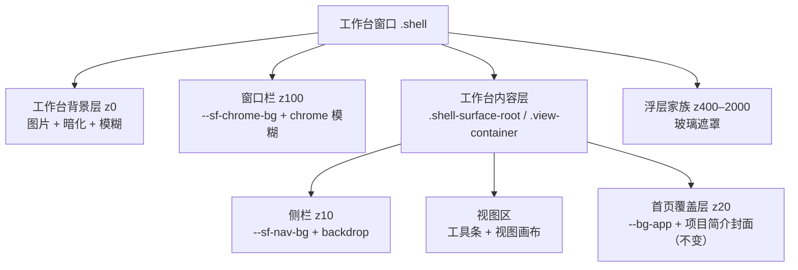

# 界面背景机制（产品域）

> 状态：v1 已落地并通过真机走查（2026-11-02）。
>
> 关联：[UI 风格机制](UI风格机制.md) · [style-kit 注释](../注释/packages/style-kit/index.md) · [全局设计令牌](../注释/tauri/theme.md) · [液化玻璃研究](../../plans/2026-10-30-液化玻璃研究.md)。
>
> 定位：给工作台窗口增加一张用户可配置的画布背景图，并与现有 UI 风格机制协作。背景是玻璃表面的新 backdrop，不是又一层面板皮肤。

## 一、范围

### 1.1 v1 做

- 工作台窗口一张背景图，位于所有界面之下。
- 图片选择 / 替换 / 移除；启用开关；填充、焦点、暗化、模糊四项视觉参数。
- 全局用户级持久化：所有项目共用一张背景，切换项目不重载。
- 与 UI 风格协作：背景在区域缝隙露出，玻璃表面通过 `backdrop-filter` 采样；mist / neu 下只在缝隙露出。
- 性能模式自动关闭背景模糊。
- 图片缺失时回退画布色并提示。

### 1.2 v1 不做

- 首页独立背景（首页继续使用现有项目简介封面，见 §1.3）。
- 窗口栏 / 侧栏 / 内容区分别配图。
- 浅色 / 深色各一张图。
- 按项目覆盖。
- 视频、动态图、幻灯片。
- 背景图的交互式裁切 / 拖动构图（用九宫格焦点代替）。

### 1.3 与首页封面的边界

首页封面是**项目级内容资产**：真源 `{projectDir}/.worldsea/home.json` 的 `coverImage`，由「设置 → 首页」管理，跟项目走。界面背景是**全局显示配置**，跟用户走，只作用于工作台画布。两者不合并、不共用存储；设置界面必须用文案明确区分。

## 二、界面层级与宿主

### 2.1 层级树



### 2.2 各层背景来源

| 层 | 现有背景 | v1 处理 |
|---|---|---|
| 窗口栏 | `--sf-chrome-bg` + `--sf-chrome-filter` | 表面保留；玻璃风格下采样背景 |
| 工作台画布 | `.shell-surface-root` / `.shell-body` / `.view-container` 的 `--bg-app` | 背景层宿主；启用时这三处背景透明 |
| 侧栏 | `--sf-nav-bg` + `--sf-nav-filter` | 表面保留；玻璃风格采样背景 |
| 视图工具条 | `--sf-panel-*` | 表面保留 |
| 视图画布 | `--region-bg`（`--sf-panel-bg`） | 表面保留；玻璃风格半透明填充 |
| 首页 | `.shell-home-layer` / `.home-surface` 的 `--bg-app` | 完全不变；覆盖背景层 |
| 卡片 / 表格 | `--sf-card-*` | 不变 |
| 浮层 / 模态 | `--sf-overlay-*` / `--sf-modal-*` | 不变；玻璃遮罩采样背景 |

源码依据：

- `apps/tauri/src/ui/layout/Shell.vue`：`.shell` 是窗口根（`contain: layout style`），`.shell-content` 是内容区。
- `apps/tauri/src/ui/layout/ShellSurface.vue`：`.shell-surface-root` / `.shell-body` / `.is-home` 写 `background: var(--bg-app)`；首页层 `.shell-home-layer` 绝对覆盖并自带背景。
- `packages/ui-kit/src/components/layout/ViewContainer.vue`：`.view-container` 写 `background: var(--bg-app)`，区域缝隙 `--region-gap: 8px` 露出画布。
- `apps/tauri/src/ui/layout/TitleBar.vue`：`--sf-chrome-bg` + `--sf-chrome-filter`。
- `apps/tauri/src/ui/layout/sidebar/SidebarV2.vue`：`--sf-nav-bg` + `--sf-nav-filter`。

### 2.3 为什么放在 `.shell` 根部

- 一处背景层可同时覆盖窗口栏下方与内容区；窗口栏本身是 chrome 表面，是否透出由风格决定。
- 首页层是绝对覆盖层，自带不透明背景；背景层放在它下面，首页天然不受影响。
- 背景层在所有 `backdrop-filter` 元素之外，不会被 backdrop root 隔离。

## 三、配置契约

### 3.1 数据模型

```ts
interface WorkspaceBackground {
  version: 1
  enabled: boolean
  path: string          // 全局磁盘路径，用于校验/删除
  src: string           // convertFileSrc 产物，缓存用于首屏应用
  fit: 'cover' | 'contain' | 'tile'
  focusX: 0 | 50 | 100
  focusY: 0 | 50 | 100
  dim: number           // 0–80，百分比
  blur: number          // 0–30，px
}
```

`path` 与 `src` 是同一张图的两面：`path` 管生命周期，`src` 管渲染。`src` 是派生缓存，不是用户配置项。

### 3.2 默认值与钳制

| 字段 | 默认 | 允许值 |
|---|---|---|
| `enabled` | `false` | boolean |
| `path` / `src` | `''` | 合法路径 / asset URL |
| `fit` | `cover` | `cover` / `contain` / `tile` |
| `focusX` / `focusY` | `50` | 0 / 50 / 100 |
| `dim` | `35` | 0–80，整数 |
| `blur` | `8` | 0–30，整数 |

归一化规则：未知 `fit` 回 `cover`；焦点不在 `{0,50,100}` 时取最近值；`dim`/`blur` 夹取并取整；缺失或损坏的 JSON 回默认值；版本不匹配时按 v1 归一化，不抛错。

### 3.3 持久化

- 键：`worldsea_workspace_background`。
- 形式：单条 JSON（含 version）。
- 作用域：全局 localStorage，不写项目目录、不写壳 `prefs.json`。
- 切换项目：无操作；主题/风格切换：只影响暗化颜色与表面透明度，不重载图片。

### 3.4 运行时属性与变量

`useBackground.apply()` 写根元素：

| 名称 | 值 | 用途 |
|---|---|---|
| `data-workspace-bg` | `on` / 移除 | 透明化规则开关 |
| `--ws-bg-image` | `url("...")` | 图片层背景图 |
| `--ws-bg-size` | `cover` / `contain` / `auto` | 填充 |
| `--ws-bg-repeat` | `no-repeat` / `repeat` | 平铺 |
| `--ws-bg-position` | `x% y%` | 焦点 |
| `--ws-bg-dim` | 0–80 | 暗化 |
| `--ws-bg-blur` | 0–30 | 模糊 |

`data-workspace-bg` 只在 `enabled && src` 时存在；`--ws-bg-*` 在有 `src` 时写入（设置卡预览在关闭态也要显示）；关闭/移除时全部清掉。

### 3.5 useBackground API

放在 `packages/style-kit/src/composables/useBackground.ts`（单例，模式同 `useStyle`）：

- 状态：`enabled`、`path`、`src`、`fit`、`focusX`、`focusY`、`dim`、`blur`、`missing`（运行时态，不持久化）。
- 方法：`setEnabled()`、`setImage({ path, src })`、`setSrc()`、`markMissing()`、`clear()`、`setFit()`、`setFocus()`、`setDim()`、`setBlur()`、`apply()`、`flush()`。
- `applyPersistedBackground()`：启动时读取并应用，和 `applyPersistedStyle()` 同批调用；文件校验由 apps 启动引导调用 `resolveWorkspaceBackgroundSrc` 后 `setSrc` / `markMissing`。
- 不依赖 Tauri；只做配置、持久化、根属性/变量。

## 四、模块边界

| 模块 | 职责 | 依赖 |
|---|---|---|
| `packages/style-kit/src/composables/useBackground.ts` | 配置、持久化、根属性/CSS 变量 | 无 Tauri |
| `packages/entity-core/src/core/backgroundAsset.ts` | 选图、归一化、落盘、删除、URL 解析 | Tauri API + FilePickerApi |
| `packages/ui-kit/src/components/layout/WorkspaceBackground.vue` | 背景层 DOM 与样式，消费 `useBackground` | style-kit |
| `packages/ui-kit/src/components/settings/panels/AppearancePanel.vue` | 「背景」设置卡 | style-kit + entity-core |
| `apps/tauri/src/ui/layout/Shell.vue` | 挂载背景层；启动引导 | ui-kit + style-kit + entity-core |
| `apps/tauri/src/styles/workspace-background.css` | 透明化规则、性能模式、层样式 | 无 |

依赖方向：`style-kit` 保持纯；`entity-core` 继续承担 Tauri 资产能力；`ui-kit` 可以依赖这两个共享包；`apps` 负责装配。禁止 `ui-kit → apps`。

### 4.1 为什么配置放 style-kit、图片导入放 entity-core

- 背景是显示机制，和 `useStyle` 同级；配置/持久化/CSS 应用不需要 Tauri，放 style-kit 可保持 ui-kit 的共享面板直接消费。
- 选图、缩放、落盘需要 Tauri 路径与文件系统；entity-core 已有 `assetImport.ts`、`FilePickerApi` 等同类能力，继续在这里扩展，避免 ui-kit 引入 apps 依赖。

## 五、图片导入与存储

### 5.1 选择与校验

- 复用自绘文件选择器 / `pickLocalFiles`。过滤器：`png`、`jpg`、`jpeg`、`webp`。
- 输入上限 20MB；取消不报错；非图片/超限给行内原因。
- v1 只接受栅格图；动态 WebP 取首帧静态化；GIF 不在 v1 过滤器内。

### 5.2 归一化

- `createImageBitmap` 解码；长边压到 **2560px** 以内。
- 画布输出 WebP（质量 0.9）；不支持 WebP 时回退 JPEG（质量 0.85）。
- 归一化失败（损坏/不支持）返回 `ok:false`，不写盘。

### 5.3 落盘与 URL

- 目录：`await appDataDir()` + `worldsea/backgrounds/`（全局，与项目无关）。
- 文件名：`workspace-<timestamp>.<ext>`。
- 流程：`cmd_fs_mkdir`（幂等）→ `cmd_fs_write`（base64，`createDirs: true`）→ `convertFileSrc(path)`。
- 资产协议 scope 已为 `**`，app data 路径可直接渲染。
- `cmd_fs_mkdir` / `cmd_fs_copy` / `cmd_fs_write` / `cmd_fs_stat` / `cmd_fs_delete` 已在 `permissions/worldsea-product.toml` 放行，无需新增权限。

### 5.4 替换 / 删除 / 缺失

- 替换：先写新文件并更新配置，成功后 `cmd_fs_delete` 旧文件；删除失败只记日志，不阻断。
- 移除：清配置 + 删除文件；删除失败仍清配置。
- 启动校验：`cmd_fs_stat(path)` 失败或 `src` 为空 → 清 `src`、置 `enabled=false`，设置卡显示「背景文件不可用，请重新选择」。
- 路径只由选择器与固定目录拼出，不接受任意用户输入拼接。

## 六、层实现

### 6.1 DOM

```html
<div class="workspace-bg" aria-hidden="true">
  <div class="workspace-bg__image"></div>
  <div class="workspace-bg__dim"></div>
</div>
```

`WorkspaceBackground` 在 `Shell.vue` 的 `.shell` 根内、所有 UI 之前渲染，仅在 `enabled && src` 时存在；设置卡使用同一组件的 `preview` 模式，只要 `src` 存在就渲染（关闭态也能看预览）。

### 6.2 CSS

- `.workspace-bg`：`position: absolute; inset: 0; z-index: 0; overflow: hidden; pointer-events: none;`
- `.workspace-bg__image`：`inset: -32px`（遮住模糊边缘）、`background-image: var(--ws-bg-image)`、`background-color: var(--bg-app)`、`background-size/repeat/position` 取 §3.4、`filter: blur(var(--ws-bg-blur))`、`transform: scale(1.03)`。
- `.workspace-bg__dim`：`inset: 0`、`background: color-mix(in srgb, var(--bg-app) calc(var(--ws-bg-dim) * 1%), transparent)`。
- `.shell` 增加 `position: relative`（为绝对定位提供包含块）。
- 启用时：`html[data-workspace-bg='on'] .shell-surface-root, .shell-body, .view-container { background: transparent; }`。
- 首页层 `.shell-home-layer` 保持 `background: var(--bg-app)`，不受透明化规则影响。

### 6.3 风格协作

- 背景层位于所有玻璃表面之后；sidebar、titlebar、modal 的 `backdrop-filter` 能采样到它。
- 玻璃表面越透明，背景越明显；mist / neu 只在区域缝隙露出，这是风格差异。
- 暗化用 `--bg-app` 混合，自动跟随亮/暗主题与当前风格的画布色；不额外定义固定黑色遮罩。
- 不在背景层祖先加 `isolation`、`filter`、`contrast()`；图片模糊只作用在图片元素自身，不影响玻璃的 backdrop root。

### 6.4 性能模式

```css
html[data-perf='on'] .workspace-bg__image {
  filter: none;
  transform: none;
}
```

- 背景图本身保留（一张全屏纹理成本低）；模糊关闭。
- 玻璃表面的模糊已由 `perf.css` 归零；背景机制不新增 backdrop 层。

### 6.5 防闪

- `applyPersistedBackground()` 与 `applyPersistedStyle()` 同批执行；背景层随首帧 Vue 渲染出现。
- 启动页覆盖首帧，v1 不新增 `index.html` 背景占位层；若真机出现明显闪烁，再补启动占位（v1.1），不改配置契约。

## 七、设置界面

### 7.1 位置与卡片变化

- 外观面板新增 **「背景」卡**，放在「主题」之后。
- `CardDeck` 从 5 张变 6 张；现有卡片索引顺延，搜索 `match` 关键词与左列 rail 同步。
- 首页封面的入口仍在「设置 → 首页 → 项目首页」，不移动。

### 7.2 控件

| 控件 | 说明 |
|---|---|
| 预览 | 16:9 预览框，复用背景层；无图时显示占位 |
| 选择 / 替换 / 移除 | 选择图片；导入中显示 loading；移除即清配置 |
| 启用 | 开关；无图时禁用 |
| 填充 | 铺满 / 完整 / 平铺 |
| 焦点 | 3×3 九宫格；`tile` 时禁用 |
| 暗化 | 0–80% 滑杆 |
| 模糊 | 0–30px 滑杆 |

### 7.3 文案与搜索

- 卡片标题：`背景`
- 提示：`背景作用于工作台画布，区域缝隙与玻璃表面会透出；首页仍使用「设置 → 首页」里的项目封面。暗化过低会降低文字可读性。`
- 搜索关键词：`背景 图片 壁纸 背景图 wallpaper`
- 缺失文件：`背景文件不可用，请重新选择。`

### 7.4 交互动效

- 选图/改参数即时应用，不要求保存按钮；配置写入走防抖（150ms）+ 失焦立即落盘。
- 移除/禁用即时生效；侧栏/工具条/视图画布不重排。

## 八、性能与可访问性

- 导入长边 ≤2560px；避免 4K 纹理与超大 base64 IPC。
- 背景层只有一个全屏纹理；模糊只作用图片元素；性能模式关闭模糊。
- 背景层 `aria-hidden`、`pointer-events: none`，不参与焦点与读屏。
- 默认暗化 35%；玻璃表面自身染料继续保证文字对比度。暗化可调到 0，但设置卡提示会降低可读性。
- 图片加载失败不阻塞界面：回退 `--bg-app`，设置卡提示重选。

## 九、风险与取舍

| 风险 | 处理 |
|---|---|
| 新增卡片导致外观面板索引/rail/搜索错位 | 同步 `CardDeck count`、`match`、rail 派生；走查翻卡与搜索 |
| 全屏模糊成本 | 长边 2560 上限 + 性能模式关模糊；不新增 backdrop 层 |
| 首页封面概念混淆 | 文案明确「工作台背景」vs「首页封面」；入口分居两处 |
| 标题栏在 mist / neu 下不透出背景 | 预期行为，由 chrome 表面决定；玻璃风格才明显 |
| 全局背景跨项目共用 | 已拍板全局用户级；如需按项目，v2 加覆盖层 |
| 图片文件被外部删除/移动 | 启动 `cmd_fs_stat` 校验；失败回退并提示 |
| 资产目录/权限变化 | 复用已放行 fs 命令与 `**` 资产协议；不新增权限面 |

## 十、测试与验收

### 10.1 自动测试

- `useBackground`：默认值、归一化/钳制、fit/focus 映射、属性开关、持久化、损坏 JSON 回退。
- `backgroundAsset`：扩展名校验、文件名生成、downscale 尺寸计算（纯函数）、Tauri 调用 mock、失败回退。
- 现有 style-kit / entity-core 测试不回归；`vue-tsc` 0；`style:check` 不新增硬编码；`workspace-dist` 重建通过。

### 10.2 视觉实验室

- 静态工作台：侧栏 + 工具条 + 视图画布 + 区域缝隙 + 一张背景图；对照 mist / liquid-glass、亮/暗、性能模式。
- 检查：缝隙透出、侧栏/标题栏采样、首页不变、文字可读性、模糊边缘无白边。

### 10.3 真机走查

1. 设置 → 外观 → 背景：选择图片，工作台画布立即出现背景。
2. 调填充 / 焦点 / 暗化 / 模糊，实时生效；区域缝隙与玻璃表面变化正确。
3. 重启应用，背景与参数保持。
4. 切换项目，背景仍在（全局）。
5. 在 mist / liquid-glass 间切换，背景可见度符合各自表面；首页保持原封面。
6. 开性能模式，背景模糊关闭，无卡顿。
7. 禁用 / 移除，画布恢复；重新选择可恢复。
8. 手动改坏/删除背景文件，重启后回退并提示。
9. 设置搜索「背景」能命中新卡；左列 rail 翻卡正确。

### 10.4 验收标准

- 6 项配置全部生效且持久化。
- 背景不遮挡、不移动任何内容，不改变首页封面。
- 玻璃风格下背景可被采样；mist / neu 下只在缝隙露出。
- 性能模式无新增模糊成本；无控制台错误。
- 图片缺失、取消选择、超限、损坏文件均有明确回退。

## 十一、实施拆分（高层）

1. style-kit：`useBackground` + 类型 + 测试 + 导出。
2. entity-core：`backgroundAsset` + Tauri 调用 + 测试 + 导出。
3. ui-kit：`WorkspaceBackground` 组件 + 层样式。
4. apps：Shell 挂载、启动引导、透明化 CSS、构建。
5. ui-kit：外观面板「背景」卡 + CardDeck 索引/搜索/rail。
6. 首页设置加一行边界提示（可选但建议）。
7. 视觉实验室 + 真机走查 + 文档归档。

## 十二、文件清单

新增：

- `packages/style-kit/src/composables/useBackground.ts`
- `packages/style-kit/src/__tests__/useBackground.spec.ts`
- `packages/entity-core/src/core/backgroundAsset.ts`
- `packages/entity-core/src/core/__tests__/backgroundAsset.spec.ts`
- `packages/ui-kit/src/components/layout/WorkspaceBackground.vue`
- `apps/tauri/src/styles/workspace-background.css`

修改：

- `packages/style-kit/src/index.ts`（导出）
- `packages/entity-core/src/core/index.ts`（导出）
- `packages/ui-kit/src/index.ts`（导出背景组件）
- `apps/tauri/src/ui/layout/Shell.vue`（挂载）
- `apps/tauri/src/main.ts`（引入 `workspace-background.css` + 启动应用背景）
- `packages/ui-kit/src/components/settings/panels/AppearancePanel.vue`（新卡/索引/搜索）
- `apps/tauri/src/world/plugins/settings/panels/HomePanel.vue`（边界提示，可选）
- `docs/index/README.md`（索引）
- 本文件
