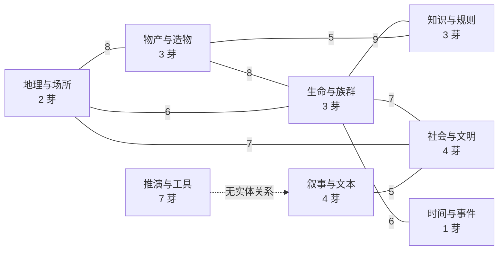

# 02 · 语义域重划

> 目标：回答“芽应该按什么分域”，并给出可落地的新 8 域方案。旧 6 类不是“不够细”，而是**轴用错了**。
>
> 2026-10-20 复核：芽数 26→27（新增字段矩阵，归 `tool` 域）；旧 6 类 `system` 由 3→4。

## 2.1 旧 6 类的实际映射

来自 `DEFAULT_SPROUTS` 的 `category` 字段：

| 旧分类 | 芽 | 数量 |
|---|---|---:|
| 世界观 `world` | 区域、概念、建筑、物种、魔法、语言、文化、植物 | 8 |
| 角色 `characters` | 角色、势力/组织 | 2 |
| 物品 `items` | 道具、服饰/装备、武器 | 3 |
| 叙事 `narrative` | 时间线、大纲、冲突、灵感、正文写作 | 5 |
| 视觉 `visual` | 思维导图、全局图谱、画板、战术棋盘、笔记本 | 5 |
| 系统 `system` | 自定义视窗、战力、创作编排、字段矩阵 | 4 |

## 2.2 旧分类的五个问题

1. **轴混用**：`世界观` / `角色` / `物品` 是内容本体；`视觉` 是媒介形态；`系统` 是功能职能；`叙事` 是创作阶段。四种轴放进同一层，必然互相打架。
2. **判定不一致**：物种在“世界观”，角色在“角色”；文化在“世界观”，冲突在“叙事”；魔法在“世界观”，战力在“系统”。同一类“设定/规则”被拆到三个抽屉。
3. **只做筛选**：`category` 不写进 manifest，只存在于内置清单；外部插件没有分类；侧栏完全不消费它。
4. **数据不支撑**：按“芽对 × 关系类型”聚合（同一条关系类型跨多个芽对会重复计），跨域 **93** 个组合，域内仅 **9** 个（跨域/域内 = **10.33 倍**）。真实生态是跨域网状，不是六个内聚抽屉。2026-10-20 新增的字段矩阵无实体关系，不改变该比值。
5. **粒度失衡**：`world` 8 个、`characters` 2 个、时间类实体被塞进 `narrative`；而“时间与事件”本可成为独立域。

> 结论：旧 6 类可以保留为“历史筛选标签”，但不能作为生态层级的语义基础。

## 2.3 判定原则

| # | 原则 | 说明 |
|---|---|---|
| R1 | 按“实体回答什么问题”定主域 | 不按界面长什么样定域（所以笔记本不属于“视觉”） |
| R2 | 变体视图随宿主 | `apparel` / `weapons` 是 `item` 的 Facet 视图，归“物产与造物” |
| R3 | 无实体芽归工具域 | 画板、图谱、思维导图、战术棋盘、自定义视窗 |
| R4 | 一主多副 | 主域用于导航，副域用于检索与关系提示（如角色副域=社会） |
| R5 | 域名用内容名词 | 不用“系统 / 视觉 / 叙事”这类功能或媒介词 |
| R6 | 新芽必须声明主域 | 未声明者进“未分类”并显式提示，不静默默认 |

## 2.4 新 8 域方案

| 域 | 中文名 | 芽 | 数量 | 域的核心问题 |
|---|---|---|---:|---|
| `geo` | 地理与场所 | 区域、建筑 | 2 | 世界在哪里、由哪些地点构成 |
| `life` | 生命与族群 | 角色、物种、植物 | 3 | 谁生活在这个世界、有哪些生命形态 |
| `society` | 社会与文明 | 组织、文化、语言、冲突 | 4 | 他们如何组织、交流、冲突 |
| `knowledge` | 知识与规则 | 概念、魔法、战力 | 3 | 世界运行依赖哪些设定、规则与力量体系 |
| `goods` | 物产与造物 | 道具、服饰/装备、武器 | 3 | 世界里有哪些物品、装备与造物 |
| `time` | 时间与事件 | 时间线 | 1 | 世界发生了什么、按什么顺序发生 |
| `narrative` | 叙事与文本 | 大纲、正文写作、笔记本、灵感 | 4 | 如何把世界组织成可写的文本 |
| `tool` | 推演与工具 | 画板、战术棋盘、全局图谱、思维导图、自定义视窗、创作编排、字段矩阵 | 7 | 用什么工具观察、推演、编排 |

**映射校验**：2 + 3 + 4 + 3 + 3 + 1 + 4 + 7 = 27，全覆盖、无重复主域。

## 2.5 旧 → 新 对照

| 芽 | 旧分类 | 新主域 | 建议副域 |
|---|---|---|---|
| 角色 | characters | `life` | `society` |
| 物种 | world | `life` | — |
| 植物 | world | `life` | `goods` |
| 区域 | world | `geo` | `society` |
| 建筑 | world | `geo` | `society` |
| 组织 | characters | `society` | `life` |
| 文化 | world | `society` | `time` |
| 语言 | world | `society` | `knowledge` |
| 冲突 | narrative | `society` | `time` |
| 概念 | world | `knowledge` | — |
| 魔法 | world | `knowledge` | `society` |
| 战力 | system | `knowledge` | `life` |
| 道具 | items | `goods` | `knowledge` |
| 服饰/装备 | items | `goods` | — |
| 武器 | items | `goods` | `knowledge` |
| 时间线 | narrative | `time` | `society` |
| 大纲 | narrative | `narrative` | — |
| 正文写作 | narrative | `narrative` | — |
| 笔记本 | visual | `narrative` | `tool` |
| 灵感 | narrative | `narrative` | — |
| 画板 | visual | `tool` | — |
| 战术棋盘 | visual | `tool` | `society` |
| 全局图谱 | visual | `tool` | — |
| 思维导图 | visual | `tool` | — |
| 自定义视窗 | system | `tool` | — |
| 创作编排 | system | `tool` | `narrative` |
| 字段矩阵 | system | `tool` | —（纯观测视图，无实体关系） |

## 2.6 域间关系（不是模块边界）

下图按“关系类型数（无向聚合）”给出八个域的主要邻接。它说明：**域是栖息地，不是封装边界**。

- 实线 = 有实体关系类型；虚线 = 仅工具/视图关系（当前无关系声明）。
- `tool` 域与其余七域**没有实体关系**，这是它必须与内容域分开导航的直接证据。

## 2.7 三个有争议的归属

| 芽 | 备选 | 建议 | 理由 |
|---|---|---|---|
| 角色 | `life` vs `society` | **`life` 主域，`society` 副域** | 角色首先是生命实体；社会属性通过组织/关系表达 |
| 时间线 | `time` vs `narrative` | **`time` 主域，`narrative` 副域** | 事件是世界事实，不是写作产物；但它服务叙事。**拍板保留独立域，不并入叙事**（后续会有新增芽） |
| 灵感 | `narrative` vs 独立“素材”域 | **`narrative` 主域** | 素材最终服务写作；单独成域会得到 1 个成员的域 |

## 2.8 落地建议

1. 在 `WorldPluginManifest` 增加 `domain`（8 枚举）与可选 `subdomains`；内置 27 芽在各自 manifest 声明。
2. `DEFAULT_SPROUTS.category` 降级为“旧筛选标签”，并标记 **`待退役`**；迁移期两者并存，避免一次性改动侧栏与设置。新芽不再写 `category`。
3. 外部插件 `domain` 缺省为 `tool`，并在管理面显示“未声明主域”，不静默归入内容域。
4. 侧栏与设置共用同一份域定义，避免两处各写一套。

## 2.9 后续新增芽的域规则（拍板 2026-10-18）

8 域方案已通过，但**域表是开放集合，不是封闭枚举**。后续新增芽按以下规则落位：

1. **优先选现有域**：能回答“这个芽属于哪类世界内容/职能”，就选现有 8 域之一。
2. **允许注册新域**：当新芽的“核心问题”无法被现有域覆盖时，可注册新域名，不强行塞进旧域。
3. 新域注册时必须给出四项：**域名 / 核心问题 / 与现有域的关系 / 首批芽**；只注册空域不成立。
4. 新芽 manifest 必须声明 `domain`；未声明者进“未分类”，管理面显式提示，不静默默认。
5. **旧 6 类 `category` 不再扩展**：保留只为兼容历史数据，状态标记为 `待退役`；新芽只写 `domain`。

> **2026-10-20 复核**：拍板后首个落地的新芽「字段矩阵」目前只有旧 `category: 'system'`，manifest 尚未声明 `domain`——因为 `domain` 字段本身尚未落地。R1 落地时它应作为 `tool` 域的首个声明对象；在此之前，它和其他芽一样处于“域未声明”状态。
