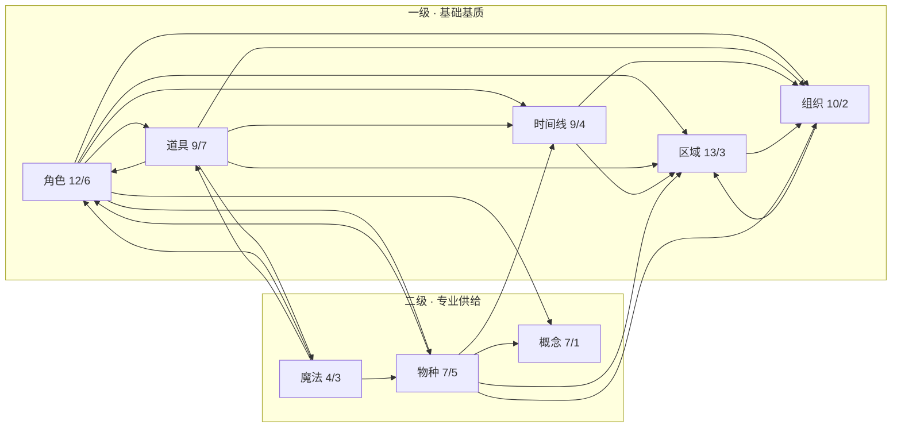
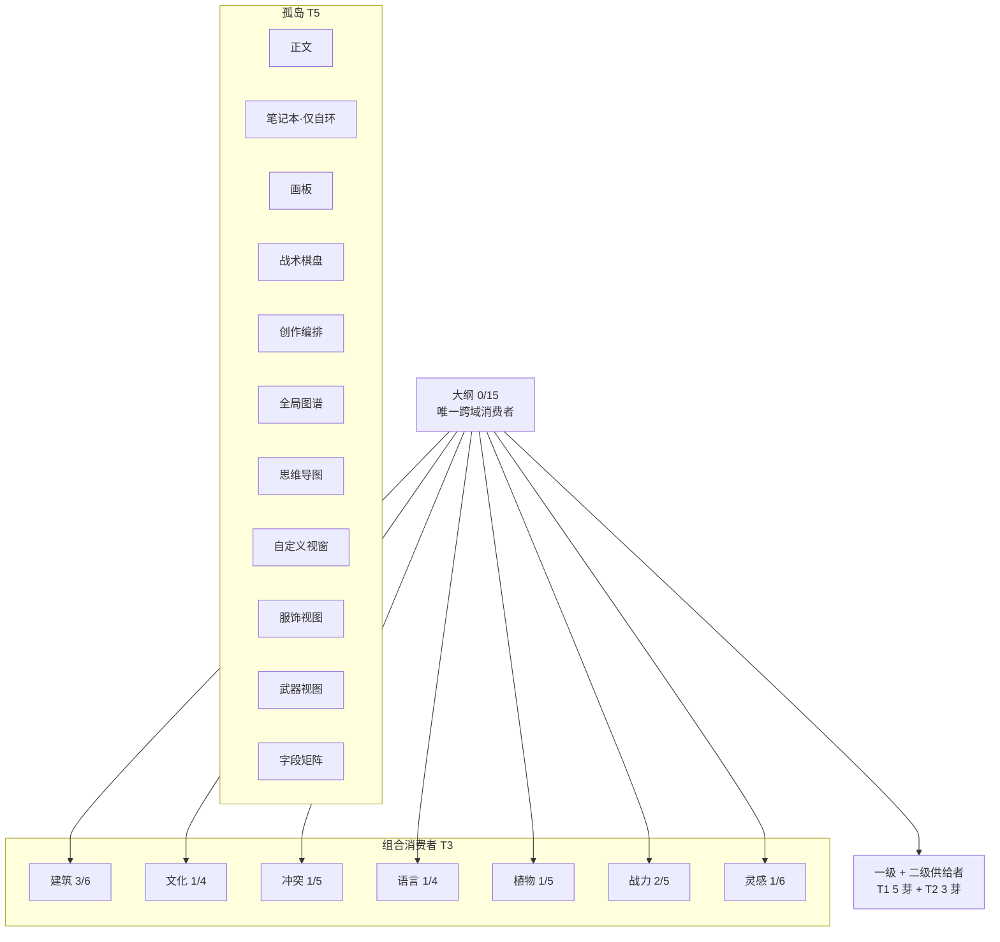

# 03 · 依赖与营养级

> 核心问题：芽与芽之间到底有哪些依赖？这些依赖是否被系统记录？由此可以划分出怎样的“营养级”？
>
> 2026-10-20 复核：孤岛 10→11（新增字段矩阵）；关系数仍 104 条 / 16 域；大纲跨芽出度仍 15（新增 3 条两端均为 `outline_node`，属类型内关系）。

## 3.1 依赖的六种载体

| 载体 | 声明位置 | 粒度 | 是否生效 | 现状 |
|---|---|---|---|---|
| 服务依赖 `requires` | 插件 manifest | 芽 → 服务名 | 是（装载前预检） | **无任何插件声明**；本树只提供 `world.info` |
| 模块依赖 `dependencies` | `SproutToggle` | 芽 → 模块 id/版本 | **否** | 死字段，全仓无读取点 |
| 默认开关 `defaultEnabled` | 插件 manifest | 芽 | **否** | 装载器明确标注“当前不消费” |
| 实体引用 `entityRef` | 实体字段 | 实体 → 实体 | 是 | 仅 1 处（`event.parentId`） |
| 被动关联 `autoLink` | 实体字段 | 实体 → 实体 | 是（写入侧自动建边） | 仅 2 处（角色 `race` / `affiliation`） |
| 语义关系 | `defineRelation` 全局注册 | 实体类型 → 实体类型 | 是 | **104 条 / 16 域** |

> `official.field-matrix` 只注册视图，不声明实体、关系或依赖，因此不进入依赖图；它是观测视图，不是新的供给/消费节点。

另有第七种、也是最容易被忽略的：**字符串 ID / JSON 字段**。它们不在关系图里，但实际承担着跨芽连接。

| 连接 | 载体 | 后果 |
|---|---|---|
| 大纲节点 ↔ 正文 | `outline_node.manuscriptId` + `manuscript.outlineNodeId` | 双向字符串，无关系边、无完整性校验 |
| 正文 ↔ 书籍 | `manuscript.bookId` | 同芽内字符串 |
| 笔记 ↔ 文件夹 | `notebook.folderId` | 无 folder 实体类型，字符串悬空 |
| 创作编排 ↔ 步骤 | `pipeline.steps` / `connections`（JSON） | 步骤不是实体，无法被关系查询 |
| 战术棋盘 ↔ 棋子 | `tactical-board.units` / `terrain`（文本） | 无法反查“这个角色出现在哪张棋盘” |
| 正文 ↔ 提及实体 | `manuscript.entityMentions`（文本列表） | 与 AutoLink/关系体系两套口径 |

## 3.2 三种“声明了但没生效”的机制

这是本次研究最明确的结构性缺口：

- `requires`：机制完整（manifest 校验 → 服务表预检 → cordis `inject`），但**没有消费者**。它现在只能防止“依赖不存在服务”的插件，无法表达“芽 A 依赖芽 B”。
- `dependencies`：类型上允许 `{ moduleId, version, optional }`，但没有任何装载、校验、UI 消费。
- `defaultEnabled`：manifest 里有，装载器注释写明“当前不消费”。

> 结论：系统具备“依赖声明”的**形状**，但没有“依赖声明”的**事实**。

## 3.3 芽级依赖图

### 供给骨架（T1 ↔ T2）

> 标注为“入度/出度”（不同芽数）。T1 是净供给者（入 > 出），T2 是专业供给者（被引用集中在少数几个域）。

### 消费者与孤岛

## 3.4 芽级有向边（按源芽聚合）

| 源芽 | 目标芽（关系类型数） |
|---|---|
| 角色 | 概念 2 · 组织 2 · 道具 1 · 区域 1 · 物种 1 · 时间线 3 |
| 道具 | 角色 6 · 建筑 2 · 组织 2 · 区域 2 · 时间线 2 · 魔法 2 · 战力 1 |
| 建筑 | 角色 3 · 道具 3 · 组织 2 · 概念 1 · 区域 1 · 时间线 1 |
| 时间线 | 建筑 1 · 角色 1 · 组织 1 · 区域 1 |
| 区域 | 概念 1 · 道具 1 · 组织 1 |
| 组织 | 区域 1 · 时间线 1 |
| 物种 | 角色 1 · 概念 1 · 组织 1 · 区域 1 · 时间线 2 |
| 概念 | 角色 1 |
| 魔法 | 角色 1 · 道具 1 · 物种 1 |
| 文化 | 组织 1 · 区域 1 · 物种 1 · 时间线 1 |
| 冲突 | 角色 1 · 道具 1 · 组织 1 · 区域 1 · 时间线 1 |
| 语言 | 角色 1 · 概念 1 · 区域 1 · 物种 1 |
| 植物 | 角色 1 · 道具 1 · 魔法 1 · 区域 1 · 物种 1 |
| 战力 | 角色 1 · 道具 1 · 魔法 1 · 区域 1 · 物种 1 |
| 灵感 | 角色 1 · 概念 1 · 道具 1 · 组织 1 · 区域 1 · 时间线 1 |
| 大纲 | 角色 1 · 道具 1 · 概念 1 · 组织 1 · 物种 1 · 语言 1 · 魔法 1 · 建筑 2 · 文化 1 · 植物 1 · 战力 1 · 灵感 1 · 区域 1 · 时间线 1 · 冲突 1 |
| 正文 / 笔记本 / 画板 / 战术棋盘 / 创作编排 / 六个视图芽（含字段矩阵） | 无跨芽关系 |

> 大纲另有 3 条两端均为 `outline_node` 的横向关系（并列 / 递进 / 对比），属类型内关系，不计入跨芽出度 15。

## 3.5 五级营养级

| 级别 | 判定 | 芽 | 生态角色 |
|---|---|---|---|
| **T1 基础基质** | 入度 ≥ 9 且入 > 出 | 区域 13/3 · 角色 12/6 · 组织 10/2 · 道具 9/7 · 时间线 9/4 | 被最多芽引用，是世界的“公共底座” |
| **T2 专业供给** | 入度 4–7 且入 ≥ 出 | 物种 7/5 · 概念 7/1 · 魔法 4/3 | 被特定域依赖，专业化程度高 |
| **T3 组合消费** | 出 > 入 | 建筑 3/6 · 文化 1/4 · 冲突 1/5 · 语言 1/4 · 植物 1/5 · 战力 2/5 · 灵感 1/6 | 依赖他人多于被依赖，是“组合型实体” |
| **T4 叙事组织者** | 出度极高、入度 0 | 大纲 0/15 | 唯一跨域消费者：消费 15 个芽，自身不被引用 |
| **T5 孤岛** | 出=入=0（或仅自环） | 正文、笔记本、画板、战术棋盘、创作编排、全局图谱、思维导图、自定义视窗、服饰、武器、字段矩阵 | 不进入实体关系网，自成一体 |

> 级别不是“重要性排序”。T5 中的正文与笔记本是核心创作芽，只是在**关系模型**里孤立。

## 3.6 孤岛的两种性质

**A. 真孤岛（设计上就不需要关系）**

- 画板、战术棋盘、自定义视窗、全局图谱、思维导图、字段矩阵：操作画布/视图或只做观测，不生产实体关系。
- 服饰、武器：`item` 的 Facet 视图，关系应记在 `item` 上。

**B. 假孤岛（应该有连接，但没有声明）**

- **正文**：与大纲通过两个字符串 ID 互指，没有关系边；与角色/道具的关联靠 `entityMentions` 文本。
- **笔记本**：只有 `note_link` 自环；文件夹是字符串，不是实体。
- **创作编排**：步骤与连接存 JSON，无法被图谱/关系查询消费。

> 写作三芽中，只有大纲进入了关系网；正文与笔记本在“生态图”上是断开的。这是本次研究最值得后续处理的一处。

## 3.7 结论

1. **生态形态 = 一网 + 十一岛**：16 个芽连通，11 个芽在网外（新增的字段矩阵为纯观测视图，不改变关系网结构）。
2. **跨域远大于域内**：按“芽对 × 关系类型”计，跨域 93 个组合、域内 9 个（10.33 倍）。任何“按域封闭”的设计都会与真实依赖冲突。
3. **大纲是唯一的叙事入口**：出度 15、入度 0，说明“世界 → 叙事”的桥只有一座。正文/笔记本若也要消费世界实体，应补关系而不是继续加字符串字段。
4. **依赖声明层是空的**：三种机制（`requires` / `dependencies` / `defaultEnabled`）都没有事实。当前所谓“依赖”只能从关系注册表反推。

> **R5 可见性（2026-10-20）**：芽详情已把“从关系注册表反推”的类型级入/出依赖展示出来（`entityTypes` 声明 + 有效关系方向；自动逆关系不重复计数），停用芽也能看。`requires` / `dependencies` / `defaultEnabled` 仍未成为运行时依赖机制；R5 只做可见性，不做依赖校验或编辑。
