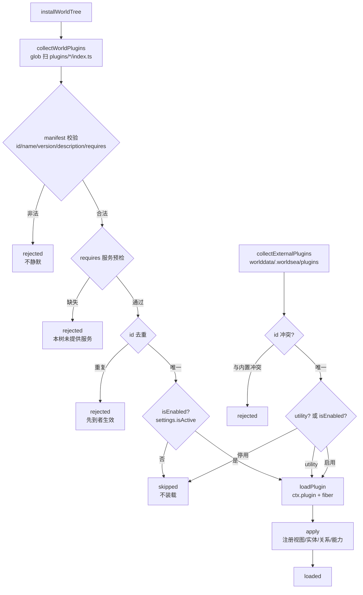
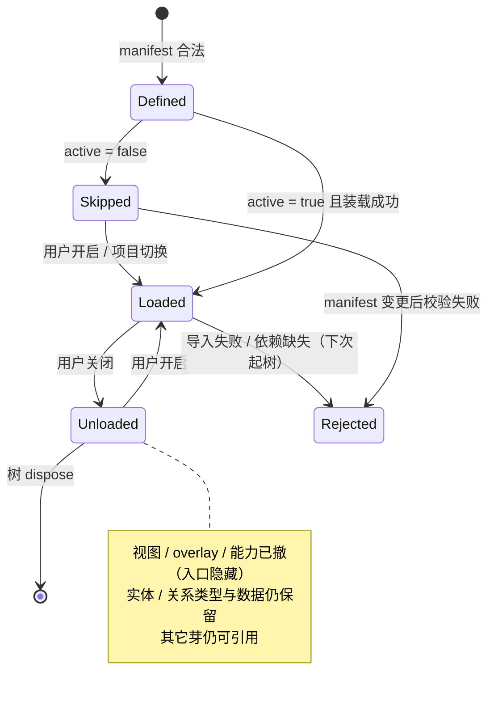

# 04 · 生命周期与状态

> 核心问题：一个芽从“被定义”到“被装载/卸载/拒绝/热更”，经历哪些状态？这些状态现在由谁记录、是否统一？
>
> 2026-10-20 复核：芽数 27；字段矩阵为纯视图芽（无实体类型/数据），关闭只影响入口。

## 4.1 现状：四套词表并存

| 层面 | 词表 | 真源 | 用户可见 |
|---|---|---|---|
| 身份来源 | `builtin` / `external`（代码里还有 `local` / `remote` 未用） | `SproutToggle.source`、manifest id 前缀 | 芽管理行有“内置/外部”小字 |
| 身份类型 | `sprout` / `utility` | manifest `kind` | 设置页分成“芽管理”与“内置插件” |
| 激活态 | `active` / `inactive` | `settingsStore.sprouts[].active`（项目级持久化） | 开关 |
| 装载态 | `loaded` / `skipped` / `rejected` | `worldTreeState()`、`externalPluginStates()` | 外部插件卡显示“已装载/已停用/被拒”；内置芽不显示 |

四套词表没有统一映射，也没有一个“芽状态面板”能同时回答：它是什么、有没有开、有没有装上、为什么没装上。

## 4.2 持久化模型

| 数据 | localStorage 键 | 项目库键（`project_settings`） | 归一规则 |
|---|---|---|---|
| 内置芽开关 | `worldsea_plugin_toggles` | `plugin_toggles` | 别名映射（`official.workflow` → `official.orchestration`）；清单外 id 丢弃 |
| 芽分组 | `worldsea_sprout_groups` | `sprout_groups` | 同上；未知 id 从组内剔除 |
| 外部插件开关 | `worldsea_external_plugins` | `external_plugins` | 只保留 `{id, active}`，独立键避免被内置归一清掉 |

三个要点：

1. **localStorage 是回退，项目库是准**：起树时先读 localStorage，项目切换后异步读项目库覆盖。
2. **持久化只存 `{id, active}`**：`label` / `icon` / `category` / `source` 不落盘，每次从清单与 manifest 重建。
3. **兜底芽**：全部停用时强制保留 `official.characters`，避免工作台无视图可用。

## 4.3 装载管线

装载完成后 `settings.syncExternalSprouts()` 把外部插件对账进芽清单；`worldTreeState()` 发布到 `globalThis.__WS_WORLD_TREE__` 供探针读取。

## 4.4 运行时状态机

## 4.5 卸载语义：关闭的是“入口”，不是“数据”

**产品本意（用户拍板 2026-10-18）**：在芽管理中关闭一个芽，实际是**隐藏它的入口**；它的实体仍然存在，并继续供给其余芽选用。也就是说，“关闭”不等于“删除数据”，也不等于“注销能力”。

当前代码与此意图一致：

- **会撤**：视图、overlay、能力桥登记、插件清理函数——用户看不到入口。
- **不会撤**：`registerEntityV2` / `registerRelationV2` / `registerFacet` 注册的类型元数据，以及已经写入的实体数据——关系查询与其它芽的引用仍然可用。

> 字段矩阵是纯视图芽，没有实体类型与实体数据；关闭它只撤视图入口，不涉及数据保留。

官方理由是“避免关系查询断裂”（[api.ts](../../../../apps/tauri/src/world/api.ts) 顶部注释）。需要显式建模的是：

- 芽的**入口态**（visible / hidden）与**数据态**（entities retained / deleted）是两件事；
- 用户关闭芽后，实体仍然可以被其它芽选中、被关系引用，这是**设计行为**，不是残留；
- 当前实现是否仍完整支持“隐藏后实体可选”需要一次真机确认（本报告未验证运行时行为）。

> 结论：不要把它当成“类型幽灵”去清理。应把“隐藏入口 / 保留数据”写成明确契约，并在 UI 文案上避免让用户误以为关闭 = 删除。

## 4.6 外部插件的状态与对账

| 状态 | 含义 |
|---|---|
| `loaded` | 已装载，视图/overlay 生效 |
| `skipped` | 通过校验但被用户停用 |
| `rejected` | 语法错 / 清单非法 / id 前缀不符 / id 与文件名不一致 / 与内置冲突 |

热更对账（防抖 1s）：

| 变化 | 行为 |
|---|---|
| 新文件 | `added`：装载 |
| 源码指纹变化 | `updated`：卸载后重装 |
| 文件消失 | `removed`：卸载并从外部集合删除 |
| 源码未变 | `unchanged`：不动 |
| 校验失败 | 进 `rejected`，附文件与原因 |

外部插件 id 强制 `ws.` 前缀，且必须与文件名一致；内置 `official.*` 不可冒名。

## 4.7 项目切换

- 项目级芽开关与分组从 `project_settings` 重读；外部插件集合随项目切换。
- 视图在切换时清空，再按新项目的芽开关重建（历史上曾出现“切项目后芽侧栏全空”，修复方式是强制 `unload → load` 重跑 `apply`）。
- 装载对账：`loadAll` 与插件 `apply` 存在竞态，树就绪后会补一次全量 `loadAll` 归一。

## 4.8 状态相关的风险

| # | 风险 | 影响 | 证据 |
|---|---|---|---|
| S1 | “关闭”与“删除”语义未被显式表达 | 用户可能误以为关芽会删数据；实际是隐藏入口、保留实体 | `api.ts` / `tree.ts`；本报告未做运行时验证 |
| S2 | 四套状态词表 | 用户无法判断“为什么我的芽没出现” | `settingsStore` / `tree.ts` / `PluginsPanel` |
| S3 | `category` / `source` 不持久化 | 外部插件无分类；重启后只能从清单重建 | `sproutPersistence.ts` 只存 `{id, active}` |
| S4 | `requires` / `dependencies` / `defaultEnabled` 未生效 | 依赖无法声明、无法校验 | 见 [03](./03-依赖与营养级.md) |
| S5 | 外部插件默认 `active=true` | 新放入的插件默认启用，可能带来非预期视图 | `world/index.ts` 的 `?? true` |
| S6 | 全停用兜底固定为角色芽 | 用户若想“全关”做不到；兜底选择是硬编码 | `FALLBACK_SPROUT_ID` |

## 4.9 建议的统一状态模型

把“芽的状态”拆成五个正交字段，UI 与代码共用一套词：

| 字段 | 取值 | 说明 |
|---|---|---|
| `origin` | `builtin` / `external` | 从哪来 |
| `kind` | `sprout` / `utility` | 是否有侧栏生态位 |
| `activation` | `active` / `inactive` | 用户意图（持久化） |
| `runtime` | `loaded` / `skipped` / `rejected` | 当前实际结果（派生，不持久化） |
| `typesRetained` | `true` / `false` | 卸载后类型与实体数据是否仍保留（当前为设计意图：保留） |

> 纯视图芽（如字段矩阵）没有实体类型，`typesRetained` 记为 N/A；其余四字段仍适用。

派生规则：`activation=inactive` → `runtime=skipped`；`origin=external` 且校验失败 → `rejected`；`utility` → 无 `activation`，恒 `loaded`（或 `rejected`）。
