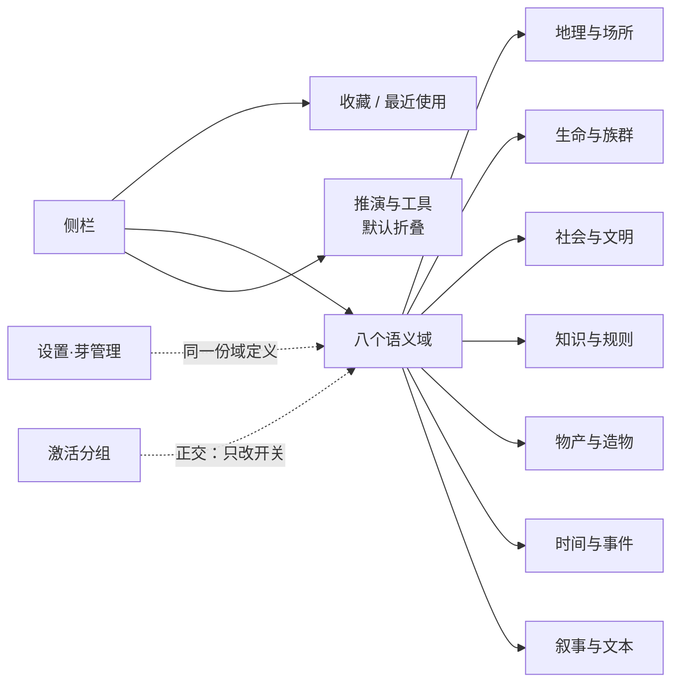

# 05 · 用户信息架构与建议

> 前四篇回答“是什么”；本篇回答“用户应该怎么看见它”。所有内容均为建议，不含施工。
>
> 2026-10-20 复核：芽数 26→27、默认开启 7→8；字段矩阵以旧 `category: 'system'` 入清单、manifest 未声明 `domain`；R1/R2 阻断已解除。

## 5.1 侧栏现状

| 事实 | 说明 |
|---|---|
| 唯一入口 | 侧栏视图列表（`SidebarV2`），工作台日常导航 |
| 数据源 | `visibleViewsInSidebarOrder()`：过滤隐藏芽 → 按 `sidebarOrder` 排序 |
| 形态 | **一维数组**，交给物理轮盘/拖拽交互渲染，没有分组容器 |
| 顺序 | 用户拖拽持久化到 `uiStore.sidebarOrder`（视图 id 列表） |
| 可见性 | `isViewVisible(pluginId)`：在芽清单内看 `active`；不在清单内的视图恒可见 |
| 首屏 | 恢复上次视图；否则取可见列表第一项 |

也就是说：**侧栏只知道“有哪些视图、按什么顺序”，不知道“它们属于哪个域”。**

## 5.2 设置现状

`PluginsPanel` 是三卡叠放：

| 卡 | 内容 | 启停 |
|---|---|---|
| 外部插件 | `worlddata/.worldsea/plugins/` 下的 `ws.*` | 有开关、源码查看、删除、重载 |
| 内置插件 | 10 个 utility，显示“常驻” | 无开关 |
| 芽管理 | 27 芽平铺列表 | 有开关；支持搜索、全选、6 类筛选、拖拽排序、分组预设 |

芽管理里的“分组”有三重身份，容易混淆：

1. **分类 `category`**：内置 6 类，只做筛选标签，决定不了排序与导航。
2. **用户分组 `sproutGroups`**：把“当前激活集”存成快照，应用后批量开关，是**激活预设**。
3. **身份 `kind` / `source`**：决定这一行出现在哪张卡、是否可启停。

再加上 `sidebarOrder`（侧栏顺序），系统里实际有**四套互不统属的组织机制**。

## 5.3 现有 IA 的五个问题

1. **27 项超过可扫描上限**：默认只开 8 个，但设置页仍一次展示 27 行；用户要靠搜索/筛选找芽。
2. **域在导航层缺席**：6 类分类只在设置页做筛选，侧栏看不到；用户无法“按域进入”。
3. **工具与内容混排**：图谱、思维导图、画板、战术棋盘与角色、区域同级，用户会把它们当“世界实体”；字段矩阵（观测工具）也默认开启，使这个问题进一步显性化。
4. **平铺被当成默认**：用户可拖拽排序，但没有“分组/折叠”的原生表达；顺序承担了本应由结构承担的职责。
5. **状态不可解释**：外部插件被拒时能看到原因；内置芽“开了但没出现”时没有解释（可能是视图未注册、装载失败或被过滤）。

## 5.4 目标 IA（建议）

> 交互原型：[原型-侧栏两级.html](./原型-侧栏两级.html)（可切换「按域分组 / 当前平铺」「置灰 / 隐藏」「全部展开 / 仅当前域 / 全部折叠」）。

**两级 + 两个辅助区**：

规则：

1. **侧栏只展示“已激活芽”的域**；未激活芽通过“管理/添加”入口进入完整域树。
2. **域内保持一维顺序**：沿用 `sidebarOrder`，但把顺序限制在域内，避免跨域拖拽的语义混乱。
3. **工具域默认折叠**：不参与日常内容导航；需要时展开。
   > 字段矩阵当前默认开启；按本目标 IA 它属于工具域，R3 落地后应默认折叠，不参与日常内容导航。
4. **收藏 / 最近使用**：解决“高频芽不在首屏”的问题，不改变域结构。
5. **激活分组与域正交**：分组仍是“开关预设”，不再冒充导航；设置页把它移到独立小节。
6. **跨域关系不作为导航**：角色属于生命域，但它与组织/事件的关系通过实体详情展示，不把侧栏做成图谱。

## 5.5 建议批次与拍板状态（2026-10-18 初版 / 2026-10-20 复核）

| 批次 | 内容 | 状态 |
|---|---|---|
| **R1 声明层** | `WorldPluginManifest` 增加 `domain` / `subdomains`；27 芽 manifest 各声明一次 | **待启动**（字段矩阵芽已完工并提交 `f18e45b`，阻断解除；其 manifest 尚未声明 `domain`，作为首个迁移对象） |
| **R2 语义域落地** | 8 域定义成为单一真源；旧 `category` 标记 `待退役` | **待启动**（8 域已拍板） |
| **R3 侧栏两级** | 域分组 + 折叠 + 收藏/最近；域内保留用户顺序 | **待启动（暂缓）**：等用户给出前端形态后再定 |
| **R4 设置同源** | 芽管理按域分组；“激活分组”独立小节；状态词统一 | **待启动** |
| **R5 依赖与状态可见** | 芽详情显示入/出依赖、装载态、被拒原因；外部插件显示 domain | **待启动** |
| **R6 孤岛治理** | 大纲 ↔ 正文关系化；笔记本文件夹实体化或显式标注“无关系”；编排步骤关系化 | **待议**（涉及数据模型，最后做） |

> **本轮不动工**：R3 等前端形态；R1/R2 涉及 27 个插件目录与 manifest，字段矩阵芽已完工（`f18e45b`），阻断解除，待用户决定是否启动。

## 5.6 验收判据

- **结构**：任一芽都能回答“主域是什么、副域是什么、当前处于什么状态”。
- **导航**：从侧栏进入任一芽不超过 2 次点击；工具域不干扰内容导航。
- **一致性**：侧栏、设置、manifest 三处域归属一致，无第二套分类。
- **可解释**：芽未出现时，界面能给出原因（未激活 / 装载失败 / 被拒 / 无视图）。
- **兼容**：旧 `category` 数据可平滑映射；外部插件未声明 domain 时不崩溃、有显式提示。
- **不回归**：现有 27 芽的启停、分组、排序、外部热装载行为不变。

## 5.7 拍板记录（2026-10-18）

| 决策点 | 裁定 |
|---|---|
| 两级侧栏 | **要做，但暂缓**；等用户构思出前端形态后再启动 |
| 8 域方案 | **通过**；后续新增芽可注册新域名，或选择合适的现有域 |
| 时间与事件单成员域 | **保留独立**，不并入叙事；后续会有新增芽 |
| 旧 6 类 `category` | **保留为过渡标签**，标记 `待退役`；新芽只写 `domain` |
| 关闭芽的语义 | **隐藏入口、保留实体数据**，实体继续供给其余芽选用；不是删除，也不是类型幽灵 |

## 5.8 剩余风险

1. **侧栏形态未定**：R3 的具体交互（折叠层级、域切换、收藏位置）必须等用户的前端形态，不能先按本文的目标图施工。
2. **新芽已完工**：字段矩阵芽已提交 `f18e45b`，R1/R2 阻断解除；但它目前只有旧 `category: 'system'`、manifest 未声明 `domain`，需要在 R1 中作为首个对象补声明。
3. **旧分类双词表**：过渡期 `category` 与 `domain` 并存，需在管理面明确标注“旧标签”，避免用户误把两者当同一层级；字段矩阵（拍板后落地的新芽）仍写入 `category: 'system'`，说明过渡期规则尚未被新芽遵守。
4. **隐藏语义的运行时验证**：本报告未验证“隐藏后实体仍可被其它芽选用”的完整交互链路，落地前需真机确认。
