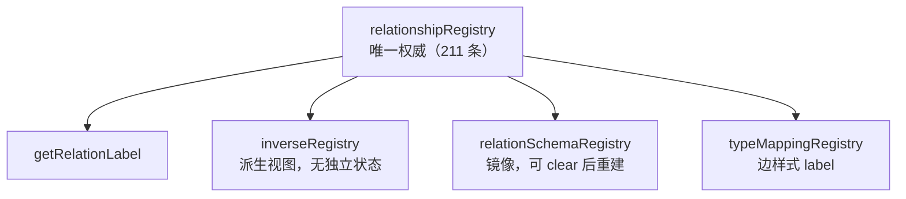

# RelationshipRegistry.ts 详细注释

> 来源：`packages/entity-core/src/core/RelationshipRegistry.ts`
> 说明：本文件为 RelationshipRegistry 内长注释块的「详细」层（why/how）归档。代码文件内仅保留一行简要注释并指向本文件。

## 注释块 1（原文件第 1-10 行）

````
/**
 * 全局关系注册中心（Relationship Registry）
 *
 * 设计决策：
 * - 所有关系集中声明，消除插件间的重复定义
 * - 基于 RelationTypeSchemaV2：强制有向 + 强制 inverseType
 * - 对称关系 inverseType 指向自身
 * - 按 sourceType/targetType 索引，支持高效查询
 * - 插件激活/停用只影响数据可见性，不影响关系定义
 */
````

## 本注册表是关系的唯一权威源（2026-11-17 收敛）

### 收敛前的问题

「关系」这个概念曾有七个互不同步的权威源，实测损伤：

| 权威源 | 条目 | 问题 |
|---|---:|---|
| `relationshipRegistry` | 211 | 事实权威 |
| `relationSchemaRegistry` | 211 | 镜像；切项目后归零且不恢复 |
| `inverseRegistry` | 213 | 自带 Map，与注册表**冲突 15 条** |
| `RelationTypes` 枚举 | 38 | 覆盖 35/119；含 2 个死常量 |
| `RelationTypeLabels` 静态表 | 38 | 导致 **187/211 条标签错误（89%）** |
| `typeMappingRegistry` | ~26 | 88% 走兜底灰 |
| `RELATION_EDIT_PROPS` 硬编码 | 26 | 完全忽略 `schema.properties` |

最严重的是逆类型冲突：`useBidirectional` 读 `inverseRegistry`，其中 6 条把非对称关系
注册成自指（`mentor_of` / `participated_in` / `causes` / `references` / `route` / `notable_for`），
于是「双向建边」建出**源目标相同的反向边**。

### 收敛后的契约



四条约束，任何新代码都必须遵守：

1. **取标签**一律用 `getRelationLabel()`，不要读任何静态表
2. **取逆类型/判对称**用 `inverseRegistry`，它已委托本注册表，不可能分歧
3. **新增关系**用 `defineRelation()`；不要手写 `inverseRegistry.register()`（该方法已是空实现）
4. **旧版镜像**由 `syncToLegacyRegistry()` 重建；`clear()` 之后必须调用一次

### 为什么逆类型的答案必须是"注册表说了算"

`inverseType` 写在 `defineRelation({...})` 的声明里，是关系的**语义定义**。任何第二份数据
（手写表、独立 Map）都会随声明演进而过期，而这种过期**不会报错**——它只是静默建出错方向的边。
把 `inverseRegistry` 改成纯派生视图，是为了让这类过期在结构上不可能发生。

同理，`getRelationLabel` 从静态表改读注册表，是因为注册表随声明增长而静态表不会：
每新增一条关系，静态表就多一条过期记录，且没有任何机制提醒。

### 守卫

`packages/entity-core/src/core/__tests__/` 下四个 spec 锁定上述契约：

- `relationAuthority.spec.ts` —— 标签 / 逆类型 / 对称性全量一致 + 15 条历史冲突夹具 + 无死枚举
- `inverseRegistrySync.spec.ts` —— 派生视图不保存状态（`register` 空实现）
- `projectSwitchRelationMirror.spec.ts` —— `clear()` 后可重建
- `relationEditPropsAuthority.spec.ts` —— 属性编辑以 schema 为准

每个 spec 都自带「扫描器非空转」断言，避免守卫在注册表为空时假绿。
