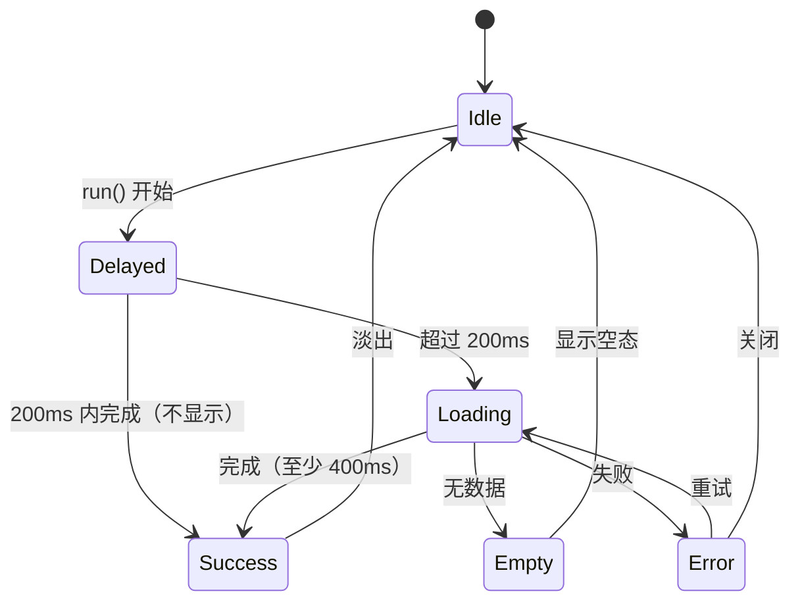

# 加载反馈机制 · 正式计划

> **来源**：2026-10-22 侧会话设计探究（[交接文档](2026-10-22-加载反馈机制-侧会话交接.md) + 三份 HTML 样张）。
> **用户拍板（2026-10-22）**：5 类口径；项目切换遮罩只盖工作台内容区；启动页纳入本批；**R3 采用 B 弧形航线**；项目切换用**阶段式 + 提高对比**（不显示假连续百分比）；扫描雷达**仅设置/诊断**。
> **边界**：只动产品域（`apps/tauri` + `packages/ui-kit` + `theme.css`），**不碰 dsh**；dsh 用自己的 `--dsw-*`，不加载产品域 theme.css/ui-kit。

设计依据：

- [Study 01 · 五类基线](../misc/加载反馈样张/loading-styles.html)
- [Study 02 · 星轨/测线语言](../misc/加载反馈样张/loading-refined.html)
- [Study 03 · 阶段线/文字/雷达](../misc/加载反馈样张/loading-study03.html)
- [Study 04 · B 弧形航线生产修正版](../misc/加载反馈样张/loading-study04.html)（4 节点、11px 短标签、阶段式、完成/失败态；本计划 R3 的视觉基准）

---

## 一、目标与裁定

### 1.1 已锁定

| # | 裁定 |
|---|---|
| 1 | **5 类**：R0 启动页 + R1 行内 + R2 骨架 + R3 区域遮罩 + R4 背景态；确定进度是模式，不单独算一类 |
| 2 | **项目切换遮罩只盖内容区**：保留 32px 窗口栏与项目名；不盖标题栏 |
| 3 | **R3 用 B 弧形航线**：A 阶段线只留档；B 需按本计划 §3.3 收掉短板（短标签、11px、4 节点上限、去假百分比） |
| 4 | **项目切换用阶段式进度**：`2/4` + 当前阶段文案 + 星点停在节点；不显示假的 46% 连续填充 |
| 5 | **扫描雷达仅设置/诊断**：存储扫描、孤立文件、一致性检查；主界面不用 |
| 6 | **启动页纳入本批**：保留星座品牌动效，替换随机假进度为真实阶段，接通错误态与重试 |
| 7 | **设计语言**：安静的仪表盘感；星轨只作运行时回声，不做烟花式动画 |
| 8 | **边界**：产品域 only，不碰 dsh |

### 1.2 非目标

- 不重做全部异步操作；只覆盖 §5 的 P0/P1 落点。
- 不为每个视图强行加骨架；数据在内存且瞬时出现的视图保持无加载。
- 不改 dsh 侧任何 UI/样式。
- 不引入新依赖（无 loading 库、无动画库）。
- 不把「空态」当「加载态」；空态仍走现有 `TuiEmpty`/视图空态。
- 项目切换不提供取消（当前链路不支持中断）；导入/导出仅在链路支持时提供取消。

---

## 二、设计语言

**一句话**：一个移动的星点，不做整圈旋转；点给方向，尾迹给速度，轨道只给参照。

| 类 | 视觉隐喻 | 一句话规格 |
|---|---|---|
| R0 | 星座（既有） | 全屏品牌动效 + 真实阶段；只修进度/错误，不重画星座 |
| R1 | 星轨环 | 14/20/30px 三档；1px 虚线轨道 + 星点 + 78° 尾迹；不整圈旋转 |
| R2 | 测线骨架 | 中性占位块 + 1px 测线缓慢扫过；默认不用 shimmer |
| R3 | 弧形航线 | 浅弧 + 4 节点；星点沿弧进站；完整阶段文案在上、短标签在下 |
| R4 | 测线背景 | 顶部 1px 线 + 一颗星；只在后台任务 >1s 时出现，结束即消失 |

**三条纪律**（沿用样张）：

1. 一个移动的点，不做整圈旋转；轨道只给参照。
2. 文字说阶段，星点说位置；不用「加载中…」包打天下。
3. 只在终点收束：完成时星点放大淡出、航线保留 300ms；失败时星点停住转 warning 色，不自动消失。
4. 背景态只给一颗星；不是整条进度条常驻。

---

## 三、五类规格

### 3.1 R0 启动页

**保留**：`SplashScreen.vue` 的双 Canvas 星座、HUD 角标、品牌标题、自定义光标、600ms 淡出。
**改**：

- 删除 `tickProgress()` 的随机进度与虚构状态文案（`Mounting WASM runtime` 等不对应真实步骤）。
- 新增 `uiStore.bootStage`：`'backend' | 'project' | 'shell' | 'bridge' | 'ready' | 'error'`；Splash 读真实阶段。
- 阶段文案（4 段）：
  1. `初始化核心`（`initializeBackend`）
  2. `恢复项目`（`useProjectSwitcher.initialize`）
  3. `装配界面`（`bootstrapShell`）
  4. `系统桥接`（`setupSystemBridge`）→ `就绪`
- 进度表达：**不显示假百分比**；保留 1px 渐变线程 + 星头（与 R3 同语言），阶段完成推进到下一节点；若启动极快，直接淡出。
- 错误：`App.vue` 的启动链加 `try/catch`；失败调 `markBootError([{ id:'boot', name:'启动', error }])`；`BootErrorScreen` 的重试走 `location.reload()`，`继续` 走 `recoverFromError()`。Splash 不得永久停留。
- 启动时序：把 `main.ts` 的 `initializeBackend()` 纳入可等待的启动序列（或暴露 Promise），确保项目初始化在 backend 注册之后；这是本批最高风险改动，单独验证。
- Token：复用 R1/R3 的星轨 token；R0 的渐变保留品牌色，但线宽改为 1px，和运行时语言一致。

**组件**：沿用 `SplashScreen.vue` / `BootErrorScreen.vue`；新增 `uiStore.bootStage` / `setBootStage`。

### 3.2 R1 行内

**视觉**：

- 三档：14 / 20 / 30px（`--loading-size-sm/md/lg`）。
- 1px 虚线圆轨道（accent 24%），星头 4.5px + 7px 光晕，78° 渐隐尾迹；周期 1.15s。
- 不整圈旋转；星点绕轨道移动；完成时星点放大淡出。
- 按钮：loading 时用 14px 星轨替代现有 `dots` 旋转；文字保留，不降透明度，`cursor: progress`。
- 行内：文件树节点/列表行尾固定 14px，不新增行高；轨道 1px 虚线避免整行变亮。
- 菜单头：项目下拉刷新用 26px 测线 + 星点从左到右一次；不改变菜单高度。

**行为**：

- 不阻断、不改变布局；一个任务只出现一个指示器。
- `role="status"` + `aria-label`；行内重复出现时用 `aria-live="off"`，避免读屏刷屏。
- 减弱动态：周期 2.4s，保留星点移动；完成放大改为淡出。

**组件**：`WsInlineLoading`（`size`, `label`, `variant: 'orbit' | 'line'`）。

### 3.3 R2 骨架

**视觉**：

- 中性占位块（`--loading-skeleton-base`），不使用 Study 01 的彩色渐变。
- 默认「测线」：1px accent 线缓慢扫过（2.6s 一个来回），占位块不呼吸、不缩放。
- 可选 `shimmer` 仅作降级备选；默认不用。
- 形状：`card` / `row` / `text` / `image`；图片按真实宽高比占位，避免 CLS。
- 内容就绪后 200ms 淡出；真实内容同步淡入，不塌高度。

**行为**：

- 骨架是装饰（`aria-hidden`），容器 `role="status"` + 屏读「正在加载」；`aria-busy` 打在区域上。
- 减弱动态：测线静止，保留占位块；不消失。
- 首载才用；已有数据刷新不用骨架，最多 R4 顶线。

**组件**：`WsSkeleton`（`variant`, `lines`, `aspect`, `label`）。

### 3.4 R3 区域遮罩（B 弧形航线）

**两种落点**：

- `scope="content"`：项目切换、全局重装配；只盖内容区（`Shell` 的 body），标题栏可见。
- `scope="panel"`：导入/导出、批量、模板、存储、版本、回收站等从弹窗/面板发起的操作；遮罩落在弹窗内部，不盖全应用。

> 视觉基准：[Study 04 · B 修正版](../misc/加载反馈样张/loading-study04.html)。样张里的 A/B 切换、46% 文字推进、9px 标签、动画内部参数均为探究稿，不照搬。
> **2026-10-22 走查后调整**：**去掉卡片背景/边框/阴影/内边距**；进度与文字直接落在 scrim 上（遮罩保留，负责阻断与对比度）。Study 04 仍展示卡片版，以本计划与产品实现为准。

**B 弧形航线生产规格**（收掉 Study 02 的短板）：

- 内容块：宽 `min(480px, calc(100vw - 48px))`；无卡片背景/边框/阴影/内边距；不占满全屏。
- 头部：标题 13px/600；计数 `2 / 4` 10px tabular；右侧失败时显示重试图标。
- 当前阶段完整文案：12px accent；下方 1px 下划线 + 星头；**星点停在当前节点**，不显示假的连续百分比。
- 弧线：浅弧 SVG（320×72 viewBox）；3–5 个节点；已完成航段实线 accent，未完成虚线 accent 24%；当前节点 halo +2px。
- 短标签：弧下 4 列，11px；未完成 `--text-secondary`，当前 `--accent`，已完成 `--text-secondary` + 小勾。
- 详情行：10px `--text-secondary`（如 `实体 1,284 · 关系 3,106 · 文件 42`）；**不显示动画内部参数**（样张的「星点进站：减速 180ms」不进生产）。
- 目标项目：保留 `目标：<项目名>`，帮助用户确认切到哪。
- 完成：星点放大 2.6 倍并淡出，航线保留 300ms，overlay 再淡出 200ms。
- 失败：星点停住转 `--warning`，显示错误文案 + `重试` / `关闭`；不自动消失。
- 取消：项目切换无取消；导入/导出仅在底层支持时显示 `取消`，否则不显示。
- 动效：节点间移动 0.6s `--ease`；进站停顿 120ms；减弱动态下节点跳转、无补间，星点仍可见。
- 可访问性：`role="status"`、`aria-live="polite"`、内容区 `aria-busy`；遮罩期间内容区 `inert`；焦点陷阱；装饰 SVG `aria-hidden`。

**节点上限**：

- 项目切换固定 4 段（把 6 个实现步骤归并）：`数据源` / `装配实体` / `重装芽` / `恢复关联`。
- 导入 4 段：`解析` / `备份` / `写入` / `刷新`。
- 导出 3 段：`收集` / `打包` / `写入`。
- 存储扫描 2 段：`扫描` / `清理`。
- 超过 5 段的流程：折叠成阶段组，或只显示「当前阶段 + n/m」；加载面板内不滚动。

**组件**：

- `WsStageRoute`：B 弧形航线视觉（接收 `stages`, `current`, `progress?`, `status`）。
- `WsLoadingOverlay`：scrim、scope、a11y、焦点/ inert、取消/重试；内部渲染 `WsStageRoute` 或 slot。
- `WsScanRadar`：36px 虚线环 + 扫描扇 + 真实百分比；仅设置/诊断。

### 3.5 R4 背景态

**视觉**：

- 顶部 1px 测线 + 一颗星点，星点带 28px 渐隐尾迹；不抢焦点、不锁滚动。
- 可选：侧栏底部/标题栏一个 8px 四角星状态点；不常驻整条进度条。
- 样张的「侧栏状态卡」只作为设置/诊断展示，不作为全局常驻 UI。

**行为**：

- 只在后台任务预计 >1s 且用户可继续操作时出现；<1s 不显示。
- 任务结束立即消失；失败用 toast，不弹模态。
- 同一时间只显示最近一个后台任务；多个任务合并为「+n」。
- 减弱动态：星点静止或极慢，保留状态点。

**组件**：`WsAmbientLine` + `useBackgroundTask`（模块级响应式注册表）。

---

## 四、Token 模型

### 4.1 全局语义 token（写 `apps/tauri/src/styles/theme.css`）

| Token | 值 | 用途 |
|---|---|---|
| `--loading-accent` | `var(--accent)` | 星点/当前阶段/进度填充 |
| `--loading-track` | `color-mix(in srgb, var(--accent) 24%, transparent)` | 虚线轨道/未完成航段 |
| `--loading-label` | `var(--text-secondary)` | 阶段短标签/详情 |
| `--loading-scrim` | `color-mix(in srgb, var(--bg-app) 80%, transparent)` | 内容区遮罩 |
| `--loading-scrim-blur` | `2px` | 内容区遮罩模糊 |
| `--loading-scrim-local` | `color-mix(in srgb, var(--bg-surface) 62%, transparent)` | 弹窗内遮罩 |
| `--loading-skeleton-base` | `var(--bg-muted)` | 骨架占位 |
| `--loading-skeleton-shine` | `color-mix(in srgb, var(--bg-surface) 65%, transparent)` | shimmer 降级备选 |
| `--loading-size-sm` | `14px` | 行内/按钮 |
| `--loading-size-md` | `20px` | 列表/菜单 |
| `--loading-size-lg` | `30px` | 空态/大区块 |
| `--loading-orbit-duration` | `1.15s` | R1 星轨周期 |
| `--loading-survey-duration` | `2.6s` | R2 测线来回 |
| `--loading-delay` | `200ms` | 延迟出现 |
| `--loading-min-visible` | `400ms` | 最短可见 |
| `--z-loading` | `1500` | 遮罩层（modal 1000 < loading < toast 2000） |

深色覆盖仅两个 scrim：

- `--loading-scrim: rgba(17, 17, 19, 0.74)`
- `--loading-scrim-local: rgba(24, 24, 27, 0.62)`

### 4.2 组件内部参数（不进全局契约）

`WsStageRoute` / `WsInlineLoading` / `WsScanRadar` 内部 scoped CSS：

| 参数 | 值 | 归属 |
|---|---|---|
| `--_loading-trail-angle` | `78deg` | R1 尾迹角度 |
| `--_loading-head-size` | `4.5px` | 星头尺寸 |
| `--_loading-head-glow` | `7px` | 星头光晕 |
| `--_loading-node-size` | `9px` | R3 节点 |
| `--_loading-node-active` | `11px` | R3 当前节点 |
| `--_loading-stage-hold` | `120ms` | 进站停顿 |
| `--_loading-radar-size` | `36px` | 扫描雷达 |
| `--_loading-radar-duration` | `2.2s` | 扫描扇周期 |

### 4.3 规则

1. 颜色全部从 `--accent` / `--bg-*` / `--border-*` 派生，不新增色板；深浅色自动跟随。
2. **延迟 200ms 出现、最短 400ms**；<200ms 的操作不显示，避免闪烁。
3. **只有真实可测才显示百分比**；拿不到进度就用不确定态/阶段式，禁止模拟。
4. 一个任务只出现一个指示器；不要遮罩里再套 spinner、按钮里再套 spinner。
5. 每个加载面都要有成功/空/失败三态；阻断型失败必须可重试。
6. 无障碍：`role="status"`、`aria-live`、`aria-busy`、遮罩期间内容区 `inert` + 焦点陷阱；装饰元素 `aria-hidden`。
7. 减弱动态：星轨 2.4s、测线 4.6s、阶段跳转无补间；shimmer 关闭；不隐藏加载语义。
8. 组件内部参数不出现在主题编辑器的公共契约里；用户主题覆盖只保证全局语义 token。
9. 不新增依赖；动画只用 transform/opacity，避免触发布局。

---

## 五、落点清单

### 5.1 P0（首批必须）

| 类 | 界面坐标 | 入口/组件 | 批 |
|---|---|---|---|
| R3-G | 窗口栏 › 项目名下拉 › 选择项目 | `ProjectSwitcher.vue` / `useProjectSwitcher.ts` | 1 |
| R3-G | 托盘 › 打开项目 | `useSystemBridge.ts` | 1 |
| R1 | 窗口栏 › 项目名下拉 › 展开刷新 | `ProjectSwitcher.vue` | 1 |
| R3-L | 视图工具条 ⋯ › 导入/导出 › 导入 | `ImportExportModal.vue` | 2 |
| R3-L | 视图工具条 ⋯ › 导入/导出 › 导出 | `ImportExportModal.vue` | 2 |
| R2 | 世界 › 画板 › 画板列表 | `DrawingView.vue` | 3 |
| R3 | 世界 › 全局图谱 › 首屏布局 | `GlobalGraph.vue` | 3 |
| R3 | 世界 › 思维导图 › 打开导图 | `MindmapView.vue` | 3 |
| R2 | 文件视图 › 文件树 › 首载 | `FileTreeBrowser.vue` | 3 |
| R2 | 文件视图 › 预览 › 图片首载 | `FilePreview.vue` | 3 |
| R3-L | 设置 › 存储 › 扫描/清理孤立文件 | `StorageManagementTab.vue` / `useOrphanCleanup.ts` | 2 |
| R0 | 冷启动 / 启动失败 | `SplashScreen.vue` / `BootErrorScreen.vue` / `App.vue` | 4 |

### 5.2 P1（同批覆盖）

| 类 | 界面坐标 | 入口/组件 | 批 |
|---|---|---|---|
| R1/R3-L | 视图工具条 ⋯ › 导出文档 | `DocExport.vue` | 2 |
| R1 | 左侧栏 ⋯ › 导出到文件夹（Ctrl+S） | `AppMenu.vue` / `useFileSystemProject.ts` | 2 |
| R1/R3-L | 视图工具条 ⋯ › 批量编辑 | `BatchEditModal.vue` | 2 |
| R1/R3-L | 视图工具条 ⋯ › 模板管理 | `TemplateManager.vue` | 2 |
| R1/R3-L | 左侧栏 ⋯ › 最近修改 › 恢复版本 | `VersionHistory` / `useVersionSnapshot.ts` | 2 |
| R1/R3-L | 视图工具条 ⋯ › 回收站 | `TrashPanel.vue` / `useTrash.ts` | 2 |
| R1/R3-L | 左侧栏 ⋯ › 一致性检查 | `ConsistencyReportPanel.vue` | 2 |
| R1 | 文件树节点展开 / 预览保存 | `FileTreeBrowser.vue` / `FilePreview.vue` | 4 |
| R3 | 世界 › 战术棋盘 › 引擎初始化 | `TacticalBoardView.vue` | 3 |
| R3 | 世界 › 角色 › 族谱/关系图 | `FamilyTree.vue` / `RelationGraph.vue` | 3 |
| R2 | 世界 › 手稿 / 笔记 / 时间线 / 管道编排 | 对应视图 | 3 |
| R2 | 世界 › 自定义仪表盘 › 小组件 | `DashboardView.vue` | 3 |
| R1 | 设置 › 外观 › 字体安装 | `AppearancePanel.vue` | 4 |
| R1 | 设置 › 芽 › 开关/重装 | `PluginsPanel.vue` | 4 |

### 5.3 P2（可选）

- R4 背景态：文件监听重载、自动备份、AutoLink、Agent 热装载（批 4，按实际噪音决定是否上线）。
- R2 实体列表/详情首载：仅当异步/分页出现明显等待时使用。
- R1 代码编辑器 LSP 状态、实体图片字段。
- R2 PDF/PPTX 首载。

### 5.4 明确不加载

- 视图切换（组件已在内存，同步换组件）。
- 全局搜索（150ms 防抖 + 内存查询）。
- 主题 / 强调色 / 字号 / 密度切换（CSS 同步）。
- 表单小改、开关、单选（<200ms）。
- 已有数据上的普通重渲染。
- 空态（空态不是加载态）。
- 纯 toast 完成提示（结果反馈，不是加载态）。

---

## 六、组件与接线

### 6.1 ui-kit 新组件

目录：`packages/ui-kit/src/components/feedback/loading/`

| 文件 | 职责 |
|---|---|
| `WsInlineLoading.vue` | R1 星轨/测线行内加载 |
| `WsSkeleton.vue` | R2 测线骨架（card/row/text/image） |
| `WsStageRoute.vue` | R3 B 弧形航线视觉 |
| `WsLoadingOverlay.vue` | R3 遮罩壳（scope/a11y/焦点/inert/重试/取消） |
| `WsScanRadar.vue` | R3-L 扫描雷达（仅设置/诊断） |
| `WsAmbientLine.vue` | R4 顶部测线/状态点 |
| `useAsyncTask.ts` | 延迟出现/最短可见/状态机（idle/loading/success/empty/error） |
| `useBackgroundTask.ts` | R4 后台任务注册表（模块级） |

全部从 `packages/ui-kit/src/index.ts` 导出；不导出到 dsh 使用的入口。

### 6.2 App 接线

| 文件 | 改动 |
|---|---|
| `apps/tauri/src/ui/layout/Shell.vue` | 新增 `.shell-content` 包裹 `.shell-body`；挂载 `WsLoadingOverlay scope="content"`；遮罩期间对 `.shell-body` 设 `inert` |
| `apps/tauri/src/composables/useProjectSwitcher.ts` | 新增 `switchStage` / `switchTarget` / `switchError`；按步骤推进；`switching` 驱动 overlay |
| `apps/tauri/src/ui/project/ProjectSwitcher.vue` | 下拉刷新 R1；切换期间禁用触发；配合全局 overlay |
| `apps/tauri/src/composables/useSystemBridge.ts` | 托盘切换复用同一 overlay 状态 |
| `apps/tauri/src/composables/shellSwitch.ts` | 切换期间禁止 `switchShell('space')`，避免双窗同时操作旧工作区 |
| `packages/ui-kit/src/components/data/ImportExportModal.vue` | `scope="panel"` 本地遮罩；备份阶段早于 `importing` 置位；阶段状态；真实进度/不确定 |
| `packages/ui-kit/src/components/data/DocExport.vue` | 生成状态 + R1；大世界升级 R3-L |
| `packages/plugin-sdk/src/components/BatchEditModal.vue` | busy 状态 + R1；大数量升级 R3-L |
| `packages/ui-kit/src/components/entity/TemplateManager.vue` | 应用模板 busy + R1/R3-L |
| `apps/tauri/src/world/plugins/settings/data/StorageManagementTab.vue` | `WsScanRadar` + 真实 `scanProgress`；清理进度 |
| `apps/tauri/src/world/plugins/data-tools/*` | 回收站/一致性/产物的 R1/R3-L |
| `packages/ui-kit/src/components/data/VersionHistory.vue` | 恢复版本 R1/R3-L |
| 各芽视图 | 首载状态 + `WsSkeleton` / `WsLoadingOverlay scope="content"` |
| `apps/tauri/src/ui/boot/SplashScreen.vue` | 真实 `bootStage`；1px 线程 + 星头；真实阶段文案 |
| `apps/tauri/src/App.vue` | 启动链 try/catch + `markBootError`；bootStage 推进 |
| `packages/entity-core/src/stores/uiStore.ts` | `bootStage` / `setBootStage` |
| `apps/tauri/src/main.ts` | `initializeBackend()` 纳入可等待启动序列 |
| `apps/tauri/src/components/ui/TuiSpinner.vue` | 迁移后退役；`TuiButton` loading 改用 `WsInlineLoading` |
| `packages/ui-kit/src/components/WsSpinner.vue` | 迁移 DrawingView 后退役；不再保留不可见组件 |
| `TacticalBoardView.vue` 的 `tb-spinner` | 退役，改用统一组件 |
| 多处文字「加载中…」 | 按落点替换为 R1/R2/R3 |

### 6.3 状态机



`useAsyncTask` 负责 delay/min-visible 与状态；组件只负责展示。阻断型 `Error` 必须有 `retry`；非阻断型 `Error` 用 toast。

---

## 七、批次计划

### 批 1 · 基座 + 项目切换（首个可走查）

> **施工完成（2026-10-22）；真机走查通过（2026-10-22）**：token、五个加载原语、useAsyncTask、Shell 内容区遮罩 + inert、项目切换阶段/重试、下拉刷新 R1、空间切换互斥已落。**走查后调整：R3 去卡片，只保留进度与文字（遮罩保留）。**

**范围**：

1. `theme.css` 全局 token。
2. ui-kit：`WsInlineLoading`、`WsSkeleton`、`WsStageRoute`、`WsLoadingOverlay`、`useAsyncTask`；单测。
3. `Shell.vue` 内容区 overlay + inert。
4. `useProjectSwitcher` 阶段状态 + 错误状态；`ProjectSwitcher` / 托盘入口；`shellSwitch` 互斥。
5. 项目下拉刷新 R1。

**不做**：其他弹窗、视图首载、Splash、R4。

**走查重点**：

- 大项目切换：overlay 200ms 后出现；标题栏可见；阶段 1/4→4/4；无假百分比；完成后 300ms + 200ms 淡出。
- 小项目切换：<200ms 不闪；或最短 400ms。
- 内容区 inert：Tab 不进入背景；标题栏窗口按钮仍可用；「进入 Agent 空间」在切换中禁用。
- 托盘切换：同一 overlay。
- 重复点击：只执行一次。
- 暗色/浅色、减弱动态。

### 批 2 · 弹窗/面板操作（R1 + R3-L + 雷达）

> **按通过处理（2026-10-22）**：用户无法真机走查；源码自检 + 全量门禁通过（typecheck / 178 文件 1443 用例通过 + 1 跳过 / workspace-dist / 断链 0）。自检发现 **AppMenu 导出到文件夹的 R1 因菜单立即收起不可见**，已在 Shell 顶部加 R4 测线（`projectSaving`）兜底；真机项留待后续补验。ImportExportModal、DocExport、BatchEditModal、StorageManagementTab、ConsistencyReportPanel、TrashPanel、ArtifactsPanel、AppMenu 均已接。**TemplateManager / VersionHistory 核实无长异步，未加（避免噪音）**。

**范围**：

1. `ImportExportModal`：导入/导出、备份阶段、阶段文案、真实进度/不确定、错误/重试、可选取消。
2. `DocExport`、`BatchEditModal`、`TemplateManager`、`VersionHistory`、`TrashPanel`、`ConsistencyReportPanel`、`ArtifactsPanel`。
3. `StorageManagementTab`：扫描雷达 + 真实百分比 + 清理进度。
4. `AppMenu` 导出到文件夹 R1。

**走查重点**：

- 导入：备份阶段先出现再进入 `importing`；解析/写入有反馈；失败不吞；重试可用。
- 导出：收集/打包/写入阶段；大包不假进度；文件落盘。
- 扫描：雷达只在存储/一致性；百分比真实；清理有进度。
- 批量/模板：小数量 R1；大数量 R3-L；完成后列表刷新。
- 版本恢复/回收站：R1 或 R3-L；失败有提示。

### 批 3 · 视图首载（R2/R3 局部）

**范围**：

- R2：画板列表、文件树、图片预览、手稿/笔记正文、时间线图表、管道编排看板、自定义仪表盘。
- R3 局部：全局图谱、思维导图、族谱/关系图、战术棋盘。
- 空态 vs 加载态区分；无布局抖动；减弱动态。

**走查重点**：

- 每个视图首载有可见反馈；加载完不闪、不塌高度。
- 图谱/导图/棋盘：画布局部遮罩，不盖标题栏；完成后可交互。
- 空项目：显示空态而不是骨架。
- 大列表：骨架数量受控，不卡顿。

### 批 4 · 启动页 + R4 + 文件/设置行内

**范围**：

1. R0：`bootStage`、真实阶段、1px 线程、错误/重试、启动时序。
2. R4：`WsAmbientLine` + `useBackgroundTask`；接入 fs watcher / auto backup / AutoLink（按噪音决定是否上线）。
3. 文件树节点展开、预览保存、字体安装、芽开关。

**走查重点**：

- 正常启动：阶段文案对应真实步骤；ready 后淡出。
- 模拟启动失败：BootErrorScreen 可达；重试/继续有效；Splash 不永久停留。
- 后台任务：>1s 才出现顶线；结束即消失；失败 toast；不打扰操作。
- 文件树/预览/字体：R1 不改变行高；完成后状态恢复。

### 批 5 · 收口

**范围**：

- 退役 `WsSpinner`、`TuiSpinner`、战术棋盘自绘 spinner、各处文字加载。
- 清除未消费的 loading 标志；更新注释与 `docs/details/注释/`。
- 索引/交接文档流转；全量门禁 + 最终真机走查。

**走查重点**：

- 全仓无重复 spinner 实现；无不可见加载。
- 所有 P0/P1 落点覆盖；空态/错误态完整。
- 文档断链 0、绝对路径 0。

---

## 八、测试与门禁

### 8.1 自动门禁

```text
pnpm typecheck:tauri
pnpm vitest run
cd apps/tauri && node node_modules/vite/bin/vite.js build --config workspace/vite.config.ts
node scripts/check-doc-links.mjs
pnpm arch:check
```

- **产物重建 = `workspace-dist`**（工作台壳协议 `/workspace` 运行时读盘），不是 `dist`；构建后 reload 页面生效。
- 组件单测：状态机（delay/min-visible）、aria、reduced motion、token fallback、scope 切换、重试/取消。
- 视图测试：首载状态出现/消失、空态不误判、无布局抖动（关键视图）。
- 产物重建是第四道门禁；模板/样式破损只有 build 抓得到。

### 8.2 真机走查（用户手测）

每批完成后由用户手测；我给预期效果与测试方法。通过标准：

- 视觉与样张 B 一致（短标签 11px、完整阶段文案在上、4 节点、无假百分比）。
- 200ms / 400ms 行为可感知但不闪烁。
- 标题栏可见、内容区阻断、窗口控制可用、空间切换禁用。
- 暗色/浅色/强调色/减弱动态都正常。
- 无控制台错误、无卡顿、无布局跳动。

---

## 九、风险与边界

| 风险 | 影响 | 应对 |
|---|---|---|
| 启动时序改动（`initializeBackend` 可等待） | 启动失败/竞态 | 批 4 单独验证；失败走 BootError；保留回退 |
| `.shell-content` 包装 + inert | 布局/焦点回归 | 优先用现有 `.shell-body` 定位；走查聚焦/滚动/全屏 |
| B 弧形航线标签拥挤 | 可读性 | 短标签 + 完整文案在上；4 节点上限；面板 480px；最小窗宽 900px |
| 标题栏保持可点 | 切换中误操作 | 切换中禁用空间切换/项目触发；窗口控制保留 |
| `TuiButton` loading 变更 | 全站按钮回归 | 只改 loading 视觉，保留 API；逐视图走查 |
| 移除 `WsSpinner`/`TuiSpinner` | 引用断裂 | 先迁移消费者再删；全仓 grep + typecheck |
| 全局 token 被用户覆盖 | 观感不一致 | 只承诺全局语义 token；组件内部参数不进契约 |
| R4 常驻噪音 | 分散注意力 | 只做临时顶线/小状态点；默认静默，失败 toast |
| 1px 线在高 DPI 不可见 | 看不见 | 关键状态同时有文字/计数；必要时 1.5px 仅在 R0 品牌线程 |
| 旧 `ExportImportDialog`/`AnimatedFontExportPanel` 死代码 | 误用 | 不接入；批 5 评估删除或留档 |

**非目标**：不改 dsh；不做全局任务中心；不做取消项目切换；不引入 loading/动画库；不重做 Splash 星座视觉。

---

## 十、文档流转

1. 本计划建立后，更新 `docs/index/README.md` 与 `docs/index/WORKSTREAMS.md`（状态 `待启动`，摘要 ≤200 字）。
2. [侧会话交接](2026-10-22-加载反馈机制-侧会话交接.md) 并入本计划后：
   - 方案 A：`git mv` 到 `docs/plans/已完成/`，状态改 `已完成`，保留设计来源；
   - 方案 B：删除临时文件，本计划保留来源表。
   默认采用 **A（留档）**，避免丢失 Uiverse 来源。
3. 三份 HTML 样张保留在 `docs/misc/加载反馈样张/`，作为设计依据；不随计划归档删除。
4. 实现后补 `docs/details/注释/tauri/components/加载反馈.md`：为什么是 5 类、B 弧形航线、阶段式进度、token 两层、延迟/最短可见、a11y/inert、减弱动态。
5. 代码内只写简要注释（一行 + 文档相对路径），why/how 进上述注释文档。

---

## 十一、设计来源（Uiverse 结构提取）

只提取结构，不复制颜色与尺寸：

| 来源 | 提取 | 落点 |
|---|---|---|
| [dexter-st · 阶段列表](https://uiverse.io/dexter-st/honest-husky-81) | 阶段列表即加载器；当前阶段亮、文字为主角 | R3 A 阶段线（仅留档） |
| [andrew-manzyk · 文字下划线](https://uiverse.io/andrew-manzyk/unlucky-mouse-21) | 文字下方 1px 细线，高光推进 | R3 阶段标签 |
| [faheemmehdi · 文字填充](https://uiverse.io/faheemmehdi/tiny-eel-27) | 文字本身作为进度面 | R3 阶段标签（仅真实进度时） |
| [mrhyddenn · 雷达](https://uiverse.io/mrhyddenn/giant-lion-34) | 虚线环 + 扫描扇 | R3-L 扫描雷达 |
| [Shoh2008 · 停顿](https://uiverse.io/Shoh2008/cold-walrus-85) | 移动标记进站减速、停一下 | R3 星点 / R4 顶线 |
| [mobinkakei · 单条弧](https://uiverse.io/mobinkakei/pink-deer-76) | SVG 弧 draw/erase + 文字 clip | 可选：R1 搜索/一致性 |
| [Christiaan-code · 线展开](https://uiverse.io/Christiaan-code/quick-bird-12) | 1px 线依次展开成块 | 可选：R2/R3 多阶段块 |
