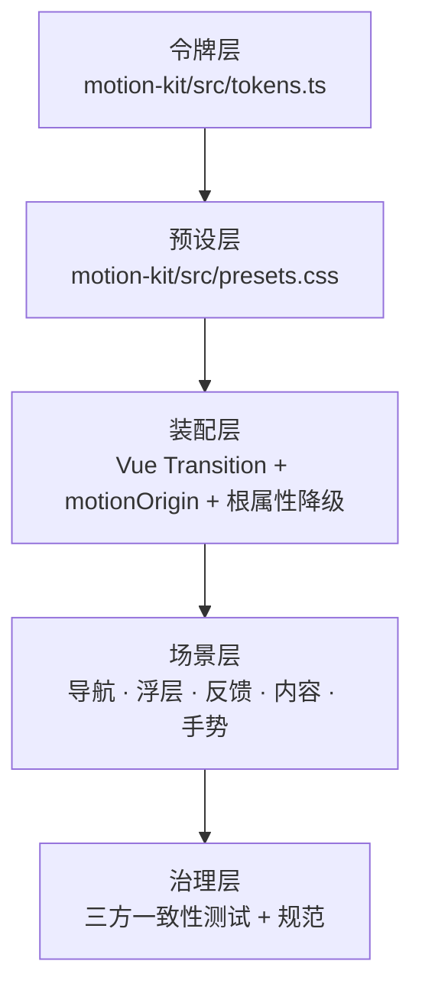

# 产品域动效机制 · 设计

> 2026-10-29 · 范围：`apps/tauri` 产品域（首页 + 工作台），不含 `dsh/` Agent 面
> 结论先行：修复并接管 `motion-kit`，建立「令牌 → 预设 → 装配 → 场景 → 治理」五层；首批覆盖骨架场景（浮层 / 导航 / 侧栏 / 详情 / 内容），芽内业务浮层后续按批接入。

## 一、背景与目标

界面存在大量分布：导航、侧栏、弹层、抽屉、菜单、详情、列表。当前动效实现分散，部分区域有动画、部分区域硬切，且存在「声明了过渡名但没有样式」的静默失效。

目标：

1. 消除界面变化的硬切，让进出场有连续感；
2. 动效可被统一管理与降级（全局减弱 / 分组开关）；
3. 场景化规范替代逐组件手写，避免再次漂移；
4. 保持克制：服务反馈与空间关系，不喧宾夺主。

非目标：

- 不改 dsh Agent 面；
- 不改画布内节点动画（图谱 / 导图 / 白板已有自己的帧循环）；
- 不改形象图动作序列（`MotionEditor` / `MotionStage`）；
- 不做表格行的虚拟滚动动画；
- 不引入动画库。

## 二、现状取证

### 2.1 界面骨架

| 层 | 现状 |
|---|---|
| 表面 | `home` 与 `workspace` 双表面，工作台常驻 `v-show`，首页按需 `v-if`（`ShellSurface.vue:22`） |
| 侧栏 | 7 种形态：flat+滚轮、flat、split、popover、rail、tabs、dual（`SidebarHost.vue:1`） |
| 视图 | 30 个注册视图 / 41 个芽目录；视图切换为 `<component :is>` + key 重挂载（`ViewContainer.vue:21`） |
| 详情 | 5 种载体：抽屉 / 栏式 / 居中弹层 / 沉浸页 / 浮层小窗（`carriers.ts:69`） |
| 浮层 | Toast、确认、询问、通用对话框、设置、全局搜索、快捷键帮助、撤销历史、插件 OverlayHost |

### 2.2 已有动效资产

| 资产 | 位置 | 状态 |
|---|---|---|
| 设计令牌 | `theme.css:103` | `--ease` / `--ease-out` / `--ease-spring`、`--dur-fast/base/lg`、`--press-scale` |
| 降级开关 | `App.vue:17`、`settingsStore.ts:103` | `data-reduce-motion` + 5 组 `data-anim-*` |
| 加载反馈 | `packages/ui-kit/.../loading` | 完整子系统，不动 |
| 组件动效 | `TuiModal` / `TuiDrawer` / `TuiToast` / `TuiSelect` / `TuiButton` | 已有过渡与按压 |
| 详情抽屉 | `EntityDetailPanel.vue:116` | 滑入 0.25s |
| 设置翻卡 | `CardDeck.vue:46` | 0.4s 几何过渡，独立动效域 |
| 侧栏轮盘 | `useSidebarPhysics.ts:1` | RAF + 弹簧物理，独立动效域 |

### 2.3 关键缺陷

`packages/motion-kit` 是半成品：

1. 有 25 个过渡预设名，但**不生成任何 CSS 类**；
2. 全仓 36 处 `<Transition>` 中有 **12 处引用了不存在的类**，实际是瞬切；
3. 令牌双轨：motion-kit 用 `--duration-*` + 50/120/200/350/500ms，产品域用 `--dur-*` + 150/220/320ms；
4. 降级双轨：motion-kit 读系统 `prefers-reduced-motion`，产品域读设置 `data-reduce-motion`；
5. 主应用仅 boot 注入 keyframes，`useTransition` / `useMotion` 零消费。

12 处无样式过渡：

| 预设名 | 使用点 |
|---|---|
| `ws-fade` | `PathPanel`、`TimelinePanel`、`UndoHistoryPanel`、`WelcomeOverlay` |
| `ws-scale-fade` | `MindmapView` ×2、`DialogContainer` |
| `ws-slide-right` | `GraphInspector`、`GraphLegendPanel` |
| `ws-detail-slide` | `CalendarEditorPanel` |
| `ws-detail-backdrop` | `CharacterList`、`CalendarEditorPanel` |

另有 `ws-menu` 在 `ViewToolbar` / `ToolbarOverflow` 各定义一份，需收编。

### 2.4 硬切清单

| 场景 | 现状 | 程度 |
|---|---|---|
| 首页 ↔ 工作台 | `v-show` / `v-if` 瞬时切换 | 高 |
| 视图切换 | key 重挂载，无进场 | 高 |
| 侧栏收起/展开 | `display:none` + margin 瞬变，源码注释明确「无 transition」 | 高 |
| 设置弹窗 | `v-if` 直接出现/消失 | 高 |
| 全局搜索 / 全局编辑菜单 | `v-if` 无过渡 | 高 |
| 右键菜单 | 无过渡 | 高 |
| 详情遮罩 | `v-if` 无淡入 | 中 |
| 列表增删 / 筛选替换 | 无过渡 | 中 |

量化：248 处 CSS `transition`，其中 411 次硬编码 `0.15s`；22 个 `enter-active` 类名；36 处 `<Transition>`。

## 三、拍板记录

| 决策 | 结论 |
|---|---|
| 动效基调 | 克制自然：120–240ms、4–12px 短位移；弹簧只用于按压与 Toast |
| 首批范围 | 骨架场景优先；芽内业务浮层后续按批 |
| 技术路线 | CSS 优先 + WAAPI 补充；零新依赖 |
| 基建落点 | 修复并接管 `motion-kit` |
| 视图切换 | 入场软化：切换立即发生，新视图淡入；不做退出、不延迟 |
| 分组 | 5 组扩为 7 组（新增 `nav` / `content`） |
| 提交与产物 | 每批走查通过后由 Agent 提交并重建 `workspace-dist` |
| 独立动效域 | CardDeck 与侧栏轮盘不纳入统一预设，只做隔离与降级接线 |

## 四、架构



五层职责：

1. 令牌层：时长与缓动的唯一源；CSS 变量名沿用 `--dur-*` / `--ease-*`；
2. 预设层：8 个通用 Transition 预设 + 2 个容器级（`ws-surface` / `ws-view`）的 CSS 实现，含降级分支；TS 预设表与 CSS 一一对应；
3. 装配层：组件只写 `name` 与可选 `--ws-origin`；降级完全由根属性 CSS 接管；
4. 场景层：按五域规定用哪个预设、何时不用；
5. 治理层：测试保证「预设表 ↔ CSS ↔ 使用点」一致。

## 五、令牌

| 令牌 | 值 | 用途 |
|---|---|---|
| `--dur-instant` | 80ms | 菜单/提示退场 |
| `--dur-fast` | 150ms | 微反馈、淡入淡出 |
| `--dur-base` | 220ms | 弹层、抽屉、面板 |
| `--dur-lg` | 320ms | 大面板、页面级 |
| `--ease` | `cubic-bezier(.4,0,.2,1)` | 颜色/透明度 |
| `--ease-out` | `cubic-bezier(0,0,.2,1)` | 进场 |
| `--ease-in` | `cubic-bezier(.4,0,1,1)` | 退场（新增） |
| `--ease-spring` | `cubic-bezier(.34,1.56,.64,1)` | 按压、Toast |

`DURATION_VALUES` / `EASING_VALUES` / `CSS_VAR_DURATION` / `CSS_VAR_EASING` 对齐上表；`theme.css` 增加 `--dur-instant` 与 `--ease-in`。加单测断言两侧一致。

## 六、预设

| 预设 | 语义 | 进场 | 退场 | 变换 |
|---|---|---|---|---|
| `ws-fade` | 遮罩、提示、通用淡入 | 150ms out | 100ms in | 仅透明度 |
| `ws-scale-fade` | 居中弹层、确认、询问、设置、搜索 | 220ms out | 120ms in | `scale(.98)` + `translateY(6px)` |
| `ws-menu` | 下拉菜单、右键菜单、Popover、浮层小窗 | 150ms out | 90ms in | `scale(.96)` + origin |
| `ws-slide-right` | 右侧抽屉 | 220ms out | 180ms in | `translateX(100%)` |
| `ws-slide-left` | 左侧抽屉 | 220ms out | 180ms in | `translateX(-100%)` |
| `ws-slide-up` | 底部 Toast / 面板 | 220ms out | 150ms in | `translateY(8px)` |
| `ws-slide-down` | 顶部面板 | 220ms out | 150ms in | `translateY(-8px)` |
| `ws-list` | 列表项增删 | 150ms out | 100ms in | `translateY(4px)` |
| `ws-view` | 视图切换进场（仅进场） | 160ms out | — | 仅透明度 |
| `ws-surface` | 首页 ↔ 工作台 | 180ms | 180ms | 仅透明度 |

说明：

- 前 8 个为通用 Transition 预设；`ws-view` / `ws-surface` 为容器级，其中 `ws-view` 是 keyframes 动画、`ws-surface` 用于首页层；
- `ws-collapse` 不是 Vue Transition，作为侧栏折叠的 CSS 工具类（宽度 + 透明度）；
- 不使用 transform 的预设在 `.view-content` / `.shell-surface` 等可能包含 fixed 子树的容器上执行；
- `ws-menu` 的 `transform-origin` 读 `--ws-origin`，缺省 `center`；
- 删除一次性命名：`slide`、`pop`、`lightbox`、`g-panel`、`fs-dropdown`、`fpp-*`、`dropdown`、`ws-confirm`、`ws-ask`，统一收编到上表。

CSS 形态示例：

```css
.ws-menu-enter-active,
.ws-menu-leave-active {
  transform-origin: var(--ws-origin, center);
  transition: opacity var(--dur-fast) var(--ease-out),
              transform var(--dur-fast) var(--ease-out);
}
.ws-menu-leave-active {
  transition-duration: var(--dur-instant);
  transition-timing-function: var(--ease-in);
}
.ws-menu-enter-from,
.ws-menu-leave-to {
  opacity: 0;
  transform: scale(0.96);
}
```

## 七、降级

| 开关 | 行为 |
|---|---|
| `data-reduce-motion='on'` | 全部预设只保留透明度淡入（120ms）；`animation` 维持 0.01ms；滚动 `auto` |
| `data-anim-overlays='off'` | 浮层类预设去掉位移/缩放，保留 100ms 淡入 |
| `data-anim-panels='off'` | 面板/侧栏类过渡 `none` |
| `data-anim-nav='off'` | 表面与视图切换无进场 |
| `data-anim-content='off'` | 列表增删无过渡 |
| `data-anim-status='off'` | 脉冲/呼吸动画停止 |
| `data-anim-messages='off'` | 消息类动画停止 |
| `data-anim-splash='off'` | 启动动画停止 |

降级全部写在 `presets.css` 的根属性分支里；组件不再各写一套 `:root[data-anim-*]` 规则。全局减弱优先于分组开关。

## 八、分组

```ts
export const ANIMATION_GROUPS = {
  nav: '导航与视图切换',
  content: '内容增减与重排',
  panels: '面板与侧边栏',
  overlays: '弹窗与浮层',
  status: '状态与脉冲',
  messages: '消息与对话',
  splash: '启动动画',
}
```

`App.vue` 的写入循环已按 `Object.entries` 泛化，新增 key 自动写根属性；设置面板按 `ANIMATION_GROUPS` 渲染，自动多两行。持久化按 key 合并，旧数据兼容。

## 九、场景规范

### A. 导航与空间切换

| 场景 | 规则 |
|---|---|
| 首页 ↔ 工作台 | 首页改绝对定位覆盖层（`inset: 0`），`ws-surface` 180ms 淡入淡出；切到首页时工作台延后 180ms 隐藏；`nav` 关闭或减弱动效时立即隐藏 |
| 视图切换 | 切换立即生效；`.view-content` 容器执行 `ws-view` 仅透明度淡入 160ms；只在 `currentView` 变化时触发，`viewRefreshKey` 刷新不触发 |
| 侧栏收起/展开 | `.sidebar` 宽度 + `.view-container` margin 180ms `ease-out`；`.sidebar-inner` 120ms 透明度；`dragging` 状态禁用过渡 |
| 导航形态切换 | 不纳入首批；避免包裹轮盘容器 |
| 设置分类切换 | 沿用 CardDeck，不叠加 |

硬规则：**不在任何可能包含 `position: fixed` 子树的祖先上加 `transform` / `filter` / `perspective` / `will-change: transform`**。视图与表面切换只用透明度。

### B. 浮层

| 场景 | 预设 |
|---|---|
| Modal / 确认 / 询问 / 通用对话框 / 设置 / 全局搜索 | `ws-scale-fade` |
| 抽屉（TuiDrawer / 详情抽屉） | `ws-slide-*` + 遮罩 `ws-fade` |
| 下拉菜单 / 右键菜单 / Popover | `ws-menu`，`--ws-origin` 指向触发点 |
| Tooltip | `ws-fade` |
| 详情载体 | 抽屉 `ws-slide-right`；居中 `ws-scale-fade`；沉浸 `ws-fade`；浮窗 `ws-menu`；遮罩统一 `ws-fade` |
| Toast | 现有 `ws-toast` 收编为 `ws-slide-up` |

### C. 状态与按压

- TuiButton 已达标；补齐 icon-only、侧栏按钮、卡片按钮的 `scale(.96)`；
- hover / 选中统一 150ms 颜色过渡；
- Loading 子系统不动；
- 状态脉冲归 `status` 组。

### D. 内容增减与重排

- 列表项增删：`ws-list`，只用于首页最近动态、标签、画廊、白板卡片；
- 表格不做行动画（与虚拟滚动冲突）；
- 筛选结果替换：容器 120ms 淡入，不做逐项错峰；
- 拖拽重排（FLIP）：只在大纲白板 / 看板用 WAAPI 220ms，其余后置。

### E. 手势与连续交互

- 侧栏滚轮物理保留；交互期间禁用 CSS 过渡；
- 拖拽、调宽进行中无过渡，松手不做吸附动画；
- 滚动锚点沿用 `smooth` + 减弱动效判断。

### F. 独立动效域（隔离）

| 组件 | 约束 |
|---|---|
| CardDeck | 不包裹 Transition；保留自身 0.4s 几何过渡；只接 `data-anim-panels` / `data-reduce-motion` |
| 侧栏轮盘 | 不包裹 Transition；`dragging` / 物理运行期间禁用折叠与按钮过渡 |

## 十、批次与验收

| 批次 | 内容 | 验收 |
|---|---|---|
| 0 基建 | 令牌对齐、`presets.css`、`motionOrigin`、三方一致性测试、7 分组、全局引入 | 单测绿；现有界面零视觉变化 |
| 1 浮层 | TuiModal / TuiDrawer / TuiToast / TuiSelect、确认 / 询问 / 通用对话框、设置、全局搜索、全局编辑菜单、6 个右键菜单、修复 12 处无样式过渡 | 逐个浮层真机走查 |
| 2 导航与侧栏 | 表面切换、视图切换进场、侧栏折叠 | 重点测帧率与布局 |
| 3 详情与内容 | 5 种详情载体 + 遮罩、首页最近动态、标签、画廊、白板卡片 | 详情进出与列表增删走查 |

每批流程：实现 → `vue-tsc` + `vitest` 全绿 → 重建 `workspace-dist` → 用户真机走查 → 通过后提交 → 开下一批。

## 十一、测试与治理

`packages/motion-kit/src/__tests__/presets.spec.ts`：

1. 预设表每个 name 在 `presets.css` 中存在 `-enter-active` / `-leave-active`；
2. 扫描 `apps/tauri/src`、`packages/ui-kit/src`、`packages/plugin-sdk/src` 的 `<Transition name="...">`，每个 name 必须命中预设表；
3. `tokens.ts` 与 `theme.css` 的时长/缓动值一致；
4. 每个预设存在 `data-reduce-motion='on'` 与对应分组 `off` 的降级规则；
5. 降级规则只允许写在 `presets.css`，组件内既有规则列入存量清单，不新增。

扫描排除 `node_modules`、`dist`、`workspace-dist`、`dsh`。

## 十二、风险与待定

| 风险 | 处置 |
|---|---|
| 侧栏宽度动画可能掉帧 | 走查时用 DevTools 测；掉帧则退化为「内容淡出 + 宽度瞬变」 |
| 视图动画误触发 | 只在 `currentView` 变化时触发，监听 `viewRefreshKey` 不触发 |
| 首页覆盖层遮挡标题栏或拦截点击 | `inset: 0` 置于 `.shell-content` 内，标题栏外；离场 `pointer-events: none` |
| 祖先 transform 破坏 fixed 子元素 | 硬规则：导航/表面只动透明度 |
| `data-reduce-motion` 全局 0.01ms 吞掉淡入 | `presets.css` 用更高特异性覆盖为 120ms 透明度 |
| 分组新增影响设置面 | 自动渲染两行；走查确认文案与顺序 |
| 系统 `prefers-reduced-motion` 未与设置合并 | 待定；首批沿用设置开关，后续评估 |
| 芽内业务浮层未覆盖 | 明确不在首批；第 2 批按芽接入 |

## 十三、文件落点

```
packages/motion-kit/
├── src/tokens.ts                 # 令牌唯一源
├── src/transitions.ts            # 预设元数据（8 个通用 + 2 个容器级）
├── src/presets.css               # 预设 CSS + 降级
├── src/motionOrigin.ts           # transform-origin 计算（纯函数）
├── src/index.ts                  # 导出更新
└── src/__tests__/presets.spec.ts # 三方一致性

apps/tauri/src/main.ts            # import presets.css
apps/tauri/src/styles/theme.css   # 增加 --dur-instant / --ease-in
apps/tauri/src/App.vue            # 7 分组根属性（循环已泛化，无需改）
packages/entity-core/src/stores/settingsStore.ts  # ANIMATION_GROUPS 扩为 7 组
```

## 十四、附录：现状使用点

- 12 处无样式过渡：见 §2.3；
- `ws-menu` 重复定义：`packages/ui-kit/src/components/layout/ViewToolbar.vue:280`、`apps/tauri/src/components/ui/ToolbarOverflow.vue:102`；
- 已有独立实现待收编：`TuiModal`、`TuiDrawer`、`TuiToast`、`TuiSelect`、`WsConfirmDialog`、`WsAskDialog`、`DialogContainer`、`EntityDetailPanel`、`CalendarEditorPanel`、`CharacterList`、`MindmapView`、`GraphInspector`、`GraphLegendPanel`。
