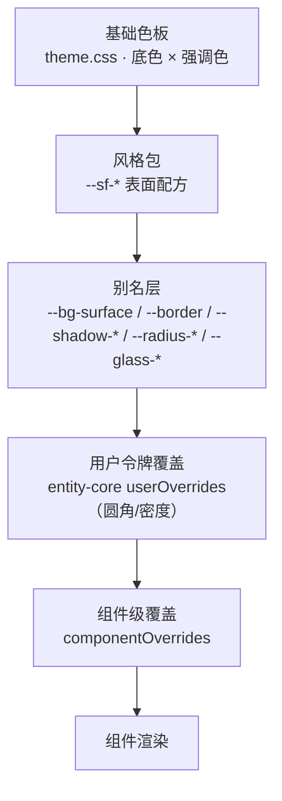

# UI 组件风格机制（产品域）

> 让用户更换整套 UI 组件风格：预置「新拟态 / 柔和液体玻璃 / 雾面（扁液之间）」三套，并支持材质、实体、形变、触感四维微调。
> 仅作用于产品域工作台窗（`/workspace/`），不涉及 dsh。
> 设计已与用户对齐（2026-10-30），施工未开始。

## 一、范围与边界

- **只做产品域**：产品域是独立「工作台窗」（`workspace` 窗，独立 Vite 构建 → `workspace-dist/`），与 dsh 的 `main` 窗同源不同文档，CSS 按文档隔离。风格包只进入产品域入口，不写入壳的 `prefs.json`、不向 dsh 广播。
- **不做**：dsh 界面、壳窗口栏之外的壳层、安装器 UI。
- **不改**：底色 × 强调色两轴（沿用），以及 `entity-core` 已有的用户令牌覆盖 / 组件覆盖引擎。

## 二、决策记录（已定）

| # | 决策点 | 结论 |
|---|---|---|
| 1 | 结构模型 | 预设包 + 四维微调（预设为基底，高级面板可单独覆盖某一维） |
| 2 | 首批范围 | 壳层 + ui-kit 原子 + 高频视图（首页/设置/侧栏/弹层/实体卡/白板卡） |
| 3 | 玻璃性能 | 分级真 blur：浮层/导航/窗口栏真模糊，密集列表伪玻璃 |
| 4 | 触感范围 | 仅视觉触感（按压/回弹/形变），不做音效与外部反馈 |
| 5 | 默认风格 | `mist` 雾面（最接近现状，避免切换突变） |
| 6 | 切换入口 | 外观卡「强调色」之后新增一段「风格」 |
| 7 | 四维微调 UI | 进 ThemeEditor（Quick 模式新增「风格微调」区） |

## 三、概念模型

### 3.1 表面角色（Surface Role）

组件只声明「我在界面里是什么角色」，不写死颜色与阴影；风格包只提供每个角色的「材质配方」。

| 角色 | 覆盖对象 | 主要变量（`--sf-<role>-<prop>`） |
|---|---|---|
| `canvas` | 应用最底层 | bg |
| `chrome` | 窗口栏 / 标题栏 | bg、edge、blur、highlight |
| `nav` | 侧栏 / 导航轨 | bg、edge、shadow、blur |
| `panel` | 区域 / 面板 | bg、edge、edge-strong、shadow、radius |
| `card` | 实体卡 / 内容卡 | bg、bg-hover、edge、shadow、radius、press |
| `control` | 按钮 / 输入 / 分段器 / chip | bg、bg-hover、edge、shadow-inset、radius、press |
| `inset` | 凹陷槽（搜索框 / 进度槽） | bg、shadow-inset、edge |
| `overlay` | 浮层 / 菜单 / 下拉 / 悬浮面板 | bg、edge、shadow、blur、highlight、radius |
| `modal` | 模态 | bg、edge、shadow、blur、radius |
| `toast` | 轻提示 | bg、edge、shadow、blur |
| `tooltip` | 气泡提示 | bg、edge、shadow、radius |
| `table` | 表头 / 行 / 网格 | bg、bg-hover、edge、radius |
| `accent-surface` | 强调面 / 选中态 / 主按钮 | bg、bg-hover、edge、shadow |

每个角色的实际变量集按需裁剪，不要求全量定义。

### 3.2 不可风格化红线

以下内容**永不被风格包改写**，由基础色板直接供给：

- 文字、图标（含链接色）
- 语义色：`danger / success / warning / info`
- 焦点环 `--ring-*`
- 代码块与 Markdown 高亮
- 数据可视化与画布内绘制的品牌色

表格网格、分隔线、滚动条**允许适配**，但必须保留「可读性下限」：文字对比度 ≥ 4.5:1，控件边界 ≥ 3:1。新拟态的低对比风险由此从结构上兜住。

### 3.3 四维

| 维度 | 含义 | 作用点 | 参数 |
|---|---|---|---|
| 材质 | 表面「怎么长出来」 | 底色/边框/模糊/噪点/高光配方 | 0–100，0 = 纯色面，100 = 配方满强度 |
| 实体 | 立体感（solidity） | 阴影与层级模型：靠边还是靠影、浮起几级 | 0–3，0 = 贴底无影 |
| 形变 | 形状对状态的响应 | 圆角缩放、按压/悬停形变、展开形变 | 0–100，联动 `motion-kit` 的 `--ease-spring`，不另造曲线库 |
| 触感 | 交互时的物理反馈 | 压缩、内阴影位移、回弹时长 | 0–100，0 = 无反馈 |

四维是**全局乘数**，实现为 `:root` 上的 `--sf-material / --sf-depth / --sf-morph / --sf-tactile` 四个数值变量，配方用 `calc()` 消费。

## 四、分层与优先级



- 风格包同时**定义 `--sf-*`** 并**重指向现有通用令牌**，使存量组件不改代码即可跟随；需要精细控制的组件再直接消费 `--sf-*`。
- 既有 `theme-kit` 的教训：风格包必须有真实消费面与验收，否则重蹈「零消费点退役」。本机制以三批真实界面改造作为消费面。

## 五、三套预设配方骨架

| | `neu` 新拟态·安全版 | `soft-glass` 柔和液体玻璃 | `mist` 雾面（默认） |
|---|---|---|---|
| 表面对底 | 同色系，明度差 ≤ 3% | 半透明 0.55–0.75 | 近不透明 + 极轻渐变 |
| 模糊 | 无 | 18–24px + `saturate(140%)`，仅 tier A | 无或 ≤ 6px |
| 边界 | 无边框，1px 内高光 | 顶部亮边 + 底部暗边 | 1px 实边框定界 |
| 阴影 | 双向外阴影 + 按压内阴影 | 柔和扩散，单级 | 单级、极浅 |
| 圆角基准 | 14–18 | 14–20 | 8–10 |
| 按压 | 下沉 + 内陷 | 轻微压缩 | 只变底色，不形变 |
| 实体默认 | 2 | 2 | 1 |
| 风险 | 对比度 | GPU / 可读性 | 辨识度弱 |

`neu` 额外规则：所有可交互控件保留 1px 描边兜底；表头/表格网格使用「结构下限」材质，不参与双阴影。

## 六、运行时设计

### 6.1 包结构

新建 `packages/style-kit/`（照 `motion-kit` 范式）：

```
src/
  index.ts              # 导出 useStyle / STYLE_PACKS / 类型
  packs.ts              # 预设注册表（id / label / 描述 / 默认四维值 / 分级）
  styles.css            # 单一引入口：@import base.css + 三套预设
  presets/base.css      # 角色变量声明 + 别名重指向 + 红线保护
  presets/mist.css
  presets/soft-glass.css
  presets/neu.css
  composables/useStyle.ts
  __tests__/packs.spec.ts
```

- CSS 选择器：`html[data-style="mist|soft-glass|neu"]`，缺省回退 `mist`。
- 引入顺序（`apps/tauri/src/main.ts`）：`theme.css` → `web-tokens-bridge.css` → `@worldsea/style-kit/styles.css` → `motion-kit/presets.css`。桥接层之后引入，保证风格包能覆盖同名变量。
- 新增 alias：`@worldsea/style-kit$`。

### 6.2 切换与持久化

- `useStyle()`：`styleId`（预设 id）+ 四维覆盖值；写入 `localStorage`，键位沿用现有 `worldsea_*` 惯例：
  - `worldsea_ui_style`（预设 id）
  - `worldsea_ui_style_axes`（JSON：四维覆盖，缺省键 = 跟随预设）
- 应用方式：`document.documentElement.dataset.style` + `style.setProperty('--sf-*', ...)`。
- 防闪：`apps/tauri/workspace/index.html` 内联脚本在挂载前读 `data-style`（与主题防闪脚本同段）；四维覆盖在启动后应用，高级用户可能有极短闪烁，接受。
- 不进壳 `prefs.json`、不广播 dsh。

### 6.3 契约测试

- 每个预设必须定义「角色清单」中的全部必需变量，缺一即测试失败。
- 变量值禁止出现 `!important`、禁止引用 `data-theme` 之外的选择器。
- 红线变量（文字/语义色/焦点环）不得出现在任何预设文件中。

## 七、性能与降级

| 层级 | 表面 | 材质策略 |
|---|---|---|
| tier A | 浮层 / 模态 / 导航 / 窗口栏 | 真 `backdrop-filter` |
| tier B | 卡片 / 面板 / 表格 | 伪玻璃（渐变 + 半透明 + 高光边框） |
| tier C | 画布 / 白板 | 不透明，零模糊 |

- 现有 37 处 `backdrop-filter` 在 B3 批次统一收编为 `--sf-*-blur`，禁止绕过角色直接写。
- 设置「性能模式」开关：一键把 tier A 降为伪玻璃，持久化；开关放在外观卡「风格」段内（预设卡下方）。
- 尊重 `prefers-reduced-transparency`（支持面有限，仍以手动开关为主）。

## 八、适配与门禁

### 8.1 一致性门禁

新增 `scripts/style-conformance/`：

- 扫描 `packages/ui-kit/src`、`apps/tauri/src`（`world/`、`ui/`、`components/`、`shell/`）的 `<style>` 块与独立 CSS。
- 禁止新增：`#hex`、`rgb()/rgba()`、直接 `box-shadow:`、直接 `backdrop-filter:`。
- 白名单放行：数据可视化、画布/白板绘制、品牌资产、Markdown/代码高亮、`iconPacks` 生成物。
- 基线文件记录存量计数，只许降不许升；每批 burn down 一部分。
- 挂入现有门禁链（与 `arch:check` 并列），命名 `style:check`。

### 8.2 存量硬编码现状（基线）

- `packages/ui-kit/src`：269 处 hex/rgba、55 处 `box-shadow`、2 个 CSS 文件。
- `apps/tauri/src`：492 处 hex、163 处 rgba、37 处 `backdrop-filter`。
- 令牌覆盖不均：`--bg-surface` 仅 16 个文件使用，`--radius-*` 208 个，`--border*` 142 个，`--shadow-*` 47 个。→ 纯令牌换肤不可行，必须走契约 + 分批适配。

## 九、批次计划

### B1 · 契约与开关（不改观感）

- 新建 `packages/style-kit`：角色变量、三套预设 CSS、`useStyle`、契约测试。
- `main.ts` 引入、`workspace/index.html` 防闪、alias 登记。
- ui-kit 原子组件适配（TuiButton、输入、分段器、chip、Tooltip、Toast）。
- 外观卡新增「风格」段：三张预设卡 + 「微调」按钮。
- ThemeEditor Quick 新增「风格微调」区（四维滑杆 + 跟随预设 + 重置）。
- 门禁脚本与基线建立。
- **验收**：默认 `mist` 下界面观感与现状基本一致（允许极小差异）；切换 `neu`/`soft-glass` 时 ui-kit 原子正确变化。

### B2 · 壳层与高频视图

- 窗口栏、侧栏/导航轨、设置弹层、首页、浮层/模态/Toast/Tooltip。
- **验收**：三套风格 × 明暗 的关键屏截图对照；导航与弹层在三套下均可读、可点。

### B3 · 卡片与表格 + 性能收编

- 实体卡、白板容器卡片、表格、区标题栏。
- 37 处 `backdrop-filter` 收编；性能模式开关。
- **验收**：白板滚动与弹层叠加无掉帧；门禁存量下降。

每批流程：`vue-tsc --noEmit` 0 错误 → vitest → `workspace-dist` 重建 → 用户真机走查 → 归档。

## 十、验收清单

- [ ] 三套预设 × 明暗，关键屏（首页/设置/白板/实体卡/弹层）截图对照
- [ ] 四维微调在 ThemeEditor 内可调、可重置、重启后保持
- [ ] 文字对比度 ≥ 4.5:1，控件边界 ≥ 3:1（新拟态重点抽查）
- [ ] `style:check` 存量不增长
- [ ] dsh 窗样式零变化（反证：切风格后 dsh 页面截图不变）
- [ ] 性能模式生效，白板滚动无掉帧

## 十一、风险与挂账

| # | 风险 | 处置 |
|---|---|---|
| 1 | 新拟态对比度不达标 | 安全版配方 + 红线 + 结构下限材质；走查重点项 |
| 2 | WebView2 多层 blur 掉帧 | 分级 + 性能模式；B3 实测后调参 |
| 3 | 103 个文件硬编码阴影，首批后仍不齐 | 门禁锁死新增，存量按视图分批 burn down，不承诺首批全量 |
| 4 | 与用户令牌覆盖（圆角/密度）优先级冲突 | 显式层级；ThemeEditor 内提供「重置本区」 |
| 5 | 多 Agent 并行共改 `docs/index` 与共享组件 | 只提交自己路径，`git add` 逐路径 |
| 6 | 视觉回归无自动截图基线 | 本轮以人工走查为准，自动截图基线另立项 |
