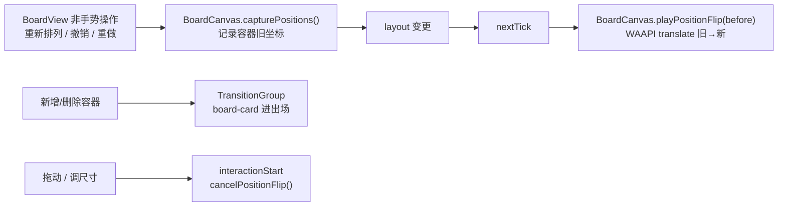

# 画布动效专项 · 设计（白板容器卡片）

> 2026-10-30 · 范围：大纲白板 `outline/board` 的容器卡片
> 结论先行：用 **TransitionGroup 片段**做卡片进出场，用 **数据驱动 FLIP**做区内重排；拖拽、调尺寸、平移缩放期间保持零动画；不新增包裹层、不改布局数据真值。

## 一、背景与目标

动效机制批 3 明确把「白板卡片」列入范围外，原因：白板是 DOM 绝对定位画布，容器由 `layout` 数据驱动，`TransitionGroup` 的 move 过渡会与每帧写坐标的拖拽冲突。

目标：

1. 新增/删除容器卡片有进出场；
2. 区内「重新排列」与撤销/重做导致的位置变化平滑过渡；
3. 选中/悬停反馈不再硬切；
4. 拖拽、调尺寸、平移缩放完全即时，不拖影。

非目标：

- 不改 `layoutSchema` / `useBoardLayout` 的写入口；
- 不做区（Section）与组件行（Component row）的动效；
- 不做图谱/导图/战术棋盘等其它画布；
- 不做手势中的平滑跟随/松手回弹。

## 二、现状取证

| 事实 | 位置 |
|---|---|
| 画布为 DOM 绝对定位 + `.bcv-world` pan/zoom | `BoardCanvas.vue` 模板 / `worldStyle` |
| 容器/区由 `layout.containers` / `layout.sections` 的 `v-for` 渲染 | `BoardCanvas.vue:58` 附近 |
| 容器是 `position:absolute`，位置来自 `container.pos`，尺寸来自 `container.size` | `BoardContainerView.vue:180` `boxStyle` |
| 拖拽/调尺寸每帧写布局 | `BoardCanvas.vue` `onContainerPointerMove` / `onResizePointerMove` |
| 区内重排是纯函数，但按每次 pointermove 调用 | `useBoardLayout.resizeSection` + `arrangeSectionInLayout` |
| 白板目前只有零散的 hover/opacity 过渡 | 本目录 grep：4 处 `transition`，无 FLIP/WAAPI |
| `TransitionGroup` 无 `tag` 时渲染 Fragment（无包裹元素） | Vue 3.5 `runtime-dom` `tag || Fragment` |

## 三、已拍板取向

| 决策 | 结论 |
|---|---|
| 范围 | 只做白板容器卡片 |
| 重点交互 | 新增/删除卡片、区内自动重排、撤销/重做重排、选中/悬停反馈 |
| 动效强度 | 克制自然：150ms 进场 / 80ms 离场，淡入 + `scale(.96)`；重排 220ms `ease-out` |
| 手势期间 | 完全即时，不做平滑跟随/回弹 |
| 实现路线 | TransitionGroup 片段 + 数据驱动 FLIP（方案 A） |

## 四、架构



| 层 | 落点 | 职责 |
|---|---|---|
| 进出场 | `BoardCanvas.vue` → `<TransitionGroup name="board-card">`；类样式在 `board-motion.css` | 容器卡片淡入/缩放、淡出/缩放 |
| 重排 | 新增 `composables/useBoardFlip.ts` | 记录旧坐标与 WAAPI 平移 |
| 编排 | `BoardView.vue` | 在重新排列/撤销/重做前后 capture/play；手势开始 cancel |
| 反馈 | `BoardContainerView.vue` | 选中/悬停边框、阴影过渡 |
| 降级 | 根属性 `data-anim-content` / `data-reduce-motion` | 卡片动效关闭 |

## 五、卡片进出场

`BoardCanvas` 的容器列表：

```vue
<TransitionGroup name="board-card">
  <BoardContainerView v-for="c in layout.containers" :key="c.id" ... />
</TransitionGroup>
```

CSS 放在新建的 `board/board-motion.css`（由 BoardCanvas import，全局类名唯一，避免 scoped 作用域落到子组件根节点的歧义）：

```css
.board-card-enter-active { transition: opacity var(--dur-fast) var(--ease-out), transform var(--dur-fast) var(--ease-out); }
.board-card-leave-active { transition: opacity var(--dur-instant) var(--ease-in), transform var(--dur-instant) var(--ease-in); pointer-events: none; z-index: 20; }
.board-card-enter-from,
.board-card-leave-to { opacity: 0; transform: scale(0.96); }
/* 拖拽每帧写坐标，move 过渡会拖影；显式禁用 */
.board-card-move { transition: none; }
:root[data-anim-content='off'] .board-card-enter-active,
:root[data-anim-content='off'] .board-card-leave-active,
:root[data-reduce-motion='on'] .board-card-enter-active,
:root[data-reduce-motion='on'] .board-card-leave-active { transition: none; }
```

说明：

- 不定义 `board-card-move` 过渡；拖拽每帧写坐标，move 过渡会拖影；
- 离场卡片仍在 DOM 80ms，`pointer-events:none` 防止误交互；
- 新卡片（无旧坐标）不参与 FLIP，由进场动画负责。

## 六、区内重排 FLIP

### 6.1 API

`composables/useBoardFlip.ts`：

```ts
export interface BoardPoint { x: number; y: number }
export interface FlipDelta { id: string; dx: number; dy: number }

/** 纯函数：对比前后坐标，返回需要平移的容器 */
export function flipDeltas(
  before: Map<string, BoardPoint>,
  after: Map<string, BoardPoint>,
): FlipDelta[]

export function useBoardFlip(root: Ref<HTMLElement | null>) {
  capture(layout: OutlineBoardLayout): Map<string, BoardPoint>
  play(before: Map<string, BoardPoint>, layout: OutlineBoardLayout): void
  cancel(): void
}
```

- `play` 在调用方 `nextTick` 后执行；
- 逐卡查询 `[data-board-container-id="<id>"]`；
- 位移非零才动画：WAAPI `translate(dx,dy) → none`，220ms `cubic-bezier(0,0,.2,1)`（取 `DURATION_VALUES.normal` / `EASING_VALUES.out`，与令牌同源）；
- 同一元素新动画前取消旧动画，避免 transform 叠加；
- `data-anim-content='off'` 或 `data-reduce-motion='on'` 时直接返回；
- `cancel` 取消当前所有 FLIP 动画并清空记录。

### 6.2 触发点

| 触发 | 处理 |
|---|---|
| 区内「重新排列」`onRearrangeSection` | capture → `layoutApi.rearrangeSection` → nextTick → play |
| 撤销 `onUndo` | capture → `await undo` → nextTick → play |
| 重做 `onRedo` | capture → `await redo` → nextTick → play |
| 未来 `setSectionArrange` 接线 | 复用同一 capture/play 包装 |
| 拖动/调尺寸/平移缩放 | **不调用**；`onInteractionStart` 只调用 cancel |

`BoardView` 只新增两个小包装（`flipLayoutChange` / `flipAsyncLayoutChange`）与 `onInteractionStart` 的 cancel，逻辑全部在 composable，避免继续膨胀 1228 行的 BoardView。

### 6.3 坐标系

FLIP 用 `layout` 的世界坐标算 `dx/dy`，在 `.bcv-world` 内部做 translate；`pan/zoom` 由父级 transform 统一缩放，不需要屏幕坐标换算。

## 七、选中 / 悬停反馈

`BoardContainerView.vue`：

```css
.bc {
  transition: border-color var(--dur-fast) var(--ease), box-shadow var(--dur-fast) var(--ease);
}
.bc:hover:not(.bc--selected):not(.bc--dangling) {
  border-color: var(--border-strong);
}
```

- 只动颜色/阴影，不动位置/尺寸；
- 选中/悬停反馈不属于「内容增减」，只受全局减弱动效影响（`data-reduce-motion` 的 0.01ms 规则接管）。

## 八、降级

| 开关 | 行为 |
|---|---|
| `data-anim-content='off'` | 卡片进出场与 FLIP 全部跳过（瞬时）；选中/悬停保留 |
| `data-reduce-motion='on'` | 卡片进出场与 FLIP 跳过；选中/悬停由全局规则近瞬移 |
| 手势期间 | 无过渡、无 FLIP；只在非手势路径播 |

## 九、测试

| 测试 | 内容 |
|---|---|
| `flipDeltas` 纯函数 | 移动 / 不变 / 新增 / 删除四类 |
| `useBoardFlip` | content off / reduce on 不调用 `animate`；`cancel` 取消旧动画 |
| 静态契约 | BoardCanvas 使用 `board-card` TransitionGroup；BoardView 在重排/撤销/重做调用 capture/play；BoardContainerView 带 `data-board-container-id` 与边框过渡 |
| 既有回归 | 白板现有测试全绿；`vue-tsc` 0；`workspace-dist` 重建 |

## 十、真机走查

1. 双击空白新建 / 右栏拖入 → 卡片淡入缩放；
2. 移除容器 / 删区连容器 / 删节点 → 卡片淡出；
3. 区内「重新排列」→ 容器平移重排；
4. 撤销 / 重做重排 → 位置平滑；
5. 拖拽 / 调尺寸 / 平移缩放 → 完全即时、无拖影；
6. 重排动画中点选拖动 → 动画取消、拖拽跟手；
7. 关闭「内容增减与重排」/ 减弱动效 → 全部瞬变；
8. 30+ 容器重排 → 无可感知掉帧；若掉帧，降级为只做进出场，不做 FLIP。

## 十一、风险

| 风险 | 处置 |
|---|---|
| TransitionGroup Fragment 与绝对定位 | 已核对 Vue 3.5 `tag || Fragment`；无包裹层 |
| 离场卡片仍在 DOM | `pointer-events:none`；FLIP 只遍历当前 `layout.containers` |
| 多容器 WAAPI 开销 | 走查实测；必要时限制同时动画数量或降级为进出场 |
| BoardView 已超冻结线 | 只加包装函数，逻辑进 `useBoardFlip` |
| 进场缩放与 FLIP 叠加 | 新卡片无旧坐标，跳过 FLIP |
| 手势打断 FLIP | `interactionStart` 调用 `cancel()` |
| 撤销/重做同时改变视口 | 当前快照只含 layout/hierarchy；若未来加入视口，跳过该次 FLIP |

## 十二、文件落点

```
apps/tauri/src/world/plugins/outline/board/
├── composables/useBoardFlip.ts          # capture / play / cancel + flipDeltas
├── board-motion.css                     # board-card 进出场 + 根属性降级
├── components/BoardCanvas.vue           # TransitionGroup + import CSS + expose capture/play/cancel
├── components/BoardContainerView.vue    # data-board-container-id + 边框过渡
├── BoardView.vue                        # 重排/撤销/重做包装 + interactionStart cancel
└── __tests__/useBoardFlip.spec.ts       # 纯函数与降级测试
```

## 十三、未覆盖

- 区（Section）进出场；
- 组件行（Component row）增删/排序；
- 拖动中平滑跟随、松手回弹；
- 图谱 / 导图 / 战术棋盘。
