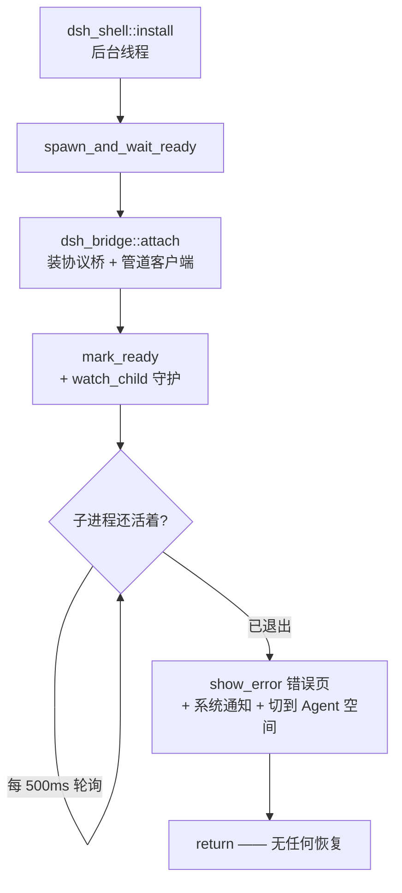
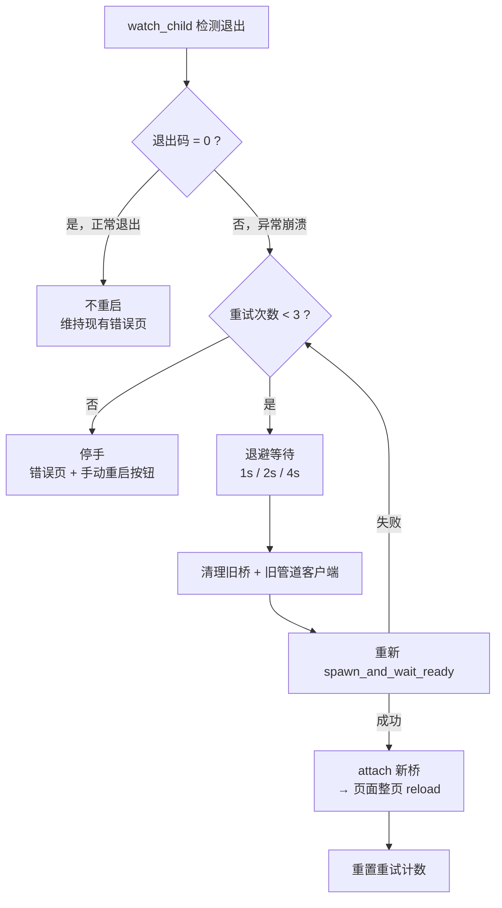

# 宿主崩溃自愈批计划（2026-11-04）

> **结论**：宿主（dsh 子进程）异常退出后，壳自动重启它并让页面自动恢复，替代当前的「一句错误页 + 请手动重启应用」。
> 用户裁定（2026-11-04）：**① 退避重试最多 3 次 ② 整页 reload ③ 保留手动重启入口**。
> **施工完成（1c7d310），待真机走查**。

## 一、动机

真机已实测一次完整事故（wallpaper-engine 插件触发 `pipe(res)` 崩溃）：

```
插件 stream.pipe(res)
  → 合成 res 缺 removeListener（已在 6facfac 修复）
  → TypeError → installFailLoud 捕获 → process.exit(1)
  → 管道断开 → 全站 502
  → 页面「dsh 已退出，请退出应用后重新启动以恢复」
```

崩溃本身已修，但**没有任何恢复手段**——这是本次要补的缺口。

### 官方有什么、没有什么（已核实源码）

官方有 `installFailLoud`（`packages/boot/app-boot/src/index.ts:884`，由
`apps/cli/src/profile-boot.ts:309` 安装）：

| 能力 | 官方 | 说明 |
|---|---|---|
| 捕获 uncaughtException / unhandledRejection | ✅ | 任意时刻 |
| 写带标签的 stderr 诊断 | ✅ | `util.inspect`，含 code/syscall/path/cause 链 |
| 等 release 钩子清理（2s 上限） | ✅ | dispose 整个 app fiber |
| **定位是哪个插件** | ❌ | 只打印原始错误 |
| **写崩溃报告到文件** | ❌ | 只有**启动失败**才写 `startup-*.log`（`apps/cli/src/startup-diagnostics.ts:59`） |
| **自动重启** | ❌ | 直接 `exit(1)` |
| **停止/卸载问题插件** | ❌ | 无 |

> **结论**：官方设计就是「fail loud（大声失败）而非自愈」。Electron 桌面端同样会死，只是用户关掉重开即可；
> 我们的壳没有等价托管，表现为「无操作」——这是**壳的集成缺口**，不是 dsh 缺陷。

## 二、现状链路



关键代码位置：

| 位置 | 现状 |
|---|---|
| `dsh_shell.rs:349` `watch_child` | 注释写明「首期不加自动重启，保留证据」 |
| `dsh_shell.rs:357` `has_exited()` | 只判「活着/死了」，**丢弃退出码** |
| `dsh_shell.rs:317` `app_handle.manage(DshProcess::new(child))` | 句柄托管后无法替换 |
| `dsh_bridge::attach` | 一次性装配，`DshBridge` 状态无法热替换 |
| `dsh_ready.rs` | 状态机**单向推进**，明确拒绝回退 |

## 三、设计

### 3.1 总览



### 3.2 三个已拍板的决策

| 决策 | 选定 | 实现要点 |
|---|---|---|
| 重启策略 | **退避重试，最多 3 次** | 1s / 2s / 4s；防崩溃循环烧 CPU |
| 页面恢复 | **整页 reload** | 最可靠；宿主已死时页面本也废了 |
| 手动兜底 | **保留重启按钮** | 自动耗尽后显示，点击手动重试 |

### 3.3 退出码语义

`has_exited()` 当前丢弃退出码，必须改为返回 `Option<ExitStatus>`：

| 退出码 | 含义 | 处置 |
|---|---|---|
| `None` | 仍活着 | 继续轮询 |
| `Some(0)` | 正常退出（用户关停 / SIGTERM） | **不重启**，维持现有错误页 |
| `Some(n≠0)` | 异常崩溃 | 触发重启链 |
| `shutting_down = true` | 应用正在关停 | 不重启（现有逻辑已覆盖） |

### 3.4 为什么必须「整页 reload」而不是「仅重连 transport」

宿主重启后 `__DSH_BOOT__`（启动图 / release / token）全部变了。页面里已加载的 client bundle
仍指向旧宿主的路由与 revision，`client-modules` 的 `ReleaseChangeGate` 会因 release 不匹配
而**拒绝应用新图**（`packages/client/modules/src/client/release-change.ts:64`）——这正是
「图变了但页面不应用」的既有语义。重连 transport 无法绕过它，只有 reload 才能拿到新 boot 图。

> 这条不是选择，是**约束**：整页 reload 是唯一可靠路径。

### 3.5 重启时的资源清理

| 资源 | 处置 |
|---|---|
| 旧管道路径 | 每次 spawn 用 `generate_pipe_path()` 生成**新路径**（含时间戳，天然不冲突）→ 无需清理 |
| 旧 `PipeClient` | 宿主已死，连接自动断开；新 `DshBridge` 装新 client |
| 旧 `DshProcess` 句柄 | 需可替换（`Mutex<Option<Child>>` 已有，直接替换） |
| 旧 `DshBridge` | `app.manage()` 同一类型二次注册会 panic → 需改为**状态可替换**（见 §3.6） |
| `dsh_ready` 状态 | 单向推进，需新增「可回退到 pending」的受控入口 |

### 3.6 `DshBridge` 热替换

Tauri `app.manage(T)` 对同一类型重复调用会 panic。两条路：

| 方案 | 做法 | 取舍 |
|---|---|---|
| **甲（推荐）** | `DshBridge` 内部状态改为 `RwLock<Option<Inner>>`，`attach` 时整体替换 | 改动集中在 `dsh_bridge.rs`，调用方签名不变 |
| 乙 | 用 `TypeId` 分层托管（每次重启注册新类型） | 需要动态类型，Tauri 不支持，放弃 |

甲的具体改法：`DshBridge { inner: RwLock<Option<BridgeInner>> }`，`BridgeInner` 持有
`cfg / summary / pipe / relay`。`pipe()` / `call_api()` / `describe()` 读锁取当前值。
重启时 `attach` 覆盖 inner。**只改壳侧，不碰 dsh。**

## 四、施工步骤

1. **`dsh_shell.rs`**：`has_exited()` → `exit_status() -> Option<Option<ExitStatus>>`
   （外层 None = 无句柄/锁失败，内层 None = 仍活着），保留现有语义并暴露退出码。
2. **`dsh_shell.rs`**：新增 `restart_host()`：清理 → 退避 → spawn → attach → reload 页面。
3. **`dsh_shell.rs`**：`watch_child` 改为调用重启链；次数上限 + 退避；耗尽后显示手动按钮。
4. **`dsh_bridge.rs`**：`DshBridge` 内部状态改 `RwLock<Option<Inner>>`，支持热替换。
5. **`dsh_ready.rs`**：新增 `mark_pending()`（仅重启路径调用），供状态机回退。
6. **`dsh_shell_bridge.js` / 错误页**：加「重新启动 Agent 内核」按钮，invoke 新命令
   `cmd_dsh_restart`；`dsh_shell.toml` 白名单 +1 条。
7. **测试**：Rust 单测覆盖退出码判定、退避序列、次数上限；反证「退出码 0 不重启」。

## 五、风险与边界

1. **崩溃循环**：某插件必崩时，3 次退避后停手。这是**刻意的**——无限重启会烧 CPU 且掩盖真因。
2. **页面状态丢失**：整页 reload 丢会话滚动位置、输入框草稿。宿主已死时页面本已不可用，可接受。
3. **重启期间页面空白**：退避等待期显示「正在重启 Agent 内核（第 N 次）」，不让用户误以为卡死。
4. **不根治**：P0 只解决「不断线」。必崩插件仍会崩 3 次——根治要靠 P1（停用/卸载问题插件）。
5. **`DshBridge` 热替换的风险面**：所有读 `app.state::<DshBridge>()` 的调用点（`dsh_proxy` /
   `dsh_gate` / 各 bridge 命令）都要经过 `RwLock`，锁竞争需评估（实际读多写极少，可接受）。
6. **不碰 dsh**：本批纯壳侧，fork 台账条目数不变。

## 六、施工记录（2026-11-04，提交 `1c7d310`）

### 6.1 与计划的偏离（两处，都是施工中发现的硬约束）

**① 手动重启入口从「页面按钮」改为「原生菜单项」**

计划原写「错误页加按钮 + `cmd_dsh_restart`」。施工时查到 Tauri 的
`webview/mod.rs::is_local_url`（2.11.5 第 1698 行）白名单只含 `tauri://`、
`devUrl`/`frontendDist` 相对、以及用户注册的自定义协议——**`data:` URL 不在其中**。
错误页正是 `data:text/html`，页面里 `__TAURI_INTERNALS__` 不存在，任何 `invoke` 都会失败。
故改为原生菜单项「视图 → 重新启动 Agent 内核」（走 `on_menu_event`，不依赖 IPC），
错误页只留文字指引。`cmd_dsh_restart` 一并删除（无调用方）。

**② 两个文件超 400 行，被迫拆分**

施工后 `dsh_shell.rs` 567 行、`dsh_bridge.rs` 452 行，触发 `arch:check`。
按计划 §五.5 的「超 400 行后拆」约定拆为四个文件：

| 文件 | 行数 | 职责 |
|---|---|---|
| `dsh_shell.rs` | 346 | spawn / 就绪探测 / 导航入口 / 守护循环 |
| `dsh_restart.rs` | 246 | `DshProcess` 句柄、退避常量、重启链、手动入口 |
| `dsh_bridge.rs` | 373 | 桥状态（`RwLock` 可热替换）、转发配置、协议处理器 |
| `dsh_nav.rs` | 88 | 页面就绪等待与导航、诊断钩子 |

`DshProcess` 随重启语义一起搬进 `dsh_restart.rs`（它是重启的核心状态），
`dsh_shell.rs` 只 `pub(crate) use` 它。

### 6.2 dsh 侧「最后活动插件」线索（用户要求「顺带埋」）

**做法**：不新增崩溃钩子，而是让既有机制多带一条证据。

- `webserver`：新增只读 `lastActivity()`。`route()` 在**调 handler 之前**记下命中的路由
  （`path` / `kind` / `method` / `url` / 自增序号）。插件路由抛异常时调用点已消失，
  这是唯一能指名插件命名空间的线索。`prefix` 路由报**注册路径**（如 `/wallpaper-engine`）
  而非请求路径，因为要指名的是插件而非资源。
- `installFailLoud`：增第四个可选参数 `activity`，fatal 诊断后补写一行
  `dsh: last route: GET /x → prefix route /wallpaper-engine`。
  供应商抛错被吞掉，绝不替换真正的失败原因。
- `profile-boot`：提供该供应商（读 `app.current?.get('webServer')?.lastActivity()`）。

### 6.3 验证

| 项 | 结果 |
|---|---|
| `cargo test --lib` | **160/160**（原 153 + 新增 7） |
| webserver | **22/22**（新增 `lastActivity` 用例 1 条） |
| app-boot | **83/83** |
| 前端 | **1429 通过 / 1 skip** · typecheck 通过 |
| 四项门禁 | 全过 · 架构 **0 违规** · fork 台账 **15 = 15** |

**新增 7 个 Rust 单测**：退出码 0 判正常 / 退出码 1 判异常 / 运行中报 None /
关停标志抑制检测 / 退避序列递增 / 上限与序列长度一致 / 换句柄清关停标志。

**两处反证已做**：
- `lastActivity`：移除记录逻辑后测试失败，恢复后通过
- 退出码语义：用真实子进程（`cmd /c exit 0` / `exit 1`）验证，非桩数据

### 6.4 真机走查（2026-11-04）

| # | 走查项 | 结果 |
|---|---|---|
| 1 | 正常启停插件不触发重启 | ✅ 通过 |
| 2 | 人为杀宿主 → 自动重启并恢复 | ✅ 通过 |
| 3 | 连续杀 4 次 → 第 3 次后停手 | ✅ 通过 |
| 4 | 错误页「⋯」→ 视图 → 重新启动 Agent 内核 | ❌ **不通过**（见 §6.5） |
| 5 | 崩溃时 stderr 出现 `last route:` | ✅ 通过 |

### 6.5 走查 #4 缺陷与修复（提交 `974f177`）

**现象**：错误页上看不到窗口栏「⋯」，手动重启入口形同不存在。

**根因**：错误页当时走 `data:text/html`，而 Tauri 2.11.5 的 `is_local_url`
（`webview/mod.rs:1698`）白名单**不含 `data:`**。于是那个页面里：

- 没有 `__TAURI_INTERNALS__` → 任何壳命令 `invoke` 都失败
- **拿不到壳注入的窗口栏脚本** → 「⋯」菜单根本不存在

> 这是 §6.1 ① 修「页面按钮不可用」时**漏掉的同一根因的另一半**：当时只换了
> 触发方式（改原生菜单），却没意识到窗口栏本身也依赖注入，而注入发生在协议
> 响应里——`data:` 页收不到。教训：**改载体时要核对「这条链上还有谁依赖注入」**。

**修法**：错误页改由 `worldsea://` 协议伺服（新增 `/shell-error` 路由）：

| 文件 | 改动 |
|---|---|
| `dsh_error.rs` | `show_error` 导航到 `worldsea://localhost/shell-error?title=…&detail=…`；新增 `error_page_response()` 渲染并注入；配套 query 编解码 |
| `dsh_inject.rs` | 新增 `inject_error_page_scripts()`：注入主题常量 + **窗口栏** + 安全网（不注入传输桥/壳桥/dsh 常量——那时宿主不在） |
| `dsh_bridge.rs` | `handle_request` 加 `/shell-error` 分支，**先于桥判定**（宿主未就绪时正是要用它） |
| `dsh_restart.rs` | `show_manual_restart` 改用 `show_error`，不再自建 data URL |

**回归锁**：新增测试 `error_page_is_served_over_the_shell_scheme_with_a_titlebar`，
断言响应 200 + `text/html` + **含窗口栏脚本** + 中文标题正确解码。
反证已做：注释掉注入后测试立即失败并打出「错误页必须注入窗口栏脚本」。
另加 4 个 URL/query 用例（必须是壳协议而非 `data:`、中文与换行往返、参数缺失不失败、
非法转义原样保留）。

**验收**：`cargo test --lib` **165/165** · 四项门禁全过 · 架构 0 违规。
