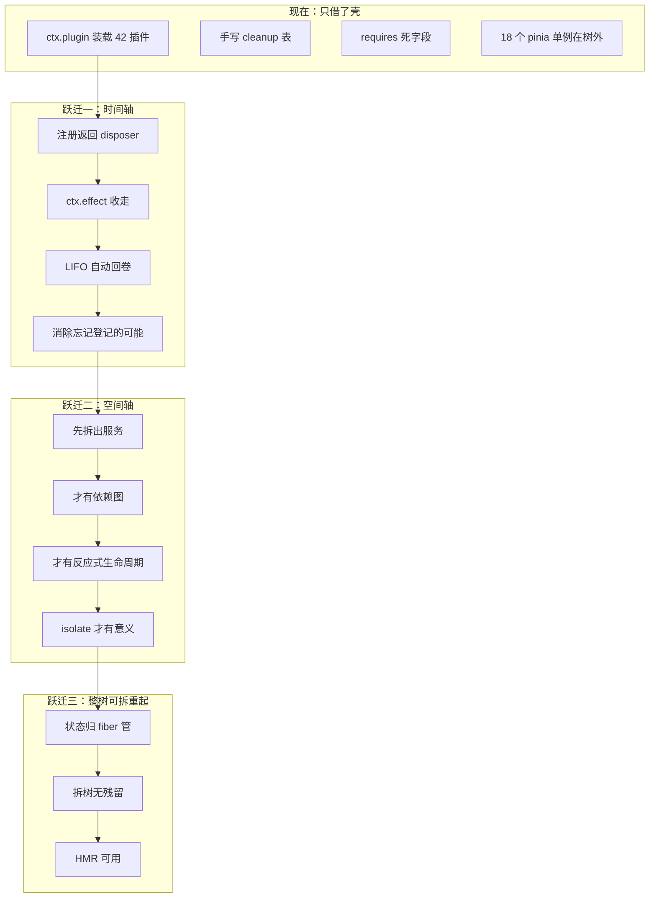

# 产品域 Cordis 成型差距与前置条件

> 建立日期：2026-11-05
> 起因：Cordis「可时空组合性」调研（[留档](../misc/cordis调研-2026-11-05/)）后，追问「产品域侧 Cordis 距 dsh 侧还差多少、要多少前置条件、是否需要重构」。
> 定位：本线**独占当前重心**，其余工作线全停。
> 性质：诊断 + 决策 + 前置条件清单。**不含施工**，施工由后续批计划承接。

---

## 零、用户拍板（2026-11-05）

| # | 决策点 | 裁定 |
|---|---|---|
| 1 | 阶段 1 先做哪个 | **状态归属划分**（决定后面一切） |
| 2 | 阶段 2 迁移策略 | **先迁 3 个试点再推广** |
| 3 | `registerEntityV2/RelationV2/Facet` 的有意不注销 | **加开关**（保留现状为默认，可显式开启真注销） |
| 4 | 能力桥反向事件通道 | **提前到阶段 2** |
| 5 | 树的数量 | **当前维持两棵树**；但用户判断「未来世界语义插件与 Agent 能力插件会互相直接调用」→ **现在就要为直接调用预留形态**（见 §六.5） |
| 6 | 风险处理 | 按 §八 建议处理（含 `vendor/README.md` 版本与同步纪律修正） |

---

## 一、一句话结论

**产品域 Cordis 现在是「借了 Cordis 的壳，没用到 Cordis 的内核」，距 dsh 侧差三次能力跃迁；不需要推倒重来，但要做一次「内核替换」性质的改造，而且最关键的瓶颈不是 Cordis 本身，是「状态归属没划清」。**

---

## 二、现状实证（2026-11-05 实测，非文档转述）

### 2.1 三个决定性数字

| 指标 | 实测 | 含义 |
|---|---|---|
| `ctx.effect` 调用 | **0 处** | 时间轴完全未启用 |
| `ctx.inject` / `ctx.provide` 实际使用 | **2 处**（仅 `tree.ts:169` 提供 `world.info`） | 空间轴只存在于 `ctx.plugin()` 参数里 |
| 42 个插件中声明 `requires` | **0 个** | 依赖声明是死字段 |

与 [芽生态 README](../details/架构/芽生态/README.md):23 的自我诊断一致：「三种依赖声明全部未生效：`manifest.requires` 无任何插件使用；`SproutToggle.dependencies` 与 `manifest.defaultEnabled` 是死字段。」

### 2.2 关键代码证据

`apps/tauri/src/world/registry.ts:22`：

```
/** 插件清理函数登记表（拆树时逐个执行；cordis `effect` 在本版本不保证 disposal 触发，故自持）。 */
```

**这句话是过时判断**——详见 [证伪报告](../misc/cordis调研-2026-11-05/)（`.devtmp/cordis-audit/effect-falsification.md` 已归档至 misc）。

### 2.3 规模数据

| 项 | 数值 |
|---|---|
| `apps/tauri/src/world/` 代码量 | 615 文件 / 76,536 行 |
| 树内插件 | 42 个 |
| `packages/entity-core/` | 160 文件 / 19,481 行 |
| entity-core 的 pinia store | 18 个（全为模块级单例） |
| `pluginAPI` 形态 | `export const pluginAPI = new PluginAPIImpl()`（模块单例） |
| 产品域引用 entity-core 的文件 | 12 个 |

---

## 三、第①项已结论：`ctx.effect` 完全可用（证伪成功）

### 3.1 实测结果

用与产品域 vendor **字节一致**的 cordis 4.1.0（SHA256 `627409AFA…31FE8F`）真跑：

| # | 能力 | 结果 |
|---|---|---|
| T1 | 插件卸载 → effect disposer 触发 | ✅ |
| T2 | 多 disposer 的 LIFO 顺序 | ✅（A,B,C → C,B,A） |
| T3 | 异步 disposer 被 await | ✅ |
| T4 | 注册式 API（`register` 返回 disposer，effect 收走） | ✅ registry 卸载后清空 |
| T5 | `inject` 依赖未满足 → PENDING | ✅ |
| T6 | provider 生灭 → consumer 自动启停 | ✅ |

**T4 证明 dsh 那种写法在现有 vendor 上直接可用；T6 证明空间轴也能跑。**

### 3.2 唯一的真实坑

```
apply 是 async 且有 await
  ↓
dispose() 在 apply settled 之前调用
  ↓
apply 后续注册的 effect 落在已退役 runner → 孤儿，永不触发
```

**修复**（三种已验证）：
1. `await fiber` 再 `await fiber.dispose()`（`fiber` 是 thenable）
2. `apply` 内**先注册 effect 再做慢初始化**（最稳）
3. `ctx.effect(async function*(){ …; yield disposer })`

**注意**：只 `await fiber.dispose()` 不够（它不等待未注册的 effect）。

### 3.3 版本考古

| 时间 | 事件 |
|---|---|
| 2026-09-25 `c5ad81f` | B 批初次 vendor **4.0.4**，`registry.ts:22` 写于此 |
| 2026-11-05 `75973cc` | 升级为 **4.1.0**，注释与 README 未同步 |
| 当前 | 产品域 `lib/index.js` ≡ `dsh/vendor/cordis/lib/index.js`（字节一致） |

**结论：不是 cordis 不行，是注释停留在了旧版本。**

### 3.4 对成本判断的影响

第一次跃迁（时间轴）从「换内核」降级为「改用法 + 退役手写 cleanup 层」——**成本下降一个数量级**。

---

## 四、三次能力跃迁（距 dsh 侧的真实差距）



### 4.1 跃迁一：时间轴（从手写 cleanup 到真 effect）

**现状写法**（`api.ts:55-60`）：

```ts
registerView(view) {
  pluginAPI.withPluginScope(pluginId, () => pluginAPI.registerView(view))
  registerPluginCleanup(pluginId, () => { unregisterViewFor(pluginId, view.id) })  // 作者要记得
}
```

**目标写法**：

```ts
registerView(view) {
  ctx.effect(() => pluginAPI.withPluginScope(pluginId, () => pluginAPI.registerView(view)))
  // registerView 自己返回 disposer，effect 收走
}
```

**差别不在代码量，在于「忘记登记」这个失败模式是否可能存在。**

已知的有意泄漏（`api.ts:67-87`）：`registerEntityV2` / `registerRelationV2` / `registerFacet` 故意无 cleanup（注释：「类型元数据长期可查」）。这属于设计选择，迁移时需逐条裁定，不能一刀切。

### 4.2 跃迁二：空间轴（从死字段到活依赖）

**顺序不可颠倒**：

```
先拆服务 → 才有依赖 → 才有反应式生命周期 → 才有真启停的语义正确性
```

**当前服务目录只有 1 个成员**（`tree.ts:28` `WORLD_SERVICES = ['world.info']`）。没有任何插件有东西可依赖，所以 `requires` 必然是死的。

**硬约束**：只要 entity-core 的 18 个 pinia store 还是模块级单例，`isolate` 就永远用不上——插件间的依赖是通过「共享全局 store」隐式发生的，不走 Cordis。

### 4.3 跃迁三：整树可拆重起且无残留

`disposeWorldTree()` 现在做三件事：跑 cleanup 表 → 拆 fiber → 撤服务。但 pinia store 不归这棵树管——拆树后 `entityStore` 里的实体、`pluginStore` 里的视图仍在。

dsh 侧能 HMR、能崩溃自愈、能整页 reload，是因为**状态全部在 fiber 里**。

---

## 五、前置条件清单（按「不做就永远上不了路」排序）

| # | 前置条件 | 现状 | 卡点 | 优先级 |
|---|---|---|---|---|
| **1** | **状态归属划分**：插件运行态 vs 应用共享态 | ❌ 未定义 | 18 个 pinia store 是共享态，插件当全局变量用。不划清，「拆插件」永远不彻底 | **P0** |
| **2** | **服务目录**：本树提供哪些服务 | ⚠️ 只有 1 个 | 无服务目录 → 无依赖图 → `requires` 永远死 | **P0** |
| **3** | **`ctx.effect` 可用性** | ✅ **已验证可用** | 只需改用法 + 退役手写层 | **P1（已解阻）** |
| **4** | **能力桥反向事件通道** | ❌ 只有 request/response | 见 [D2 触点基线](../details/架构/D2-产品域触点基线.md):60「无反向事件通道」 | **P1** |
| **5** | **目录口径**（写盘落点） | ⚠️ 已拍板「单一可见根」，待施工 | `dsh-运行手册.md:262` 已定：根 = `%USERPROFILE%\WorldSea` | **P1** |

---

## 六、一棵树 vs 两棵树：利弊决策

### 6.1 先看已存在的事实（这改变了整个讨论）

**两棵树并不隔离——dsh 侧已经有 `dsh-plugin-worldsea` 插件穿透进来**：

| 事实 | 证据 |
|---|---|
| dsh 侧已有 17 个 `world_*` 原生工具 | `apps/dsh-plugin-worldsea/README.md:7` |
| 作为「产品域模式」预设的能力组成 | `cordis.patch.yml:18-26` |
| 数据面已同源 | `worlddata/` 透明 JSON，工作台 FileStorageBackend 与 dsh 工具共写 |
| 外部插件可被 dsh 写入并被工作台 ~1s 热装载 | `README.md:25-26` |
| Agent 可直接写插件代码扩展工作台功能 | `world_plugin_write` |

**所以「两棵树」不是「两个孤岛」，而是「两个运行时 + 一条已通车的数据缝」。**

### 6.2 逐项利弊

| 维度 | 两棵树（现状） | 一棵树（方案 B） |
|---|---|---|
| **改动量** | — | 搬 42 插件 + 改 entity-core + 改 12 个引用点 |
| **状态一致性** | 靠 `FsWatcher` + 原子写 + 目录锁保证；跨端同时写有窄窗口未协同（`README.md:46` 已登记） | 天然一致，无跨进程问题 |
| **隔离性** | ✅ 强：世界树崩溃不影响 dsh；dsh 崩溃自愈机制已做完 | ❌ 弱：一棵树挂了就全挂 |
| **Vue 生态** | ✅ 世界树直接用 Vue 组件、`h()`、pinia | ❌ dsh 是 Node 侧，Vue 组件需跨边界 |
| **HMR** | ⚠️ 世界树 `import.meta.hot` 已可用；dsh 侧 HMR 受壳协议限制（SSE 只能回缓冲体） | ❌ 合并后受 dsh 侧限制 |
| **真·一切皆插件** | ❌ 只有「本树内的一切皆插件」 | ✅ 理论最纯 |
| **启动成本** | 两棵树各起一次 | 一棵树，启动更快 |
| **崩溃影响面** | 局部 | 全局 |
| **能力桥必要性** | 必须（跨树通信） | 可退化为普通服务调用 |

### 6.3 判断

**建议维持两棵树（方案 C：保持两棵树但补齐服务化），理由是三条硬约束：**

1. **运行时不同质**：世界树跑在 **webview（Vue + pinia + DOM）**，dsh 树跑在 **Node 进程**。合并意味着要么把 Vue 塞进 Node（不可行），要么把 Cordis 树搬到 webview（则失去 Node 的文件/进程能力）。**这不是架构偏好问题，是运行时物理约束。**

2. **崩溃隔离是真需求**：`2026-11-04-交接-壳与dsh集成线.md:75-99` 记载宿主崩溃后无自愈的惨痛教训，已经补了 P0 自愈机制。合并后这层保护失效。

3. **两棵树已经在正确协作**：数据缝已通车（`worlddata/` 同源 + 能力桥 + 17 个 `world_*` 工具）。**「两棵树 + 一条缝」的形态已经成立且在工作**，合并的收益（理论纯度）远小于代价。

**但要补一个前提**：两棵树的「缝」目前只有 request/response，缺反向事件通道（前置条件 #4）。**修好这条缝，两棵树的价值就完整了；不修，才是真的别扭。**

### 6.4 什么情况下应该改成一棵树

如果未来出现以下任一情况，应重新评估：

- 世界树需要大量调用 dsh 的 Node 能力（文件/进程/subagent），跨树开销成为瓶颈
- 两棵树的服务重复率超过 50%（目前是 0%：世界树 `world.*`，dsh 树 `dsh-*`，命名空间本就分开）
- 需要「世界语义插件」与「Agent 能力插件」互相直接调用（目前只能经能力桥）

### 6.5 ★ 用户判断：未来会互相直接调用 → 现在就要预留形态

**用户 2026-11-05 拍板原话**：「未来应该会互相直接调用，但当前阶段我同意维持两颗树。」

这个判断改变了「两棵树」的性质：它**不是一个稳态终点，而是一个过渡形态**。所以现在的架构选择必须满足两个条件：

1. **不把未来的直接调用堵死**——不能设计成「只能经过能力桥」的硬绑定；
2. **不为了未来的合并今天就付出代价**——不能现在就按一棵树的形态做改造。

#### 具体预留方式（三条，都不增加当前工作量）

| # | 预留点 | 做法 | 为什么现在做 |
|---|---|---|---|
| **P1** | **服务名不绑定传输** | 世界树的服务一律用 `world.*` 命名（已在做），并在 §七 阶段 1 的**服务目录**里显式标注「此服务未来是否需要暴露给 Agent 侧」 | 未来合并时，已标注的服务直接映射；没标注的会变成遗留债 |
| **P2** | **能力桥的调用面与服务名对齐** | 能力 id 与 Cordis 服务名同构（如 `world.views.list` ↔ 服务 `world.views` 的方法 `list`） | 未来若真合并，能力调用可直接退化成 `ctx.get('world.views').list()`，**零改造** |
| **P3** | **不允许「绕过服务直接读 pinia store」的新代码** | 在 §五 前置条件 #1（状态归属）里立规：插件只能经服务访问共享态，不能直接 import store | 这是唯一会**堵死**未来合并的做法——直接耦合 store 的插件，合并时要全部重写 |

**判定线**：如果一个插件把 `useEntityStore()` 直接写进 `apply`，它就把自己钉死在「两棵树」形态上。**P3 是这三条里唯一有强制力的。**

#### 未来真合并时的路径（现在只需知道存在）

```
能力桥调用（invoke → eval → 回执）
  ↓ 若 P2 成立：能力 id ≡ 服务名
直接服务调用（ctx.get('world.views').list()）
  ↓ 若 P3 成立：插件从未直接摸过 store
零插件改造
```

**如果 P3 不成立，未来合并 = 42 个插件全部重写。**

---

## 七、建议路线（三阶段）

| 阶段 | 内容 | 批数 | 产出 |
|---|---|---|---|
| **阶段 0 · 决策与设计**（本计划） | 三次跃迁认知对齐 + 两棵树判决 + 前置条件清单 | 1 | 本文档 |
| **阶段 1 · 地基** | 状态归属划分（文档 + 18 store 定位）+ 服务目录设计 | 1–2 | 两份设计文档，不动代码 |
| **阶段 2 · 内核替换** | 42 插件注册改走 `ctx.effect` + 退役手写 cleanup + 拆 5–8 个服务 | 4–6 | 真时间轴 |
| **阶段 3 · 生态成型** | store 服务化 + 依赖图启用 + 拆树无残留 + 能力桥反向事件 | 8–12 | 真空间轴 |

**不建议跳过阶段 1 直接做阶段 2**——[芽生态 README](../details/架构/芽生态/README.md) 已诊断：27 个芽是「平铺的能力清单，还不是有生态位的系统」。服务目录未定、状态归属未清就上依赖图，只会把「平铺」变成「耦合」。

---

## 八、风险点（需用户决定）

| # | 风险 | 说明 | 建议 |
|---|---|---|---|
| **R1** | `vendor/README.md` 版本号过期 | 写 4.0.4，实际 4.1.0；同步命令 `cp dsh/vendor/cordis/lib/index.js` 违反「产品域不依赖 dsh 目录」的 fork 纪律（虽是开发期手动同步） | 阶段 1 一并修正；考虑改为「记录 upstream SHA + 校验脚本」 |
| **R2** | `registry.ts:22` 过时注释 | 会误导后来者继续走手写 cleanup 路 | 阶段 2 首件修正 |
| **R3** | 异步插件雷 | 当前 42 插件全同步 apply，但一旦引入异步初始化就踩 D 坑 | 阶段 2 写入插件开发纪律 |
| **R4** | entity-core 单例耦合 | 18 个 store 全模块级单例，`isolate` 无法使用 | 阶段 3 才动，需评估是否值得 |
| **R5** | 两棵树缝不完整 | 缺反向事件通道，「Agent 改了数据 → 工作台实时刷新」做不到 | 阶段 3 补，或提前到阶段 2 |

---

## 九、与既有文档的关系

| 文档 | 关系 |
|---|---|
| [现状与冻结面](../details/架构/现状与冻结面.md) | 三层结构（壳/Agent面/产品域）基线，本计划在其上讨论第 3 层内部 |
| [D2-产品域触点基线](../details/架构/D2-产品域触点基线.md) | 触点面全清单，本计划 §五 #4 直接引用其 §四表格 |
| [插件开发纪律](../details/架构/插件开发纪律.md) | 现有纪律，本计划阶段 2 需扩展「effect 用法」章节 |
| [芽生态研究](../details/架构/芽生态/README.md) | 「平铺而非生态」的诊断，本计划 §四 引用 |
| [双Cordis-DA批计划](已完成/2026-09-25-双Cordis-DA批计划.md) | 第二棵树起源，能力桥与视图生命周期的来历 |
| [B-正式化第二棵树批计划](已完成/2026-09-25-B-正式化第二棵树批计划.md) | vendor 决策与清单/装载器形态 |
| [Cordis 调研留档](../misc/cordis调研-2026-11-05/) | 论文核验 + 先例审计 + `ctx.effect` 证伪报告 |

---

## 十、开工前待确认

| # | 待确认 | 选项 |
|---|---|---|
| 1 | 阶段 1 先做状态归属还是服务目录？ | A. 状态归属（我倾向：它决定后面一切）<br>B. 服务目录<br>C. 并行 |
| 2 | 阶段 2 的迁移策略？ | A. 一次性全迁（风险集中）<br>B. 按插件分批（慢但稳，我倾向）<br>C. 先迁 3 个试点再推广 |
| 3 | `registerEntityV2/RelationV2/Facet` 的「有意不注销」是否保留？ | A. 保留（现状）<br>B. 改走 effect 并接受类型注销<br>C. 加开关 |
| 4 | 能力桥反向事件通道是否提前到阶段 2？ | A. 提前（Agent 写数据后工作台实时刷新是高频需求）<br>B. 留到阶段 3 |

**§十 四项的实际裁定**（2026-11-05 拍板）：

| # | 裁定 |
|---|---|
| 1 | **A 状态归属优先**（决定后面一切） |
| 2 | **C 先迁 3 个试点再推广** |
| 3 | **C 加开关**（保留现状为默认，可显式开启真注销） |
| 4 | **A 提前到阶段 2** |

---

## 十一、✅ 收口（2026-11-06）

### 11.1 三阶段实际完成情况

| 阶段 | 计划 | 实际 |
|---|---|---|
| **阶段 0 · 决策与设计** | 1 批 | ✅ 完成（本文档 + [Cordis 调研留档](../misc/cordis调研-2026-11-05/)） |
| **阶段 1 · 地基** | 1–2 批 | ✅ 完成（[1A 状态归属](../../docs/plans/已完成/2026-11-05-阶段1A-状态归属划分.md) + [1B 服务目录](已完成/2026-11-05-阶段1B-服务目录设计.md)） |
| **阶段 2 · 内核替换** | 4–6 批 | ✅ **超额完成**（时间轴 + 空间轴 + 能力桥对齐，共 5 提交） |
| **阶段 3 · 生态成型** | 8–12 批 | 🔄 **已重开**（用户 2026-11-06 拍板选 B；首个试点已落地，见 §十二） |

### 11.2 阶段 2 交付清单

| 提交 | 内容 |
|---|---|
| `6775fb3` | 插件注册走 `ctx.effect` + 拆树回收 root fiber（**时间轴**） |
| `1075924` | 服务目录 7 个服务 + timeline 真实依赖（**空间轴**） |
| `8fcc82e` | 能力桥 12 条改由服务供数（**P2 同构**） |
| `e72e583` / `4290720` / `baa27c9` | 调研留档 + 施工记录 + 收口归档（文档） |

**核心指标达成**：

| 指标 | 改造前 | 改造后 |
|---|---|---|
| `ctx.effect` 调用 | 0 处 | 全部注册路径 |
| 服务目录 | 1 个（`world.info`） | **7 个** |
| `requires` 声明 | 42 插件 **0** 个 | `timeline` 真实使用 |
| 能力经服务供数 | 0 / 12 | **11 / 12**（`project.list` 属壳命令） |
| 拆树回收 root effect | ❌ 泄漏 | ✅ 已回收 |

### 11.3 阶段 3 曾搁置的理由（2026-11-06 已重开，见 §十二）

> **重开说明**：下方判定被证明是**判据选错了对象**。当时用「`apply` 层有没有消费者」来判断，
> 得出「无消费者」；但真正的取数发生在 **Vue 组件层**（40 个插件里 29 个的组件直接 `useXxxStore`）。
> 服务要的不是 `apply` 消费者，而是**组件消费者**。据此重开，首个试点见 §十二。

阶段 3 的内容是「store 服务化 + 依赖图启用 + 拆树无残留 + 能力桥反向事件」。

逐项核实后发现**大部分驱动因素不存在**：

| 项 | 核实结果 |
|---|---|
| store 服务化 | 42 插件 `apply` 里**零**读应用共享态 → 服务化后无消费者 |
| 依赖图启用 | 唯一真实依赖（`timeline`）已落地；其余插件无 `apply` 层依赖可声明 |
| 拆树无残留 | 已由 root fiber dispose + 服务撤除覆盖，测试已锁 |
| 能力桥反向事件 | 现有 `ws-capability-mutated` + FsWatcher 已满足「Agent 改完工作台即见」（真机验证通过） |

**第二级服务（settings/plugins 等 6 个）也一并搁置**：核实发现 dsh 侧的 `world_plugin_*` / `world_schema_*` 工具**直接读文件系统**，不经过产品域 Cordis 树，加服务对它们零影响。

> **注**：上表「依赖图启用」与「第二级服务」两项的结论**仍然成立**（`apply` 层确实无消费者）。
> 被推翻的只是「因此整个阶段 3 都不做」的推论——组件层另有大量消费者。

### 11.4 风险点处理结果

| # | 风险 | 状态 |
|---|---|---|
| R1 | `vendor/README.md` 版本号过期 | ⏸ 未修（仍写 4.0.4）。建议下次同步 vendor 时一并改 |
| R2 | `registry.ts:22` 过时注释 | ✅ **已修**（`6775fb3`，改为「迁移期兼容路径」+ 说明 4.0.4 时代判断） |
| R3 | 异步插件雷 | ✅ **已写入文档**（1A §8.2、证伪报告 §3.2：`await fiber` 后再 dispose 等三种修复） |
| R4 | entity-core 单例耦合 | ⏸ 未动（`isolate` 无需求，见 §11.3） |
| R5 | 两棵树缝不完整 | ✅ **已澄清**（`ws-capability-mutated` + FsWatcher 已覆盖刷新链路，真机验证） |

### 11.5 后续触发条件

本计划不再主动推进。以下情况出现时应重开：

| 触发 | 该做什么 |
|---|---|
| 出现插件需要在 `apply` 里读 settings/plugins 等 | 按 1B §三 清单实现第二级服务 |
| dsh 侧工具想从「读文件」改为「问产品域」 | 那时才需要 `world.plugins` 服务 |
| 需要 `isolate`（同一服务不同插件不同实例） | 那时才需要 store 服务化（R4） |
| 世界语义插件与 Agent 能力插件需互相直接调用 | 评估合并成一棵树（§六.4 / §六.5 的 P3 约束） |

### 11.6 一句话总结

**阶段 2 的目标是「让产品域 Cordis 达到 dsh 侧的高度」——时间轴（可回滚副作用）与空间轴（反应式依赖）都已打通并经真机验证，核心目标达成。** 继续做没有消费者的服务是过度设计，故到此收口。

---

## 十二、🔄 阶段 3 重开（2026-11-06）

### 12.1 判据更正：消费者在组件层，不在 `apply` 层

用户追问「42 个插件分别需要什么类型的消费者」，逐项扫描后得到与 §11.3 不同的事实底单。

**扫描口径**：40 个插件目录（`apps/tauri/src/world/plugins/*`，排除 `__tests__`），逐个读 `index.ts` 与全部 `.vue`/`.ts`。

| 需求类型 | 插件数 | 事实 |
|---|---|---|
| **① 声明式注册** | 40 / 40 | `apply` 只调 `registerEntityV2` / `registerView` / `registerOverlay` / `registerFacet`，**无 if / 循环 / 定时器 / 监听 / await** |
| **② 数据读取** | 29 | 全部在 **Vue 组件**里直连 `useXxxStore`，`apply` 层零读取 |
| **③ 资源持有** | 25 | timer / listener / observer / rAF，全部在组件里由 `onUnmounted` 自回收 |

**结论**：§11.3 用「`apply` 层有没有消费者」判断，得出「无消费者」——**结论对，但推错了范围**。

> **`apply` 层确实没有消费者；但组件层有 29 个。** 服务要的从来不是 `apply` 消费者，
> 而是**取数方消费者**。§11.3 因此只对「依赖图 / 第二级服务」成立，对「store 服务化」不成立。

**`ctx.effect` 那半边不需要推广**：`createPluginApi(id, ctx)` 已让 40 个插件的每次注册自动走 `ctx.effect`，源码零改动——1A §五 S4「向 42 插件推广」中的时间轴部分**早已完成**。

### 12.2 首个试点：`regions`（已落地）

选它的理由：3 文件 / 475 行 / 单组件直连 store，且读的正是服务已覆盖的 `world.entities` + `world.relations`——**最小可行样本，风险可控**。

| 项 | 改造前 | 改造后 |
|---|---|---|
| 取数通道 | `useEntityStore()` / `useRelationStore()` 直连 | `getWorldService('world.entities' / 'world.relations')` |
| 按类型取 | `entities.filter(e => e.type === 'region')` | `byType('region')` |
| 按 id 取 | `entityMap.get(id)` | `get(id)` |
| 全量重载 | `loadAll()` | `reload()` |
| 服务缺席 | —（不适用） | **抛错**（不静默降级，避免「列表莫名是空的」） |

**响应式等价**：服务返回的是 store 的响应式引用（非拷贝），故 `computed` 依赖追踪与直连时一致——这是 1B §十 定下的口径，试点未改。

**新增守卫** `regions/__tests__/regionDataPath.spec.ts`（4 例，源码扫描而非挂载）：不再出现 store 直访 / 确实经 `getWorldService` / 服务缺席抛错 / 重载走 `reload()`。

> 为何用扫描而非挂载：挂载 `GenericEntityView` 需要 pinia + i18n + 图标注册表全链路，造出的替身测的是假路径；扫描直接证明「取数通道」这一架构事实，判别力更强。

**反证 3 轮**（各精准命中后还原）：

| 反证 | 改动 | 结果 |
|---|---|---|
| 1 | 服务名改 `world.entitiesXX` | 「经 getWorldService 取服务」用例红 |
| 2 | 删掉 entities 的缺席守卫 | 「服务缺席时抛错」用例红 |
| 3 | 还原为直连 store（`git stash`） | 4 例全红 |

**门禁**：`world` 129 文件 / 1068 过 + 1 skip · 全仓 **310 文件 / 2305 过 + 1 skip，零失败** · `vue-tsc` 0 · gate 5/5。

### 12.3 剩下的组件层消费者（供后续批次排期）

| 强度 | 插件（store 调用点 / 行数） |
|---|---|
| **重** | `outline` 52 / 13441 · `settings` 40 / 3978 · `manuscript` 28 / 4408 · `notebook` 27 / 5528 · `characters` 19 / 1712 · `timeline` 16 / 9091 |
| **中** | `data-tools` 7 · `buildings` `custom` `languages` `magic` `mindmap` `plants` `species` `weapons` 各 6 · `combat_stats` `culture` `orchestration` 各 5 · `field-matrix` `graph` `theme-editor` 各 4 |
| **轻（已试点/可快速推）** | `regions` 3 ✅ · `organizations` 3 · `codex` `concepts` `drawing` `gallery` `inspiration` 各 2 |

**前置缺口**（推进前需先补，否则只能覆盖一部分）：

| 缺口 | 影响 |
|---|---|
| `world.settings` 服务不存在 | `settings` / `manuscript` / `graph` 等 9 个插件读 settings，无法迁移 |
| 无 store 服务 `world.trash` / `world.ui` / `world.font` 等 | `data-tools` / `mindmap` 等读的 store 无对应服务 |
| `world.entities` 缺 `entityMap` 语义（只能 `get`） | 已够用（`get` 即 Map 查找），但批量场景需确认 |

**故第二级服务（§11.3 搁置的 6 个）现在有了真实消费者**——但应按上面「重」档插件的实际需求逐个补，而不是按清单一次性建齐。

### 12.4 下一步选项

| 选项 | 内容 | 代价 |
|---|---|---|
| **A · 按需补服务** | 先补 `world.settings`（9 个插件要），再推 `organizations` / `codex` 等轻量插件 | 中；服务与迁移交替推进 |
| **B · 先横扫轻档** | 把「轻」档 5 个插件全改成服务（不需要新服务） | 低；但消费者规模小，收益有限 |
| **C · 先做 `settings` 试点** | 单挑最重的 `settings`（40 调用点 / 11 store），一次性验证重度场景 | 高；但能暴露服务目录的真实缺口 |
| **D · 暂缓** | 试点已证明路径可行，等有具体功能需求再推 | 最低 |
