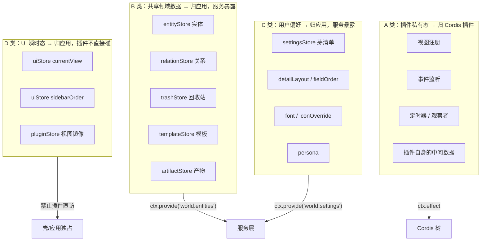
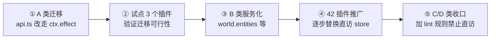

# 阶段 1-A：状态归属划分

> 归属计划：[产品域 Cordis 成型差距与前置条件](2026-11-05-产品域Cordis成型差距与前置条件.md)（用户 2026-11-05 拍板第 1 项「先做状态归属划分」）
> 建立日期：2026-11-05
> 性质：**设计文档，不含施工**。施工由阶段 2 承接。
> 目标：回答一个问题——**哪些状态归 Cordis 树管，哪些归应用管？**

---

## 一、问题陈述

把产品域 Cordis 推向 dsh 侧高度，必须先回答「状态归属」。原因有三：

1. **没有归属划分，就没法判断「拆插件是否彻底」**——拆完 fiber，pinia store 里的东西还在，等于没拆。
2. **没有归属划分，`isolate` 永远用不上**——插件间的依赖是通过共享单例隐式发生的，不走 Cordis。
3. **没有归属划分，未来合并成一棵树时要全部重写**——插件直接摸 store，就无法退化成服务调用（计划 §六.5 的 P3）。

---

## 二、现状实测数据（2026-11-05）

### 2.1 直接 import store 的规模

| store | 直接 import 它的插件文件数 |
|---|---|
| `useEntityStore` | **96** |
| `useRelationStore` | **43** |
| `useSettingsStore` | 14 |
| `useUiStore` | 9 |
| `useDetailLayoutStore` | 6 |
| `useFontStore` / `usePluginStore` / `useIconAssetStore` | 各 4 |
| `useFieldOrderStore` | 3 |
| `useIconOverrideStore` | 2 |
| `useTrashStore` | 1 |

**96 个文件直接 import `useEntityStore`** —— 这是最大的耦合面，也是 P3 要治的对象。

### 2.2 18 个 store 的职责分类

| store | 行数 | 状态性质 | 变化频率 |
|---|---|---|---|
| `entityStore` | 358 | **领域数据**（实体集合）+ 派生索引 | 用户编辑时 |
| `relationStore` | 151 | **领域数据**（关系集合） | 用户编辑时 |
| `trashStore` | 80 | 领域数据（回收站） | 删除时 |
| `templateStore` | 86 | 领域数据（模板） | 低频 |
| `artifactStore` | 194 | 领域数据（产物） | 中频 |
| `settingsStore` | 487 | **用户偏好 + 芽清单** | 设置变更时 |
| `uiStore` | 307 | **UI 瞬时态**（侧栏顺序、当前视图、选中） | 高频 |
| `pluginStore` | 55 | **UI 派生**（视图列表镜像） | 装载/卸载时 |
| `detailLayoutStore` | 146 | 用户偏好（详情布局） | 低频 |
| `fieldOrderStore` | 134 | 用户偏好（字段顺序） | 低频 |
| `fontStore` | 210 | 用户偏好 + 资源 | 低频 |
| `iconAssetStore` | 373 | 领域资源（图标） | 低频 |
| `iconOverrideStore` | 305 | 用户偏好（图标覆盖） | 低频 |
| `fileStore` | 148 | 领域资源（文件） | 中频 |
| `personaStore` | 52 | 用户偏好（人设） | 极低频 |
| `viewVisibility` | 18 | 纯函数判定 | — |
| `sproutPersistence` | — | 持久化适配层 | — |

---

## 三、划分原则（判定线）

我提出**三条判定线**，按顺序套用：

### 判定线 1：生命周期归属

> **状态的生命周期与谁对齐？**

- 与**插件**对齐（插件卸载就该消失）→ **必须归 Cordis**（走 `ctx.effect`）
- 与**项目**对齐（切项目才重建）→ **归应用**，但需插件经服务访问
- 与**应用**对齐（永不消失）→ **归应用**，插件只读或经服务写

### 判定线 2：是否可被多个插件共享

> **多个插件是否需要看到同一份状态？**

- **是** → 归应用，作为**服务 provide 出来**（`ctx.provide('world.entities', ...)`）
- **否**（插件私有的运行态）→ **必须归插件**（走 `ctx.effect`）

### 判定线 3：是否需要隔离

> **不同插件是否需要看到不同的实例？**

- **是** → 用 `ctx.isolate`（前提：状态必须是「服务」而非模块单例）
- **否** → 普通服务即可

---

## 四、归属结论（四类）



### 4.1 A 类：插件私有态 → 必须归 Cordis

**判据**：插件卸载就该消失的一切。

| 项 | 现状 | 目标 |
|---|---|---|
| 视图注册 | `api.registerView` + 手写 cleanup | `ctx.effect(() => pluginAPI.registerView(view))` |
| overlay 注册 | `api.registerOverlay` + 手写 cleanup | 同上 |
| 能力注册 | `api.capabilities.register` + 手写 cleanup | 同上 |
| 事件监听 | 各插件自己 `addEventListener` | 走 `ctx.on()` |
| 定时器 / 观察者 | 各插件自己 `setInterval` / `watch` | 包进 `ctx.effect` 返回 clear |

**这一类的迁移代价最低、收益最高**——它不需要动 entity-core，只改 `api.ts` 和插件内部的注册写法。

### 4.2 B 类：共享领域数据 → 归应用，服务暴露

**判据**：多个插件读同一份数据，且生命周期与项目对齐。

| 服务名 | 背后 store | 暴露面（建议） |
|---|---|---|
| `world.entities` | `entityStore` | `list / get / put / update / delete / search` |
| `world.relations` | `relationStore` | `list / get / put / delete` |
| `world.trash` | `trashStore` | `list / restore / purge` |
| `world.templates` | `templateStore` | 只读 |
| `world.artifacts` | `artifactStore` | 只读 |

**关键设计**：服务暴露的是**方法**，不是 store 本身。插件调 `world.entities.list()`，不调 `useEntityStore().entities`。

**这样做的直接收益**：
- 未来合并成一棵树时，`ctx.get('world.entities').list()` 与原调用完全一致，**零改造**；
- 可以加访问控制（哪些插件能写）；
- 可以做 `isolate`（虽然 B 类大概率不需要）。

### 4.3 C 类：用户偏好 → 归应用，服务暴露

**判据**：跨会话持久、与项目绑定、多个插件可能读。

| 服务名 | 背后 store |
|---|---|
| `world.settings` | `settingsStore`（芽清单 + 主题等） |
| `world.layout` | `detailLayoutStore` + `fieldOrderStore` |
| `world.fonts` | `fontStore` |
| `world.icons` | `iconOverrideStore` + `iconAssetStore` |
| `world.persona` | `personaStore` |

### 4.4 D 类：UI 瞬时态 → 归应用，**插件禁止直接访问**

**判据**：纯 UI 状态，插件的正确做法是「声明意图」，不是「直接改」。

| 项 | 正确做法 |
|---|---|
| `uiStore.currentView` | 插件不切视图；由用户操作或壳指令触发 |
| `uiStore.sidebarOrder` | 插件注册视图后由应用自动排序 |
| `pluginStore.views` | 已有 `viewSync` 单点镜像（D 批已做），插件不碰 |

**这一类是 P3 的核心禁区**——插件碰 UI 瞬时态会让「拆插件」永远不彻底。

---

## 五、执行顺序（阶段 2 的迁移路径）



### 5.1 试点插件选择（3 个）

选择标准：**有状态 + 有依赖 + 规模适中**。

| 试点 | 理由 |
|---|---|
| `mindmap` | 已有 `capabilities.ts`（能力桥已接），有独立 store，规模适中 |
| `outline` | 最大芽之一（15KB index.ts），依赖面广，是压力测试 |
| `field-matrix` | 纯视图芽（`entityTypes: []`），最简单的对照组 |

### 5.2 验收门（对应计划 §七 阶段 2）

| 门 | 内容 |
|---|---|
| **时间轴门** | 3 个试点插件的所有注册走 `ctx.effect`；卸载后无残留（断言 registry 清空） |
| **反证门** | 故意删掉一个 `ctx.effect` 包裹 → 卸载后应残留（证明 effect 在起作用） |
| **服务门** | `world.entities` 等 5 个服务可被 `ctx.get` 取到且方法可用 |
| **回归门** | 既有 1421 个测试全过 |

## 六、与既有文档的关系

| 文档 | 关系 |
|---|---|
| [插件开发纪律](../details/架构/插件开发纪律.md) | 现有纪律的第 2 节「贡献位契约」需补「必须走 effect」；第 4 节「disposal 必测」保留 |
| [芽生态 README](../details/架构/芽生态/README.md) | 其 §二.3「三种依赖声明全部未生效」是本设计的直接输入 |
| [D2-产品域触点基线](../details/架构/D2-产品域触点基线.md) | 能力桥是 dsh ↔ 产品域的通道；本设计的服务层是产品域内部通道，两者正交 |

---

## 七、风险点（需用户决定）

| # | 风险 | 说明 | 建议 |
|---|---|---|---|
| **A1** | 96 个文件直接 import `useEntityStore` | 服务化后需全部改为 `ctx.get('world.entities')` | 分阶段：先提供服务，保留直访为**兼容路径**，新增代码禁止直访 |
| **A2** | 服务层性能开销 | 每次调用多一层 | 服务暴露**引用**而非**拷贝**（`list()` 返回响应式数组），零拷贝 |
| **A3** | `settingsStore` 487 行职责过重 | 芽清单 + 主题 + 动画 + 外部插件… | 服务化时按职责拆成 2–3 个服务 |
| **A4** | D 类禁区需强制 | 光靠文档约束不住 | 阶段 2 加 lint 规则（插件目录内禁止 import `uiStore`/`pluginStore`） |
---

## 八、✅ 施工记录：A 类迁移已落地（2026-11-05）

### 8.1 做了什么

`api.ts` 的 `createPluginApi(id)` 扩为 `createPluginApi(id, ctx?)`，内部新增 `tracked()` 原语：

```ts
function tracked<T>(register: () => T, unregister: () => void): T {
  if (!ctx) {
    const result = register()
    registerPluginCleanup(pluginId, unregister)   // 兼容路径（迁移期）
    return result
  }
  let result!: T
  ctx.effect(() => { result = register(); return unregister })   // 真时间轴
  return result
}
```

- **传 `ctx`**：注册与撤销整体交给 `ctx.effect`，卸载时 LIFO 自动回卷，作者无「忘记登记」的失败模式。
- **不传 `ctx`**：退回 `registerPluginCleanup`，行为与迁移前完全一致（既有测试与未接 ctx 的调用方不受影响）。

`tree.ts:114` 改为 `createPluginApi(id, inner)`，**插件签名 `apply(ctx, api)` 不变**，42 个插件零改动。

### 8.2 一个关键实测：`ctx.effect` 回调是**同步**执行的

这决定了 `tracked()` 能否同步返回注册结果（`registerView` 等返回 `void`，但语义上要求「调用后即刻生效」）：

| 测试 | 结果 |
|---|---|
| `ctx.effect(fn)` 调用后立即读 `fn` 内的赋值 | ✅ 已赋值（同步执行） |
| 插件 `apply` 同步段内 `ctx.effect` 已执行 | ✅ 是（`apply` 返回前） |
| `tracked()` 的返回值可直接使用 | ✅ 是 |

**故 `tracked()` 的 `result` 在同步路径可用，无需 await。**

### 8.3 试点：`official.field-matrix`

- 它是 42 个插件中最干净的形态：单 `registerView`、无 cleanup、`entityTypes: []`。
- **插件源码一行未改**——迁移发生在 `api.ts` 层，这正是设计的意图（插件不必感知）。
- 测试用例按它的**形态**复刻（不 import 真 `.vue`：`FieldMatrixView.vue` 连带重依赖，vitest 并行下超时，见 `tree.spec.ts` 文件头注）。

### 8.4 回归锁（`tree.spec.ts` 新增 4 例，共 11 例全过）

| 用例 | 锁什么 |
|---|---|
| 插件不写 cleanup，卸载后视图仍被回收 | effect 自动回卷生效 |
| 真启停（关/开）走 effect 回卷，视图不进幽灵态 | `setPluginEnabled` 路径 |
| 试点 field-matrix 形态经 effect 注册与回卷 | 试点形态 |
| **注册走 `ctx.effect`：撤销顺序为 LIFO** | **路径判据**（见下） |

### 8.5 反证：为什么需要「LIFO」这条用例

第一轮反证（把 `createPluginApi(id, inner)` 改回 `createPluginApi(id)`）**11 例中 10 例仍通过**——因为旧 cleanup 表路径与 effect 路径在**最终结果**上等价（视图都会被撤）。

**功能测试无法区分两条路径。** 真正的差异是**撤销顺序**：

| 路径 | 顺序 |
|---|---|
| `ctx.effect` | **LIFO**（后注册先撤，`B → A`） |
| `cleanup` 表 | **FIFO**（按登记顺序正序撤，`A → B`） |

于是补了一条以顺序为判据的用例。**第二轮反证**：

```
回退为 createPluginApi(id)
  ↓
× 注册走 ctx.effect：撤销顺序为 LIFO
  → expected [ 'order-a', 'order-b' ] to deeply equal [ 'order-b', 'order-a' ]
```

**恢复后转绿。这条用例是「注册确实走了 effect」的唯一硬证据。**

### 8.6 顺带修掉的文件规模门禁

首次 `gate` 报红：`tree.ts` **401 行超上限 400**（我加的 5 行注释导致）。按项目纪律**不登记进基线**，改为压缩实现（`const root = ctx; if (root) {...}` → `void ctx?.fiber.dispose()`），压回 **395 行**。

### 8.7 ✅ 真实插件冒烟：10 个 utility 插件全过（`plugins-effect.spec.ts`）

**为什么选这 10 个**：它们的 `index.ts` 不 import `.vue`（组件走 `defineAsyncComponent` 懒加载），可被 vitest 直接导入而不触起重依赖；且覆盖四种登记形态——单 overlay / 多 overlay / 带 `menu` / 带 `shortcutId`。

| 插件 | overlay 数 |
|---|---|
| `official.batch-edit` | 1 |
| `official.data-tools` | 3（含 2 个带 menu） |
| `official.doc-export` | 1 |
| `official.entity-tools` | 2 |
| `official.import-export` | 1 |
| `official.search` | 1（带 menu + shortcutId） |
| `official.settings` | 1（带 menu + shortcutId） |
| `official.templates` | 1 |
| `official.theme-editor` | 1（带 menu） |
| `official.version-history` | 1（带 menu） |

**这是真插件而非形态复刻**——验证 `createPluginApi(id, ctx)` 的 `tracked()` 在真实插件代码上不改变行为（登记进真源、`pluginId` 正确、卸载全撤）。

另加「同一插件装/卸 3 轮」，验证背靠背启停零泄漏。

### 8.8 ★ 反证意外暴露了 effect 路径的**独有价值**

第一轮反证把 `createPluginApi(id, inner)` 改回 `createPluginApi(id)`，本预期「行为等价、测试仍过」。**结果 12 例全红**：

```
→ batch-edit 卸载后应全部回卷: expected [ { id: 'batch-edit' } ] to have a length of +0 but got 1
→ data-tools 卸载后应全部回卷: expected [ …(3) ] to have a length of +0 but got 3
（其余 8 例同）
```

**为什么**：这组测试只调 `fiber.dispose()`，**不调 `runPluginCleanups()`**。
- cleanup 表路径：撤销只由 `runPluginCleanups(id)` 触发 → **没调就泄漏**；
- effect 路径：撤销挂在 fiber 上 → `fiber.dispose()` 即回卷。

**这正是两条路径的根本差异**：不是「结果是否等价」，而是「撤销是否依赖调用方记得手动触发」。

于是补了一条专门锁定该差异的用例（`只 fiber.dispose()、不调 runPluginCleanups`）。**第三轮反证**：

```
回退为 createPluginApi(settingsManifest.id)
  ↓
× 只 fiber.dispose()、不调 runPluginCleanups —— 真实插件仍应完全回卷
  → expected [ { id: 'settings', …(4) } ] to have a length of +0 but got 1
```

**这是「effect 让撤销成为不变量、而非开发者纪律」在生产代码上的直接证据**（对应论文 §7.3 对 `developer-authored recovery` 的批判）。

### 8.9 门禁

全仓 vitest **306 文件 / 2274 通过 + 1 skip** · vue-tsc 0 错 · gate **5/5 全过**（架构 0 违规、存量 54 = 基线 54）

---
