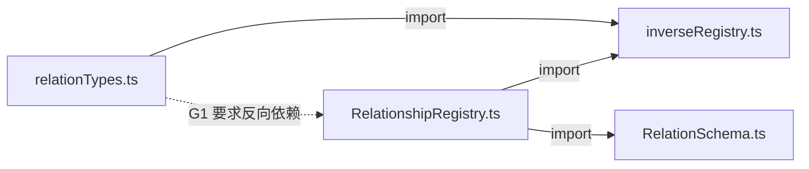

# 关系权威源收敛（阶段 2.1 第 1 步）

> 分析基准：`main` @ `e6fc2255`，2026-11-17
> 范围：收敛「关系」概念的多个权威源为单一权威源。**不迁移关系定义位置**（那是第 2、3 步）。
> 前置：`docs/plans/2026-11-13-产品域插件粒度与一切皆插件.md` §阶段 2

---

## 一、为什么先做这一步，而不是直接下沉

原计划 2.1 是「把 119 条关系定义从 `entity-core/relations/` 迁到各插件」。实测发现：**关系这个概念目前有 7 个互不同步的权威源**。

在权威源分裂的前提下做下沉，等于把一份已经过期的副本拆成更多份副本。先收敛，再谈位置。

### 1.1 七个权威源实测

| # | 权威源 | 条目 | 谁在读 | 状态 |
|---|---|---|---:|---|
| 1 | `relationshipRegistry` | 211 | FieldMatrix / sproutInsights / outlineRefs / NodeRefsSection / OutlineRefsForm | **事实权威**（119 声明 + 92 自动逆类型） |
| 2 | `relationSchemaRegistry` | 211 | `useGraphData`（边标签）、`typeMappingRegistry`、`RelationTypeSerializer`（导出） | 镜像，切项目后归零（见 §1.3） |
| 3 | `inverseRegistry` | 213 | `useBidirectional`、`useEdgeDedup` | **与 #1 冲突 15 条**（见 §1.2） |
| 4 | `RelationTypes` 枚举 | 38 | `UniversalRelationPanel` 等 | 只覆盖 35/119 声明 |
| 5 | `RelationTypeLabels` 静态表 | 38 | `getRelationLabel` | **89% 标错**（见 §1.2） |
| 6 | `typeMappingRegistry` 边样式 | ~26 | 全局图谱 | 88% 走兜底灰 |
| 7 | `RELATION_EDIT_PROPS` 硬编码 | 26 | `UniversalRelationPanel` 属性编辑 | **完全忽略 `schema.properties`** |

### 1.2 可测量的用户可见损伤

**损伤一：89% 关系标签错误**

`getRelationLabel` 读的是静态表 `RelationTypeLabels`（38 项），而非注册表（211 项）。全量比对：

```
注册表条目 = 211    getRelationLabel 给错 = 187    = 89%
```

典型：

| 关系 | 注册表（正确） | `getRelationLabel` 实际返回 |
|---|---|---|
| `ally_of` | 盟友 | `ally_of` |
| `mentor_of` | 导师 | 师徒 |
| `parent_of` | 父母 | 父子 |
| `has_member` | 拥有成员 | `has_member` |

受影响用户可见面三处：`useSmartFieldLink.ts:64`（AutoLink 提醒文案）、`useBidirectional.ts:68`（撤销栈条目名）、`ExperienceNode.vue:104`（家族树边名）。

**损伤二：15 条关系逆类型两表冲突**

`useBidirectional.ts:26` 读 #3，权威在 #1：

| 关系 | 权威说逆类型 | 实际建出的反向边 |
|---|---|---|
| `mentor_of` | `student_of` | `mentor_of`（自指） |
| `belongs_to` | `has_member` | `controls` |
| `member_of` | `has_member` | `contains` |
| `located_in` | `contains_location` | `contains` |
| `causes` | `caused_by` | `causes`（自指） |
| `references` | `referenced_by` | `references`（自指） |
| `inspired_by` | `inspiration_for` | `references` |
| `route` | `reverse_route` | `route`（自指） |
| `notable_for` | `notable_in` | `notable_for`（自指） |
| `resides_in` | `resident_of_place` | `located_in` |
| `participated_in` | `has_participant` | `participated_in`（自指） |
| `controls` | `controlled_by` | `belongs_to` |
| `contains` | `contained_in` | `located_in` |
| `capital_of` | `has_capital` | `contains` |
| `enclave_of` | `has_enclave` | `contains` |

「自指」意味着 V2 认定为非对称，但被当成对称处理 —— `createBidirectional` 会建一条源目标相同的反向边。

此路径实际在使用：`FamilyTree.vue:316`、`notebook/backlinkDerive.ts:176`、`timeline/eventInvolves.ts:44`、`useSmartFieldLink.ts:58`、`useAutoCreateEntity.ts:50`。

**损伤三：切项目后关系镜像表归零且永不恢复**

`useProjectSwitcher.ts:326` 执行 `relationSchemaRegistry.clear()`，恢复靠包入口 side-effect —— 而包入口只在模块**首次加载**时执行一次。实测：

```
切项目前 legacy 条目 = 211
clear 后              =   0
重装插件后            =   0     ← 不恢复
V2 表                  = 211    ← 未被清，仍完好
```

后果：切一次项目后，全局图谱边标签从「属于」退化为 `belongs_to`。验证过修复成本：`clear()` 后补一次 `syncToLegacyRegistry()` → 立即恢复 211。

**损伤四：关系属性编辑面板与 schema 脱节**

`UniversalRelationPanel.vue:433` 用 `RELATION_EDIT_PROPS[type]` 硬编码 26 条，完全不读 `schema.properties`。实测比对：

```
硬编码 26 条 · 对应 schema 不存在 2 条（precedes / happens_in）· 两者不一致 23 条
route：schema 声明 distance/travelTime/dangerLevel/transport，硬编码只有 distance/method
```

即「关系属性的唯一真实定义」在 schema 里，但编辑面板看不见它。

### 1.3 一个判断纠正

初判「`child_of` / `happens_in` / `precedes` 是死枚举」——**部分错误**：

- `child_of` 是 `parent_of` 的**自动注册逆类型**，真实存在（label=子女），不是死枚举
- `happens_in` / `precedes` 确为死枚举（注册表无对应条目，仅硬编码表引用）

---

## 二、目标与边界

### 2.1 本步目标（四条）

| # | 目标 | 可测验收 |
|---|---|---|
| G1 | 标签单一权威：所有取关系 label 的路径读 `relationshipRegistry` | 全量 211 条 `labelOf(x) === registry.get(x).label`，零例外 |
| G2 | 逆类型单一权威：删掉 `inverseRegistry` 的独立状态，改为 `relationshipRegistry` 的派生视图 | 15 条冲突归零；`isSymmetric` 与 `schema.symmetric` 全量一致 |
| G3 | 切项目不丢镜像：`clear()` 后有明确恢复点 | 模拟切项目后 legacy 条目恢复为 211 |
| G4 | 关系属性单一权威：编辑面板读 `schema.properties` | 26 条硬编码表中所有能对上 schema 的，字段与 schema 一致 |

### 2.2 明确不做（留给第 2、3 步）

- 不迁移关系定义位置（119 条仍留在 `entity-core/relations/`）
- 不新建关系族插件
- 不改 `domain` 划分
- 不改关系类型 id、不改现有数据语义
- 不改 `RelationTypes` 枚举的对外导出（`UniversalRelationPanel` 在用它做键，保留）

### 2.3 为什么 G4 只收敛不删除

`RELATION_EDIT_PROPS` 里 21 条 schema 无 `properties`。若直接改成读 schema，这 21 条关系的属性编辑会**消失** —— 那是功能退化，不是收敛。

故 G4 本步只做：**schema 有 `properties` 时以 schema 为准**（`member_of` / `route` 两条立即生效），`schema` 无 `properties` 时保留硬编码表作为过渡，并加守卫列出「有硬编码但无 schema 声明」的清单，作为第 3 步补 schema 的待办账。

---

### 2.4 三项决策（2026-11-17 已定）

| # | 决策 | 选择 |
|---|---|---|
| 1 | 15 条逆类型冲突 | **按权威修正**。`belongs_to` 反向从「控制」改为「拥有成员」，`mentor_of` 从自指改为「学生」，`causes` 从自指改为「由...导致」 |
| 2 | 属性编辑 21 条无 schema 声明 | **schema 优先 + 硬编码兜底**，不导致功能退化；产出待办清单给第 3 步 |
| 3 | `relationSchemaRegistry`（旧镜像）去留 | **保留，改成自动跟随**。导出序列化器仍读它，本步降低改动面 |

---

## 三、影响范围

### 3.1 改动文件清单

| 文件 | 改动 | 风险 |
|---|---|---|
| `packages/entity-core/src/core/relationTypes.ts` | `getRelationLabel` 改读注册表；删除 `InverseRelation`（@deprecated 且无消费方）；删除死枚举 `HAPPENS_IN` / `PRECEDES` | 中：需处理循环 import |
| `packages/entity-core/src/core/inverseRegistry.ts` | 改为委托 `relationshipRegistry` 的薄视图 | 中 |
| `packages/entity-core/src/core/RelationshipRegistry.ts` | `register` / `unregister` 维护 inverse 派生；`syncToLegacyRegistry` 幂等性复核 | 中 |
| `packages/entity-core/src/core/typeMappingRegistry.ts` | 边样式 label 读注册表；为 185 条兜底项给出确定性降级 | 低 |
| `apps/tauri/src/composables/useProjectSwitcher.ts` | `clear()` 后补 `syncToLegacyRegistry()` | 低 |
| `packages/plugin-sdk/src/components/UniversalRelationPanel.vue` | `RELATION_EDIT_PROPS` 让位 schema.properties | 中 |
| `packages/entity-core/src/core/__tests__/inverseRegistrySync.spec.ts` | 现有断言依赖旧行为（`belongs_to → controls`），需改为新契约 | 低 |

### 3.2 循环 import 风险（必须先解决）

当前依赖方向：



`getRelationLabel` 要在 `relationTypes.ts` 里读 `relationshipRegistry`，而 `RelationshipRegistry.ts` 不 import `relationTypes.ts`，故不构成循环。但需实测确认加载顺序安全（`relations/index.ts` 在包入口 side-effect 执行，`defineRelation` → `register`）。

选择：把 `getRelationLabel` 从 `relationTypes.ts` **移到** `RelationshipRegistry.ts`，由 `relationTypes.ts` 重导出，消除潜在方向问题。

### 3.3 回滚方式

单 PR 可整体 revert。分 6 个提交，每个提交独立可 revert：

1. `getRelationLabel` 单一权威
2. `inverseRegistry` 降为派生视图
3. 删死枚举与 `InverseRelation`
4. `typeMappingRegistry` 读注册表
5. 切项目恢复
6. `RELATION_EDIT_PROPS` 让位 schema

无数据迁移，无存储格式变更，revert 不会造成数据不一致。

---

## 四、施工步骤

| # | 提交 | 内容 | 验收 |
|---|---|---|---|
| 1 | `refactor(entity-core): 关系标签收敛到单一权威源` | `getRelationLabel` 移入 `RelationshipRegistry` 并读注册表；`relationTypes.ts` 重导出 | 211 条 label 全对 |
| 2 | `refactor(entity-core): inverseRegistry 降为关系注册表的派生视图` | 删独立 Map，改委托；`register`/`unregister` 同步 | 15 条冲突归零 |
| 3 | `refactor(entity-core): 删除死枚举与 InverseRelation` | 删 `HAPPENS_IN`/`PRECEDES`/`InverseRelation`；保留 `child_of`（自动逆类型） | 全仓引用零残留 |
| 4 | `refactor(entity-core): 图谱边样式改读关系注册表` | `typeMappingRegistry` label 来源切换 | 无兜底灰误判 |
| 5 | `fix(tauri): 切项目后恢复关系镜像表` | `clear()` 后补同步 | 模拟切项目恢复 211 |
| 6 | `refactor(plugin-sdk): 关系属性编辑以 schema 为准` | schema.properties 优先 | `member_of`/`route` 字段与 schema 一致 |

### 4.1 守卫测试（新增）

| 守卫 | 断言 | 自证非空转 |
|---|---|---|
| `relationLabelAuthority.spec.ts` | 全量 211 条 `getRelationLabel(t) === registry.get(t).label` | 断言扫描数 = 211 且 > 100 |
| `relationInverseAuthority.spec.ts` | 全量非对称关系 `inverseRegistry.getInverse(t) === registry.get(t).inverseType` | 断言非对称数 > 100 |
| `relationSymmetricConsistency.spec.ts` | `inverseRegistry.isSymmetric(t) === registry.get(t).symmetric` | 断言对称关系数 > 10 |
| `deadEnumGuard.spec.ts` | `RelationTypes` 每个值都在注册表内 | 断言枚举数 ≥ 30 |
| `projectSwitchRelationMirror.spec.ts` | 模拟 `clear()` + 同步 → 条目恢复 | 断言恢复前为 0、恢复后 > 100 |
| `relationEditPropsAuthority.spec.ts` | schema 有 properties 的，硬编码表不得与之不一致 | 断言至少 2 条命中（current = member_of / route） |

### 4.2 反证要求

每个守卫都要做一次「故意改坏 → 确认报红 → 诊断可读 → 复原」。重点反证：

- 把 `getRelationLabel` 改回静态表 → `relationLabelAuthority` 必须报出具体关系名与两个值
- 把 `inverseRegistry` 的委托改成独立 Map 并写错一条 → `relationInverseAuthority` 必须点名该关系
- 删掉 `useProjectSwitcher` 的同步调用 → `projectSwitchRelationMirror` 必须报红

---

## 五、验证方式

| 项 | 命令 | 通过标准 |
|---|---|---|
| 全量测试 | `npx vitest run` | 全绿；文件数不低于 320 |
| 类型 | `pnpm typecheck:all` | 0 错 |
| 门禁 | `pnpm gate` | 6/6 |
| 架构 | `pnpm arch:check` | 0 新增违规 |
| 文档 | 链接校验脚本 | 断链 0 / 绝对路径 0 |

---

## 六、风险

| # | 风险 | 应对 |
|---|---|---|
| 1 | `inverseRegistry` 改动影响 `useBidirectional` / `useEdgeDedup` 的双向建边行为 | 15 条冲突的修正会**改变现有行为**：`belongs_to` 的反向从 `controls` 变 `has_member`。这是修正而非退化，但需你确认 |
| 2 | 删死枚举可能影响 `UniversalRelationPanel` 的 `RELATION_EDIT_PROPS` 键 | `HAPPENS_IN`/`PRECEDES` 是该表的键，删除后这两条属性编辑失效。需同步删掉这两条硬编码 |
| 3 | `RELATION_EDIT_PROPS` 21 条无 schema 声明 | 本步保留为过渡，产出待办清单给第 3 步 |
| 4 | 无关系实例的回归验证手段 | 需真机走查：建一条「角色→组织」的 `belongs_to`，确认反向边为「拥有成员」而非「控制」 |
