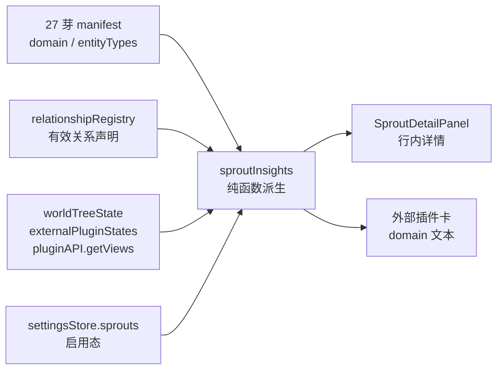

# R5 · 依赖与状态可见批计划

> **定位**：让每一个芽都能回答「主域/副域是什么、现在处于什么状态、为什么没出现、它和哪些芽有依赖」。
> **依据**：研究 05 §5.5 R5；2026-10-20 设计确认：行内展开 + 补 manifest `entityTypes` 声明。
> **目标**：芽管理行内详情展示启用态、装载态、被拒原因、入口视图与入/出依赖；外部插件显示 domain；停用芽的依赖仍完整。

## 一、架构



- **声明层**：`WorldPluginManifest` 增加 `entityTypes`；27 个内置芽各声明一次（纯视图芽声明 `[]`）。停用芽不需要 apply 也能参与依赖图。
- **派生层**：`sproutInsights.ts` 把 manifest、启用态、装载态、视图数、关系注册表汇成 `SproutInsight[]`；纯函数可测，采集口只读运行时。
- **展示层**：芽管理行尾信息图标 → 当前域分组内展开全宽详情；外部插件卡行内显示主/副域。ui-kit 只提供展开位与插槽，不反向依赖世界树。

### 依赖口径（必须写进 UI）

- 关系类型是**类型级设计意图**，不是当前项目实际实体边数。
- 只取**有效关系声明方向**：自动生成的逆关系按「镜像对先出现者」跳过，避免双向重复计数；与研究中 104 条声明口径一致。
- 实体类型 → 芽由 `manifest.entityTypes` 决定；源芽 ≠ 目标芽才记边。
- 芽内部关系忽略；纯视图芽没有实体类型，明确显示「不注册实体类型」。
- 外部插件未声明 `entityTypes` 时回退到运行时 schema 归属，并标记「依赖仅统计已装载类型」。
- **已知幂等冲突**：`owned_by` 的显式声明被 `owns` 自动逆关系挡住；展示层用 `DECLARED_RELATION_OVERRIDES` 补回 item/building → character/organization，不改关系注册表。

## 二、全局约束

- 施工期间**不提交、不推送**；真机走查通过后再统一提交（遵守项目工作流）。
- 不新增 npm / cargo 依赖；不改 R3 六形态、R4 域分组/拖拽/激活分组；不做 R6。
- 不做依赖校验、依赖编辑、关系图可视化；只做可见性。
- 图标只用 `WsIcon`，禁止 emoji；代码标识符英文、注释中文；UTF-8 无 BOM；代码内路径用相对路径。
- 新文件保持单一职责；`arch:check` 单文件 400 行上限。
- 不触碰 `.trae-html-share-packages/`。
- 运行时状态是快照：芽开关、视图注册/反注册、外部重载后必须刷新详情数据。

## 三、文件结构

### 新增

| 文件 | 职责 |
|---|---|
| `apps/tauri/src/world/sproutInsights.ts` | 芽洞察纯函数 + 运行时采集口 + 域标签工具 |
| `apps/tauri/src/world/__tests__/sproutInsights.spec.ts` | 依赖方向、逆关系去重、状态与外部回退测试 |
| `apps/tauri/src/world/plugins/settings/panels/SproutDetailPanel.vue` | 行内详情展示（纯展示组件） |
| `apps/tauri/src/world/plugins/settings/panels/__tests__/sproutDetailPanel.spec.ts` | 详情文案与状态展示测试 |
| `packages/ui-kit/src/components/settings/panels/__tests__/sproutsCardContent.spec.ts` | 信息图标展开/单一展开/插槽测试 |
| `docs/details/注释/apps/tauri/world/sproutInsights.md` | 依赖口径、快照刷新、外部回退的 why/how |

### 修改

| 文件 | 改动 |
|---|---|
| `apps/tauri/src/world/manifest.ts` | 增加 `entityTypes?: string[]` 与校验 |
| `apps/tauri/src/world/plugins/*/index.ts`（26 个） | 芽 manifest 声明 `entityTypes` |
| `apps/tauri/src/world/plugins/mindmap/manifest.ts` | 同上（思维导图清单在独立文件） |
| `apps/tauri/src/world/__tests__/manifest.spec.ts` | 校验形状、重复、空数组合法 |
| `apps/tauri/src/world/__tests__/sproutDomains.spec.ts` | AST 守卫：声明值与 `registerEntityV2` 一致、类型归属唯一 |
| `packages/ui-kit/src/components/settings/panels/SproutsCardContent.vue` | 信息图标、单一展开、`#sprout-detail` 插槽、异常标记 |
| `packages/ui-kit/src/components/settings/panels/sprouts-card.css` | 信息图标/详情位样式 |
| `apps/tauri/src/world/plugins/settings/panels/PluginsPanel.vue` | 洞察快照、异常标记、详情插槽、外部插件 domain |
| `docs/index/README.md` | 新增在途计划行 |
| 归档时：`docs/index/ARCHIVE.md`、`docs/details/架构/芽生态/*`、阅读版 | R5 完成状态与施工记录 |

## 四、任务

### Task 1：manifest `entityTypes` 声明与守卫

**Files:**
- Modify: `apps/tauri/src/world/manifest.ts`
- Modify: `apps/tauri/src/world/plugins/*/index.ts`（26 个）
- Modify: `apps/tauri/src/world/plugins/mindmap/manifest.ts`
- Test: `apps/tauri/src/world/__tests__/manifest.spec.ts`
- Test: `apps/tauri/src/world/__tests__/sproutDomains.spec.ts`

**Interfaces:**
- Produces: `WorldPluginManifest.entityTypes?: string[]`，供 Task 2 的 `buildSproutInsights` 读取。

- [ ] **Step 1: 写失败测试（校验 + AST 守卫）**

在 `manifest.spec.ts` 的 `domain / secondaryDomains` 用例后追加：

```ts
it('entityTypes 若给则须为字符串数组、元素非空且不重复；空数组合法', () => {
  expect(validateManifest({ ...valid, entityTypes: ['character'] }).ok).toBe(true)
  expect(validateManifest({ ...valid, entityTypes: [] }).ok).toBe(true)
  expect(validateManifest({ ...valid, entityTypes: 'character' }).ok).toBe(false)
  expect(validateManifest({ ...valid, entityTypes: [''] }).ok).toBe(false)
  expect(validateManifest({ ...valid, entityTypes: ['x', 'x'] }).ok).toBe(false)
})
```

在 `sproutDomains.spec.ts` 中扩展 `ParsedManifest`：

```ts
interface ParsedManifest {
  id: string
  domain?: string
  secondaryDomains?: string[]
  entityTypes?: string[]
  file: string
}
```

在 `manifestObjects` 里读取并校验 `entityTypes`：

```ts
const typesNode = prop(init, 'entityTypes')?.initializer
const entityTypes = typesNode ? stringArray(typesNode) : undefined
if (typesNode && !entityTypes) {
  throw new Error(`${id} 的 entityTypes 不是字符串数组（${file}）`)
}
found.push({ id, domain, secondaryDomains, entityTypes, file })
```

新增测试（放在同一文件）：

```ts
function registeredEntityTypes(file: string): string[] {
  const indexFile = path.join(path.dirname(file), 'index.ts')
  const sf = ts.createSourceFile(
    indexFile,
    fs.readFileSync(indexFile, 'utf8'),
    ts.ScriptTarget.Latest,
    true,
    ts.ScriptKind.TS,
  )
  const types: string[] = []
  const visit = (node: ts.Node) => {
    if (ts.isCallExpression(node) && ts.isPropertyAccessExpression(node.expression)) {
      const method = node.expression.name.text
      if (method === 'registerEntityV2' || method === 'registerEntityType') {
        const arg = unwrap(node.arguments[0])
        if (arg && ts.isObjectLiteralExpression(arg)) {
          const key = method === 'registerEntityV2' ? 'type' : 'typeKey'
          const value = stringValue(prop(arg, key)?.initializer)
          if (value) types.push(value)
        }
      }
    }
    ts.forEachChild(node, visit)
  }
  visit(sf)
  return types
}

it('27 个内置芽声明 entityTypes，且与实际 registerEntityV2 一致', () => {
  expect(manifests).toHaveLength(27)
  const owners = new Map<string, string>()
  for (const manifest of manifests) {
    expect(Array.isArray(manifest.entityTypes), `${manifest.id} 缺 entityTypes（${manifest.file}）`).toBe(true)
    const actual = registeredEntityTypes(manifest.file)
    expect(
      [...new Set(manifest.entityTypes!)].sort(),
      `${manifest.id} entityTypes 与注册不一致`,
    ).toEqual([...new Set(actual)].sort())
    for (const type of manifest.entityTypes!) {
      expect(
        owners.has(type),
        `实体类型 ${type} 被 ${owners.get(type)} 与 ${manifest.id} 重复声明`,
      ).toBe(false)
      owners.set(type, manifest.id)
    }
  }
  const pureView = manifests
    .filter(manifest => manifest.entityTypes?.length === 0)
    .map(manifest => manifest.id)
    .sort()
  expect(pureView).toEqual([
    'official.apparel',
    'official.custom',
    'official.field-matrix',
    'official.graph',
    'official.mindmap',
    'official.weapons',
  ])
})
```

- [ ] **Step 2: 跑测试确认失败**

Run:

```bash
pnpm vitest run apps/tauri/src/world/__tests__/manifest.spec.ts apps/tauri/src/world/__tests__/sproutDomains.spec.ts
```

Expected: FAIL，`entityTypes` 校验未实现、27 芽均缺 `entityTypes`。

- [ ] **Step 3: 实现字段与校验**

在 `manifest.ts` 的 `secondaryDomains?: string[]` 后加：

```ts
  /** 实体类型（R5）：该芽注册的实体 type；纯视图芽显式声明 []。
   *  用于依赖图，独立于运行时注册表（停用芽也能参与）。 */
  entityTypes?: string[]
```

在 `validateManifest` 的 `secondaryDomains` 校验后加：

```ts
  if (manifest.entityTypes !== undefined) {
    if (
      !Array.isArray(manifest.entityTypes) ||
      manifest.entityTypes.some(item => typeof item !== 'string' || !item.trim())
    ) {
      return { ok: false, reason: 'entityTypes 须为字符串数组（元素非空）' }
    }
    if (new Set(manifest.entityTypes).size !== manifest.entityTypes.length) {
      return { ok: false, reason: 'entityTypes 不得重复' }
    }
  }
```

- [ ] **Step 4: 给 27 个芽声明 `entityTypes`**

在各自 manifest 的 `domain` 附近加入下表值（`mindmap` 在 `manifest.ts`，其余在 `index.ts`）：

| 芽 id | 目录 | entityTypes |
|---|---|---|
| `official.characters` | `characters` | `['character']` |
| `official.regions` | `regions` | `['region']` |
| `official.timeline` | `timeline` | `['event']` |
| `official.organizations` | `organizations` | `['organization']` |
| `official.concepts` | `concepts` | `['concept']` |
| `official.items` | `items` | `['item']` |
| `official.buildings` | `buildings` | `['building']` |
| `official.species` | `species` | `['species']` |
| `official.magic` | `magic` | `['magic']` |
| `official.outline` | `outline` | `['outline_node', 'outline_board']` |
| `official.languages` | `languages` | `['language']` |
| `official.culture` | `culture` | `['culture']` |
| `official.conflict` | `conflict` | `['conflict']` |
| `official.inspiration` | `inspiration` | `['inspiration']` |
| `official.plants` | `plants` | `['plant']` |
| `official.combat_stats` | `combat_stats` | `['combat_stat']` |
| `official.manuscript` | `manuscript` | `['book', 'manuscript']` |
| `official.drawing` | `drawing` | `['drawing']` |
| `official.notebook` | `notebook` | `['notebook']` |
| `official.orchestration` | `orchestration` | `['pipeline']` |
| `official.tactical-board` | `tactical-board` | `['tactical-board']` |
| `official.field-matrix` | `field-matrix` | `[]` |
| `official.mindmap` | `mindmap` | `[]` |
| `official.graph` | `graph` | `[]` |
| `official.custom` | `custom` | `[]` |
| `official.apparel` | `apparel` | `[]` |
| `official.weapons` | `weapons` | `[]` |

示例：

```ts
export const manifest = {
  id: 'official.characters',
  domain: 'life',
  secondaryDomains: ['society'],
  entityTypes: ['character'],
  name: '角色',
  version: '2.0.0',
  description: '管理世界观中的角色、NPC、主角等人物',
  author: 'WorldSea',
}
```

- [ ] **Step 5: 跑测试确认通过**

Run:

```bash
pnpm vitest run apps/tauri/src/world/__tests__/manifest.spec.ts apps/tauri/src/world/__tests__/sproutDomains.spec.ts
```

Expected: PASS（27 芽声明一致，6 个纯视图芽为 `[]`）。

- [ ] **Step 6: 类型检查**

Run:

```bash
pnpm typecheck:tauri
```

Expected: 0 error。

---

### Task 2：`sproutInsights` 派生模块与单测

**Files:**
- Create: `apps/tauri/src/world/sproutInsights.ts`
- Test: `apps/tauri/src/world/__tests__/sproutInsights.spec.ts`

**Interfaces:**
- Consumes: `WorldPluginManifest.entityTypes`（Task 1）、`relationshipRegistry`、`worldTreeState()`、`externalPluginStates()`、`pluginAPI.getViews()`。
- Produces:
  - `buildSproutInsights(input: SproutInsightInput): SproutInsight[]`（纯函数）
  - `collectSproutInsights(sprouts): SproutInsight[]`（应用侧采集口）
  - `sproutDomainLabel(id?: string): string`
  - `externalDomainText(domain?: string, secondaryDomains?: string[]): string`
  - 类型 `SproutInsight`、`SproutDependency`、`SproutRuntimeStatus`

- [ ] **Step 1: 写失败测试**

创建 `sproutInsights.spec.ts`：

```ts
import { describe, expect, it } from 'vitest'
import {
  buildSproutInsights,
  externalDomainText,
  sproutDomainLabel,
  type SproutInsightInput,
} from '../sproutInsights'

const sprout = (id: string, active = true, source = 'builtin') => ({
  id,
  label: id,
  icon: 'bulb',
  active,
  source,
})

const plugin = (id: string, entityTypes: string[], extra: Record<string, unknown> = {}) => ({
  manifest: {
    id,
    name: `芽 ${id}`,
    version: '1.0.0',
    description: id,
    domain: 'life',
    entityTypes,
    ...extra,
  },
})

const relation = (
  type: string,
  label: string,
  sourceTypes: string[],
  targetTypes: string[],
  inverseType: string,
) => ({ type, label, sourceTypes, targetTypes, inverseType })

function makeInput(overrides: Partial<SproutInsightInput> = {}): SproutInsightInput {
  return {
    sprouts: [sprout('official.a'), sprout('official.b'), sprout('official.c')],
    plugins: [
      plugin('official.a', ['a']),
      plugin('official.b', ['b']),
      plugin('official.c', ['c']),
    ],
    relations: [],
    runtime: { plugins: ['official.a', 'official.b', 'official.c'], skipped: [], rejected: [] },
    external: [],
    views: [
      { pluginId: 'official.a' },
      { pluginId: 'official.b' },
      { pluginId: 'official.c' },
    ],
    ...overrides,
  }
}

describe('buildSproutInsights 依赖方向', () => {
  it('按声明方向聚合，自动逆关系不重复计数', () => {
    const insights = buildSproutInsights(makeInput({
      relations: [
        relation('a_to_b', 'A到B', ['a'], ['b'], 'b_to_a'),
        relation('b_to_a', 'B到A', ['b'], ['a'], 'a_to_b'),
        relation('a_to_b_2', 'A到B二', ['a'], ['b'], 'b_to_a_2'),
      ],
    }))
    const a = insights.find(item => item.id === 'official.a')!
    const b = insights.find(item => item.id === 'official.b')!
    expect(a.outgoing).toHaveLength(1)
    expect(a.outgoing[0]).toMatchObject({ pluginId: 'official.b', relations: ['A到B', 'A到B二'] })
    expect(b.incoming[0]).toMatchObject({ pluginId: 'official.a', relations: ['A到B', 'A到B二'] })
    expect(b.outgoing).toEqual([])
  })

  it('停用芽仍用 manifest 类型计算依赖', () => {
    const insights = buildSproutInsights(makeInput({
      sprouts: [sprout('official.a', false), sprout('official.b'), sprout('official.c')],
      relations: [relation('a_to_b', 'A到B', ['a'], ['b'], 'b_to_a')],
    }))
    const a = insights.find(item => item.id === 'official.a')!
    expect(a.runtime).toBe('skipped')
    expect(a.reason).toBe('未启用')
    expect(a.outgoing[0].pluginId).toBe('official.b')
  })

  it('被拒原因与无入口视图可见', () => {
    const insights = buildSproutInsights(makeInput({
      runtime: {
        plugins: ['official.b'],
        skipped: ['official.c'],
        rejected: [{ id: 'official.a', reason: '清单非法' }],
      },
      views: [{ pluginId: 'official.b' }],
    }))
    const a = insights.find(item => item.id === 'official.a')!
    const b = insights.find(item => item.id === 'official.b')!
    expect(a.runtime).toBe('rejected')
    expect(a.reason).toBe('清单非法')
    expect(b.runtime).toBe('loaded')
    expect(b.viewCount).toBe(1)
  })

  it('外部插件缺 entityTypes 时回退运行时归属，并标记依赖受限', () => {
    const insights = buildSproutInsights(makeInput({
      sprouts: [sprout('ws.ext', true, 'external'), sprout('official.b')],
      plugins: [
        // 注意：不能写 entityTypes: [] —— 空数组也属于「已声明」，不会触发运行时回退
        { manifest: {
          id: 'ws.ext',
          name: '外部芽',
          version: '1.0.0',
          description: '外部插件',
          domain: 'homebrew',
        } },
        plugin('official.b', ['b']),
      ],
      external: [{ id: 'ws.ext', status: 'loaded', domain: 'homebrew' }],
      runtimeTypeOwners: { x: 'ws.ext' },
      relations: [relation('x_to_b', 'X到B', ['x'], ['b'], 'b_to_x')],
    }))
    const ext = insights.find(item => item.id === 'ws.ext')!
    expect(ext.entityTypes).toEqual(['x'])
    expect(ext.dependencyLimited).toBe(true)
    expect(ext.outgoing[0].pluginId).toBe('official.b')
  })
})

describe('域标签', () => {
  it('已登记域用中文名，未声明归未分类，未知外部域原样显示', () => {
    expect(sproutDomainLabel('life')).toBe('生命与族群')
    expect(sproutDomainLabel(undefined)).toBe('未分类')
    expect(sproutDomainLabel('homebrew')).toBe('homebrew')
    expect(externalDomainText('life', ['society'])).toBe('域：生命与族群 · 副域：社会与文明')
    expect(externalDomainText(undefined)).toBe('域：未分类')
  })
})
```

- [ ] **Step 2: 跑测试确认失败**

Run:

```bash
pnpm vitest run apps/tauri/src/world/__tests__/sproutInsights.spec.ts
```

Expected: FAIL，模块不存在。

- [ ] **Step 3: 实现模块**

创建 `apps/tauri/src/world/sproutInsights.ts`：

```ts
/**
 * 芽洞察派生（R5）：声明（domain / entityTypes）+ 运行态（装载 / 视图）+ 关系注册表
 * → 可供设置面展示的状态与入/出依赖。
 * 详细说明见 docs/details/注释/apps/tauri/world/sproutInsights.md
 */
import {
  entitySchemaRegistryV2,
  pluginAPI,
  relationshipRegistry,
  SPROUT_DOMAINS,
} from '@worldsea/entity-core'
import { availablePlugins, externalPluginStates, worldTreeState } from './tree'
import type { WorldPluginManifest } from './manifest'

export type SproutRuntimeStatus = 'loaded' | 'skipped' | 'rejected'

export interface SproutInsightSprout {
  id: string
  label: string
  icon?: string
  active: boolean
  source?: string
}

export interface SproutInsightPlugin {
  manifest: WorldPluginManifest
}

export interface SproutInsightRelation {
  type: string
  label: string
  sourceTypes: string[]
  targetTypes: string[]
  inverseType: string
}

export interface SproutDependency {
  pluginId: string
  label: string
  relations: string[]
}

export interface SproutInsight {
  id: string
  label: string
  icon: string
  domain: string
  secondaryDomains: string[]
  source: 'builtin' | 'external'
  active: boolean
  runtime: SproutRuntimeStatus
  reason?: string
  viewCount: number
  entityTypes: string[]
  requires: string[]
  outgoing: SproutDependency[]
  incoming: SproutDependency[]
  dependencyLimited: boolean
}

export interface SproutInsightInput {
  sprouts: ReadonlyArray<SproutInsightSprout>
  plugins: ReadonlyArray<SproutInsightPlugin>
  relations: ReadonlyArray<SproutInsightRelation>
  runtime: {
    plugins: ReadonlyArray<string>
    skipped: ReadonlyArray<string>
    rejected: ReadonlyArray<{ id: string; reason: string }>
  }
  external: ReadonlyArray<{
    id: string
    status: SproutRuntimeStatus
    reason?: string
    domain?: string
    secondaryDomains?: string[]
  }>
  views: ReadonlyArray<{ pluginId?: string }>
  /** 运行时 schema 归属（外部插件未声明 entityTypes 时的回退） */
  runtimeTypeOwners?: Readonly<Record<string, string>>
}

export function sproutDomainLabel(id: string | undefined): string {
  if (!id || id === 'unclassified') return '未分类'
  return SPROUT_DOMAINS.find(domain => domain.id === id)?.label ?? id
}

export function externalDomainText(domain?: string, secondaryDomains?: string[]): string {
  const primary = sproutDomainLabel(domain)
  const secondary = (secondaryDomains ?? [])
    .map(sproutDomainLabel)
    .filter(label => label && label !== primary)
  return secondary.length
    ? `域：${primary} · 副域：${secondary.join(' / ')}`
    : `域：${primary}`
}

export function buildSproutInsights(input: SproutInsightInput): SproutInsight[] {
  const pluginMap = new Map(input.plugins.map(plugin => [plugin.manifest.id, plugin.manifest]))
  const externalMap = new Map(input.external.map(item => [item.id, item]))
  const rejectedMap = new Map(input.runtime.rejected.map(item => [item.id, item.reason]))
  const loaded = new Set(input.runtime.plugins)
  const runtimeOwners = input.runtimeTypeOwners ?? {}

  const typeOwner = new Map<string, string>()
  for (const [type, pluginId] of Object.entries(runtimeOwners)) typeOwner.set(type, pluginId)
  for (const plugin of input.plugins) {
    for (const type of plugin.manifest.entityTypes ?? []) typeOwner.set(type, plugin.manifest.id)
  }

  const relationLabels = new Map(input.relations.map(item => [item.type, item.label]))
  const edges = new Map<string, Map<string, Set<string>>>()
  const seenRelations = new Set<string>()
  for (const relation of input.relations) {
    // 自动逆关系与正向声明构成镜像对：保留先出现者，避免双向重复计数
    if (relation.inverseType !== relation.type && seenRelations.has(relation.inverseType)) continue
    seenRelations.add(relation.type)
    for (const sourceType of relation.sourceTypes) {
      const from = typeOwner.get(sourceType)
      if (!from) continue
      for (const targetType of relation.targetTypes) {
        const to = typeOwner.get(targetType)
        if (!to || to === from) continue
        const byTarget = edges.get(from) ?? new Map<string, Set<string>>()
        edges.set(from, byTarget)
        const labels = byTarget.get(to) ?? new Set<string>()
        byTarget.set(to, labels)
        labels.add(relation.type)
      }
    }
  }

  const labelOf = (id: string) =>
    pluginMap.get(id)?.name ?? input.sprouts.find(sprout => sprout.id === id)?.label ?? id

  const dependencies = (id: string, direction: 'out' | 'in'): SproutDependency[] => {
    const result: SproutDependency[] = []
    if (direction === 'out') {
      for (const [to, types] of edges.get(id) ?? []) {
        result.push({
          pluginId: to,
          label: labelOf(to),
          relations: [...types].map(type => relationLabels.get(type) ?? type),
        })
      }
    } else {
      for (const [from, byTarget] of edges) {
        const types = byTarget.get(id)
        if (types) {
          result.push({
            pluginId: from,
            label: labelOf(from),
            relations: [...types].map(type => relationLabels.get(type) ?? type),
          })
        }
      }
    }
    return result.sort(
      (a, b) => b.relations.length - a.relations.length || a.label.localeCompare(b.label, 'zh-CN'),
    )
  }

  return input.sprouts.map(sprout => {
    const manifest = pluginMap.get(sprout.id)
    const external = externalMap.get(sprout.id)
    const declaredTypes = manifest?.entityTypes
    const entityTypes = declaredTypes ?? Object.entries(runtimeOwners)
      .filter(([, pluginId]) => pluginId === sprout.id)
      .map(([type]) => type)

    let runtime: SproutRuntimeStatus = 'skipped'
    let reason: string | undefined
    if (!sprout.active) {
      reason = '未启用'
    } else if (external?.status === 'rejected' || rejectedMap.has(sprout.id)) {
      runtime = 'rejected'
      reason = external?.reason ?? rejectedMap.get(sprout.id)
    } else if (external) {
      runtime = external.status
      reason = external.reason
    } else if (loaded.has(sprout.id)) {
      runtime = 'loaded'
    }

    return {
      id: sprout.id,
      label: manifest?.name ?? sprout.label,
      icon: sprout.icon ?? 'puzzle',
      domain: manifest?.domain ?? external?.domain ?? 'unclassified',
      secondaryDomains: manifest?.secondaryDomains ?? external?.secondaryDomains ?? [],
      source: sprout.source === 'external' ? 'external' : 'builtin',
      active: sprout.active,
      runtime,
      reason,
      viewCount: input.views.filter(view => view.pluginId === sprout.id).length,
      entityTypes: [...entityTypes].sort(),
      requires: manifest?.requires ?? [],
      outgoing: dependencies(sprout.id, 'out'),
      incoming: dependencies(sprout.id, 'in'),
      dependencyLimited: sprout.source === 'external' && declaredTypes === undefined,
    }
  })
}

/** 应用侧采集口：只读快照；调用方在芽开关/视图变更/外部重载后重新调用。 */
export function collectSproutInsights(
  sprouts: ReadonlyArray<SproutInsightSprout>,
): SproutInsight[] {
  const runtimeTypeOwners: Record<string, string> = {}
  for (const schema of entitySchemaRegistryV2.getAll()) {
    if (schema.pluginId) runtimeTypeOwners[schema.type] = schema.pluginId
  }
  return buildSproutInsights({
    sprouts,
    plugins: availablePlugins(),
    relations: relationshipRegistry.getAll(),
    runtime: worldTreeState(),
    external: externalPluginStates().map(state => ({
      id: state.id,
      status: state.status,
      reason: state.reason,
      domain: state.domain,
      secondaryDomains: state.secondaryDomains,
    })),
    views: pluginAPI.getViews(),
    runtimeTypeOwners,
  })
}
```

- [ ] **Step 4: 跑测试确认通过**

Run:

```bash
pnpm vitest run apps/tauri/src/world/__tests__/sproutInsights.spec.ts
```

Expected: PASS（5 例）。

- [ ] **Step 5: 类型检查**

Run:

```bash
pnpm typecheck:tauri
```

Expected: 0 error。

---

### Task 3：芽管理行内展开位

**Files:**
- Modify: `packages/ui-kit/src/components/settings/panels/SproutsCardContent.vue`
- Modify: `packages/ui-kit/src/components/settings/panels/sprouts-card.css`
- Test: `packages/ui-kit/src/components/settings/panels/__tests__/sproutsCardContent.spec.ts`

**Interfaces:**
- Consumes: 无（不依赖世界树）。
- Produces:
  - prop `attentionIds?: string[]`
  - emit `inspect: [id: string]`
  - slot `sprout-detail: { id: string }`

- [ ] **Step 1: 写失败测试**

创建测试文件：

```ts
import { describe, expect, it } from 'vitest'
import { mount } from '@vue/test-utils'
import { createPinia } from 'pinia'
import { h } from 'vue'
import SproutsCardContent from '../SproutsCardContent.vue'

function mountCard() {
  return mount(SproutsCardContent, {
    props: { attentionIds: ['official.characters'] },
    global: { plugins: [createPinia()] },
    slots: {
      'sprout-detail': ({ id }: { id: string }) => h('div', { class: 'test-detail' }, id),
    },
  })
}

describe('SproutsCardContent 行内详情', () => {
  it('点击信息图标展开详情，再次点击收起', async () => {
    const w = mountCard()
    await w.find('.set-input').setValue('角色')
    const info = w.get('[aria-label="角色详情"]')
    expect(info.attributes('aria-expanded')).toBe('false')
    await info.trigger('click')
    expect(info.attributes('aria-expanded')).toBe('true')
    expect(w.get('.test-detail').text()).toBe('official.characters')
    expect(w.emitted('inspect')?.[0]).toEqual(['official.characters'])
    await info.trigger('click')
    expect(w.find('.test-detail').exists()).toBe(false)
  })

  it('同时只展开一个芽，异常芽信息图标带 warn 标记', async () => {
    const w = mountCard()
    await w.find('.set-input').setValue('角色')
    const info = w.get('[aria-label="角色详情"]')
    expect(info.classes()).toContain('warn')
    await info.trigger('click')
    await w.find('.set-input').setValue('')
    const another = w.get('[aria-label="区域图谱详情"]')
    await another.trigger('click')
    expect(w.findAll('.test-detail')).toHaveLength(1)
    expect(w.get('.test-detail').text()).toBe('official.regions')
  })
})
```

- [ ] **Step 2: 跑测试确认失败**

Run:

```bash
pnpm vitest run packages/ui-kit/src/components/settings/panels/__tests__/sproutsCardContent.spec.ts
```

Expected: FAIL，信息图标与插槽不存在。

- [ ] **Step 3: 实现展开位**

在 `SproutsCardContent.vue` 的 props 增加：

```ts
  /** 需要提示状态异常的芽 id（已启用但未装载/被拒/无入口视图） */
  attentionIds?: string[]
```

在 `withDefaults` 增加：

```ts
  attentionIds: () => [],
```

在 `defineEmits` 增加：

```ts
const emit = defineEmits<{ dirty: []; inspect: [id: string] }>()
```

在 `sproutSearch` 附近增加：

```ts
const expandedId = ref<string | null>(null)

function toggleDetail(id: string) {
  expandedId.value = expandedId.value === id ? null : id
  emit('inspect', id)
}
```

在两组行模板的 `<label class="sp-toggle">…</label>` 后各加信息按钮：

```vue
<button
  type="button"
  class="sp-info"
  :class="{ warn: attentionIds.includes(p.id) }"
  :aria-label="`${p.label}详情`"
  :aria-expanded="expandedId === p.id"
  :title="attentionIds.includes(p.id) ? '芽详情（状态异常）' : '芽详情'"
  @click="toggleDetail(p.id)"
>
  <WsIcon name="info" size="xs" />
</button>
```

在每个域分组的列表（`</draggable>` / 静态列表 `</div>`）之后加：

```vue
<div v-if="expandedId && group.items.some(p => p.id === expandedId)" class="sp-detail">
  <slot name="sprout-detail" :id="expandedId" />
</div>
```

在 `sprouts-card.css` 追加：

```css
.sp-info {
  margin-left: auto;
  flex-shrink: 0;
  display: inline-flex;
  align-items: center;
  justify-content: center;
  width: 18px;
  height: 18px;
  padding: 0;
  border: none;
  border-radius: var(--radius-sm);
  background: transparent;
  color: var(--text-tertiary, var(--color-text-tertiary));
  cursor: pointer;
  opacity: 0.55;
  transition: opacity 0.1s, background 0.1s, color 0.1s;
}
.sp-info:hover,
.sp-info:focus-visible {
  opacity: 1;
  background: var(--hover-bg, var(--color-bg-hover));
  color: var(--text-color, var(--color-text-primary));
}
.sp-info.warn {
  opacity: 1;
  color: var(--warning, var(--color-warning, #d97706));
}
.sp-info.warn::after {
  content: '';
  width: 4px;
  height: 4px;
  margin-left: 1px;
  border-radius: 50%;
  background: currentColor;
}
.sp-detail {
  margin: 2px 0 8px 18px;
}
```

- [ ] **Step 4: 跑测试确认通过**

Run:

```bash
pnpm vitest run packages/ui-kit/src/components/settings/panels/__tests__/sproutsCardContent.spec.ts
```

Expected: PASS（2 例）。

---

### Task 4：详情面板与 PluginsPanel 接线

**Files:**
- Create: `apps/tauri/src/world/plugins/settings/panels/SproutDetailPanel.vue`
- Modify: `apps/tauri/src/world/plugins/settings/panels/PluginsPanel.vue`
- Modify: `apps/tauri/src/world/index.ts`（导出洞察 API）
- Test: `apps/tauri/src/world/plugins/settings/panels/__tests__/sproutDetailPanel.spec.ts`

**Interfaces:**
- Consumes: `SproutInsight`、`collectSproutInsights`、`externalDomainText`（Task 2）；`#sprout-detail` 插槽（Task 3）。
- Produces: 行内详情 UI；外部插件卡 domain 文本。

- [ ] **Step 1: 写失败测试**

创建 `sproutDetailPanel.spec.ts`：

```ts
import { describe, expect, it } from 'vitest'
import { mount } from '@vue/test-utils'
import SproutDetailPanel from '../SproutDetailPanel.vue'
import type { SproutInsight } from '@/world/sproutInsights'

const base: SproutInsight = {
  id: 'official.characters',
  label: '角色',
  icon: 'character',
  domain: 'life',
  secondaryDomains: ['society'],
  source: 'builtin',
  active: true,
  runtime: 'loaded',
  viewCount: 1,
  entityTypes: ['character'],
  requires: [],
  outgoing: [{ pluginId: 'official.species', label: '物种', relations: ['属于', '诞生于'] }],
  incoming: [],
  dependencyLimited: false,
}

describe('SproutDetailPanel', () => {
  it('展示域、装载态、入口视图与出依赖', () => {
    const w = mount(SproutDetailPanel, { props: { insight: base } })
    expect(w.text()).toContain('生命与族群')
    expect(w.text()).toContain('社会与文明')
    expect(w.text()).toContain('已装载')
    expect(w.text()).toContain('入口视图：1 个')
    expect(w.text()).toContain('物种')
    expect(w.text()).toContain('2')
  })

  it('未启用显示关闭语义；被拒显示原因', () => {
    const inactive = mount(SproutDetailPanel, {
      props: { insight: { ...base, active: false, runtime: 'skipped', viewCount: 0 } },
    })
    expect(inactive.text()).toContain('未启用')
    expect(inactive.text()).toContain('实体数据保留')

    const rejected = mount(SproutDetailPanel, {
      props: { insight: { ...base, runtime: 'rejected', reason: '清单非法', viewCount: 0 } },
    })
    expect(rejected.text()).toContain('被拒')
    expect(rejected.text()).toContain('清单非法')
  })

  it('纯视图芽解释无依赖；外部缺声明提示依赖受限', () => {
    const pure = mount(SproutDetailPanel, {
      props: { insight: { ...base, entityTypes: [], outgoing: [], incoming: [] } },
    })
    expect(pure.text()).toContain('纯视图芽')

    const external = mount(SproutDetailPanel, {
      props: { insight: { ...base, source: 'external', dependencyLimited: true } },
    })
    expect(external.text()).toContain('仅统计已装载类型')
  })
})
```

- [ ] **Step 2: 跑测试确认失败**

Run:

```bash
pnpm vitest run apps/tauri/src/world/plugins/settings/panels/__tests__/sproutDetailPanel.spec.ts
```

Expected: FAIL，组件不存在。

- [ ] **Step 3: 实现详情组件**

创建 `SproutDetailPanel.vue`：

```vue
<template>
  <div v-if="insight" class="spd" role="region" :aria-label="`${insight.label}详情`">
    <div class="spd-head">
      <WsIcon :name="insight.icon" size="sm" class="spd-icon" />
      <span class="spd-name">{{ insight.label }}</span>
      <span class="spd-badge">{{ insight.source === 'external' ? '外部' : '内置' }}</span>
      <span class="spd-state">{{ insight.active ? '已启用' : '未启用' }}</span>
      <span class="spd-state">{{ runtimeLabel }}</span>
    </div>

    <div class="spd-meta">
      <span>域：{{ sproutDomainLabel(insight.domain) }}</span>
      <span v-if="insight.secondaryDomains.length">
        副域：{{ insight.secondaryDomains.map(sproutDomainLabel).join(' / ') }}
      </span>
    </div>

    <div class="spd-runtime">
      <template v-if="!insight.active">
        未启用 · 入口已隐藏（实体数据保留，仍可被其它芽引用）。
      </template>
      <template v-else-if="insight.runtime === 'rejected'">
        被拒：{{ insight.reason || '原因未记录' }}
      </template>
      <template v-else-if="insight.runtime !== 'loaded'">
        未装载，入口不可用。
      </template>
      <template v-else-if="insight.viewCount === 0">
        已装载，但没有注册侧栏视图。
      </template>
      <template v-else>入口视图：{{ insight.viewCount }} 个</template>
    </div>

    <div class="spd-deps">
      <section>
        <h4>出依赖 <span>{{ insight.outgoing.length }}</span></h4>
        <p v-if="insight.outgoing.length === 0" class="spd-empty">{{ emptyOutgoing }}</p>
        <ul v-else>
          <li v-for="item in insight.outgoing" :key="item.pluginId" :title="item.relations.join(' / ')">
            <span>{{ item.label }}</span>
            <em>{{ item.relations.length }}</em>
          </li>
        </ul>
      </section>
      <section>
        <h4>入依赖 <span>{{ insight.incoming.length }}</span></h4>
        <p v-if="insight.incoming.length === 0" class="spd-empty">暂无其它芽引用它。</p>
        <ul v-else>
          <li v-for="item in insight.incoming" :key="item.pluginId" :title="item.relations.join(' / ')">
            <span>{{ item.label }}</span>
            <em>{{ item.relations.length }}</em>
          </li>
        </ul>
      </section>
    </div>

    <div class="spd-foot">
      <span v-if="insight.requires.length">服务依赖：{{ insight.requires.join(' / ') }}</span>
      <span v-if="insight.dependencyLimited">外部插件未声明类型归属；依赖仅统计已装载类型。</span>
      <span>依赖为类型级关系（设计意图），不是当前项目实体边数。</span>
    </div>
  </div>
</template>

<script setup lang="ts">
import { computed } from 'vue'
import { WsIcon } from '@worldsea/ui-kit'
import { sproutDomainLabel, type SproutInsight } from '@/world/sproutInsights'

const props = defineProps<{ insight: SproutInsight | null }>()

const runtimeLabel = computed(() => (
  props.insight?.runtime === 'loaded'
    ? '已装载'
    : props.insight?.runtime === 'rejected'
      ? '被拒'
      : '未装载'
))

const emptyOutgoing = computed(() => (
  (props.insight?.entityTypes.length ?? 0) === 0
    ? '纯视图芽：不注册实体类型，无跨芽实体关系。'
    : '没有向外的关系声明。'
))
</script>

<style scoped>
.spd { margin: 4px 0 2px; padding: 10px 12px; border: 1px solid var(--border, var(--color-border)); border-radius: var(--radius-md, 8px); background: var(--bg-secondary, var(--color-bg-elevated)); }
.spd-head { display: flex; align-items: center; gap: 8px; min-width: 0; }
.spd-icon { color: var(--primary, var(--color-primary)); }
.spd-name { font-size: var(--font-size-sm); font-weight: var(--font-weight-medium, 500); }
.spd-badge, .spd-state { font-size: var(--text-micro-font-size, 10px); color: var(--text-tertiary, var(--color-text-tertiary)); }
.spd-badge { padding: 1px 5px; border-radius: 999px; background: var(--bg, var(--color-bg-surface)); }
.spd-meta { display: flex; flex-wrap: wrap; gap: 4px 12px; margin-top: 6px; font-size: var(--font-size-xs, 12px); color: var(--text-secondary, var(--color-text-secondary)); }
.spd-runtime { margin-top: 4px; font-size: var(--font-size-xs, 12px); color: var(--text-secondary, var(--color-text-secondary)); }
.spd-deps { display: grid; grid-template-columns: 1fr 1fr; gap: 12px; margin-top: 8px; }
.spd-deps h4 { margin: 0 0 4px; font-size: var(--font-size-xs, 12px); color: var(--text-tertiary, var(--color-text-tertiary)); font-weight: var(--font-weight-medium, 500); }
.spd-deps h4 span { font-variant-numeric: tabular-nums; }
.spd-deps ul { display: flex; flex-wrap: wrap; gap: 4px; margin: 0; padding: 0; list-style: none; }
.spd-deps li { display: inline-flex; align-items: center; gap: 4px; padding: 2px 7px; border-radius: 999px; background: var(--bg, var(--color-bg-surface)); font-size: var(--font-size-xs, 12px); }
.spd-deps li em { font-style: normal; color: var(--text-tertiary, var(--color-text-tertiary)); font-variant-numeric: tabular-nums; }
.spd-empty { margin: 0; font-size: var(--font-size-xs, 12px); color: var(--text-tertiary, var(--color-text-tertiary)); }
.spd-foot { display: flex; flex-direction: column; gap: 2px; margin-top: 8px; font-size: var(--text-micro-font-size, 10px); color: var(--text-tertiary, var(--color-text-tertiary)); }
@media (max-width: 720px) { .spd-deps { grid-template-columns: 1fr; } }
</style>
```

- [ ] **Step 4: 导出洞察 API**

在 `apps/tauri/src/world/index.ts` 的导出区加：

```ts
export { collectSproutInsights, sproutDomainLabel, externalDomainText } from './sproutInsights'
export type { SproutInsight, SproutDependency, SproutRuntimeStatus } from './sproutInsights'
```

- [ ] **Step 5: 接线 PluginsPanel**

在模板的 `SproutsCardContent` 上：

```vue
<SproutsCardContent
  v-else-if="idx === 2"
  :class="cls"
  :search-query="searchQuery"
  :domain-of="domainOf"
  :attention-ids="attentionIds"
  @dirty="emit('dirty')"
  @inspect="refreshInsights"
  ref="sproutsContentRef"
>
  <template #sprout-detail="{ id }">
    <SproutDetailPanel :insight="insightMap.get(id) ?? null" />
  </template>
</SproutsCardContent>
```

在外部插件行 `.exp-item-meta` 的 `exp-id` 后加：

```vue
<span v-if="item.status !== 'rejected'" class="exp-domain">
  {{ externalDomainText(item.domain, item.secondaryDomains) }}
</span>
```

脚本部分：

```ts
import { ref, computed, nextTick, onMounted, onUnmounted, watch } from 'vue'
import { getFileStorageBackend, pluginAPI, useSettingsStore } from '@worldsea/entity-core'
import { availablePlugins, externalPluginStates, reloadExternalPlugins, collectSproutInsights, externalDomainText } from '@/world'
import type { ExternalPluginState, SproutInsight } from '@/world'
import SproutDetailPanel from './SproutDetailPanel.vue'

const insights = ref<SproutInsight[]>([])
const insightMap = computed(() => new Map(insights.value.map(item => [item.id, item])))
const attentionIds = computed(() => insights.value
  .filter(item => item.active && (item.runtime !== 'loaded' || item.viewCount === 0))
  .map(item => item.id))

function refreshInsights(): void {
  insights.value = collectSproutInsights(settings.sprouts)
}

let stopViewWatch: (() => void) | null = null
```

在现有芽开关 watch 中追加：

```ts
  refreshInsights()
```

在 `onToggle` 中追加：

```ts
  void nextTick(refreshInsights)
```

在 `onReload` 的 `refresh()` 后追加：

```ts
    refreshInsights()
```

将现有 `onMounted(refresh)` 替换为：

```ts
onMounted(() => {
  refresh()
  refreshInsights()
  stopViewWatch = pluginAPI.onViewChange(() => refreshInsights())
})
```

将现有 `onUnmounted` 替换为：

```ts
onUnmounted(() => {
  if (deleteTimer) clearTimeout(deleteTimer)
  stopViewWatch?.()
})
```

在样式区加：

```css
.exp-domain { font-size: var(--text-micro-font-size, 10px); color: var(--text-tertiary, var(--color-text-tertiary)); }
```

- [ ] **Step 6: 跑测试与类型检查**

Run:

```bash
pnpm vitest run apps/tauri/src/world/plugins/settings/panels/__tests__/sproutDetailPanel.spec.ts apps/tauri/src/world/__tests__/sproutInsights.spec.ts
pnpm typecheck:tauri
```

Expected: 测试 PASS（详情 3 例 + 洞察 5 例），类型 0 error。

---

### Task 5：注释文档、门禁与真机走查

**Files:**
- Create: `docs/details/注释/apps/tauri/world/sproutInsights.md`
- Modify: `docs/details/架构/芽生态/05-用户信息架构与建议.md`
- Modify: `docs/details/架构/芽生态/README.md`
- Modify: `docs/details/架构/芽生态/阅读版/index.html`
- Modify: `docs/index/README.md`
- Modify: `docs/index/ARCHIVE.md`（走查通过后）
- Move: `docs/plans/已完成/2026-10-20-R5-依赖与状态可见批计划.md`（走查通过后）

- [ ] **Step 1: 写注释文档**

创建 `docs/details/注释/apps/tauri/world/sproutInsights.md`，至少包含：

```markdown
# sproutInsights（芽洞察派生）

> 代码：`apps/tauri/src/world/sproutInsights.ts`

## 为什么需要声明层

停用芽在本次启动中不会 apply，因此运行时 `entitySchemaRegistryV2` 里没有它的实体类型。
依赖图若只读运行时注册表，会在「刚启动 + 多数芽停用」时大面积缺失。R5 因此让 27 个内置芽
在 manifest 里声明 `entityTypes`；运行时注册表只作为外部插件的回退。

## 关系方向口径

- 只用有效关系声明方向；`defineRelation` 自动生成的逆关系与正向声明构成镜像对。
- 按「镜像对先出现者」过滤，避免同一关系被双向重复计数；与研究中 104 条声明口径一致。
- 只统计跨芽边；芽内部关系忽略。
- 统计粒度是关系类型，不是实体实例边数；UI 必须写明「类型级设计意图」。

## 快照与刷新

`collectSproutInsights` 是快照采集口。芽开关、视图注册/反注册、外部插件重载后都要重新采集；
`PluginsPanel` 通过芽开关 watch + `pluginAPI.onViewChange` + 外部重载后刷新。

## 外部插件

外部插件 manifest 可不声明 `entityTypes`。缺省时回退到运行时 schema 的 `pluginId` 归属，
并标记 `dependencyLimited`，详情显示「仅统计已装载类型」。
```

- [ ] **Step 2: 跑新增专项测试**

Run:

```bash
pnpm vitest run \
  apps/tauri/src/world/__tests__/manifest.spec.ts \
  apps/tauri/src/world/__tests__/sproutDomains.spec.ts \
  apps/tauri/src/world/__tests__/sproutInsights.spec.ts \
  packages/ui-kit/src/components/settings/panels/__tests__/sproutsCardContent.spec.ts \
  apps/tauri/src/world/plugins/settings/panels/__tests__/sproutDetailPanel.spec.ts
```

Expected: 全部 PASS。

- [ ] **Step 3: 全量门禁**

Run:

```bash
pnpm vitest run
pnpm typecheck:tauri
pnpm arch:check
pnpm --filter @worldsea/tauri build
cd apps/tauri && node node_modules/vite/bin/vite.js build --config workspace/vite.config.ts
node scripts/check-doc-links.mjs
```

> **注意**：产品域窗口加载的是 `apps/tauri/workspace-dist/`，不是 `apps/tauri/dist/`。只跑 `pnpm --filter @worldsea/tauri build` 不会让 R5 出现在工作台窗口；必须再跑 workspace 构建并 reload。

Expected:
- vitest：0 failed（基线 173 文件 / 1419 通过 / 1 跳过；R5 新增测试后数量增加）。
- typecheck：0 error。
- arch：0 违规（存量超限 64 / 基线 68）。
- build：成功。
- docs：断链 0 / 绝对路径 0（疑似误报为存量）。

- [ ] **Step 4: 真机走查（用户手测）**

打开「设置 → 插件 → 芽管理」，按以下预期逐项确认：

1. **角色**：详情显示主域「生命与族群」、副域「社会与文明」；装载「已装载」、入口「1 个」；出依赖应覆盖概念、组织、道具、区域、物种、时间线 6 个芽（关系类型数参照研究 03 §3.4）；入依赖列出道具、建筑、时间线、物种、概念、魔法、冲突、语言、植物、战力、灵感、大纲 12 个芽。
2. **大纲**：出依赖 15 个芽，入依赖为空；详情底部出现「类型级关系，不是当前项目实体边数」。
3. **停用道具**：在芽管理关闭「道具」，详情仍显示其 6 个出依赖目标；启用状态变为「未启用」、装载状态「未装载」，提示「入口已隐藏（实体数据保留）」；重新启用后恢复。
4. **服饰**：详情显示「纯视图芽：不注册实体类型，无跨芽实体关系」，入/出依赖均为空，不应显示为错误。
5. **字段矩阵**：tool 域、纯视图、无依赖；与 R4 的域分组一致。
6. **外部插件**：外部插件卡每行 id 后显示 `域：…`（有副域则 `域：… · 副域：…`）；未声明显示「域：未分类」。若有外部芽，芽管理详情显示同一域与依赖（缺声明时提示仅统计已装载类型）。
7. **异常标记**：已启用但被拒/未装载/无入口视图的芽，信息图标带弱警告圆点；未启用芽不报警。
8. **展开行为**：点击信息图标展开；再次点击收起；切到另一个芽时只保留一个详情；切域/搜索后不残留错误详情。
9. **回归**：R4 域 Tab、工具域折叠、组内拖拽、激活分组、快捷区「管理芽」均不变。
10. **被拒原因（可选）**：在 `worlddata/.worldsea/plugins/` 放一个临时非法 `ws.broken.js`，等待热重载，外部插件卡应显示「被拒」与原因；删除文件后恢复。此步涉及工作区文件，由用户决定是否执行。

- [ ] **Step 5: 走查通过后归档**

仅在用户明确回复「走查通过」后执行：

- 计划头部 `status: 待启动` → `已完成`，追加「五、施工记录」与门禁数字。
- `git mv` 到 `docs/plans/已完成/2026-10-20-R5-依赖与状态可见批计划.md`。
- `docs/index/README.md` 移除在途行；`docs/index/ARCHIVE.md` 新增完成行。
- 研究 05 §5.5 R5 行改为已完成；§5.8 风险 2 更新；README §六下一步、§八补 R5；阅读版 HTML R5 行同步。
- 同批提交（代码 + 文档），提交信息建议：`feat(settings): R5 依赖与状态可见（manifest entityTypes/行内详情/外部域）`；不推送。

## 五、施工记录（2026-10-20，待真机走查）

### 已完成

- **Task 1**：`WorldPluginManifest.entityTypes` + 校验；27 个内置芽声明（6 个纯视图芽 `[]`）；`manifest.spec` 补形状用例；`sproutDomains.spec` 补 AST 守卫（声明值与 `registerEntityV2` 一致、类型归属唯一）。
- **Task 2**：新增 `sproutInsights.ts`：manifest/关系注册表/运行时状态/视图数 → `SproutInsight[]`；自动逆关系按镜像对去重；`owned_by` 幂等冲突展示层补丁；域标签与外部域文本；6 例单测。
- **Task 3**：`SproutsCardContent` 行尾信息图标、单一展开、`#sprout-detail` 插槽、`attentionIds` 异常标记；2 例组件测试。
- **Task 4**：新增 `SproutDetailPanel`（域/启用态/装载态/被拒原因/入口视图/入出依赖/类型级说明）；`PluginsPanel` 洞察快照、视图变更订阅、详情插槽、外部插件卡 domain；3 例详情测试 + 1 例 `owned_by` 补丁测试。
- **Task 5**：新增 [sproutInsights 注释文档](../../details/注释/apps/tauri/world/sproutInsights.md)；计划与索引状态更新。

### 真机前取证

- 临时真实关系图探针（已删除）核对：角色出 6 芽、大纲出 15/入 0、道具出 7 芽（角色 6/组织 2）、区域出 3 芽；与研究中 03 §3.4 一致。
- 角色入依赖实际 12 芽：道具、建筑、时间线、物种、概念、魔法、冲突、语言、植物、战力、灵感、大纲（不含文化，研究表也未列文化→角色）。

### 门禁

- R5 专项：**24/24 通过**（manifest 7 + sproutDomains 6 + insights 6 + detail 3 + card 2）。
- 全量 vitest：**176 文件 / 1432 通过 / 1 跳过**（R4 基线 173 / 1419 / 1；新增 3 文件 / 13 例）。
- `vue-tsc --noEmit`：0 error（构建内 `vue-tsc -b` 亦通过）。
- `arch:check`：0 违规（存量超限 64 / 基线 68）。
- `pnpm --filter @worldsea/tauri build`：成功（9514 modules / 1m35s）。
- `workspace-dist` 构建：成功（9516 modules；产品域窗口实际加载此产物，构建后需 reload）。
- `check-doc-links`：336 文件 / 1288 链接，断链 0 / 绝对路径 0 / 疑似误报 11（存量）。

### 真机走查

- **2026-10-20 用户走查通过**。首次走查时工作台加载的是旧 `workspace-dist`（R4 13:15 产物），补跑 workspace 构建并 reload 后，行内信息图标、角色/大纲依赖、停用芽依赖保留、纯视图提示与外部插件域均可见。
- 走查结论：R5 通过；不涉及 R3/R4 回归。

### 待办

- 无（已归档；研究文档与 ARCHIVE 已同步）。

## 六、验收

- [ ] 任一芽详情能回答：主域、副域、启用态、装载态、被拒原因、入口视图、入/出依赖。
- [ ] 27 个内置芽都有 `entityTypes`（6 个纯视图为 `[]`）；停用芽依赖不缺失。
- [ ] 自动逆关系不重复计数；依赖方向与关系声明一致。
- [ ] 外部插件卡显示主/副域；缺省显示「未分类」。
- [ ] 行内详情单一展开、再次点击收起、切芽不残留；异常标记只对已启用异常芽出现。
- [ ] R3/R4 行为无回归。
- [ ] 全量门禁与真机走查通过。

## 七、风险

1. **类型级 ≠ 实例级**：详情展示的是关系类型设计意图，不是当前项目实体边数；UI 已有固定说明，避免误读。
2. **外部插件声明缺省**：外部插件可不声明 `entityTypes`，依赖只能按已装载类型统计；详情标注 `dependencyLimited`。
3. **运行时快照**：`worldTreeState()` / `externalPluginStates()` 非响应式；依赖 `PluginsPanel` 的开关 watch、视图变更订阅与重载后刷新。遗漏刷新会导致详情滞后。
4. **镜像对过滤**：按「先出现者」保留关系方向；若未来有插件在全局关系之外自行注册同义关系，需在测试中补样本确认方向。
5. **行内展开撑高分组**：详情在域分组内展开，长依赖列表会撑高当前分组；采用 chip 换行 + 两栏布局控制高度，不引入弹窗。
6. **被拒内置芽**：`worldTreeState().rejected` 的 id 在导入失败时可能是文件路径，无法与芽 id 对齐；此类芽通常不在 `availablePlugins()` 中，详情只能显示启用态与原因，依赖为空。该边界写入注释文档。
