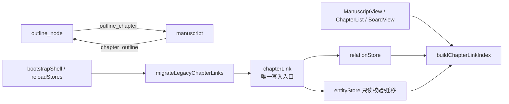

# R6-a · 大纲↔正文关系化批计划

> **定位**：把「大纲节点 ↔ 正文章节」从双侧字符串字段改为**关系唯一真源**，让正文进入关系网与 R5 依赖图。
> **依据**：研究 03 §3.6「正文是假孤岛」；研究 05 R6；2026-10-20 拍板：R6 拆 R6-a/b/c，先做 R6-a；关系唯一真源 + 自动迁移。
> **后续（不在本批）**：R6-b 笔记本文件夹实体化；R6-c 编排步骤保留 JSON 并显式标注工具内部结构。

## 一、范围

### A. 关系声明

新增：

```ts
defineRelation({
  type: 'outline_chapter', label: '对应章节', inverseType: 'chapter_outline', inverseLabel: '所属大纲节点',
  sourceTypes: ['outline_node'], targetTypes: ['manuscript'], symmetric: false, domain: 'narrative',
})
```

- 方向：大纲节点 → 正文；反向 `chapter_outline` 由 `defineRelation` 自动登记。
- 1:1 语义由唯一写入入口 `chapterLink` 保证。
- `outline_mentions` 的注释同步改为「不含 manuscript（由 `outline_chapter` 专用关系表达）」，目标类型不变。

### B. 关系唯一真源

- `chapterLink.ts` 不再写实体 `properties`；link/unlink 改为增删关系对（forward + inverse，`pairId` 配对）。
- 移除 manifest 字段：
  - `manuscript.outlineNodeId`
  - `outline_node.manuscriptId`
- 旧存储值**不删除**，只作为迁移源；迁移完成后 UI/依赖图只读关系。
- 新建章节/节点不再初始化这两个字段。

### C. 自动迁移

- 在项目数据加载完成后调用 `migrateLegacyChapterLinks(entityStore, relationStore)`：
  - 扫描全部 `manuscript` / `outline_node`，从旧字段提取候选关联；
  - 已存在关系的不重复创建；
  - 冲突时章节侧优先，其次节点侧；
  - 写入用 `import` + `skipUndo`，不污染用户撤销历史；
  - 幂等，可重复调用。
- 触发点：
  - 应用启动 `bootstrapShell()`（项目初始化之后）；
  - 项目切换 `reloadStores()` 之后。

### D. 读取面

- `buildChapterLinkIndex(entities, relations)`：关系优先，旧字段作迁移前兜底。
- 更新以下读取点：
  - `ManuscriptView` 按大纲节点筛选、新建章节后关联；
  - `ChapterList` 关联大纲节点预选、关联/解除；
  - `BoardView` 章节索引、已关联章节名、打开正文、容器按钮、关联/解除；
  - `BoardCanvas` / `BoardContainerView` 的 `hasManuscript`；
  - `NodeDetailView` 的 `hasManuscript`（由 `linkedChapterName` 派生）；
  - `useBoardNodeActions` 删除节点时的章节绑定撤销载荷。

## 二、非目标

- 不关系化 `manuscript.bookId`（书→章仍为同芽字符串；跨芽依赖不受影响）。
- 不做 R6-b 笔记文件夹、R6-c 编排步骤。
- 不改 1:1 语义；不新增多章节对一节点。
- 不清理旧存储字段（保留为迁移源，不做破坏性删除）。
- 不新增 npm/cargo 依赖。

## 三、架构



- 关系写入与实体写入解耦；`chapterLink` 只依赖两个 store 的最小接口，便于单测。
- UI 不读 `properties.manuscriptId/outlineNodeId`；索引函数保留旧字段兜底，只用于迁移前/迁移失败时显示。

## 四、文件结构

### 修改

| 文件 | 改动 |
|---|---|
| `packages/entity-core/src/relations/index.ts` | 新增 `outline_chapter`；更新 `outline_mentions` 注释 |
| `apps/tauri/src/entity/chapterLink.ts` | 关系唯一真源重写 + 迁移 + 索引 |
| `apps/tauri/src/__tests__/chapterLink.spec.ts` | 全量改写关系版测试 |
| `apps/tauri/src/world/plugins/manuscript/index.ts` | 移除 `outlineNodeId` 字段 |
| `apps/tauri/src/world/plugins/outline/index.ts` | 移除 `manuscriptId` 字段 |
| `apps/tauri/src/world/plugins/manuscript/ManuscriptView.vue` | 筛选/新建改关系 |
| `apps/tauri/src/world/plugins/manuscript/components/ChapterList.vue` | 预选/关联/解除改关系 |
| `apps/tauri/src/world/plugins/outline/board/BoardView.vue` | 使用新 composable + 关系读写 |
| `apps/tauri/src/world/plugins/outline/board/components/BoardCanvas.vue` | 传 `hasManuscript` |
| `apps/tauri/src/world/plugins/outline/board/components/BoardContainerView.vue` | `hasManuscript` 改 prop |
| `apps/tauri/src/world/plugins/outline/board/components/NodeDetailView.vue` | `hasManuscript` 由 `linkedChapterName` 派生 |
| `apps/tauri/src/world/plugins/outline/board/composables/useBoardNodeActions.ts` | 撤销载荷从关系索引读 |
| `apps/tauri/src/world/plugins/outline/board/forms/childNodeCreate.ts` | 移除 `manuscriptId` 初始化 |
| `apps/tauri/src/entity/outlineNodeDelete.ts` | 注释改为关系语义 |
| `apps/tauri/src/plugins/boot.ts` | 启动迁移 |
| `apps/tauri/src/composables/useProjectSwitcher.ts` | 项目切换迁移 |
| `docs/details/架构/芽字段矩阵.md/.html` | 生成器重跑（字段 276→274） |
| `docs/details/架构/芽生态/03/04/05、README、阅读版` | 关系数/度/孤岛/字段数同步（走查后） |
| `docs/index/README.md` | 新增在途 R6-a 行 |

### 新增

| 文件 | 职责 |
|---|---|
| `apps/tauri/src/world/plugins/outline/board/composables/useBoardChapterLinks.ts` | 白板章节索引/章节列表/已关联名/容器按钮集合；避免 BoardView 继续膨胀 |

## 五、任务

### Task 1：关系声明 + `chapterLink` 关系化 + 单测

**Files:**
- Modify: `packages/entity-core/src/relations/index.ts`
- Modify: `apps/tauri/src/entity/chapterLink.ts`
- Test: `apps/tauri/src/__tests__/chapterLink.spec.ts`

**Interfaces:**
- Produces:
  - `CHAPTER_LINK_REL = 'outline_chapter'`、`CHAPTER_LINK_INVERSE = 'chapter_outline'`
  - `linkChapterToNode(store, relations, chapterId, nodeId): Promise<LinkOutcome>`
  - `unlinkChapter(store, relations, chapterId): Promise<LinkOutcome>`
  - `unlinkNode(store, relations, nodeId): Promise<LinkOutcome>`
  - `buildChapterLinkIndex(entities, relations): ChapterLinkIndex`
  - `migrateLegacyChapterLinks(store, relations): Promise<number>`
  - `ChapterRelationStore`（`relations` + `add` + `remove`）

- [ ] **Step 1: 写失败测试**

将 `apps/tauri/src/__tests__/chapterLink.spec.ts` 全量替换为关系版测试（下方为核心用例；保留等价覆盖）：

```ts
import { describe, it, expect } from 'vitest'
import { relationshipRegistry, type Entity, type Relation } from '@worldsea/entity-core'
import {
  buildChapterLinkIndex,
  chapterIdOfNode,
  linkChapterToNode,
  migrateLegacyChapterLinks,
  nodeIdOfChapter,
  unlinkChapter,
  unlinkNode,
  CHAPTER_LINK_REL,
  CHAPTER_LINK_INVERSE,
  type ChapterLinkStore,
  type ChapterRelationStore,
} from '../entity/chapterLink'

function chapter(id: string, outlineNodeId = ''): Entity {
  return {
    id, type: 'manuscript', name: `章节 ${id}`, description: '',
    properties: { outlineNodeId, wordCount: 10, status: '草稿' },
    tags: [], createdAt: '', updatedAt: '',
  }
}
function node(id: string, manuscriptId = ''): Entity {
  return {
    id, type: 'outline_node', name: `节点 ${id}`, description: '',
    properties: { manuscriptId, parentId: '', status: '未写' },
    tags: [], createdAt: '', updatedAt: '',
  }
}
function makeStore(seed: Entity[]): { store: ChapterLinkStore } {
  const table = new Map(seed.map(e => [e.id, structuredClone(e)]))
  return {
    store: {
      async getAllEntities() { return [...table.values()].map(e => structuredClone(e)) },
    },
  }
}
function makeRelations(seed: Relation[] = []) {
  const rows = seed.map(r => structuredClone(r))
  const store: ChapterRelationStore = {
    relations: rows,
    async add(relation) { rows.push(structuredClone(relation)); return relation.id },
    async remove(id) { const i = rows.findIndex(r => r.id === id); if (i >= 0) rows.splice(i, 1) },
  }
  return { store, rows }
}
const forward = (rows: Relation[]) => rows.filter(r => r.type === CHAPTER_LINK_REL)

describe('chapterLink / 关系声明', () => {
  it('outline_chapter 注册为 outline_node → manuscript', () => {
    const schema = relationshipRegistry.get(CHAPTER_LINK_REL)!
    expect(schema.sourceTypes).toEqual(['outline_node'])
    expect(schema.targetTypes).toEqual(['manuscript'])
    expect(schema.inverseType).toBe(CHAPTER_LINK_INVERSE)
  })
})

describe('chapterLink / linkChapterToNode', () => {
  it('创建 forward + inverse，成对且方向正确', async () => {
    const { store } = makeStore([chapter('c1'), node('n1')])
    const { store: rel, rows } = makeRelations()
    const out = await linkChapterToNode(store, rel, 'c1', 'n1')
    expect(out.written.sort()).toEqual(['c1', 'n1'])
    expect(rows).toHaveLength(2)
    const f = rows.find(r => r.type === CHAPTER_LINK_REL)!
    const i = rows.find(r => r.type === CHAPTER_LINK_INVERSE)!
    expect(f).toMatchObject({ sourceId: 'n1', targetId: 'c1' })
    expect(i).toMatchObject({ sourceId: 'c1', targetId: 'n1' })
    expect(f.pairId).toBeTruthy()
    expect(f.pairId).toBe(i.pairId)
  })

  it('1:1 —— 章节改关联新节点时，清旧关系对', async () => {
    const { store } = makeStore([chapter('c1'), node('n1'), node('n2')])
    const { store: rel, rows } = makeRelations()
    await linkChapterToNode(store, rel, 'c1', 'n1')
    const out = await linkChapterToNode(store, rel, 'c1', 'n2')
    expect(forward(rows)).toHaveLength(1)
    expect(forward(rows)[0]).toMatchObject({ sourceId: 'n2', targetId: 'c1' })
    expect(rows).toHaveLength(2)
    expect(out.cleared).toEqual([{ id: 'n1', side: 'node' }])
  })

  it('1:1 —— 节点改关联新章节时，清旧关系对', async () => {
    const { store } = makeStore([chapter('c1'), chapter('c2'), node('n1')])
    const { store: rel, rows } = makeRelations()
    await linkChapterToNode(store, rel, 'c1', 'n1')
    const out = await linkChapterToNode(store, rel, 'c2', 'n1')
    expect(forward(rows)).toHaveLength(1)
    expect(forward(rows)[0]).toMatchObject({ sourceId: 'n1', targetId: 'c2' })
    expect(rows).toHaveLength(2)
    expect(out.cleared).toEqual([{ id: 'c1', side: 'chapter' }])
  })

  it('幂等：已互相关联时不再写关系', async () => {
    const { store } = makeStore([chapter('c1'), node('n1')])
    const { store: rel, rows } = makeRelations()
    await linkChapterToNode(store, rel, 'c1', 'n1')
    const before = rows.length
    const out = await linkChapterToNode(store, rel, 'c1', 'n1')
    expect(out).toEqual({ written: [], cleared: [] })
    expect(rows).toHaveLength(before)
  })

  it('实体不存在 / 空 id → 静默返回空结果', async () => {
    const { store } = makeStore([chapter('c1'), node('n1')])
    const { store: rel, rows } = makeRelations()
    expect(await linkChapterToNode(store, rel, 'missing', 'n1')).toEqual({ written: [], cleared: [] })
    expect(await linkChapterToNode(store, rel, 'c1', 'missing')).toEqual({ written: [], cleared: [] })
    expect(await linkChapterToNode(store, rel, '', 'n1')).toEqual({ written: [], cleared: [] })
    expect(rows).toHaveLength(0)
  })
})

describe('chapterLink / 解除', () => {
  it('从章节侧解除：删关系对，实体不动', async () => {
    const { store } = makeStore([chapter('c1'), node('n1')])
    const { store: rel, rows } = makeRelations()
    await linkChapterToNode(store, rel, 'c1', 'n1')
    const out = await unlinkChapter(store, rel, 'c1')
    expect(rows).toHaveLength(0)
    expect(out.written.sort()).toEqual(['c1', 'n1'])
  })

  it('从节点侧解除：删关系对', async () => {
    const { store } = makeStore([chapter('c1'), node('n1')])
    const { store: rel, rows } = makeRelations()
    await linkChapterToNode(store, rel, 'c1', 'n1')
    await unlinkNode(store, rel, 'n1')
    expect(rows).toHaveLength(0)
  })

  it('未关联 → 空结果，不抛错', async () => {
    const { store } = makeStore([chapter('c1'), node('n1')])
    const { store: rel, rows } = makeRelations()
    expect(await unlinkChapter(store, rel, 'c1')).toEqual({ written: [], cleared: [] })
    expect(await unlinkNode(store, rel, 'n1')).toEqual({ written: [], cleared: [] })
    expect(rows).toHaveLength(0)
  })
})

describe('chapterLink / 索引与迁移', () => {
  it('关系优先；旧字段仅在无关系时兜底', async () => {
    const { store } = makeStore([
      chapter('c1', 'legacy-n'), chapter('c2', 'n1'),
      node('n1'), node('legacy-n'),
    ])
    const { store: rel, rows } = makeRelations()
    await linkChapterToNode(store, rel, 'c2', 'n1')
    const idx = buildChapterLinkIndex(await store.getAllEntities(), rows)
    expect(idx.nodeByChapter.get('c1')).toBe('legacy-n') // 旧字段兜底
    expect(idx.nodeByChapter.get('c2')).toBe('n1') // 关系优先
    expect(idx.chapterByNode.get('n1')).toBe('c2')
  })

  it('迁移旧字段且幂等；冲突时章节侧优先', async () => {
    const { store } = makeStore([
      chapter('c1', 'n1'), chapter('c2'), chapter('c3', 'n3'),
      node('n1'), node('n2', 'c2'), node('n3', 'c9'),
    ])
    const { store: rel, rows } = makeRelations()
    const created = await migrateLegacyChapterLinks(store, rel)
    expect(created).toBe(3)
    expect(forward(rows).map(r => `${r.sourceId}->${r.targetId}`).sort())
      .toEqual(['n1->c1', 'n2->c2', 'n3->c3'])
    const second = await migrateLegacyChapterLinks(store, rel)
    expect(second).toBe(0)
    expect(rows).toHaveLength(6)
  })

  it('legacy field readers 仍可作为迁移源', () => {
    expect(nodeIdOfChapter(chapter('c1', ' n1 '))).toBe('n1')
    expect(chapterIdOfNode(node('n1', ' c1 '))).toBe('c1')
  })
})
```

- [ ] **Step 2: 跑测试确认失败**

Run:

```bash
pnpm vitest run apps/tauri/src/__tests__/chapterLink.spec.ts
```

Expected: FAIL（`CHAPTER_LINK_REL` 未定义 / 新入口未实现）。

- [ ] **Step 3: 注册关系**

在 `packages/entity-core/src/relations/index.ts` 的「15. 创作关系域」内、`note_link` 之前加：

```ts
defineRelation({
  type: 'outline_chapter', label: '对应章节', inverseType: 'chapter_outline', inverseLabel: '所属大纲节点',
  sourceTypes: ['outline_node'], targetTypes: ['manuscript'], symmetric: false, domain: 'narrative',
})
```

同时把 `outline_mentions` 的注释“不含 manuscript（有关联字段）”改为“不含 manuscript（由 `outline_chapter` 专用关系表达）”。

- [ ] **Step 4: 重写 `chapterLink.ts`**

完整替换为：

```ts
/**
 * chapterLink —— 「正文章节（manuscript）↔ 大纲节点（outline_node）」关联的**唯一写入入口**。
 *
 * R6-a（2026-10-20）：关系唯一真源。旧实现的双侧字符串字段（manuscript.outlineNodeId /
 * outline_node.manuscriptId）已移除；旧存储值仅由 migrateLegacyChapterLinks 读取并迁移。
 * 关系方向：outline_node --outline_chapter--> manuscript；反向 chapter_outline。
 * 1:1 语义：一个章节只对应一个节点，反之亦然。
 *
 * 详细说明见 docs/details/注释/apps/tauri/world/sproutInsights.md（R6-a 追加）。
 */
import type { Entity, Relation } from '@worldsea/entity-core'

export const CHAPTER_TYPE = 'manuscript'
export const NODE_TYPE = 'outline_node'
export const CHAPTER_LINK_REL = 'outline_chapter'
export const CHAPTER_LINK_INVERSE = 'chapter_outline'

/** 旧字段仅用于迁移与迁移前兜底读取；新代码不写。 */
export const LEGACY_LINK_FIELD = {
  chapterToNode: 'outlineNodeId',
  nodeToChapter: 'manuscriptId',
} as const

export interface ChapterLinkStore {
  getAllEntities(): Promise<Entity[]>
}

export interface ChapterRelationStore {
  relations: readonly Relation[]
  add(
    relation: Relation,
    source?: 'user' | 'agent' | 'import',
    opts?: { skipUndo?: boolean },
  ): Promise<unknown>
  remove(
    id: string,
    source?: 'user' | 'agent' | 'import',
    opts?: { skipUndo?: boolean },
  ): Promise<unknown>
}

export interface LinkOutcome {
  written: string[]
  cleared: Array<{ id: string; side: 'chapter' | 'node' }>
}

export interface ChapterLinkIndex {
  nodeByChapter: Map<string, string>
  chapterByNode: Map<string, string>
}

let relationSeq = 0
function newRelationId(prefix: string): string {
  relationSeq += 1
  return `${prefix}-${Date.now()}-${relationSeq}-${Math.random().toString(36).slice(2, 6)}`
}

function legacyNodeIdOfChapter(chapter: Entity | null | undefined): string {
  return String((chapter?.properties?.[LEGACY_LINK_FIELD.chapterToNode] as string) ?? '').trim()
}
function legacyChapterIdOfNode(node: Entity | null | undefined): string {
  return String((node?.properties?.[LEGACY_LINK_FIELD.nodeToChapter] as string) ?? '').trim()
}

/** 旧字段读取（迁移源/兜底；UI 不应新增调用）。 */
export function nodeIdOfChapter(chapter: Entity | null | undefined): string {
  return legacyNodeIdOfChapter(chapter)
}
export function chapterIdOfNode(node: Entity | null | undefined): string {
  return legacyChapterIdOfNode(node)
}

function forwards(relations: readonly Relation[]): Relation[] {
  return relations.filter(r => r.type === CHAPTER_LINK_REL)
}

function buildPair(nodeId: string, chapterId: string): [Relation, Relation] {
  const now = new Date().toISOString()
  const pairId = newRelationId('pair')
  return [
    {
      id: newRelationId('rel'), type: CHAPTER_LINK_REL,
      sourceId: nodeId, targetId: chapterId, properties: {}, pairId,
      createdAt: now, updatedAt: now,
    },
    {
      id: newRelationId('rel'), type: CHAPTER_LINK_INVERSE,
      sourceId: chapterId, targetId: nodeId, properties: {}, pairId,
      createdAt: now, updatedAt: now,
    },
  ]
}

async function removePair(relations: ChapterRelationStore, relation: Relation): Promise<void> {
  const ids = relation.pairId
    ? relations.relations.filter(r => r.pairId === relation.pairId).map(r => r.id)
    : [relation.id]
  for (const id of ids) await relations.remove(id)
}

export async function linkChapterToNode(
  store: ChapterLinkStore,
  relations: ChapterRelationStore,
  chapterId: string,
  nodeId: string,
): Promise<LinkOutcome> {
  const outcome: LinkOutcome = { written: [], cleared: [] }
  if (!chapterId || !nodeId) return outcome
  const all = await store.getAllEntities()
  const chapter = all.find(e => e.id === chapterId && e.type === CHAPTER_TYPE)
  const node = all.find(e => e.id === nodeId && e.type === NODE_TYPE)
  if (!chapter || !node) return outcome

  const currentForChapter = forwards(relations.relations).find(r => r.targetId === chapterId)
  const currentForNode = forwards(relations.relations).find(r => r.sourceId === nodeId)
  if (currentForChapter?.sourceId === nodeId && currentForNode?.targetId === chapterId) return outcome

  const removing = new Map<string, Relation>()
  const cleared = new Map<string, { id: string; side: 'chapter' | 'node' }>()
  for (const relation of forwards(relations.relations)) {
    if (relation.targetId === chapterId) {
      removing.set(relation.id, relation)
      cleared.set(`node:${relation.sourceId}`, { id: relation.sourceId, side: 'node' })
    }
    if (relation.sourceId === nodeId) {
      removing.set(relation.id, relation)
      cleared.set(`chapter:${relation.targetId}`, { id: relation.targetId, side: 'chapter' })
    }
  }
  for (const relation of removing.values()) await removePair(relations, relation)
  outcome.cleared = [...cleared.values()]

  const [forward, inverse] = buildPair(nodeId, chapterId)
  await relations.add(forward)
  await relations.add(inverse)
  outcome.written.push(chapterId, nodeId)
  return outcome
}

export async function unlinkChapter(
  _store: ChapterLinkStore,
  relations: ChapterRelationStore,
  chapterId: string,
): Promise<LinkOutcome> {
  const outcome: LinkOutcome = { written: [], cleared: [] }
  if (!chapterId) return outcome
  const relation = forwards(relations.relations).find(r => r.targetId === chapterId)
  if (!relation) return outcome
  await removePair(relations, relation)
  outcome.written.push(chapterId, relation.sourceId)
  return outcome
}

export async function unlinkNode(
  _store: ChapterLinkStore,
  relations: ChapterRelationStore,
  nodeId: string,
): Promise<LinkOutcome> {
  const outcome: LinkOutcome = { written: [], cleared: [] }
  if (!nodeId) return outcome
  const relation = forwards(relations.relations).find(r => r.sourceId === nodeId)
  if (!relation) return outcome
  await removePair(relations, relation)
  outcome.written.push(nodeId, relation.targetId)
  return outcome
}

export function buildChapterLinkIndex(
  entities: readonly Entity[],
  relations: readonly Relation[],
): ChapterLinkIndex {
  const nodeByChapter = new Map<string, string>()
  const chapterByNode = new Map<string, string>()
  for (const relation of forwards(relations)) {
    if (!nodeByChapter.has(relation.targetId)) nodeByChapter.set(relation.targetId, relation.sourceId)
    if (!chapterByNode.has(relation.sourceId)) chapterByNode.set(relation.sourceId, relation.targetId)
  }
  // 旧字段兜底：迁移前/迁移失败时仍能显示既有绑定；关系永远优先
  for (const entity of entities) {
    if (entity.type === CHAPTER_TYPE) {
      const nodeId = legacyNodeIdOfChapter(entity)
      if (nodeId && !nodeByChapter.has(entity.id)) {
        nodeByChapter.set(entity.id, nodeId)
        if (!chapterByNode.has(nodeId)) chapterByNode.set(nodeId, entity.id)
      }
    }
    if (entity.type === NODE_TYPE) {
      const chapterId = legacyChapterIdOfNode(entity)
      if (chapterId && !chapterByNode.has(entity.id)) {
        chapterByNode.set(entity.id, chapterId)
        if (!nodeByChapter.has(chapterId)) nodeByChapter.set(chapterId, entity.id)
      }
    }
  }
  return { nodeByChapter, chapterByNode }
}

/** 旧字段 → 关系的一次性幂等迁移；不修改实体、不进撤销栈。 */
export async function migrateLegacyChapterLinks(
  store: ChapterLinkStore,
  relations: ChapterRelationStore,
): Promise<number> {
  const all = await store.getAllEntities()
  const nodes = new Map(all.filter(e => e.type === NODE_TYPE).map(e => [e.id, e]))
  const chapters = new Map(all.filter(e => e.type === CHAPTER_TYPE).map(e => [e.id, e]))
  const existing = forwards(relations.relations)
  const usedNodes = new Set(existing.map(r => r.sourceId))
  const usedChapters = new Set(existing.map(r => r.targetId))
  const pairs = new Map<string, string>()

  for (const chapter of chapters.values()) {
    const nodeId = legacyNodeIdOfChapter(chapter)
    if (nodeId && nodes.has(nodeId)) pairs.set(nodeId, chapter.id)
  }
  for (const node of nodes.values()) {
    const chapterId = legacyChapterIdOfNode(node)
    if (chapterId && chapters.has(chapterId) && !pairs.has(node.id)) {
      pairs.set(node.id, chapterId)
    }
  }

  let created = 0
  for (const [nodeId, chapterId] of pairs) {
    if (usedNodes.has(nodeId) || usedChapters.has(chapterId)) continue
    const [forward, inverse] = buildPair(nodeId, chapterId)
    await relations.add(forward, 'import', { skipUndo: true })
    await relations.add(inverse, 'import', { skipUndo: true })
    usedNodes.add(nodeId)
    usedChapters.add(chapterId)
    created += 1
  }
  return created
}
```

- [ ] **Step 5: 跑测试确认通过**

Run:

```bash
pnpm vitest run apps/tauri/src/__tests__/chapterLink.spec.ts
```

Expected: PASS（约 11 例）。

> Task 1 的交付物是「关系模块 + 单测」；调用签名收口与 schema 字段移除在 Task 3，Task 1 不跑全局 typecheck。

---

### Task 2：迁移接线（启动 / 切项目）

**Files:**
- Modify: `apps/tauri/src/plugins/boot.ts`
- Modify: `apps/tauri/src/composables/useProjectSwitcher.ts`
- Test: `apps/tauri/src/__tests__/chapterLink.spec.ts`

**Interfaces:**
- Consumes: `migrateLegacyChapterLinks(store, relations)`（Task 1）。
- Produces: 启动/切项目自动迁移；迁移函数幂等、skipUndo、失败不阻塞。

- [ ] **Step 1: 写失败测试（迁移触发）**

在 `chapterLink.spec.ts` 追加：

```ts
it('迁移幂等：重复调用不产生重复关系对', async () => {
  const { store } = makeStore([chapter('c1', 'n1'), node('n1', 'c1')])
  const { store: rel, rows } = makeRelations()
  expect(await migrateLegacyChapterLinks(store, rel)).toBe(1)
  expect(await migrateLegacyChapterLinks(store, rel)).toBe(0)
  expect(rows).toHaveLength(2)
})
```

（迁移函数本身已在 Task 1 覆盖；此例锁幂等。）运行确认通过后进入接线。

- [ ] **Step 2: 启动迁移接线**

在 `apps/tauri/src/plugins/boot.ts` 顶部加：

```ts
import { migrateLegacyChapterLinks } from '../entity/chapterLink'
```

在 `bootstrapShell` 内、`installCapabilityMutationListener()` 之后加：

```ts
  // R6-a：旧「章节↔大纲节点」双字段 → 关系迁移（幂等、skipUndo；失败不阻塞启动）
  try {
    const entityStore = useEntityStore()
    const relationStore = useRelationStore()
    if (!(entityStore.entities?.length)) await entityStore.loadAll()
    if (!(relationStore.relations?.length)) await relationStore.loadAll()
    await migrateLegacyChapterLinks(entityStore, relationStore)
  } catch (err) {
    console.warn('[boot] 章节关联迁移失败（不影响启动）:', err)
  }
```

- [ ] **Step 3: 切项目迁移接线**

在 `useProjectSwitcher.reloadStores()` 的 `Promise.all([...])` 之后加：

```ts
    try {
      const { migrateLegacyChapterLinks } = await import('@/entity/chapterLink')
      await migrateLegacyChapterLinks(entityStore, relationStore)
    } catch (err) {
      console.warn('[project] 章节关联迁移失败（不影响切项目）:', err)
    }
```

- [ ] **Step 4: 跑专项**

```bash
pnpm vitest run apps/tauri/src/__tests__/chapterLink.spec.ts
```

Expected: 迁移幂等例通过。全局 typecheck 在 Task 3 调用签名收口后必须为 0。

---

### Task 3：字段移除 + UI 关系读写 + 类型收口

**Files:**
- Modify: `apps/tauri/src/world/plugins/manuscript/index.ts`
- Modify: `apps/tauri/src/world/plugins/outline/index.ts`
- Modify: `apps/tauri/src/world/plugins/manuscript/ManuscriptView.vue`
- Modify: `apps/tauri/src/world/plugins/manuscript/components/ChapterList.vue`
- Modify: `apps/tauri/src/world/plugins/outline/board/BoardView.vue`
- Modify: `apps/tauri/src/world/plugins/outline/board/components/BoardCanvas.vue`
- Modify: `apps/tauri/src/world/plugins/outline/board/components/BoardContainerView.vue`
- Modify: `apps/tauri/src/world/plugins/outline/board/components/NodeDetailView.vue`
- Modify: `apps/tauri/src/world/plugins/outline/board/composables/useBoardNodeActions.ts`
- Modify: `apps/tauri/src/world/plugins/outline/board/forms/childNodeCreate.ts`
- Modify: `apps/tauri/src/entity/outlineNodeDelete.ts`
- Create: `apps/tauri/src/world/plugins/outline/board/composables/useBoardChapterLinks.ts`
- Test: `apps/tauri/src/__tests__/chapterLink.spec.ts`（索引用例）

**Interfaces:**
- Consumes: `buildChapterLinkIndex`、`linkChapterToNode`、`unlinkChapter`、`unlinkNode`（新签名）。
- Produces: 所有 UI 读写只走关系索引；`useBoardChapterLinks` 返回 `chapters/index/chapterNodeNames/chapterNodeIds/refresh`。

- [ ] **Step 1: 移除 schema 字段与新建初始化**

- `apps/tauri/src/world/plugins/manuscript/index.ts`：删除 `{ key: 'outlineNodeId', ... }` 一行。
- `apps/tauri/src/world/plugins/outline/index.ts`：删除 `{ key: 'manuscriptId', ... }` 一行。
- `ManuscriptView.vue` 的 `newManuscript` properties 删除 `outlineNodeId: filterOutline.value || '',`。
- `BoardView.vue` 两处新建节点 properties 删除 `manuscriptId: '',`。
- `useBoardNodeActions.ts` 复制节点 properties 删除 `manuscriptId: '', // Q3：不复制关联章节`。
- `childNodeCreate.ts` 删除 `manuscriptId: '',`。
- `outlineNodeDelete.ts` 的注释改为：

```ts
  // 2) 章节：删节点时同时解除 outline_chapter 关系对（章节实体保留）
```

- [ ] **Step 2: 写索引/按钮测试**

在 `chapterLink.spec.ts` 追加：

```ts
it('章节/节点两侧关系都进入索引；容器按钮集合来自 chapterByNode', async () => {
  const entities = [chapter('c1'), chapter('c2'), node('n1'), node('n2')]
  const { store } = makeStore(entities)
  const { store: rel, rows } = makeRelations()
  await linkChapterToNode(store, rel, 'c1', 'n1')
  await linkChapterToNode(store, rel, 'c2', 'n2')
  const idx = buildChapterLinkIndex(entities, rows)
  expect(idx.chapterByNode.get('n1')).toBe('c1')
  expect(idx.chapterByNode.get('n2')).toBe('c2')
  expect(new Set(idx.chapterByNode.keys())).toEqual(new Set(['n1', 'n2']))
})
```

- [ ] **Step 3: 新建白板章节索引 composable**

创建 `useBoardChapterLinks.ts`：

```ts
import { computed, ref } from 'vue'
import { useEntityStore, useRelationStore, type Entity } from '@worldsea/entity-core'
import { buildChapterLinkIndex, CHAPTER_TYPE, type ChapterLinkIndex } from '@/entity/chapterLink'

export function useBoardChapterLinks() {
  const es = useEntityStore()
  const rs = useRelationStore()
  const chapters = ref<Entity[]>([])
  const index = ref<ChapterLinkIndex>({ nodeByChapter: new Map(), chapterByNode: new Map() })

  async function refresh(): Promise<void> {
    const all = await es.getAllEntities()
    chapters.value = all.filter(e => e.type === CHAPTER_TYPE)
    index.value = buildChapterLinkIndex(all, rs.relations ?? [])
  }

  const chapterNodeNames = computed(() => {
    const byId = new Map(
      (es.entities ?? []).filter(e => e.type === 'outline_node').map(e => [e.id, e]),
    )
    const out = new Map<string, string>()
    for (const [chapterId, nodeId] of index.value.nodeByChapter) {
      out.set(chapterId, (byId.get(nodeId)?.name ?? '').trim() || '未命名节点')
    }
    return out
  })

  const chapterNodeIds = computed(() => new Set(index.value.chapterByNode.keys()))

  return { chapters, index, chapterNodeNames, chapterNodeIds, refresh }
}
```

- [ ] **Step 4: BoardView 接入**

- 导入 `useRelationStore` 与 `useBoardChapterLinks`；`const rs = useRelationStore()`。
- 删除原有 `chapters`/`chapterLink`/`refreshChapters`/`chapterNodeNames` 块，改为：

```ts
const {
  chapters,
  index: chapterLink,
  chapterNodeNames,
  chapterNodeIds,
  refresh: refreshChapters,
} = useBoardChapterLinks()
```

- `inspectedChapterName` 删除旧字段回退，只读 `chapterLink.value.chapterByNode`。
- `ctxItems` 的 `state.hasManuscript = chapterLink.value.chapterByNode.has(node.id)`。
- `onOpenManuscript`：

```ts
  const node = nodesById.value.get(container.nodeId)
  const manuscriptId = node ? chapterLink.value.chapterByNode.get(node.id) ?? '' : ''
  if (!manuscriptId) return
```

- `linkChapter` 调用：

```ts
const outcome = await linkChapterToNode(es, rs, chapterId, nodeId)
```

- `onUnlinkChapter` 调用：

```ts
const outcome = await unlinkNode(es, rs, node.id)
```

- `BoardCanvas` 传参：

```vue
:chapter-node-ids="chapterNodeIds"
```

- [ ] **Step 5: BoardCanvas / BoardContainerView**

`BoardCanvas.vue` 的 props 增加：

```ts
  chapterNodeIds?: Set<string>
```

传给容器：

```vue
:has-manuscript="chapterNodeIds?.has(c.nodeId) ?? false"
```

`BoardContainerView.vue`：

```ts
const props = defineProps<{
  container: BoardContainer
  node?: Entity
  selected: boolean
  hasManuscript?: boolean
  openFormSignal?: { id: string; token: number } | null
}>()
```

删除原来的 `const hasManuscript = computed(...)`（模板直接用 prop）。

- [ ] **Step 6: NodeDetailView**

```ts
const hasManuscript = computed(() => !!props.linkedChapterName)
```

删除基于 `node.properties.manuscriptId` 的读取。

- [ ] **Step 7: ManuscriptView / ChapterList**

`ManuscriptView.vue`：

- 导入 `buildChapterLinkIndex`。
- 增加：

```ts
const chapterLinkIndex = computed(() =>
  buildChapterLinkIndex(es.entities ?? [], rs.relations ?? []),
)
```

- `filteredManuscripts`：

```ts
return viewChapters.value.filter(m => chapterLinkIndex.value.nodeByChapter.get(m.id) === filterOutline.value)
```

- `newManuscript` 删除 `outlineNodeId` 初始化；关联改：

```ts
if (filterOutline.value) await linkChapterToNode(es, rs, id, filterOutline.value)
```

`ChapterList.vue`：

- 导入 `useRelationStore`、`buildChapterLinkIndex`；`const rs = useRelationStore()`。
- `ctxLinkOutline`：

```ts
outlinePickId.value = buildChapterLinkIndex(es.entities ?? [], rs.relations ?? [])
  .nodeByChapter.get(ctxMenu.entity.id) ?? ''
```

- `confirmOutline` 调用新签名：

```ts
if (!nodeId) {
  await unlinkChapter(es, rs, chapterId)
  return
}
await linkChapterToNode(es, rs, chapterId, nodeId)
```

- [ ] **Step 8: useBoardNodeActions 撤销载荷**

把：

```ts
const chapterLinks = (es.entities ?? [])
  .filter(e => e.type === 'manuscript')
  .map(c => ({ chapterId: c.id, nodeId: nodeIdOfChapter(c) }))
  .filter(l => l.nodeId && doomed.has(l.nodeId))
```

改为：

```ts
const linkIndex = buildChapterLinkIndex(es.entities ?? [], rs.relations ?? [])
const chapterLinks = (es.entities ?? [])
  .filter(e => e.type === 'manuscript')
  .map(c => ({ chapterId: c.id, nodeId: linkIndex.nodeByChapter.get(c.id) ?? '' }))
  .filter(l => l.nodeId && doomed.has(l.nodeId))
```

删除 `nodeIdOfChapter` 导入；`deleteApi.unlinkChapter` 改为 `unlinkNode(es, rs, nodeId)`。

- [ ] **Step 9: 跑专项与类型检查**

```bash
pnpm vitest run apps/tauri/src/__tests__/chapterLink.spec.ts apps/tauri/src/world/plugins/outline/__tests__/boardUndo.spec.ts apps/tauri/src/world/plugins/outline/__tests__/nodeDetailDock.spec.ts
pnpm typecheck:tauri
```

Expected: PASS；类型 0 error。

---

### Task 4：字段矩阵、研究文档、门禁与真机走查

**Files:**
- Regenerate: `docs/details/架构/芽字段矩阵.md`、`docs/details/架构/芽字段矩阵.html`
- Modify: `docs/details/架构/芽生态/03-依赖与营养级.md`、`04-生命周期与状态.md`、`05-用户信息架构与建议.md`、`README.md`、`阅读版/index.html`
- Modify: `docs/index/README.md`、`docs/index/ARCHIVE.md`（走查后）
- Move: `docs/plans/已完成/2026-10-20-R6a-大纲正文关系化批计划.md`（走查后）

- [ ] **Step 1: 重生成字段矩阵**

```bash
node scripts/generate-field-matrix.mjs
```

Expected: 字段实例 276→274，唯一键 156→154；`manuscriptId` / `outlineNodeId` 行消失。

- [ ] **Step 2: 更新研究文档（走查前先改事实行，走查后加“已完成”）**

- 03 §3.1 第 2 条“大纲节点 ↔ 正文”从“双向字符串”改为“`outline_chapter` 关系（R6-a）”；§3.6 B 类删去正文，注明“R6-a 已移出孤岛”；§3.4 大纲出度 15→16、正文从孤岛移除。
- 04 §4.1 状态表补一句“章节↔节点关系已关系化，不再有双字段”；§4.8 S3 的“字段不持久化”不涉及本批。
- 05 R6 行改为“R6-a 已完成；R6-b/c 待后续”，并写清 R6-b 文件夹实体化、R6-c 编排 JSON 显式标注的后续方向。
- README §六/§九补 R6-a 落地；阅读版 HTML 同步 R6 行与下一步。
- 关系数 104→105、大纲出度 15→16、孤岛 11→10、字段 276→274。

- [ ] **Step 3: 全量门禁**

```bash
pnpm vitest run
pnpm typecheck:tauri
pnpm arch:check
pnpm --filter @worldsea/tauri build
cd apps/tauri && node node_modules/vite/bin/vite.js build --config workspace/vite.config.ts
node scripts/check-doc-links.mjs
```

Expected:
- vitest：0 failed（R5 基线 176 文件 / 1432 通过 / 1 跳过；R6-a 新增用例后数量增加）。
- typecheck：0 error。
- arch：0 违规（BoardView 为冻结超限文件，优先用 `useBoardChapterLinks` 外置，避免继续增长）。
- 两次构建成功；产品域窗口加载 `workspace-dist`，构建后必须 reload。
- 文档断链 0 / 绝对路径 0。

- [ ] **Step 4: 真机走查（用户手测）**

1. **章节关联**：正文 → 任意书籍的章节右键「关联大纲节点」→ 选节点。预期：白板该节点容器出现「打开正文」按钮；点击能打开该章节。
2. **反向筛选**：正文视图按该大纲节点筛选，章节出现在列表中；解除关联后消失。
3. **1:1 换绑**：把同一章节改关联到另一个节点。预期：旧节点「打开正文」消失，新节点出现；章节只出现一次。
4. **关系可见**：打开该节点的实体详情/关联页，能看到「对应章节」；打开章节详情能看到「所属大纲节点」。
5. **R5 依赖**：设置 → 芽管理 → 大纲详情，出依赖新增「正文写作」（`对应章节`）；正文不再显示为无跨芽关系的孤岛。
6. **删除节点**：删除已关联节点（含子节点策略），章节实体保留、关联解除；撤销删除后关联恢复（白板撤销载荷）。
7. **旧数据迁移**：用已有旧链接的项目启动一次，旧关联仍显示；关系表中生成 `outline_chapter` 对，不重复。
8. **字段矩阵**：不再出现 `manuscriptId` / `outlineNodeId`；字段数 274。
9. **回归**：书籍分组/移动、正文编辑与保存、白板布局/撤销、R5 详情不变。

- [ ] **Step 5: 走查通过后归档**

仅在用户明确回复「走查通过」后执行：

- 计划 `status: 待启动` → `已完成`，追加施工记录与门禁数字。
- `git mv` 到 `docs/plans/已完成/2026-10-20-R6a-大纲正文关系化批计划.md`。
- 索引在途行 → ARCHIVE 完成行；研究 03/04/05/README/阅读版同步。
- 同批提交（代码 + 文档），建议：`feat(narrative): R6-a 大纲↔正文关系化（outline_chapter/迁移/UI 关系读写）`；不推送。

## 六、施工记录（2026-10-20，真机走查通过）

### 已完成

- **Task 1**：新增 `outline_chapter` / `chapter_outline` 关系；`chapterLink` 重写为关系唯一真源（forward+inverse、pairId、1:1 清旧、幂等、迁移、索引兜底）；`chapterLink.spec` 12 例。
- **Task 2**：`bootstrapShell` + `useProjectSwitcher.reloadStores` 接入 `migrateLegacyChapterLinks`（幂等、import + skipUndo、失败只 warn）。
- **Task 3**：移除 `manuscript.outlineNodeId` / `outline_node.manuscriptId`；`ManuscriptView`、`ChapterList`、`BoardView`、`BoardCanvas`、`BoardContainerView`、`NodeDetailView`、`useBoardNodeActions` 全部改关系索引；新增 `useBoardChapterLinks`；新建节点不再初始化旧字段。
- **门禁发现并修复**：新关系会被通用「关联实体」编辑器自动纳入，绕过 `chapterLink` 1:1 入口；已在 `outlineRefs` 增加 `DEDICATED_REF_RELATION_TYPES = ['outline_chapter']` 排除，并补真实注册表断言。
- **Task 4**：字段矩阵重生成 274 实例 / 154 唯一键；研究 03/04/05、README、阅读版 HTML、索引同步。
- **架构减压**：4 个冻结文件曾小幅超限，通过合并行/压缩新增代码回到冻结线内，未 update-baseline。

### 门禁

- R6-a 定向：`chapterLink` 12 例 + `outlineRefs` 27 例 + `boardUndo` 14 例 + `nodeDetailDock` 5 例，全绿。
- 全量 vitest：**176 文件 / 1427 通过 / 1 跳过**（0 failed）。
- `vue-tsc --noEmit`：0 error。
- `arch:check`：0 违规（存量超限 64 / 基线 68）。
- `pnpm --filter @worldsea/tauri build`：成功（9515 modules / 1m35s）。
- workspace-dist 构建：成功（9517 modules；产品域窗口实际加载此产物，需 reload）。
- `check-doc-links`：337 文件 / 1294 链接，断链 0 / 绝对路径 0 / 疑似误报 11（存量）。

### 真机走查

- **2026-10-20 用户走查通过**：章节关联/解除、1:1 换绑、正文按节点筛选、白板打开正文、删除节点撤销恢复、R5 大纲出依赖新增正文、字段矩阵 274 均符合预期。
- 无遗留阻塞项；R6-b/R6-c 按既定方向后续处理。

## 七、验收

- [ ] 章节↔节点关系只由 `outline_chapter` 关系表达；旧字段不再写入。
- [ ] link/unlink 幂等、1:1 换绑正确、关系对成对增删。
- [ ] 旧字段自动迁移一次且幂等；重复启动/切项目不产生重复关系。
- [ ] 正文筛选、章节预选、白板打开正文、容器按钮、删除撤销全部走关系索引。
- [ ] R5 大纲出依赖出现正文；正文离开孤岛。
- [ ] 字段矩阵 274 字段；关系 105 条；文档同步。
- [ ] 全量门禁与真机走查通过。

## 八、风险

1. **迁移时机**：`bootstrapShell` 必须晚于项目初始化；`reloadStores` 必须晚于两个 store 的 `loadAll`。迁移失败只 warn，不阻塞启动；旧字段兜底索引可保证 UI 仍能显示。
2. **撤销粒度**：link/unlink 会分别增删 forward/inverse 两条关系，可能产生两条撤销记录；本批不引入关系事务。若走查觉得撤销步数过多，再合并。
3. **旧字段残留**：不移除实体存储中的旧 properties；迁移后不再读取（索引仅在无关系时兜底）。不做破坏性清理。
4. **R5 数字变化**：关系数 104→105、大纲出度 15→16、孤岛 11→10；研究文档与字段矩阵必须同批更新。
5. **BoardView 冻结**：新增 `useBoardChapterLinks` 外置章节索引，避免 BoardView 继续膨胀；若仍触发 arch 超限，优先继续外置，不 update-baseline。
6. **bookId 未关系化**：书→章仍是字符串；本次只解决跨芽的「大纲↔正文」，不把同芽内部结构强行关系化。
