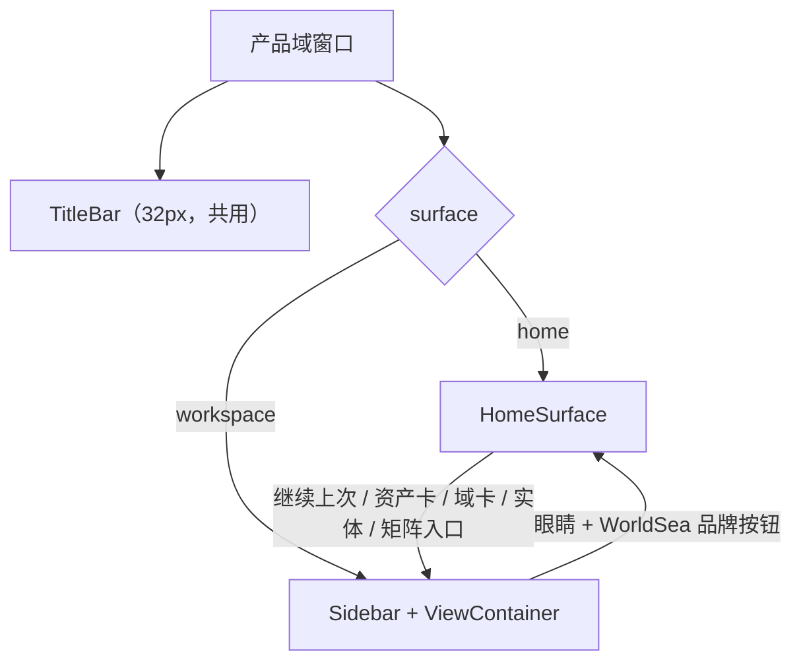

# 产品域首页（项目扉页）· 设计

> **已完成（2026-10-23 真机走查通过）**；已归档至 `docs/plans/已完成/`。
> 2026-10-23 立项。设计基线已由用户确认：门户结构 + 轻量可编辑简介 + 字段矩阵摘要 + 冷启动先见首页。
> 本文件是设计规格；批计划：[2026-10-23-产品域首页-批计划.md](2026-10-23-产品域首页-批计划.md)。

## 一、背景与目标

现状：产品域是独立 Tauri 窗口（`/workspace` 前缀、运行时读 `workspace-dist`），前端没有路由；`Shell.vue` 固定渲染 `TitleBar + Sidebar + ViewContainer`，视图切换由 Pinia `uiStore.currentView` 驱动。窗口栏左侧「工作台」胶囊是「进入 Agent 空间」，紧邻的眼睛是 `ProjectSwitcher` 里的品牌 logo，点它打开的是项目下拉。

目标：在产品域增加一个**高于芽侧栏/工具条/视图的壳级表面**——项目扉页/门户。它同时承担：

1. 用户页/博客感：项目名、一句话/短文、封面、近期写作；
2. 项目资产管理：8 个语义域 + 芽 + 实体数量 + 最近实体；
3. 数据仪表盘：实体/关系/芽/字段/大纲/正文速览，不伪造趋势；
4. 静态字段矩阵摘要：实体类型 × 字段/必填/关系类型，完整矩阵仍走现有芽。

## 二、非目标（首版不做）

- 不引入 vue-router；不注册第 28 个芽；`DEFAULT_SPROUTS` 保持 27。
- 不做可拖拽 widget / 自由编排内容块 / 文章模型。
- 不把完整字段矩阵复制进首页。
- 不做文件资产管理（图片/封面文件的全量管理）。
- 不保留工作台视图内部状态（滚动、字段矩阵当前面板）；用户已接受首版重置，后续批次可单独安排。
- 不新增 Rust 命令、不新增 npm/Cargo 依赖、不引入图表库（ECharts 已在依赖里，但首版只用 CSS/SVG）。
- 不改左侧「工作台」胶囊的 Agent 空间语义；这是既有语义债，单列。

## 三、信息架构与导航

### 3.1 表面模型

`uiStore` 增 `surface: 'home' | 'workspace'`，默认 `'home'`；不落盘。`Shell.vue` 按 surface 渲染：



- 冷启动（窗口创建 / 应用重启）→ `home`。
- 从 Agent 空间切回工作台、托盘恢复 → 保留当前 surface（用户已裁定：避免写作中途被打断）。
- 工作台内切项目 → 保留当前 surface；首页数据与 profile 随项目刷新。
- 不提供 URL/深链；`Ctrl+R` 重载 = 冷启动 → 首页。

### 3.2 标题栏

- 左侧「工作台」胶囊不变：进入 Agent 空间。
- 品牌区拆为两个可聚焦元素：
  - `ProjectHomeButton`：`WorldSeaLogo` + `WorldSea`，点击 `openHome()`；首页时 `aria-current="page"`，点击不动作；tooltip「返回项目首页」。
  - `ProjectSwitcher`（`show-brand=false`）：`[项目名 ▾]`，点击仍打开项目清单；下拉定位/切换/刷新逻辑不变。
- 中间标签：`surface === 'home' ? '首页' : currentViewLabel`。
- 首页不渲染侧栏与工具条；标题栏是唯一共享壳件。

### 3.3 进入工作台

单点 `useHomeNavigation().openWorkspace(viewId?, entityId?)`：

1. 目标 view：显式 `viewId` → `uiStore.currentView`（仍可见）→ `resolveDefaultViewId(visibleViewsInSidebarOrder(), readLastViewId())`。
2. 设 `uiStore.setView(viewId)` + `viewComponent = pluginStore.getView(viewId)?.component`。
3. 有 `entityId`：`uiStore.selectEntity(entityId)` + 派发 `ws-select-entity`（沿用 Shell 的双通道）。
4. `uiStore.setSurface('workspace')`。
5. 无可见视图：不切面，toast「没有可用视图，请先在设置中启用芽」。

`HomeSurface` 的入口：

- Hero 主 CTA：`继续上次：{label}`（无 last view 时文案为「进入工作台」）。
- 域卡「进入」：该域第一个启用芽的视图。
- 芽 chip：该芽视图。
- 最近实体 / 域内最近实体：对应视图 + `entityId`。
- 矩阵摘要「查看完整字段矩阵」：`field-matrix`（仅该视图已注册、即芽已启用时可用）。
- 近期写作「进入正文写作」：`manuscript`。

### 3.4 键盘与焦点

- 首页可用：`Ctrl+K` 搜索、`Ctrl+,` 设置、`?` 帮助、`Ctrl+Tab` 进入 Agent 空间、`Ctrl+S` 导出。
- 只在工作台生效：`Ctrl+↑/↓` 切视图、`Ctrl+B` 侧栏、`Ctrl+Z/Y` / undo history。首页下这些快捷键**不得静默改底层视图/数据**。
- 切到首页：focus Hero `h1`（`tabindex="-1"`）；切到工作台：focus `#main-content`。
- `#main-content` 由壳级 `ShellSurface` 统一承载（单一 `<main tabindex="-1">`）；`HomeSurface` 与工作台作为其插槽内容，二者**互斥可见**：工作台子树常驻（`v-show`）、首页按需挂载（`v-if`）。工作台子树（`ViewContainer` / 实体视图）内含 `#view-toolbar-*` Teleport 与挂载期 DOM 引用，卸载会让切面 patch 崩溃（surface 已切、DOM 不动），故不采用双向卸载式互斥；首页无此类依赖，不常驻以免工作台编辑时后台重算首页聚合。

## 四、页面结构

### 4.1 区块

| 顺序 | 区块 | 内容 | 首版边界 |
|---|---|---|---|
| 1 | 封面 | 项目名、tagline/短文、封面、最后更新、已启用芽、主 CTA、编辑简介 | 项目名不可在此改；无封面用默认视觉 |
| 2 | 世界速览 | 实体、关系、已启用芽、字段、大纲、正文 6 个数字 | 不做环比/趋势/假 sparkline |
| 3 | 资产地图 | 8 域卡片 + 域构成堆叠条 | 只看启用芽；未启用域置灰、计数显示「—」 |
| 4 | 最近动态 + 近期写作 | 最近 10 条启用芽实体；最近 book/manuscript 封面卡 | 无书写则写作段隐藏 |
| 5 | 字段矩阵摘要 | 前 8 个实体类型 × 字段/必填/关系类型 + 总计 + 完整矩阵入口 | 静态表，无筛选/搜索/展开 |
| 6 | 页脚 | WorldSea · 最后更新 | 不显示绝对路径 |

### 4.2 封面（Hero）

- 标题 = 当前项目名（`currentProject.name`；`isDefault` 时「默认工作区」），不在 profile 里另存别名。
- 副标题 = profile.tagline；为空时用事实型自动句：`{实体} 个实体 · {关系} 条关系 · {启用芽} 个芽在运行`；空项目为「尚未填写简介」。
- 短文 = profile.about，最多 2 行（CSS line-clamp）；为空隐藏。
- 封面 = profile.coverImage；为空用「品牌眼睛水印 + 柔和渐变 + 细星点」的默认视觉，不加载全局图谱组件。
- 元信息：最后更新时间（相对时间）、`已启用芽 {active}/{total}`。
- 主 CTA：`继续上次：{label}` / `进入工作台`；次按钮：`编辑简介`（打开设置 → 首页）。
- 高度约 300–340px；文字区加渐变遮罩保证明暗两套主题对比度。

### 4.3 世界速览

- 6 个 KPI：实体总数（全量）、关系总数（全量）、已启用芽（active/total）、字段实例数（Schema）、大纲节点数、正文数（仅 `manuscript` 类型，不含 `book`）。
- 点击映射：已启用芽 → 设置 › 插件；大纲 → 大纲视图；正文 → 正文写作视图（目标芽未启用时不可点）；实体/关系/字段为全局概念，不跳转。
- 数字 `font-variant-numeric: tabular-nums`；没有历史数据，**不显示涨跌箭头/环比**。

### 4.4 资产地图

- 数据范围：只取当前启用芽（与侧栏一致）。未启用域卡片置灰，实体数显示「—」，不显示 0（避免暗示无数据），「进入」禁用。
- 每张卡：
  - 域图标 + 域名 + 域问题（`SPROUT_DOMAINS.question`）。
  - 实体数 = 该域启用芽的实体类型集合去重后求和。
  - 启用芽 chips（最多 3 个 + `+N` 非交互标签），点击进入对应视图。
  - 最近实体（最多 3 个；无则「尚无内容」），点击进入视图并选中实体。
  - 「进入」按钮 → 第一个启用芽的视图。
- 顶部域构成堆叠条：按域实体数占比；用 8 个低饱和语义色；`title`/`aria-label` 给出数值；全 0 时隐藏。
- 8 域布局：视口 ≥1200px 4 列；900–1199 2 列；<900 1 列。卡片等高，内容溢出省略。

### 4.5 最近动态 + 近期写作

- 最近：启用芽实体按 `updatedAt` 倒序取 10；每行 = 相对时间 + 类型图标/名称 + 类型 label + 描述首行；整行 button。
- 相对时间：`<1 分钟` 刚刚 / `<1 小时` N 分钟前 / `<24 小时` N 小时前 / 昨天 / `MM-DD`；纯函数 + 测试。
- 近期写作：启用 `official.manuscript` 时，取最近 `book`（无书则最近 `manuscript`）；显示封面、名称、简介 2 行、章节数、总字数、`进入正文写作`。章节/字数口径 = `manuscript.properties.bookId === book.id` + `properties.wordCount` 求和；首页自带纯函数 + 测试，不重构正文芽。
- 宽屏 2/3 + 1/3；无写作段时最近列表占满。

### 4.6 字段矩阵摘要

- 数据源：`useFieldMatrixData()` 的 `FieldMatrixModel`（运行时 Schema/Trait/Facet/关系/视图）。
- 行：`model.entities` 按字段数降序取前 8；列 = 实体类型、所属芽、字段数、必填数、关系类型数。
- 关系类型数 = `model.relations` 中 source/target 包含该类型的条数（**类型数，不是实例数**）。
- 底部：`{芽数} 芽 · {实体类型数} 类型 · {字段实例数} 字段 · {关系类型数} 关系类型` + `查看完整字段矩阵`。
- 表 `table-layout: fixed` + `scrollbar-gutter: stable`；无 `<details>`、无筛选、无搜索。
- 范围 = 全量 Schema（含未启用芽），与资产地图的「启用芽」口径不同；在区块标题旁标注「当前注册 Schema」（运行时芽开关会改变注册集，不用「全量」以免与运行态漂移）。
- `查看完整字段矩阵` 只在字段矩阵视图已注册（芽已启用）时显示；未启用时摘要仍在，入口隐藏并提示。

### 4.7 视觉与响应式

- 语言：安静的档案馆/扉页；沿用 `theme.css` token；不新增字体；不新增重阴影；不持续动画。
- 内容宽 `max-width: 1180px` 居中；首页根 `overflow-y: auto; scrollbar-gutter: stable`；标题栏固定。
- 首页根背景 `--bg-app`；卡片 `--bg-surface` + `--border` + `--radius-*`；强调色只用 `--accent` 与低饱和域色。
- 过渡：surface 切换 120–160ms 淡入；`prefers-reduced-motion` 关闭。
- 空态/骨架/错误沿用加载反馈机制：首载用 `WsSkeleton`；局部错误用行内错误 + 重试；不整页 spinner。

### 4.8 无障碍

- `<main>` 地标；h1 = 项目名；h2 = 区块标题。
- 所有卡片/实体 chip/按钮可键盘达；焦点环用现有 token；避免嵌套 button（域卡用 article + 独立 button/chips）。
- 封面图 `alt`；装饰性默认视觉 `aria-hidden`。
- 域构成条有 `aria-label` 文本摘要；表格有 caption（可视觉隐藏）。
- 切面 focus 管理；项目切换时首页 `inert`。

## 五、数据设计

### 5.1 数据来源

| 数据 | 来源 |
|---|---|
| 项目名 / 当前项目 | `useProjectSwitcher().currentProject` |
| 实体 / 计数 / 最近 | `useEntityStore()`：`entities`、`typeCounts`、`allTypeCounts`、`loadAll()` |
| 关系 | `useRelationStore().relations` |
| 字段/类型/关系统计 | `useFieldMatrixData()` → `FieldMatrixModel` |
| 8 域 | `SPROUT_DOMAINS` + 插件 manifest（`availablePlugins`） |
| 启用芽 | `useSettingsStore().sprouts` |
| 视图 | `usePluginStore().views` + `visibleViewsInSidebarOrder()` |
| 正文/书籍 | `entityStore` 的 `book`/`manuscript` + `properties.bookId`/`wordCount` |
| 首页简介 | `useHomeProfileStore`（新） |

### 5.2 聚合规则

- 域归属：插件 manifest 的 `domain` / `secondaryDomains`；副域允许同一实体类型出现在两张域卡，但每张卡内按类型去重。
- 全局总数不重复：实体 KPI 用所有实体/`allTypeCounts` 求和，不用域卡相加。
- 资产地图/最近/写作只取启用芽；矩阵摘要取当前注册的 Schema（不随芽启用过滤）。
- 最近列表排除没有视图映射的类型（无法导航的不展示）。
- 空值：计数缺失按 0；`lastUpdatedAt` 取所有实体的最大 `updatedAt`，无实体为 null。

### 5.3 首页 profile

- 路径：`<projectDir>/.worldsea/home.json`（`projectDir` = `getFileStorageBackend().projectDir`，即 `<workspace>/worlddata`）。
- 形状：

```json
{
  "version": 1,
  "tagline": "一句话",
  "about": "短文",
  "coverImage": "images/xxx.png",
  "updatedAt": "2026-10-23T00:00:00.000Z"
}
```

- 限制：tagline ≤ 80 字；about ≤ 240 字；coverImage 为空表示无封面。读取时 trim；非法/缺失 → 默认值；`version` 仅登记，首版无迁移。
- 读写：`cmd_fs_read` / `cmd_fs_write`（产品域 ACL 已含）；封面复用 `composables/imageAssets.ts` 的 `writeImageAsset`/`ASSET_MAX_BYTES`。`.worldsea/` 被 FsWatcher 忽略，不触发实体重载。
- 项目切换：`HomeSurface` 挂载时 + `currentProject.id` 变化时 `load()`；设置面板挂载时也 `load()`（幂等）；设置面板另在 `currentProject.id` 变化时作废防抖并重载重灌草稿。
- 跨项目守卫：store 记录 `loadedProjectDir`（内存 profile 归属的 `projectDir`）与载入代际；`save()` 只在两者一致时写盘，否则拒绝（内存态还没对应当前项目时不得写入）。载入代际保证切项目途中的过期读盘结果不回填内存。
- 浏览器预览：`isTauri() === false` → 默认值；保存失败只 toast，不阻塞页面。
- 导出/备份：profile 随项目目录；`ProjectFS` 导出/导入已把 `.worldsea/home.json` 纳入白名单（作为可选文件，缺失即跳过）。**已知边界**：应用启动链未注册 `registerProjectSwitcherApi`，导入流程当前不可达（导出已接；pre-existing）。
- 已知限制（封面）：`coverImage` 存的是 `writeImageAsset` 返回的 `convertFileSrc` **绝对 asset URL**（含本机路径/协议），与正文图片同一取舍——跨机器迁移后封面失效。首页封面加载失败会 `@error` 回落默认视觉（不留破图）；`home.json` 本体随项目导出（导入代码就绪，待项目切换服务注册），只有封面 URL 需要重新选择。

### 5.4 设置分区「首页」

- `SettingsDialog.vue` categories 增 `{ id: 'home', icon: 'home', label: '首页' }`；搜索模式与正常模式各加 `HomePanel` 分支；沿用 `settingsTarget`、`CardDeck`/`.set-card`、`card-change` 契约。
- `HomePanel.vue`：
  - 卡片「项目首页」：tagline input、about textarea、封面预览 + 上传/移除。
  - 失焦/防抖自动保存（约 400ms）；封面上传/移除即时落盘；状态行「已保存 / 保存中 / 保存失败」；不接全局 dirty。
  - `编辑简介` 入口：`uiStore.settingsTarget = { section: 'home' }` + `ws-open-settings`。
  - 失败：toast + 保留本地值 + 可重试；不静默吞错。

### 5.5 加载与性能

- 冷启动 `bootstrapShell` 已为 R6-a 迁移 `loadAll()` 实体/关系；首页复用，不重复 IPC。若 store 为空且不在 loading，首页兜底 `loadAll()` 一次。
- 首屏：Hero 立即渲染（项目名 + 默认/已加载简介）；数据区骨架直到实体/关系就绪。
- 派生计算全部 `computed`；最近排序 O(n log n)，域聚合 O(n × 域数) 可接受。
- 真机测量首屏数据可见时间与 `invoke` 数量；若大项目超过预算（建议阈值：Hero < 200ms、数据区 < 800ms），再评估只读 overview 命令（不在首批）。

## 六、组件与文件落位

新增：

- `apps/tauri/src/ui/home/HomeSurface.vue` — 页面骨架 + Hero + 速览 + 最近 + 写作（小节内联）
- `apps/tauri/src/ui/home/HomeAssetMap.vue`
- `apps/tauri/src/ui/home/HomeMatrixDigest.vue`
- `apps/tauri/src/ui/home/useHomeData.ts`
- `apps/tauri/src/ui/home/useHomeNavigation.ts`
- `apps/tauri/src/stores/homeProfileStore.ts`
- `apps/tauri/src/ui/layout/ProjectHomeButton.vue`
- `apps/tauri/src/world/plugins/settings/panels/HomePanel.vue`

修改：

- `packages/entity-core/src/stores/uiStore.ts` — `surface` + `setSurface`/`openHome`
- `apps/tauri/src/ui/layout/Shell.vue` — surface 分支 + inert 包装 + 同 ID 互斥
- `apps/tauri/src/ui/layout/TitleBar.vue` — 品牌拆件 + 中间标签
- `apps/tauri/src/ui/project/ProjectSwitcher.vue` — `show-brand`（默认 true）
- `apps/tauri/src/world/plugins/settings/SettingsDialog.vue` — 首页分类 + 面板接线
- `apps/tauri/src/plugins/boot.ts` — 优先由 HomeSurface 挂载/项目 watch 承担 profile 重载，不改 boot

## 七、边界与失败态

- 空项目：Hero 正常；KPI 0；启用域的域卡「尚无内容」，未启用域显示「—」且「进入」禁用；最近空态；写作段隐藏；矩阵摘要仍显示 Schema。
- profile 缺失/损坏：默认值；Hero 显示自动句；编辑简介仍可用。
- 封面文件缺失：回退默认视觉，不报错。
- 无关系/无书/无启用芽：对应区块空态或隐藏；不显示假数据。
- 世界树未就绪：数据区骨架；启动失败沿用现有启动错误面。
- 实体/关系加载失败：局部错误 + 重试；Hero 与 profile 不受影响。
- 项目切换：首页保持；数据与 profile 刷新；切换遮罩盖住内容；期间 `inert`。
- 浏览器预览：profile 默认值；文件命令失败静默降级；不阻塞。

## 八、测试与门禁

### 8.1 单元/纯函数

- `buildHomeData`：域归属、副域去重、启用芽过滤、空项目、无关系、无书、无视图类型过滤、最近排序、矩阵行/关系类型数、lastUpdated。
- `relativeTime`：分钟/小时/昨天/日期边界。
- `bookStats`：bookId 归属、wordCount 求和、无书回退 manuscript。
- `homeProfile` 归一：缺失/损坏/长度/trim/cover 空值。
- `resolveContinueTarget`：last view 可见/隐藏/无记录。

### 8.2 Store/组件

- `uiStore`：surface 默认、setSurface、openHome 不清 currentView。
- `useHomeNavigation`：显式 view、currentView、last view、default fallback、非法 view、无 view toast、entity 双通道。
- `HomeSurface`：home/workspace 渲染、骨架/空态/错误、区段入口。
- `TitleBar`：中间标签、ProjectHomeButton、ProjectSwitcher 拆分后仍能打开下拉。
- `Shell`：surface 分支、`#main-content` 唯一、项目切换 inert/遮罩。
- `HomePanel`：自动保存、封面上传/移除、失败保留、搜索/翻卡契约。
- 守卫：`DEFAULT_SPROUTS` 仍 27；没有 `registerView('home')`；首页下 `Ctrl+↑/↓` 不改 `currentView`；undo/redo 不执行。

### 8.3 反证（按用户验收口径）

- 变异注入后必须报红：surface 不切换 / 首页快捷键仍改视图 / 域计数重复 / profile 损坏不回落 / 矩阵关系数把实例当类型 / 空项目仍显示假数字。

### 8.4 门禁

- `vue-tsc` 0；全量 vitest 通过；`arch:check` 0；workspace-dist 构建成功；文档链接 0（含本文件与索引）。
- 门禁绿 ≠ 真机绿；以下走查由用户执行。

### 8.5 真机走查清单

1. 冷启动 → 首页；项目名/数字/封面正确；无侧栏/工具条。
2. 工作台 → 眼睛 → 首页；标题栏中间变「首页」；原芽保留；主 CTA 显示「继续上次：角色」。
3. 继续上次 / 域卡 / 芽 chip / 最近实体 → 工作台正确视图/实体。
4. 编辑简介 → 设置 › 首页；改一句话/短文/封面 → 返回首页即时生效；关闭设置不残留未保存态。
5. 切项目（首页）→ 数据/profile 刷新；仍停留首页。
6. 空项目 → 空态正确，无报错。
7. 窗口 1600/1280（4 列）、1000（2 列）、860（1 列）→ 无横向滚动。
8. 明暗主题、全屏、托盘恢复、Agent 空间往返 → 表面行为符合第 3 节。
9. 快捷键：`Ctrl+K` / `Ctrl+,` / `?` / `Ctrl+Tab` 可用；`Ctrl+↑/↓`、`Ctrl+B`、`Ctrl+Z` 在首页不改视图/数据。
10. Agent 经能力桥改数据 → 回首页数字/最近更新。

## 九、分批建议（供 writing-plans 细化）

- B1 表面与导航：uiStore surface、Shell 分支、TitleBar 拆分、HomeSurface 空壳、快捷键守卫、测试。
- B2 首页数据与上三块：useHomeData、Hero、世界速览、骨架/空态。
- B3 资产地图 + 最近/写作 + 矩阵摘要：三块组件与入口。
- B4 profile：store、settings HomePanel、封面、导出白名单核对。
- B5 视觉/无障碍/性能/门禁/真机走查。

依赖：B2 依赖 B1；B3 依赖 B2；B4 可与 B3 并行但建议顺序；B5 收口。

## 十、风险与已知限制

已裁定：

- 默认落点 = 冷启动回首页；Agent 切回/托盘恢复保留表面。
- 可编辑范围 = 轻量简介；文章模型/自由编排另立批次。
- 视图内部状态重置 = 首版接受；后续批次再评估。

待实现时验证：

- 标题栏品牌拆分会改变项目下拉的点击肌肉记忆；B1 走查重点看「项目切换仍可达」。
- `worlddata/.worldsea/home.json` 是否被现有导出包含：已核（2026-10-23 终审修复）原导出/导入不含 `home.json`，现已加入 `ProjectFS` 白名单（可选文件）；**已知边界**：`registerProjectSwitcherApi` 未在应用注册，导入流程暂不可达（pre-existing）。
- 首页封面跨机器迁移会失效：`coverImage` 是 `convertFileSrc` 绝对 asset URL（与正文图片同一历史取舍），`home.json` 随项目走但该 URL 指向原机器路径；加载失败时首页回落默认视觉，用户需重新选择封面。**不做** URL 相对化（涉及正文图片体系，另立批次）。
- `loadAll` 首屏开销；真机测量，超预算再评估只读 overview 命令。冷启动首页另加启动门：等 `bootState` 离开 `booting` 且文件后端 `isReady` 才允许空 store 兜底 `loadAll()`，避免读到旧 fallback 并让 `bootstrapShell` 误判已有数据。
- 8 域副域重复计数在域卡内已去重，但跨域卡允许重复；这是展示口径，不是数据错误。
- 首页 `v-if` 重挂载会重置视图滚动/面板；已在非目标中声明。
- 左侧「工作台」胶囊语义债：本批不改。

## 十一、参考

- 用户决策（2026-10-23 会话）：门户 + 轻量简介；冷启动首页；矩阵摘要 + 入口；接受视图状态重置。
- 相关代码：`apps/tauri/src/ui/layout/Shell.vue`、`apps/tauri/src/ui/layout/TitleBar.vue`、`apps/tauri/src/ui/project/ProjectSwitcher.vue`、`packages/entity-core/src/stores/uiStore.ts`、`apps/tauri/src/world/plugins/settings/SettingsDialog.vue`、`apps/tauri/src/world/plugins/field-matrix/composables/useFieldMatrixData.ts`、`apps/tauri/src/plugins/boot.ts`。
- 相关文档：[芽生态研究](../../details/架构/芽生态/README.md)、[字段矩阵芽计划](2026-10-20-字段矩阵芽-表宽稳定.md)、[加载反馈](../../details/注释/tauri/components/加载反馈.md)、[快捷键系统](../../details/架构/快捷键系统.md)。
