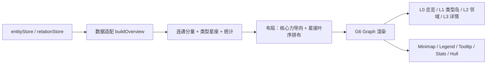

# 全局图谱重构（世界总览地图）

> 创建于 2026-10-26。范围：`official.graph` 芽整体重构（视图、布局、渲染、交互、依赖）。
> 动因：用户判定现有图谱「太差」。上一轮 [2026-10-09 全局图谱改进立项](2026-10-09-全局图谱改进立项.md)
> 是功能增量（边色/提示/搜索/聚类/主题），本线改为**信息设计与渲染栈的整体重做**。
>
> 已拍板（2026-10-26）：
> 1. 路线 **C 换可视化库**，具体采用 **AntV G6 v5.1.1**（MIT）。
> 2. 视图首先服务 **世界总览与导航**，不是关系分析器。
> 3. 孤立实体的处理由实现方按新设计决定，不再单独拍板。

---

## 一、设计前提（实测）

以产品域真实项目为样本（`D:\纯真\worlddata`，与用户截图图例吻合）：

| 指标 | 实测 |
|---|---|
| 实体 | 829 |
| 关系记录 | 22（去重后十余条边） |
| 孤立实体 | 807 |
| 有关系节点 | 22（以 outline_node / character / event / region / concept 为主） |
| 类型 | 17（concept 341 · region 160 · character 86 · item 80 · organization 48 · species 41 · event 33 · outline_node 21 …） |

结论：现有「全部节点等权 + 全图力导向」在任何渲染栈下都会呈散沙。新设计的核心不是隐藏孤立实体，
而是把它们组织成可读的**类型星座**，让关系核心保持干净。

## 二、目标形态

四层视图：

- **L0 世界总览**：中央「关系核心」+ 环绕的「类型星座」。孤立实体按类型收进星座；星座默认收起为气泡。
- **L1 类型岛**：点击星座展开该类型实体（叶序圆盘排布），右侧同步类型列表与搜索。
- **L2 邻域**：点击实体高亮邻居；双击进入聚焦模式，非邻居淡化；芯片 / Esc / 点空白退出。
- **L3 实体详情**：检查器提供实体摘要与关系列表，可跳转现有实体详情页。

导航壳：顶部 HUD（面包屑 + 搜索 + 模式/筛选），右侧检查器，左下统计，右下小地图与缩放，
悬浮提示跟随鼠标。图例为可收起面板（类型 + 数量 + 开关），不是固定色块墙。

## 三、视觉语言

- **类型 = 形状 + 色相族**：复用 `typeMappingRegistry` 的色相身份，统一降饱和/提亮并归并 6 个语义色族；
  形状承担主要区分（圆 / 圆角矩形 / 菱形 / 六边形 / 三角 / 椭圆），26 种类型定义全部生效。
- **节点大小**：度数平方根映射，孤立节点最小档；选中/悬停加光环。
- **标签三级**：总览只标 hub 与星座名；中景按重要性展开；近景全标。用 G6 `auto-adapt-label`
  自动避让重叠，标签带半透明底。
- **边 = 5 个语义族**（结构 / 社会 / 空间 / 因果 / 叙事）：统一低透明度细线 + 方向箭头；
  悬停/选中/路径时提亮并显示关系名。不再使用 27 色等高噪点。
- **星座**：半透明气泡 + 类型名 + 数量；hover 抬升；点击展开并飞近。
- **背景双档**：深色星图（默认）/ 跟随主题，沿用 `worldsea_graph_background` 设置键。

## 四、技术架构

- G6 内置消费：Combo（类型岛/核心）、`collapse-expand`、`auto-adapt-label`（标签避让）、Minimap、
  Grid、Tooltip、Hull（社区轮廓）。
- 布局**预计算坐标**：核心用 d3-force / FA2，类型岛用叶序（phyllotaxis）圆盘；G6 负责渲染，
  保证每次打开位置稳定（布局结果按节点/边规模缓存）。
- **不复用 sigma 的视觉层**；G6 数据必须是普通对象，不得直接传 Vue reactive（官方约束）。
- 目录（`apps/tauri/src/world/plugins/graph/`）：
  - `model/`：数据适配、连通分量、类型岛、统计、布局
  - `policy/`：节点/边/标签/星座纯函数（可直测）
  - `view/`：`GraphCanvas.vue`（G6 实例）、`GraphHud.vue`、`GraphInspector.vue`、
    `GraphLegendPanel.vue`、`GraphStats.vue`、`GraphTypePanel.vue`、`PathPanel.vue`、`TimelinePanel.vue`
  - `graphTheme.ts`：G6 主题令牌（深色/主题双档）
- 依赖变化：新增 `@antv/g6@^5.1.1`；移除 app 侧 `sigma`、`graphology-layout-forceatlas2`、
  `graphology-layout`（`graphology` 保留给 `canvas-engine` 算法）。
- 架构约束：新文件 ≤400 行；`GlobalGraph.vue` 只留视图壳（目标 ≤200 行），不再触碰 594 冻结线。

## 五、施工批次

| 批次 | 交付 | 门禁 |
|---|---|---|
| **B0 底座 + spike** | 装 G6；数据适配/分量分析/布局/样式纯函数 + 单测；829 节点合成数据验证 Combo、x/y 定位、auto-adapt-label、Minimap、折叠展开 | vitest / vue-tsc / arch / workspace-dist 构建 |
| **B1 总览地图** | L0：关系核心 + 类型星座 + 统计条 + 小地图 + 图例 + 深色主题 | 同上 + 真机走查 |
| **B2 导航与检查器** | 搜索、检查器、聚焦模式、面包屑、类型列表面板、悬浮提示、键盘 | 同上 + 真机走查 |
| **B3 能力补齐** | 路径搜索、社区聚类与 Hull、时间轴、类型/关系/年份筛选、主题双档、LOD 与性能 | 同上 + 真机走查 |
| **B4 清理收口** | 删除 sigma 旧代码与依赖、文档/索引同步、最终性能与走查 | 全门禁 + 终验 |

每批门禁按项目既有口径：`pnpm vitest run` · `pnpm --filter @worldsea/tauri typecheck` ·
`node scripts/architecture/check.mjs` · 产品域载体 `apps/tauri/workspace-dist` 重建
（`pnpm --filter @worldsea/tauri exec vite build --config workspace/vite.config.ts`）。
渲染层无自动化手段，视觉终审走用户真机走查。

## 六、边界与非目标

- 不改后端、实体/关系数据模型、关系写入；不自动创建关系。
- 不做 3D、不做编辑画布（画板/战术棋盘职责）。
- 旧 A-E 批能力全部保留：类型筛选、搜索、路径、聚类、时间轴、拖拽、聚焦、图例、详情。
- 不保留 sigma 兼容层；旧 composable 在 B4 物理删除。

## 七、风险

1. **G6 Combo + 预计算 x/y 的组合**需 B0 spike 先验证；若 x/y 不被采纳，退回 `combo-combined` 布局。
2. G6 包体较大（~7.25MB 解包），会增大 `workspace-dist`；桌面端可接受，需记录构建体积变化。
3. 数据稀疏是现实约束：新结构用类型星座把 807 个孤立实体变成可读的世界构成，不隐藏问题。
4. G6 v5 API 与既有 sigma 交互模型不同，事件/状态/折叠需逐项接线并用真机走查兜底。

## 八、实施记录

- 2026-10-26：立项，拍板 G6 v5.1.1 / 世界总览与导航 / 类型星座方案；B0 开工。
- 2026-10-26 **B0 落地**：装 `@antv/g6@5.1.1` + `d3-force`（app 依赖）；新目录
  `model/`（overview/layout/inspector/g6Data）· `policy/`（palette/nodeStyle/edgeStyle/labelPolicy/tooltip）·
  `view/`（GraphCanvas/Hud/Stats/LegendPanel/TypePanel/Inspector）· `graphTheme.ts`。
  纯函数单测 4 文件 / 17 例（关系核心与类型星座分组、叶序布局、环打包、形状/色族/边族映射）。
- 2026-10-26 **B1 落地（待真机走查）**：G6 首屏「关系核心 + 类型星座」——核心 d3-force、星座叶序圆盘
  与环形打包（视觉半径含 padding，gap 40）；星座默认收起，`collapse-expand` 双击切换、单击展开；
  `auto-adapt-label` + `fix-element-size` 保证标签避让与恒定字号；Minimap 190×128 / Grid / 深色星图；
  统计条（实体/关系/未连接/类型/连接率）；HUD（搜索/总览-关系模式/图例/适应/缩放）。
  合成 832 节点 spike（真实比例：22 核心 + 8 星座）浏览器验证：无 console error、核心与星座无压边。
- 2026-10-26 **B2 落地（待真机走查）**：搜索（高亮 + 回车飞至 + 命中数）· 节点检查器（类型/度数/标签/
  描述/关系行/以他为中心/打开详情）· 单击/双击聚焦与 Esc/点空白退出 · 类型列表面板 · 图例类型开关与
  定位 · 悬浮提示跟随 · 键盘 Esc 分层关闭。
- 2026-10-26 **B4 部分落地**：旧 sigma 栈物理删除（20 文件：6 组件 / 8 composable / 3 策略 / 3 旧 spec）+
  app 依赖移除 `sigma` / `graphology` / `graphology-layout` / `graphology-layout-forceatlas2`（根依赖也移除
  sigma 与两个 layout 包，`graphology` 保留给 canvas-engine 算法）；`index.ts` toolbar 改 `none`
  （全屏地图由 HUD 接管标题）；视图壳再减压为 `GlobalGraph.vue` 209 行 + `useGraphView.ts` 400 行。
- **门禁实测（2026-10-26）**：graph vitest 4 文件 / 17 例通过；`vue-tsc` 0；主 `dist` 与 `workspace-dist`
  重建通过；全量 vitest **227/228 文件、1704/1716 例通过**——唯一失败为
  `apps/tauri/src/world/plugins/settings/panels/__tests__/homePanel.spec.ts`（11 例，Pinia 无 active instance，
  与图谱无关，既有问题）；`arch:check` 16 项均为存量文件超限（基线滞后，图谱新增/改写文件不在其列）。
- 2026-10-26 **性能优化（B1/B2 走查反馈）**：`optimize-viewport-transform`（debounce 160ms，平移/缩放时保留
  node/combo 主图形、隐藏边与标签）；移除 Combo `shadowBlur`（Canvas2D 阴影为大头）；`fix-element-size`
  收窄为「核心节点标签 + Combo 标签」，不再让 800+ 孤立节点参与逐帧字号补偿；Minimap 只渲染 Combo 轮廓
  （delay 240ms）；`auto-adapt-label` throttle 180ms；选择/搜索/退出状态只下发可见元素，`applyVisibility`
  改为「隐藏类型即折叠星座」而非 800+ 子节点逐条 `setVisibility`。**暂不换 WebGL**：当前可见元素仅核心
  22 节点 + 星座，瓶颈更可能在 Canvas 文本/阴影/状态下发；待 DevTools 录制确认 draw time 占主后再评估。
- 2026-10-27 **B3 落地（待真机走查）**：路径搜索（无向 BFS 最短路 + HUD 按钮/浮层面板：起点/终点
  候选、互换、跳数与链路、不可达提示，关闭面板恢复原选中/搜索状态）· 社区 Hull（连通分量划分，
  大分量走确定性标签传播拆分，≥3 节点画 Hull 并带社区名；图例提供开关与社区清单）· 世界时间轴
  （`properties.date/dateEnd` 解析为绝对年，双滑杆收窄区间，无日期实体常显，面板明示带日期计数）·
  关系语义族开关（图例内按 6 族开关，路径结果被过滤时自动收回并提示）· composable 拆分
  （`useGraphSearch` / `useGraphTooltip` / `useGraphCommunities` / `useGraphVisibility` /
  `usePathSearch` / `useTimelineFilter`），`useGraphView.ts` 381 行 · `GlobalGraph.vue` 285 行 ·
  `GraphCanvas.vue` ≤400 行；新增路径/社区/时间轴单测 16 例。
- **门禁实测（2026-10-27）**：graph vitest 7 文件 / 33 例通过；`vue-tsc` 0；`workspace-dist` 重建通过
  （graph chunk 1.40 MB / gzip 404 KB）；全量 vitest **230/231 文件、1720/1732 例通过 + 1 跳过**，
  唯一失败仍为 `homePanel.spec.ts`（11 例，Pinia 无 active instance，既有问题）；
  `arch:check` 16 项均为存量文件超限（无图谱文件）。
- 2026-10-27 **B3 真机走查通过**：路径搜索 / 社区 Hull / 世界时间轴 / 关系语义族 / 主题双档全部通过；
  B0-B4 收口完成，本计划归档至 `plans/已完成/`。
- **遗留（不阻塞本计划）**：`homePanel.spec.ts` 11 例存量失败（Pinia 无 active instance）与
  `arch:check` 16 项存量文件超限，另行处置。
