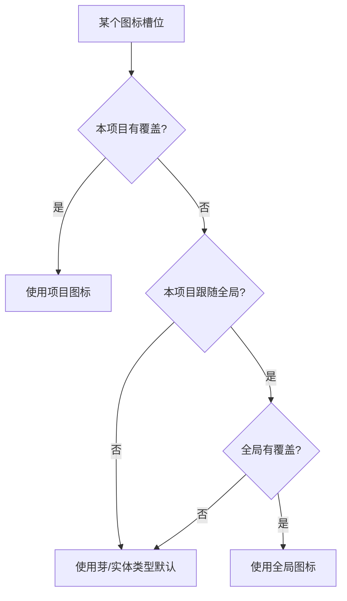

# 图标库与图标槽位 · 批计划

> 产品域基础设施线：把「芽 / 实体类型」的图标从硬编码字符串，升级为可覆盖、可搜索、可回退的图标槽位系统。
> 本文同时承担设计说明与施工计划；走查通过后归档到 `docs/plans/已完成/`。

## 一、背景与问题

现状不是「没有图标」，而是图标真源散、消费面各走各的：

- 芽图标有三份来源：视图注册 `registerView({ icon })`、默认芽清单 `DEFAULT_SPROUTS[].icon`、实体类型注册 `registerEntityV2({ icon })`。
- 侧栏读 `view.icon`；设置芽管理、首页资产地图读 `sprout.icon`；实体卡片走 `entitySchemaRegistry.getIconName()` 的静态 `TYPE_ICON` 表。
- 静态表缺项导致注册的图标被忽略：`book`、`outline_board` 等实际回退成 `manuscript`。
- 图标名混编 Lucide / Tabler / 自定义路径，且存在语义错配：`concept` 映射到 Terraform 品牌 logo，`combat` 是填充愤怒脸。

结果：今天改任何一处图标，都不会全界面同步；用户也无法表达「这个概念我想换成另一个视觉」。

## 二、目标与非目标

**目标（一期）**

1. 芽图标可换：设置芽管理行内入口 + 设置「图标」中心。
2. 实体类型图标可换：卡片、关联、提及、详情头跟随。
3. 项目级覆盖 + 可选「应用到全局」+ 项目级「跟随/不跟随全局」。
4. 内置精选图标库（中文/英文搜索、语义分类、实际尺寸预览）。
5. 顺手修复实体类型注册图标不生效的存量问题。

**非目标（一期不做）**

- 语义域图标、详情 Tab 图标、区域类型图标。
- 自定义 SVG/PNG 上传（涉及全局图标文件放哪，三期单独设计）。
- 图标配色、拖拽换图标、AI 生成图标。
- Lucide 1000+ 动态全集（静态精选，保持 tree-shaking 与离线可用）。

## 三、已拍板决策

| 决策 | 结论 |
|---|---|
| 一期槽位 | 芽 + 实体类型 |
| 图标来源 | 内置精选库（首批约 150–200，按 8 域 + 通用） |
| 默认持久化 | 项目级（`project_settings.icon_overrides`） |
| 可选扩散 | 「应用到全局」写全局 + 本项目 |
| 项目独立 | 项目级「跟随全局」开关；关闭时快照当前全局图标，并提供「回到芽默认」 |
| 联动 | 换芽图标默认仅在「该芽只有一个实体类型且仍为默认」时联动；选择器提供同步控件；已单独设置的不动 |
| 入口 | 芽管理行内 + 设置「图标」中心 |

## 四、优先级模型



- 项目覆盖永远最高优先级；「跟随全局」只控制未覆盖时的回退。
- 关闭「跟随全局」：把当前生效的全局图标快照进项目覆盖，画面不跳。
- 「应用到全局」：全局 + 项目同时落一份；当前项目立即生效，以后切独立也保留。
- 「回到芽默认」：清空本项目覆盖 + 停止跟随全局。

## 五、数据模型

```ts
// 全局层（localStorage，跨项目）
worldsea_icon_overrides_global = {
  version: 1,
  overrides: { 'sprout:official.concepts': 'lightbulb' },
}

// 项目层（project_settings key = icon_overrides；localStorage 回退按 projectId 分键）
{
  version: 1,
  followGlobal: true,
  overrides: { 'entityType:concept': 'book' },
}
```

槽位 key：

- `sprout:<pluginId>`：芽 / 视图图标。
- `entityType:<type>`：实体类型图标。
- 后续扩展：`domain:<id>` / `detailTab:<type>:<tabId>` / `regionType:<value>`，存储结构不变。

持久化策略：

- 全局层：`localStorage['worldsea_icon_overrides_global']`。
- 项目层：项目库 `project_settings.icon_overrides` 为主；`localStorage['worldsea_icon_overrides_project:<projectId>']` 为回退（避免跨项目串味）。
- 读不到项目库时用回退；再读不到用默认 `{ followGlobal: true, overrides: {} }`。
- 保留未知槽位：外部芽临时禁用时覆盖不丢；渲染时只解析当前存在的槽位。

## 六、解析收口点

| 收口点 | 影响面 | 改动 |
|---|---|---|
| `viewOrder.allVisibleViewsInSidebarOrder` | 侧栏轮盘/平铺/分栏、快捷访问、首页可见视图 | 用 `sprout:<pluginId>` 解析后替换 `view.icon` |
| `EntitySchemaRegistry.getIconName` | 实体卡、关联选择器、提及、详情头 | 先读覆盖，再读 schema.icon，再回退 `TYPE_ICON` |
| `buildHomeData` | 首页资产地图芽 chip | 用可见视图的已解析图标替代 `sprout.icon` |
| `buildSproutInsights` | 设置芽详情图标 | 用已解析视图图标替代 `sprout.icon` |
| `SproutsCardContent` | 设置芽管理行图标 | 注入 `iconOf(sproutId, fallback)` 解析器 |
| `IconsPanel` | 图标中心 | 直接走覆盖 store 与槽位注册表 |

不改每个 Vue 组件；只在数据组装边界收口。

## 七、文件结构

**新建**

- `packages/entity-core/src/core/iconOverrides.ts`：有效覆盖注册表 + 槽位 key 助手（无 Pinia 依赖，供 `getIconName` 读取）。
- `packages/entity-core/src/stores/iconOverrideStore.ts`：全局/项目覆盖状态、持久化、快照、清除。
- `packages/entity-core/src/stores/__tests__/iconOverrideStore.spec.ts`：优先级、快照、清除、串味守卫。
- `packages/ui-kit/src/assets/iconCatalog.ts`：精选图标目录（名称/中文名/关键词/域）。
- `packages/ui-kit/src/assets/__tests__/iconCatalog.spec.ts`：唯一性、可解析、域合法。
- `apps/tauri/src/world/iconSlots.ts`：从视图/芽/schema 构建槽位。
- `apps/tauri/src/world/__tests__/iconSlots.spec.ts`：槽位覆盖、默认值、去重。
- `apps/tauri/src/world/plugins/settings/panels/IconPicker.vue`：图标选择器（TuiModal）。
- `apps/tauri/src/world/plugins/settings/panels/IconSlotList.vue`：图标中心列表/分组行。
- `apps/tauri/src/world/plugins/settings/panels/IconsPanel.vue`：设置「图标」面板（三卡）。
- `apps/tauri/src/world/plugins/settings/panels/IconScopeCard.vue`：作用范围卡。
- `apps/tauri/src/world/__tests__/iconPanelModel.spec.ts`：来源徽标/清除/联动判定纯函数。
- `apps/tauri/src/composables/modalStack.ts`：设置抽屉与 TuiModal 的共享弹层栈（嵌套弹层 Esc/Tab 归栈顶）。
- `apps/tauri/src/composables/__tests__/modalStack.spec.ts`：栈顶/重复入栈守卫。

**修改**

- `packages/entity-core/src/core/EntitySchema.ts`：`getDefaultIconName` + `getIconName` 覆盖。
- `packages/entity-core/src/core/index.ts` / `src/index.ts` / `stores/index.ts`：导出新模块。
- `packages/ui-kit/src/components/lucideMap.ts`：`concept` 换 `Brain`、`combat` 换 `Swords`，清理不用的 Tabler 导入。
- `packages/ui-kit/src/index.ts`：导出图标目录。
- `packages/ui-kit/src/components/settings/panels/SproutsCardContent.vue` + `sprouts-card.css`：图标独立按钮 + `iconOf` prop + `edit-icon` 事件。
- `apps/tauri/src/world/plugins/settings/panels/PluginsPanel.vue`：接线图标选择器 + `iconOf`。
- `apps/tauri/src/world/plugins/settings/settingsCategories.ts` + `SettingsDialog.vue`：新增「图标」分类与面板。
- `apps/tauri/src/ui/layout/sidebar/viewOrder.ts`：视图图标解析。
- `apps/tauri/src/ui/home/homeData.ts`：首页芽 chip 用视图图标。
- `apps/tauri/src/world/sproutInsights.ts`：洞察图标用已解析视图图标。
- `apps/tauri/src/composables/useProjectSwitcher.ts`：初始加载 + 切项目加载图标覆盖。
- `apps/tauri/src/composables/useFocusTrap.ts` + `apps/tauri/src/components/ui/TuiModal.vue`：接入共享弹层栈（嵌套选择器 Esc 不再误关设置）。
- `docs/index/README.md` / `docs/index/WORKSTREAMS.md`：登记本线。

## 八、施工任务

> **施工进度（2026-10-27）**：Task 1-7 已落地，实际范围覆盖芽图标、实体类型图标、作用范围与图标中心。
> 验证：全量 vitest **257 文件 / 1876 通过 / 1 跳过**；`vue-tsc`（tauri / ui-kit / entity-core）0 错误；
> `arch:check --changed` 0 违规；文档断链 0；`workspace-dist` 重建成功。
> 浏览器冒烟已验证：图标中心三卡渲染、选择器打开、概念/设定库换图标并同步实体类型、重载后覆盖保留、Esc 关闭嵌套弹层。
> 顺带修复：设置抽屉（useFocusTrap）与 TuiModal 混用时的嵌套弹层 Esc/Tab 冲突（新增共享 `modalStack`）。
> **真机走查通过（2026-10-27，用户确认），已归档。**
>
> **走查修复（2026-10-27）**：① 换图标后显示图标名 → `hasIcon` 门面只查自定义路径注册表，不认 Lucide；已改为「自定义 + Lucide」合并，侧栏/设置行不再走文本回退。② 设置左列「实体类型图标 / 作用范围」点不动 → `SettingsDialog` 的 `panelRefs` 未登记 `icons`，左列标题拿不到 `goToCard`；已补 `iconsRef` 与映射。③ 实体未跟随 → 视图 `icon-fn` 硬编码绕过覆盖；`GenericEntityView` 收口为「用户覆盖 > 视图 iconFn > schema 图标」，并补角色详情头、首页最近动态两个直读点。④ 二次换芽图标实体不跟随 → 同步判定扩展为「仍为默认 或 仍与本芽当前图标一致」，已同步过的实体类型继续跟随；选择器标题标明「芽 / 实体类型」。⑤ 快速重启丢覆盖 → 项目覆盖加 `updatedAt`，项目库与分键 localStorage 回退取较新者。浏览器实测：角色卡头部 `character → users → user`、二次换芽自动跟随、重载保留；全量 **258 文件 / 1884 通过 / 1 跳过**。

### Task 1：图标覆盖内核（entity-core）

**Files**
- Create: `packages/entity-core/src/core/iconOverrides.ts`
- Create: `packages/entity-core/src/stores/iconOverrideStore.ts`
- Test: `packages/entity-core/src/stores/__tests__/iconOverrideStore.spec.ts`
- Modify: `packages/entity-core/src/core/index.ts`、`packages/entity-core/src/index.ts`、`packages/entity-core/src/stores/index.ts`

- [ ] Step 1：写失败测试（优先级 / 快照 / 清除 / 局部覆盖）

```ts
import { createPinia, setActivePinia } from 'pinia'
import { beforeEach, describe, expect, it } from 'vitest'
import { useIconOverrideStore } from '../iconOverrideStore'

describe('iconOverrideStore', () => {
  beforeEach(() => {
    setActivePinia(createPinia())
    localStorage.clear()
  })

  it('项目覆盖优先于全局', () => {
    const s = useIconOverrideStore()
    s.setGlobalIcon('sprout:a', 'book')
    s.setProjectIcon('sprout:a', 'flame')
    expect(s.sourceOf('sprout:a')).toBe('project')
    expect(s.resolve('sprout:a', 'default')).toBe('flame')
  })

  it('关闭跟随全局时快照当前全局图标', () => {
    const s = useIconOverrideStore()
    s.setGlobalIcon('sprout:a', 'book')
    expect(s.setFollowGlobal(false)).toBe(1)
    expect(s.project.followGlobal).toBe(false)
    expect(s.sourceOf('sprout:a')).toBe('project')
    expect(s.resolve('sprout:a', 'default')).toBe('book')
  })

  it('回到芽默认会清空项目覆盖并停止跟随', () => {
    const s = useIconOverrideStore()
    s.setGlobalIcon('sprout:a', 'book')
    s.setProjectIcon('sprout:a', 'flame')
    s.resetToDefaults()
    expect(s.project.followGlobal).toBe(false)
    expect(s.resolve('sprout:a', 'default')).toBe('default')
  })
})
```

- [ ] Step 2：跑测试确认红

Run: `pnpm vitest run packages/entity-core/src/stores/__tests__/iconOverrideStore.spec.ts`
Expected: FAIL（模块不存在）

- [ ] Step 3：实现 `iconOverrides.ts`

```ts
import { ref } from 'vue'

const effective = new Map<string, string>()
export const iconOverrideVersion = ref(0)

export function sproutIconSlot(pluginId: string): string { return `sprout:${pluginId}` }
export function entityTypeIconSlot(type: string): string { return `entityType:${type}` }

export function setEffectiveIconOverrides(entries: ReadonlyMap<string, string>): void {
  effective.clear()
  for (const [key, icon] of entries) effective.set(key, icon)
  iconOverrideVersion.value++
}

export function getEffectiveIconOverride(slotKey: string): string | undefined {
  void iconOverrideVersion.value
  return effective.get(slotKey)
}
```

- [ ] Step 4：实现 `iconOverrideStore.ts`

按本文 §五 的持久化策略与 §四 的优先级实现；导出纯函数 `sanitizeOverrides` / `buildEffectiveMap` 供测试。

- [ ] Step 5：跑测试确认绿

Run: `pnpm vitest run packages/entity-core/src/stores/__tests__/iconOverrideStore.spec.ts`
Expected: PASS

- [ ] Step 6：导出与提交

```bash
git add packages/entity-core/src/core/iconOverrides.ts packages/entity-core/src/stores/iconOverrideStore.ts packages/entity-core/src/stores/__tests__/iconOverrideStore.spec.ts packages/entity-core/src/index.ts packages/entity-core/src/core/index.ts packages/entity-core/src/stores/index.ts
git commit -m "feat(icons): 图标覆盖内核与项目/全局优先级"
```

### Task 2：实体类型图标解析修复

**Files**
- Modify: `packages/entity-core/src/core/EntitySchema.ts`
- Test: `packages/entity-core/src/core/__tests__/entitySchemaIcon.spec.ts`

- [ ] Step 1：写失败测试

```ts
import { describe, expect, it } from 'vitest'
import { EntitySchemaRegistry } from '../EntitySchema'
import { entityTypeIconSlot, setEffectiveIconOverrides } from '../iconOverrides'

describe('EntitySchemaRegistry.getIconName', () => {
  it('优先使用注册的 icon，而不是静态表', () => {
    const r = new EntitySchemaRegistry()
    r.register({ typeKey: 'book', label: '书籍', icon: 'book', fields: [] })
    expect(r.getIconName('book')).toBe('book')
  })

  it('覆盖层优先于注册 icon', () => {
    const r = new EntitySchemaRegistry()
    r.register({ typeKey: 'book', label: '书籍', icon: 'book', fields: [] })
    setEffectiveIconOverrides(new Map([[entityTypeIconSlot('book'), 'flame']]))
    expect(r.getIconName('book')).toBe('flame')
  })
})
```

- [ ] Step 2：跑测试确认红

Run: `pnpm vitest run packages/entity-core/src/core/__tests__/entitySchemaIcon.spec.ts`
Expected: FAIL（`book` 实际回退 `manuscript`）

- [ ] Step 3：实现

```ts
getDefaultIconName(type: string): string {
  const schema = this.schemas.get(type)
  return schema?.icon || TYPE_ICON[type] || 'manuscript'
}

getIconName(type: string): string {
  return getEffectiveIconOverride(entityTypeIconSlot(type)) ?? this.getDefaultIconName(type)
}
```

- [ ] Step 4：跑测试确认绿并回归既有 schema 测试

Run: `pnpm vitest run packages/entity-core/src/core/__tests__`
Expected: PASS

- [ ] Step 5：提交

```bash
git add packages/entity-core/src/core/EntitySchema.ts packages/entity-core/src/core/__tests__/entitySchemaIcon.spec.ts
git commit -m "fix(entity): 实体类型图标优先读注册 icon 与覆盖层"
```

### Task 3：精选图标目录

**Files**
- Create: `packages/ui-kit/src/assets/iconCatalog.ts`
- Test: `packages/ui-kit/src/assets/__tests__/iconCatalog.spec.ts`
- Modify: `packages/ui-kit/src/index.ts`、`packages/ui-kit/src/components/lucideMap.ts`

- [ ] Step 1：写失败测试（唯一 / 可解析 / 域合法 / 默认图标在库）

```ts
import { describe, expect, it } from 'vitest'
import { ICON_CATALOG, ICON_DOMAIN_IDS, isCatalogIconAvailable } from '../iconCatalog'

describe('iconCatalog', () => {
  it('名称唯一且全部可解析', () => {
    const names = ICON_CATALOG.map(e => e.name)
    expect(new Set(names).size).toBe(names.length)
    for (const e of ICON_CATALOG) expect(isCatalogIconAvailable(e.name), e.name).toBe(true)
  })

  it('每个条目有中文名、关键词和合法域', () => {
    for (const e of ICON_CATALOG) {
      expect(e.label.trim()).not.toBe('')
      expect(e.keywords.trim()).not.toBe('')
      expect(e.domains.length).toBeGreaterThan(0)
      for (const d of e.domains) expect(ICON_DOMAIN_IDS).toContain(d)
    }
  })

  it('芽/实体类型默认图标均可找回', () => {
    for (const name of ['character', 'region', 'organization', 'concept', 'book', 'outline', 'manuscript', 'grid'])
      expect(ICON_CATALOG.some(e => e.name === name), name).toBe(true)
  })
})
```

- [ ] Step 2：跑测试确认红

Run: `pnpm vitest run packages/ui-kit/src/assets/__tests__/iconCatalog.spec.ts`
Expected: FAIL（模块不存在）

- [ ] Step 3：实现目录

- 行格式：`[name, label, keywords, domains]`，按 8 域 + 通用分组。
- 域 id 使用 `geo/life/society/knowledge/goods/time/narrative/tool/general`。
- 首批 150–200 条；只收世界观语义相关图标，不收 `panel-left` / `align-center` 这类界面图标。
- 默认图标全部纳入；`puzzle` 纳入通用（外部芽占位）。
- 同文件导出 `searchIconCatalog(query, domain)`：名称、中文名、关键词三路命中。

- [ ] Step 4：修 `lucideMap` 默认图标体检

- `concept: IconBrandTerraform` → `concept: Brain`。
- `combat: IconMoodAngryFilled` → `combat: Swords`。
- 清理不再使用的 Tabler 导入（`IconBrandTerraform` / `IconMoodAngryFilled`）。

- [ ] Step 5：跑测试确认绿

Run: `pnpm vitest run packages/ui-kit/src/assets/__tests__/iconCatalog.spec.ts`
Expected: PASS

- [ ] Step 6：提交

```bash
git add packages/ui-kit/src/assets/iconCatalog.ts packages/ui-kit/src/assets/__tests__/iconCatalog.spec.ts packages/ui-kit/src/components/lucideMap.ts packages/ui-kit/src/index.ts
git commit -m "feat(icons): 世界观精选图标目录与默认图标体检"
```

### Task 4：槽位注册表

**Files**
- Create: `apps/tauri/src/world/iconSlots.ts`
- Test: `apps/tauri/src/world/__tests__/iconSlots.spec.ts`

- [ ] Step 1：写失败测试

```ts
import { describe, expect, it } from 'vitest'
import { buildIconSlots } from '../iconSlots'

describe('buildIconSlots', () => {
  it('芽槽位默认取视图图标，缺视图回退芽默认', () => {
    const slots = buildIconSlots({
      views: [{ id: 'concepts', label: '概念/设定库', icon: 'book-open', component: null as never, pluginId: 'official.concepts' }],
      sprouts: [{ id: 'official.concepts', label: '概念/设定库', icon: 'concept', active: true }],
      plugins: [{ manifest: { id: 'official.concepts', name: '概念/设定库', domain: 'knowledge', entityTypes: ['concept'] } }],
      schemas: [],
    })
    expect(slots.find(s => s.key === 'sprout:official.concepts')?.defaultIcon).toBe('book-open')
  })

  it('实体类型槽位使用 schema 注册 icon', () => {
    const slots = buildIconSlots({
      views: [], sprouts: [],
      plugins: [],
      schemas: [{ type: 'book', label: '书籍', icon: 'book', pluginId: 'official.manuscript' }],
    })
    expect(slots.find(s => s.key === 'entityType:book')?.defaultIcon).toBe('book')
  })
})
```

- [ ] Step 2：跑测试确认红

Run: `pnpm vitest run apps/tauri/src/world/__tests__/iconSlots.spec.ts`
Expected: FAIL

- [ ] Step 3：实现 `iconSlots.ts`

输出 `IconSlot[]`：`key / kind / label / defaultIcon / pluginId / domain / entityTypes`。
芽槽位：`sproutIconSlot(sprout.id)`；默认 `view?.icon ?? sprout.icon`；实体类型从 manifest 或运行时 schema 归属取得。
实体类型槽位：`entityTypeIconSlot(schema.type)`；默认 `schema.icon || TYPE_ICON`（通过 `entitySchemaRegistry.getDefaultIconName` 或直接 schema.icon + 兜底）。

- [ ] Step 4：跑测试确认绿

Run: `pnpm vitest run apps/tauri/src/world/__tests__/iconSlots.spec.ts`
Expected: PASS

- [ ] Step 5：提交

```bash
git add apps/tauri/src/world/iconSlots.ts apps/tauri/src/world/__tests__/iconSlots.spec.ts
git commit -m "feat(icons): 芽与实体类型图标槽位注册表"
```

### Task 5：解析接线

**Files**
- Modify: `apps/tauri/src/ui/layout/sidebar/viewOrder.ts`
- Modify: `apps/tauri/src/ui/home/homeData.ts`
- Modify: `apps/tauri/src/world/sproutInsights.ts`
- Modify: `apps/tauri/src/composables/useProjectSwitcher.ts`
- Test: `apps/tauri/src/ui/layout/sidebar/__tests__/viewOrderIcons.spec.ts` / `apps/tauri/src/ui/home/__tests__/homeDataIcons.spec.ts`

- [ ] Step 1：写失败测试（视图图标走覆盖；首页芽 chip 用视图图标）

- [ ] Step 2：实现

- `viewOrder`：对每个可见视图，`icon: iconStore.resolve(sproutIconSlot(view.pluginId), view.icon)`。
- `homeData`：`active.push({ ..., icon: v.icon })`（`v` 为已解析的可见视图）。
- `sproutInsights`：`views` 入参增加 `icon`，优先用视图图标；`collectSproutInsights` 传入已解析视图。
- `useProjectSwitcher.initialize()` 与 `reloadStores()` 调 `loadProjectIconOverrides()`。

- [ ] Step 3：跑测试并回归侧栏/首页既有测试

Run: `pnpm vitest run apps/tauri/src/ui/layout/sidebar apps/tauri/src/ui/home apps/tauri/src/world/__tests__/sproutInsights.spec.ts`
Expected: PASS

- [ ] Step 4：提交

```bash
git add apps/tauri/src/ui/layout/sidebar/viewOrder.ts apps/tauri/src/ui/home/homeData.ts apps/tauri/src/world/sproutInsights.ts apps/tauri/src/composables/useProjectSwitcher.ts apps/tauri/src/ui/layout/sidebar/__tests__ apps/tauri/src/ui/home/__tests__
git commit -m "feat(icons): 侧栏/首页/芽洞察接入图标覆盖解析"
```

### Task 6：图标选择器 + 图标中心

**Files**
- Create: `apps/tauri/src/world/plugins/settings/panels/IconPicker.vue`
- Create: `apps/tauri/src/world/plugins/settings/panels/IconSlotList.vue`
- Create: `apps/tauri/src/world/plugins/settings/panels/IconsPanel.vue`
- Create: `apps/tauri/src/world/plugins/settings/panels/IconScopeCard.vue`
- Modify: `apps/tauri/src/world/plugins/settings/settingsCategories.ts`、`SettingsDialog.vue`
- Test: `apps/tauri/src/world/__tests__/iconPanelModel.spec.ts`

- [ ] Step 1：写纯函数测试（来源徽标 / 联动判定 / 清除计数）

- [ ] Step 2：实现 `IconPicker.vue`

- TuiModal `size="lg"`；搜索 + 分类 chips + 网格 + 16/20/24 预览 + 同步控件 + 应用到全局 + 取消/确定。
- 当前图标不在目录时显示「当前」项。
- 键盘：方向键移动、Enter 确定、Esc 关闭（TuiModal 已处理 Esc）。

- [ ] Step 3：实现 `IconsPanel.vue` 三卡

| 卡 | 内容 |
|---|---|
| 0 | 芽图标：按 8 域分组，来源徽标（默认/全局/项目），点图标换 |
| 1 | 实体类型图标：按所属芽分组，点图标换 |
| 2 | 作用范围：跟随全局开关、本项目/全局覆盖计数与清除、回到芽默认 |

- [ ] Step 4：接线设置分类

- `SETTINGS_CATEGORIES` 新增 `{ id: 'icons', icon: 'image', label: '图标' }`，放在 `appearance` 之后。
- `SETTINGS_CATEGORY_KEYWORDS.icons` 补「图标 图标库 芽 实体 全局 项目 icon sprout entity global project」。
- `SettingsDialog` 搜索模式与正常模式各渲染 `IconsPanel`。

- [ ] Step 5：跑测试 + 类型检查

Run: `pnpm vitest run apps/tauri/src/world/__tests__/iconPanelModel.spec.ts`
Expected: PASS

- [ ] Step 6：提交

```bash
git add apps/tauri/src/world/plugins/settings/panels/IconPicker.vue apps/tauri/src/world/plugins/settings/panels/IconSlotList.vue apps/tauri/src/world/plugins/settings/panels/IconsPanel.vue apps/tauri/src/world/plugins/settings/panels/IconScopeCard.vue apps/tauri/src/world/plugins/settings/settingsCategories.ts apps/tauri/src/world/plugins/settings/SettingsDialog.vue apps/tauri/src/world/__tests__/iconPanelModel.spec.ts
git commit -m "feat(icons): 图标选择器与设置图标中心"
```

### Task 7：芽管理行内入口

**Files**
- Modify: `packages/ui-kit/src/components/settings/panels/SproutsCardContent.vue`
- Modify: `packages/ui-kit/src/components/settings/panels/sprouts-card.css`
- Modify: `apps/tauri/src/world/plugins/settings/panels/PluginsPanel.vue`

- [ ] Step 1：`SproutsCardContent` 增加 `iconOf` prop 与 `edit-icon` 事件

- 行内图标改为独立按钮（`.sp-icon-btn`），点图标换图标；复选框/文字仍启停。
- 图标按钮 aria-label「<芽名>图标，点击更换」，支持 Enter/Space。
- CSS 用 order 保持「拖拽柄 → 来源 → 图标 → 复选框 → 名称 → 详情」的视觉顺序。

- [ ] Step 2：`PluginsPanel` 接线

- 用槽位注册表 + 覆盖 store 提供 `iconOf`。
- 收到 `edit-icon` 时打开 `IconPicker`，目标为对应芽槽位。
- 保存时写覆盖；按拍板规则决定是否同步实体类型（仅更新仍为默认的槽位）。

- [ ] Step 3：回归

Run: `pnpm vitest run apps/tauri/src/world/__tests__/batch3-plugins.spec.ts apps/tauri/src/world/__tests__/batch5-plugins.spec.ts`
Expected: PASS

- [ ] Step 4：提交

```bash
git add packages/ui-kit/src/components/settings/panels/SproutsCardContent.vue packages/ui-kit/src/components/settings/panels/sprouts-card.css apps/tauri/src/world/plugins/settings/panels/PluginsPanel.vue
git commit -m "feat(icons): 芽管理行内换图标入口"
```

### Task 8：收口与走查

- [ ] 全量测试：`pnpm vitest run`
- [ ] 类型检查：`pnpm vue-tsc --noEmit`（apps/tauri + ui-kit）
- [ ] 架构门禁：`node scripts/architecture/check.mjs`
- [ ] 文档断链：`node scripts/check-doc-links.mjs`
- [ ] 产物重建：`pnpm build`（含 workspace-dist，如走查需要）
- [ ] 真机走查清单：
  1. 设置 → 图标：芽列表按域分组，来源徽标正确。
  2. 芽管理行内点图标：选择器打开，搜索/分类/预览正常。
  3. 换芽图标 → 侧栏轮盘、平铺、分栏、快捷访问、首页资产地图、设置芽列表同步。
  4. 换实体类型图标 → 卡片、关联选择器、提及、详情头同步。
  5. 「应用到全局」→ 切到另一项目，跟随全局的项目显示全局图标。
  6. 关闭「跟随全局」→ 画面不跳；「回到芽默认」→ 全部回到默认。
  7. 外部插件禁用/重启用 → 覆盖保留。
  8. 重启应用 → 覆盖保留；切项目 → 各自保留。
- [x] 归档：状态改「已完成」→ `git mv` 到 `docs/plans/已完成/`，同步索引与工作线。

## 九、测试与验收

**单元**

- `iconOverrideStore`：项目 > 全局 > 默认；关闭跟随快照；回到默认；清除全局；未知槽位保留。
- `EntitySchemaRegistry`：注册 icon 优先；覆盖优先；缺省回退。
- `iconCatalog`：唯一、可解析、域合法、默认图标可找回。
- `buildIconSlots`：芽默认取视图图标、缺视图回退芽默认；实体类型默认取 schema icon。
- 面板纯函数：来源徽标、联动判定（仅默认）、全部清除计数。
- 弹层栈：后开层在栈顶、重复入栈不重复、父层关闭后恢复栈顶。
- IconPicker 组件：中文搜索、同步控件默认态、应用全局、撤销本项目、当前图标不在库提示、按域过滤。

**回归**

- 侧栏顺序/可见性/快捷访问/首页既有测试。
- 芽洞察既有测试。
- 设置面板搜索/卡片切换既有测试。

**真机**

见 Task 8 清单。

## 十、风险点

| 风险 | 处置 |
|---|---|
| `getIconName` 改为读 schema.icon 后，外部插件注册了不存在的图标名 → 空白 | 图标目录守卫只保内置；外部插件在槽位注册表构建时校验，无法解析则回退默认。 |
| 覆盖 store 的 DB 写入失败 | 项目级 localStorage 按 projectId 分键回退；仍失败则内存态继续，重启丢失（风险低）。 |
| 切项目时旧项目覆盖串味 | 项目级回退键带 projectId；切项目 `loadProjectIconOverrides` 重读；测试覆盖。 |
| `viewOrder` 返回新对象导致引用比较 | 该函数已在各 computed 内使用；只改 `icon` 字段，按依赖缓存，风险低。 |
| 设置行图标从 label 内移出改变视觉顺序 | CSS order 保持原视觉；复选框/文字行为不变；真机走查确认。 |
| 图标目录 150–200 条内容工作量大 | 首批先落世界观相关 + 默认图标；后续按需扩充，目录结构稳定。 |
| 嵌套弹窗焦点/层级 | 复用 `TuiModal` 的栈式 Esc/Tab 管理与 focus 还原；设置抽屉 + TuiModal 混用时由共享弹层栈判定栈顶。 |
| 默认图标体检改变观感 | 只改 `concept` / `combat` 两个明显错配；真机走查确认。 |

## 十一、文档同步

- 本文件：`docs/plans/已完成/2026-10-27-图标库与图标槽位-批计划.md`。
- 架构说明：`docs/details/架构/图标系统.md`（优先级模型、槽位 key、解析收口点）。
- 索引：`docs/index/README.md` 新增「图标库与图标槽位」行。
- 工作线：`docs/index/WORKSTREAMS.md` 新增产品域基础设施线一行。
