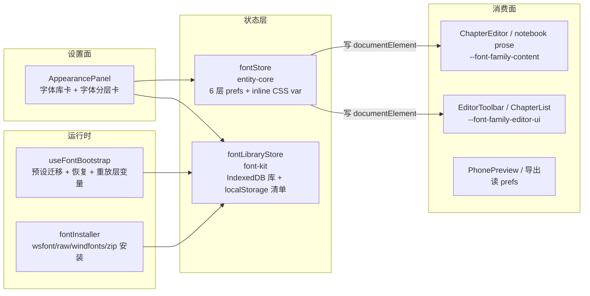
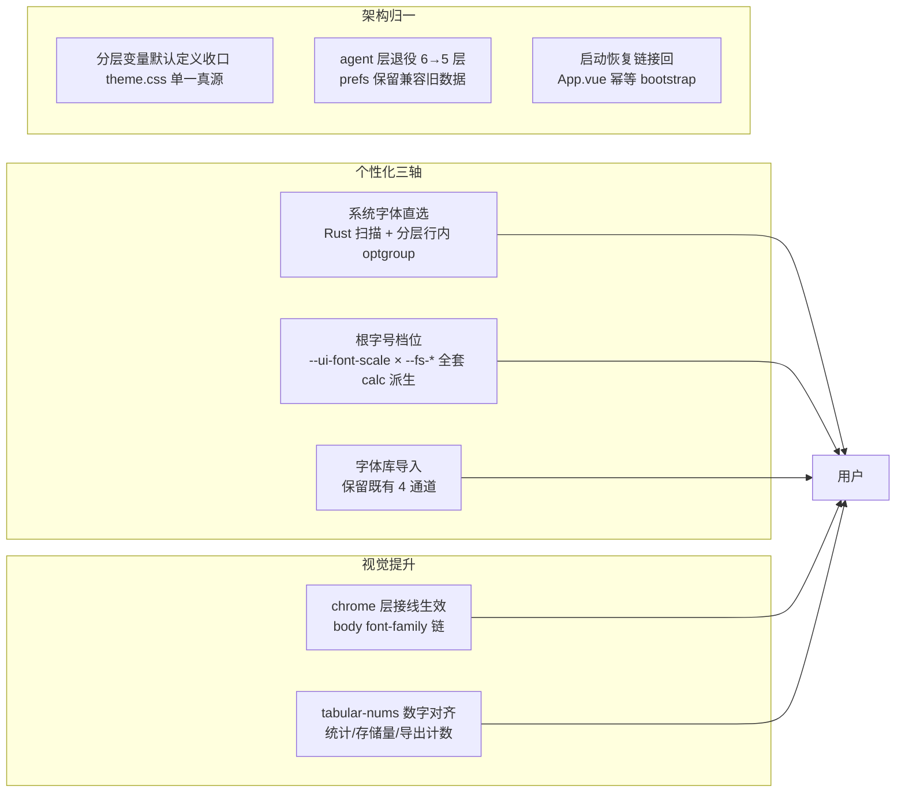

# 字体系统 v2 · 综合改造批计划

> 2026-11-02 · Goal 模式长任务（用户睡眠期自主执行）
> 目标：把字体系统做成**完整、个性化、视觉提升**的综合系统；所有改动可审阅（本文 + 详情文档）。
> 约束：**dsh 侧零改动**；字体工作中有关 Agent 面的信息一律按旧信息处理（agent 层按死层处置）。

## 一、摸底报告（2026-11-02 实测）

### 1.1 现状架构

- **状态层**：`entity-core/stores/fontStore`（6 层 prefs：chrome/editorUi/content/preview/canvas/agent，localStorage `worldsea_font_prefs`）；`font-kit/stores/fontLibraryStore`（库清单 localStorage + 字体二进制 IndexedDB）。
- **安装链**：fontInstaller（wsfont/raw/windfonts/zip 四通道 → FontFace 注册 + IndexedDB 持久化，400MB 上限）。
- **消费面**：`--font-family-content`（ChapterEditor / notebook prose）、`--font-family-editor-ui`（编辑器工具条族）；preview/canvas 层走 prefs 直读（PhonePreview / 导出）。
- **设置面**：ui-kit AppearancePanel「字体库」卡（导入/分组/删除）+「字体分层」卡（6 层 family+variant）。

### 1.2 问题清单（实测取证）

| # | 问题 | 证据 |
| --- | --- | --- |
| 1 | **启动恢复链断裂**：`useFontBootstrap` 全仓无调用 → 重启后字体不恢复 FontFace，用户已选 family 悬空回退 | `restoreAllFonts` 唯一调用点在 bootstrap，bootstrap 零调用方 |
| 2 | **chrome/preview/agent 层设置不生效**：三个 CSS 变量无任何 CSS 规则消费 | 全仓 grep `--font-family-chrome/preview/agent` 仅 fontStore 写入侧 |
| 3 | **agent 死层**：旧 Agent 面已随 E7/E8 退场（用户确认 Agent 面信息为旧信息） | FONT_LAYERS 仍有 agent 行 |
| 4 | **预设字体死数据**：`public/fonts/*.wsfont` 10 个文件全不存在 → FONT_PRESETS 死条目 + migratePresets 死码 | `public/fonts/` 目录不存在 |
| 5 | **系统字体扫描全断**：`cmd_font_scan_system` / `cmd_font_read_file` Rust 命令不存在（E8 清理被删），ACL 白名单两条悬空 | lib.rs 零命中；worldsea-product.toml:38 有两条 |
| 6 | **死组件**：ui-kit FontSelector / TextRenderPreview / FontPreviewPanel（750 行）零消费 | 全仓消费方仅 ui-kit index 导出与组件互引 |
| 7 | **令牌双轨**：font-kit tokens.ts（COSMIC_FONT_TOKENS 语义令牌）与 theme.css `--fs-*` 两套并行，前者零消费 | grep 消费方仅包导出层 |
| 8 | **变量默认定义散两处**：content/editor-ui/display 默认定义在 web-tokens-bridge.css，theme.css 无定义；且 chrome/preview 层连默认都没有 | web-tokens-bridge.css:206-210 |
| 令牌 | 无全局字号缩放（--fs-* 静态 px）；无系统字体选择器；无 tabular-nums 数字对齐 | — |

### 1.3 摸底结论

字体系统「半残」：库/安装/分层骨架健全（400MB 库 + 4 通道安装 + 6 层 prefs），但**应用链三处断裂**（恢复/chrome 接线/系统扫描）+ **两处死码**（预设数据/死组件）。个性化维度只有「导入文件 → 分层指定」，缺系统字体直选与全局字号缩放；视觉维度缺数字对齐等排版增强。

## 二、目标蓝图

**判定线（不做的）**：
- 项目级字体覆盖（对齐图标三层覆盖）——涉及 project_settings 数据模型扩展，挂账待拍板；
- 内容层行距/字距全局档位——与 manuscript Aa / notebook `--nb-line-height` per-芽偏好归属冲突，挂账待拍板；
- 预设字体包（自托管 wsfont 资产）——涉及 200MB 级资产决策，FONT_PRESETS 结构保留、数据清空挂账；
- CJK 悬挂标点/字距自动——WebView2/Chromium `text-autospace` 未正式版，挂账；
- dsh 侧零改动（约束）。

## 三、批次切分

### 批 1 · 断链修复 + 架构归一（P0）

1. **启动恢复链接回**：App.vue onMounted 调 `useFontBootstrap().bootstrap()`（幂等守卫，切项目重播种不重复恢复；失败 console.warn 不阻塞启动）。
2. **chrome 层接线**：theme.css `body { font-family: var(--font-family-chrome, var(--font-sans)) }`；层变量默认定义补全（chrome/preview）。
3. **变量默认定义收口**：分层字体变量默认定义从 web-tokens-bridge.css 收进 theme.css（单一真源），bridge 删三行。
4. **agent 层退役**：FONT_LAYERS 删 agent 行（设置面不再显示）；fontStore 保留 agent 键兼容旧 localStorage 数据，CSS 变量置空（与 canvas 同款）。
5. **预设死码清理**：FONT_PRESETS 清空（保留机制与类型，数据挂账）；PhonePreview 的 contentPresets 消费改库内真实字体（等价回退链）；AppearancePanel 的 getPresetByFamily 语义改「库内按 family 查」。

### 扇 2 · 个性化扩展（P1）

6. **Rust 系统字体扫描**：实现 `cmd_font_scan_system`（注册表 HKLM+HKCU Fonts 键 → family+文件路径；路径校验限字体目录）+ `cmd_font_read_file`（路径校验后读文件）；注册 lib.rs；ACL 两条既有条目从悬空变实。lib 测试锁定扫描/校验逻辑。
7. **系统字体直选接线**：useSystemFonts 修 installFont（注册前解析 buffer 的真实 weight/style/family）；AppearancePanel 字体分层行加「系统字体」optgroup（懒扫描 + 安装即入库）。
8. **根字号档位**：theme.css `--fs-*` 改 calc 派生（`calc(14px * var(--ui-font-scale, 1))`）；fontStore 加 `uiScale`（档位 0.85–1.15 步进 0.05，默认 1 = 现状零变化）；AppearancePanel 加档位控件（紧凑/标准/宽松 + 自定义滑杆）。

### 批 3 · 视觉提升（P1）

9. **tabular-nums**：全局工具类 + 代表性应用（设置存储量提示 / 写作统计 / 字数）。
10. **内容排版增强**：正文区（content 层消费点）`text-wrap: pretty` 渐进增强（WebView2 Chromium 120+ 支持，不支持则自然降级）。

### 批 4 · 文档收口

11. 详情文档 `docs/details/架构/字体系统.md`（现行）；
12. 注释文档 `docs/details/注释/tauri/font.md`（why/how 层）；
13. 索引三卷同步（README 在途行删除 + ARCHIVE 归档行 + WORKSTREAMS）；
14. project_memory.md 新节；
15. CDP 自走查 + 截图留档 `details/截图/`。

## 四、门禁

- 定向 vitest（font-kit + entity-core + ui-kit + tauri 相关 spec）全绿；
- 全量 vitest 基线不倒退（当前 2016 通过 / 0 失败 / 287 文件）；
- vue-tsc 四包 0；
- arch:check 本批 0（基线单点抬升仅限行数）；
- cargo test（src-tauri lib）全绿（新增字体扫描测试）；
- 断链 0 / 绝对路径 0；
- workspace-dist 重建；
- CDP 自走查（设置面字体卡片、chrome 层生效、档位缩放、系统字体列表）。

## 五、走查口径（留用户）

1. 设置 → 外观 → 字体库：导入 ttf/otf/woff/zip 正常安装（能力面，既有）；
2. 字体分层：改「界面字体」→ **全局界面立即变化**（本批修复点①）；
3. 字体分层：改「内容字体」→ manuscript/notebook 正文变化（既有链路回归）；
4. 「系统字体」分组：下拉展开懒扫描，选中即装即用（本批新增）；
5. 根字号档位：紧凑/标准/宽松切换 → 全局字号整体缩放，默认「标准」零变化（本批新增）；
6. 重启应用：已装字体与分层设置全部保持（本批修复点②）；
7. 手机预览 / 导出：字体偏好仍生效（既有链路回归）。

## 六、风险与回退

- chrome 层接线后若某组件显式 font-family 覆盖了 body 继承，属局部视觉变化——本批只接 body 链，不动组件级样式；走查发现再定点处理（属呈现级）。
- `--fs-*` calc 派生在 scale=1 时值恒等（`calc(14px * 1)` = 14px），默认零变化；风险在第三方硬编码 px 的地方不跟随缩放——属既有口径（主题令牌消费方才跟随），登记不做全局兜底。
- 系统字体扫描只读注册表 + 字体目录，路径校验限目录内；无写操作。

## 七、施工收口（2026-11-02，Agent 自走查通过）

### 交付明细（与批次对应）

**批 1 断链修复**：
- theme.css：四层变量默认定义（chrome/content/editorUi/preview）+ `--ui-font-scale` + `--fs-*` 全套 calc 化 + body 接 `--font-family-chrome` 链；web-tokens-bridge.css 删分层默认三行（收进 theme.css 单一真源）+ 桥接字号 calc 化。
- fontStore 重写：agent/canvas 层退役（LAYER_CSS_VAR 空串，prefs 键保留兼容）；新增 `uiScale` + `setUiScale` + `reapplyAll`（原 reapplyAllLayers 改名扩展）；watchDebounced 持久化双键。
- App.vue onMounted 接回 `useFontBootstrap().bootstrap()`（fire-and-forget + 告警）。
- FONT_PRESETS 死数据清空（机制保留挂账）；PhonePreview 字体下拉改字体库真实条目（原 contentPresets 死数据）；AppearancePanel 摘除 preset 标记死逻辑。

**批 2 个性化**：
- 新建 `font_scan.rs`（零依赖）：字体目录枚举（WINDIR + LOCALAPPDATA 两级）+ sfnt name/OS-2 表解析（ttc 容器展开）+ `cmd_font_read_file` 路径校验（canonicalize 限字体目录）；lib.rs 注册两条命令；ACL 两条既有条目从悬空变实。真机实测扫描 394 字体（中文名正确）。
- useSystemFonts.installFont 重写：复用 installFromRawFont 完整链（真实 family/weight/style 解析 + IndexedDB 持久化 + 入库）；返回类型显式化。
- 新建 SystemFontPicker.vue（ui-kit/font/）：懒扫描 + 搜索 + 点击安装入库 + 已装标记 + 浏览器降级空态；接入 AppearancePanel 字体库卡。
- 界面字号档位：AppearancePanel 字体分层卡三档按钮 + 滑杆；fontStore.uiScale 全链。

**批 3 视觉**：`.tnum` 工具类 + 写作统计/存储量提示两处应用；manuscript `.tiptap` 与 notebook `.ws-nb-prose` 加 `text-wrap: pretty`。

### 附加修复（非本批范围，顺带）

- **存量测试失败修复**：`appearancePreviewCard.spec` 因并行线新建 style-kit 包后未重跑 pnpm install（ui-kit 的 style-kit link 缺失）而 import 解析失败——`pnpm install` 重建链接后转绿。归属：并行线（47b28ae 之后）漏装，非本批引入。
- font_scan.rs sfnt 解析在测试驱动下修正一处表记录偏移错位（checksum 与 offset 混淆），测试锁定。

### 门禁实测

| 项 | 结果 |
| --- | --- |
| vue-tsc（tauri 四包） | 0 |
| 全量 vitest | **2115 通过 / 1 跳过 / 0 失败**（296 文件；基线 2016 之上新增 fontStore spec 5 例 + 并行线增量） |
| arch:check | 本批 0 新增（存量 4 项均他线：workspace_window.rs 405 / FilePickerHost.vue 406 / useTheme.ts 423 / AppearancePanel 冻结增长，历史带入） |
| 断链 | 0 |
| cargo test --lib | **139/0**（含 font_scan 3 例） |
| workspace-dist | 已重建（走查载体） |

### 自走查（CDP，headless Edge + workspace-dist 伺服）

六组验证全过：
1. CSS 变量链：body font-family = chrome 链；四层变量默认值就位（= --font-sans）。
2. 字号档位：inline 1.08 → body 15.12px；--fs-xs calc 联动；移除回 14px。
3. 设置面：五卡渲染；字体分层 5 层（agent 已消失）；三档按钮 + SystemFontPicker 就位。
4. SystemFontPicker 展开降级（浏览器无 Tauri → 「未扫描到系统字体」空态）；点「宽松」→ inline 1.08 + body 15.12px + **localStorage 持久化 1.08** + 按钮高亮（全链含持久化）。
5. chrome 层：inline 覆盖 → body 立即变字体；移除回退；「标准」档恢复 inline 移除 + 持久化 "1"。
6. `.tnum` computed = tabular-nums；存储量提示应用生效。

截图：`docs/details/截图/字体系统v2-01-设置面.png`（字体库卡 + 系统字体面板展开态）、`字体系统v2-02-字体分层与字号档位.png`（档位行 + 5 层无 agent）。

### 走查口径（留用户）

见 §五；补充两点：
- 系统字体在真机（桌面端）才可扫描；浏览器预览降级空态属正常。
- 「界面字号」档位只影响主题令牌消费方；个别组件内硬编码 px 不跟随（登记口径，见详情文档 §八）。
