# VibeCoding 编排模式链路设计

> **文档版本** V1.0 ｜ **日期** 2026-08-29 ｜ **状态** 设计定稿
> **范围** 13 种编排模式在 VibeCoding 场景下的链路设计、统一节点抽象（`OrchestratorNode`）与图执行器（`DefaultOrchestrator`）调度方案
> **技术基线** Rust 生态；LLM 通信层经 genai 适配，只影响最下层
> **性质** 设计文档（含关键签名与伪代码），非可运行实现；不含性能压测与部署方案

---

## 目录

- [1. 背景与目标](#1-背景与目标)
- [2. 总体架构：三层与 Memory 横切](#2-总体架构三层与-memory-横切)
- [3. 统一节点抽象：OrchestratorNode](#3-统一节点抽象orchestratornode)
- [4. 图执行器：DefaultOrchestrator](#4-图执行器defaultorchestrator)
- [5. Agent loop 层：六种基础循环](#5-agent-loop-层六种基础循环)
  - [5.1 Single Agent 单智能体直通](#51-single-agent-单智能体直通)
  - [5.2 ReAct 推理与行动](#52-react-推理与行动)
  - [5.3 Plan-and-Execute 计划与执行](#53-plan-and-execute-计划与执行)
  - [5.4 Reflection 反思](#54-reflection-反思)
  - [5.5 Self-Refine 自我精炼](#55-self-refine-自我精炼)
  - [5.6 Tool Use 工具调用](#56-tool-use-工具调用)
- [6. 编排框架层：六种图编排模式](#6-编排框架层六种图编排模式)
  - [6.1 TOT 思维树](#61-tot-思维树)
  - [6.2 GoT 思维图](#62-got-思维图)
  - [6.3 Multi-Agent 多智能体协作](#63-multi-agent-多智能体协作)
  - [6.4 Supervisor 主管调度](#64-supervisor-主管调度)
  - [6.5 Router 智能路由](#65-router-智能路由)
  - [6.6 Loop Engineering 循环工程](#66-loop-engineering-循环工程)
- [7. Memory：横切所有层](#7-memory横切所有层)
- [8. LLM 通信层与 genai 适配](#8-llm-通信层与-genai-适配)
- [9. VibeCoding 模式选型对照](#9-vibecoding-模式选型对照)
- [10. 落地路线图](#10-落地路线图)
- [附录 A. 术语表](#附录-a-术语表)
- [附录 B. 模式速查索引](#附录-b-模式速查索引)

---

## 1. 背景与目标

### 1.1 什么是 VibeCoding

VibeCoding 指以自然语言为主要输入、由 LLM 驱动的编码工作流：开发者描述意图（例如「给这个模块加一个带重试的 HTTP 客户端」），智能体负责理解、规划、改码、验证与交付。本文讨论的 13 种编排模式，就是这条工作流在不同任务特征下的 13 条执行链路。

VibeCoding 的典型任务谱系：

| 任务族 | 典型例子 | 链路特征 |
|---|---|---|
| 即席生成 | 单函数、小脚本、正则、docstring | 低复杂度，单步可完成 |
| 交互排障 | Bug 定位、环境排错、构建失败 | 需要读码—假设—验证循环 |
| 多步工程 | 新功能落地、大型重构、迁移 | 有依赖序，需要计划与重规划 |
| 质量收敛 | 代码审查修订、测试补全 | 有明确验收信号，可迭代逼近 |
| 方案探索 | 架构选型、技术调研、算法设计 | 解空间大，需要并行评估与剪枝 |
| 系统协作 | 端到端特性交付（码+测+文档） | 多角色、多工件、需要调度 |

不同任务族适合不同链路：交互排障适合 ReAct，多步工程适合 Plan-and-Execute，方案探索适合 TOT/GoT，系统协作适合 Supervisor/Multi-Agent。第 9 章的选型对照表给出完整决策依据。

### 1.2 设计目标与原则

设计目标一句话：**同一套节点抽象（`OrchestratorNode`）+ 同一个图执行器（`DefaultOrchestrator`），覆盖 13 种编排模式，让 VibeCoding 任务按自身特征路由到成本—质量最优的链路。**

四条设计原则：

1. **单一抽象**：一切可调度单元都是 `OrchestratorNode`——无论它是单次 LLM 调用、一个 ReAct 循环，还是一整条 Supervisor 子链路。执行器只认 trait，不认模式。
2. **图即链路**：每种模式等价于一张「节点 + 端口 + 边」的图模板。链路设计 = 图结构设计 + 状态约定 + 终止条件设计。
3. **上层稳定、下层可换**：LLM 通信层经 genai 适配，只影响最下层。节点只持有 `LlmHandle`，不感知任何具体 Provider SDK；换模型、换供应商、加降级策略都不触碰上层链路。
4. **模式可组合**：任意子图可经 `CompositeNode`（见 3.4）包装为单节点。Supervisor 的工人内部可以是 ReAct 循环，TOT 的分支内部可以是 Plan-and-Execute 链——组合不产生新抽象，只产生新的图嵌套。

### 1.3 范围与读者

本文是**链路设计文档**：给出统一 trait 定义、各模式图结构（Mermaid）、数据流与状态约定、终止条件、关键 Rust 风格签名与伪代码、选型对照表。**不含**可运行代码库与编译验证、genai 适配层的真实对接联调、真实代码仓库的改写落盘、性能压测与生产部署方案。

读者：编排框架的实现者（按第 3、4 章落地骨架）、Agent 工程师（按第 5—7 章实现具体模式节点）、架构评审人（按第 2、9 章审分层与选型）。

---

## 2. 总体架构：三层与 Memory 横切

### 2.1 分层总览

整套体系是「三层 + 一横切」：

- **编排框架层（6 个模式，100% 自研）**：决定「节点如何组成图」。包含树（TOT）、图（GoT）、并发车道（Multi-Agent）、星型调度（Supervisor）、条件分发（Router）、循环治理（Loop Engineering）。这层必须自研的原因：动态子图展开、思维合并、预算治理、收敛判定这些调度语义没有现成库可搬，是框架的核心差异点；它们直接体现在 `DefaultOrchestrator` 的调度器能力上。
- **Agent loop 层（6 个模式）**：决定「节点内部跑什么基础循环」。包含单发直通（Single Agent）、推理—行动交织（ReAct）、计划—执行（Plan-and-Execute）、反思（Reflection）、自我精炼（Self-Refine）、工具调用（Tool Use）。它们是构造一切上层图的最小循环单元，可黑盒（整个循环是一个节点）也可白盒（展开为子图）。
- **LLM 通信层（genai 适配）**：只影响最下层。对上暴露统一的 `LlmHandle`，对下经 `GenaiAdapter` 完成 Provider/模型矩阵、工具 schema 转换、流式归一化、重试与降级。这一层**不含编排模式**，只为上述 12 个模式提供通信底座。
- **Memory（横切所有层）**：不构成独立链路。以 `MemoryHandle` 注入每个节点的执行上下文，由执行器在节点前后统一挂钩子，四层记忆（工作/情景/语义/程序）贯穿三层。

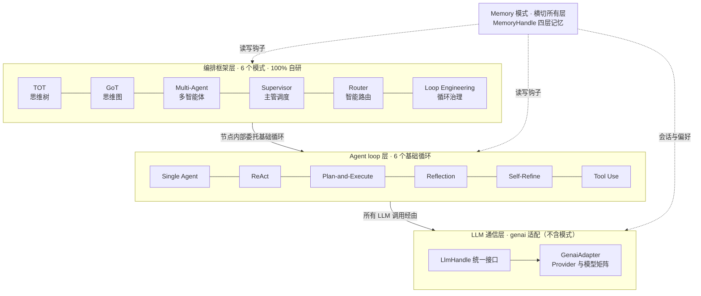

图 2-1 三层架构总览。实线为调用/委托方向，虚线为 Memory 横切注入。

### 2.2 模式归属映射表

13 种模式到层的完整映射（编号对应用户原始清单序号）：

**表 2-1 模式—层级归属映射**

| 原始序号 | 模式 | 归属层 | 归属理由 |
|---|---|---|---|
| 1 | Single Agent | Agent loop 层 | 单节点直通，无图拓扑诉求，是最小循环单元 |
| 2 | ReAct | Agent loop 层 | 思考—行动—观察是一个节点内基础循环，回边是其唯一拓扑 |
| 3 | Plan-and-Execute | Agent loop 层 | 计划—执行—重规划基础循环；计划本身是循环内部状态而非运行时拓扑 |
| 4 | Reflection | Agent loop 层 | 执行者与评估者交替的基础循环，双节点 + 回边即可表达 |
| 5 | Self-Refine | Agent loop 层 | 单角色自评自改的基础循环，不引入第二个视角 |
| 6 | TOT | 编排框架层 | 需要运行时动态展开候选子树 + 评分剪枝，树形编排是调度器级能力 |
| 7 | GoT | 编排框架层 | 需要 split/merge 的 DAG 编排，思维合并是调度器级能力 |
| 8 | Multi-Agent | 编排框架层 | 多节点并发车道 + 聚合拓扑，依赖执行器的并发调度 |
| 9 | Supervisor | 编排框架层 | 星型调度拓扑，主管在运行时动态派发与回收任务 |
| 10 | Router | 编排框架层 | 多出口条件分发拓扑，是链路之间的分发器而非任务执行者 |
| 11 | Tool Use | Agent loop 层 | LLM 与工具之间的调用协议循环，是构造 ReAct 等循环的协议底座 |
| 12 | Memory | 横切所有层 | 不构成独立链路；四层记忆经 `MemoryHandle` 贯穿三层 |
| 13 | Loop Engineering | 编排框架层 | 对任意内层链路的循环治理（预算/收敛/上下文/退避），是最外层框架 |

数量核对：**编排框架层 6 个**（TOT、GoT、Multi-Agent、Supervisor、Router、Loop Engineering）；**Agent loop 层 6 个**（Single Agent、ReAct、Plan-and-Execute、Reflection、Self-Refine、Tool Use）；**Memory 横切 1 个**；**LLM 通信层为 genai 适配，不含模式**。合计 13 个模式，与原始清单一一对应、无遗漏。

两个容易误判的归属说明：

- **Plan-and-Execute 归 loop 层而非框架层**：它的图（计划节点 → 执行节点 → 重规划门）是固定的三段式循环，不依赖运行时动态拓扑变化；当计划被展开成多节点依赖图并由执行器调度时，那已经是「Plan-and-Execute 循环 + 动态子图」的组合形态（见 5.3 的白盒展开说明）。
- **Tool Use 归 loop 层而非通信层**：工具调用循环发生在 Agent 语义层（决定调什么、怎么解读结果），而 LLM 通信层只负责把调用协议翻译给 Provider。前者是编排语义，后者是传输适配，边界在 `LlmHandle`。

### 2.3 层间契约与组合规则

| 契约 | 内容 |
|---|---|
| 框架层 → loop 层 | 框架层图中的节点可整体委托一个基础循环（黑盒），或展开为子图（白盒）；两种形态经 `CompositeNode` 统一（见 3.4） |
| loop 层 / 框架层 → 通信层 | 一切 LLM 调用只经 `ctx.llm`（`LlmHandle`）。节点代码中禁止出现任何 Provider SDK 类型 |
| Memory 横切 | 执行器在每节点前后调用 `memory.before` / `memory.after` 钩子；节点内可经 `ctx.memory` 主动读写。节点不允许绕过 `MemoryHandle` 直连存储 |
| 状态契约 | 跨节点数据一律走黑板 `ctx.state`（键约定见各模式小节）；节点间不允许直接引用彼此内部状态 |
| 终止契约 | 每种模式的终止条件分三类：自然终止（出口端口）、治理终止（预算/轮次上限，由 Loop Engineering 提供）、异常终止（Fatal 错误） |

组合规则（白盒/黑盒对偶）：loop 层模式的最小部署形态是一个黑盒节点（内部跑完整个循环才返回）；需要观测每步、或在循环中插入治理门时，展开为白盒子图。框架层模式天然是白盒图。任何子图都能经 `CompositeNode` 重新装回黑盒，组合不产生新抽象。

### 2.4 图例约定

本文所有链路图遵循统一图例（Fathom 式克制配色：灰底为入口/出口，海军蓝为 LLM 节点，白底虚线为执行/工具动作，浅灰菱形为判定门）：

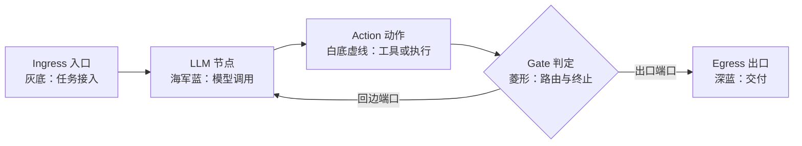

图 2-2 全文统一图例。后续各图沿用：入口 `ingress`、出口 `egress`、LLM 节点海军蓝、动作节点白底虚线、判定门菱形；回边（循环）一律标注端口名。

---

## 3. 统一节点抽象：OrchestratorNode

### 3.1 设计考量

13 种模式共用一个 trait，意味着这个抽象必须同时容纳三类形态：

1. **原子节点**：一次 LLM 调用或一次工具执行（Single Agent 的直通节点、Tool Use 的工具节点）。
2. **循环节点**：内部多轮迭代、对外单次进出的节点（ReAct 黑盒、Self-Refine 黑盒）。
3. **容器节点**：运行时动态展开子图或派发任务的节点（TOT 展开、Supervisor 派发、Router 分发）。

因此 trait 的形状由三个约束倒逼出来：

- **可恢复**：任意节点崩溃后能从最近快照恢复（VibeCoding 任务长、成本高，不能整链重跑）——所以快照是 trait 的一等方法，不是外挂。
- **可路由**：图结构需要条件分支与回边——所以节点执行完要报告「从哪个端口出」。
- **可治理**：Loop Engineering 与 Memory 要能在节点边界拦截——所以节点执行只能拿到受控的执行上下文，钩子由执行器统一挂。

### 3.2 核心定义

```rust
use std::collections::HashMap;
use std::sync::Arc;

/// 图中每个节点可声明的端口。端口是边的路由目标：
/// 执行器根据 NodeResult.port 决定下一跳。
#[derive(Debug, Clone, PartialEq, Eq, Hash)]
pub enum Port {
    /// 默认出口（线性下沿）
    Out,
    /// 循环回边：回到本节点或上游节点再迭代
    Loop,
    /// 条件分支出口（Router/判定门使用）
    Branch(String),
    /// 子图/子任务派发出口（TOT 展开、Supervisor 派发使用）
    Spawn,
    /// 成功终局：交付并结束
    Done,
    /// 失败终局：携带错误结束（可被外层治理捕获）
    Fatal(String),
}

/// 节点执行结果：数据一律写入黑板，结果只携带路由与元信息。
#[derive(Debug, Clone)]
pub struct NodeResult {
    /// 本节点的出口端口，执行器据此路由下一跳
    pub port: Port,
    /// 本次执行的增量用量（token/调用数），供预算门累计
    pub usage: Usage,
    /// 本节点自评：进度是否可观测（供治理层日志与心跳）
    pub progress: Option<ProgressNote>,
}

/// 节点快照：恢复所需的全部内部状态。
/// 黑盒循环节点必须能在每轮迭代边界产出快照。
#[derive(Debug, Clone, serde::Serialize, serde::Deserialize)]
pub struct NodeSnapshot {
    /// 节点自定义的恢复载荷（如 ReAct 的轨迹、TOT 的树状态）
    pub payload: serde_json::Value,
}

/// 统一节点抽象。13 种模式的所有节点都实现这一个 trait。
#[async_trait::async_trait]
pub trait OrchestratorNode: Send + Sync {
    /// 节点稳定标识（图内唯一；同名不同实例用实例后缀区分）
    fn id(&self) -> &NodeId;

    /// 元信息：模式来源、端口规格、资源画像。执行器用于校验与预算。
    fn meta(&self) -> &NodeMeta;

    /// 声明本节点可能出现的出口端口集合（静态可查，供构图校验）
    fn outputs(&self) -> &[Port];

    /// 执行节点：读黑板、调 LLM/工具、写黑板、返回路由。
    /// 一切 LLM 访问经 ctx.llm，一切记忆访问经 ctx.memory。
    async fn execute(&self, ctx: &mut NodeCtx) -> Result<NodeResult, NodeError>;

    /// 产出可恢复快照。容器节点在此保存子图状态。
    async fn snapshot(&self) -> Result<NodeSnapshot, NodeError> {
        Ok(NodeSnapshot { payload: serde_json::Value::Null })
    }

    /// 从快照恢复（默认无状态）。恢复后 execute 应从断点继续而非重跑。
    async fn restore(&mut self, snap: NodeSnapshot) -> Result<(), NodeError> {
        let _ = snap;
        Ok(())
    }
}

/// 节点执行上下文：受控视图，钩子由执行器统一挂。
pub struct NodeCtx<'a> {
    /// 黑板：跨节点共享的任务状态（计划、轨迹、工件、评分）
    pub state: &'a mut Blackboard,
    /// LLM 统一入口（genai 适配层暴露的句柄）
    pub llm: &'a dyn LlmHandle,
    /// 记忆统一入口（四层记忆的读写句柄）
    pub memory: &'a dyn MemoryHandle,
    /// 本节点预算剩余视图（治理层注入）
    pub budget: BudgetView,
    /// 取消信号：治理层或用户中止时置位
    pub cancel: CancelToken,
}
```

要点解读：

- **数据与路由分离**：`execute` 的产出物写入黑板（`ctx.state`），`NodeResult` 只携带端口与用量。这保证图的边永远是「控制流」而非「数据流管道」，任一节点的输出都能被任意后继节点按约定键读取——TOT 的多候选聚合、GoT 的思维合并都依赖这一点。
- **默认实现**：`snapshot`/`restore` 给了无状态默认实现，原子节点零负担；循环节点、容器节点按需覆写。这是「单一抽象不臃肿」的关键。
- **`Port::Spawn` 与动态子图**：TOT/Supervisor/GoT 的容器节点通过 `Spawn` 端口请求执行器挂接动态子图（见 4.4），节点自身不私建并发。
- **错误语义**：`NodeError` 分 `Retryable`（可重试：Provider 抖动、工具超时）与 `Fatal`（不可重试：schema 不匹配、预算拒绝）两档，执行器与治理层据此分级处置（见 4.5）。

### 3.3 端口路由与黑板契约

边在构图时绑定「源节点 + 源端口」到目标节点。执行循环的核心一步就是查表：

```rust
/// 图的边：从 (源节点, 源端口) 到目标节点。
#[derive(Debug, Clone)]
pub struct Edge {
    pub from: NodeId,
    pub from_port: Port,
    pub to: NodeId,
    /// 可选谓词：Branch 端口可带条件（构图时静态声明）
    pub when: Option<Condition>,
}
```

黑板键按「模式 + 用途」命名空间化，避免组合模式时键冲突。全文约定如下（各模式小节直接引用）：

**表 3-1 黑板键约定（模式命名空间）**

| 键 | 写入者 | 读取者 | 内容 |
|---|---|---|---|
| `task.intent` | Ingress | 所有节点 | 用户原始意图与验收标准 |
| `react.trace` | ReAct | ReAct 自身 / 治理层 | 思考—行动—观察轨迹 |
| `pne.plan` | Plan-and-Execute | 执行/重规划节点 | 当前计划（步骤数组） |
| `pne.cursor` | 执行节点 | 重规划门 | 计划游标 |
| `reflect.review` | Reflection | 执行者 | 评估者反馈 |
| `refine.draft` | Self-Refine | 自身 | 当前精炼稿 |
| `tot.tree` | TOT 容器 | 展开/评分/选择 | 思维树状态（节点+边+分数） |
| `got.graph` | GoT 容器 | split/merge | 思维图状态 |
| `ma.results` | Multi-Agent 聚合 | 所有工人 | 各车道结果槽位 |
| `sup.queue` | Supervisor | 主管 | 待派发任务队列 |
| `route.choice` | Router | 目标链路入口 | 分发决策与理由 |
| `tool.calls` | Tool Use | 协议循环 | 工具调用记录 |
| `mem.notes` | Memory 钩子 | 所有节点 | 会话级记忆笔记 |
| `gov.budget_ledger` | 治理门 | 预算视图 | 全链路用量台账 |

### 3.4 组合粘合剂：CompositeNode

loop 层模式「黑盒部署」与「白盒展开」的对偶，以及框架层节点内嵌 loop 循环，全部经同一个组合器完成——组合不产生新 trait：

```rust
/// 把一张子图包装成单节点（黑盒化）。
/// Supervisor 的工人、Loop Engineering 的被治理链、
/// TOT 的候选评估器，都是 CompositeNode 的实例。
pub struct CompositeNode {
    inner: Graph,                    // 被包装的子图
    entry: NodeId,                   // 子图入口
    exit_map: HashMap<Port, NodeId>, // 子图终止节点到端口的映射
    /* OrchestratorNode 字段略 */
}

#[async_trait::async_trait]
impl OrchestratorNode for CompositeNode {
    async fn execute(&self, ctx: &mut NodeCtx) -> Result<NodeResult, NodeError> {
        // 1. 以 ctx 为根派生子执行上下文（黑板/llm/memory 直通，预算派生视图）
        // 2. 跑 DefaultOrchestrator::run(inner) 直到子图终止
        // 3. 子图终止节点的结果映射回 CompositeNode 的 NodeResult
        // 4. 子图内部快照聚合进本节点 snapshot()
        //    —— 外层恢复时先恢复 CompositeNode，再级联恢复子图
        /* 伪代码 */
        let sub_result = DefaultOrchestrator::run(&self.inner, ctx.derive()).await?;
        Ok(map_to_own_result(sub_result))
    }
}
```

这条机制是整个体系的组合律：**白盒图 ⇄ 黑盒节点自由切换，嵌套任意深度**。第 6 章各框架模式将反复引用 `CompositeNode` 作为「内层跑 loop 模式」的标准做法。

### 3.5 节点实现纪律

所有模式节点共用的实现纪律（各小节不再重复）：

1. **不私建并发**：并发一律经 `Spawn` 端口交执行器调度（4.4），保证治理与快照的全局一致性。
2. **不直连 Provider**：节点代码中不出现任何具体 SDK 类型，只认 `ctx.llm`。
3. **幂等优先**：`execute` 设计为可重入；恢复后继续而非重跑。
4. **黑板只追加不改写**：历史键（如 `react.trace`）只追加条目；需要覆盖时写新版本键，保证审计可回放。
5. **用量如实上报**：`NodeResult.usage` 是预算治理的原始输入，漏报等于破坏治理。

---

## 4. 图执行器：DefaultOrchestrator

### 4.1 职责与数据结构

`DefaultOrchestrator` 是唯一的图执行器：13 种模式的图模板都由它调度。职责边界：**拓扑推进、端口路由、并发调度、动态子图挂接、预算与钩子、快照与恢复**。它不理解任何具体模式的语义——模式语义全部落在节点实现与图模板里。

```rust
/// 一张可执行的链路图。
pub struct Graph {
    nodes: HashMap<NodeId, Box<dyn OrchestratorNode>>,
    edges: Vec<Edge>,
    entry: NodeId,
}

/// 全链路执行句柄。
pub struct DefaultOrchestrator {
    graph: Graph,
    memory: Arc<dyn MemoryHandle>,
    llm: Arc<dyn LlmHandle>,
    hooks: Hooks,               // before/after/budget/cancel 钩子集
    run_config: RunConfig,      // 全局预算上限、并发度、快照间隔
}

impl DefaultOrchestrator {
    /// 跑完整张图：从 entry 推进到 Done/Fatal 或治理终止。
    pub async fn run(&self, root_ctx: &mut NodeCtx) -> Result<RunReport, NodeError> {
        /* 见 4.2 调度循环 */
    }

    /// 从最近快照恢复整链（含子图级联恢复）。
    pub async fn resume(&self, ckpt: Checkpoint) -> Result<RunReport, NodeError> {
        /* restore 节点 → 定位断点 → 继续调度 */
    }
}
```

### 4.2 调度循环

```text
function run(graph, ctx):
    ready ← { graph.entry }
    while ready ≠ ∅ and not cancelled:
        node ← ready.pop()                        # 1. 取就绪节点
        memory.before(node, ctx)                  # 2. 记忆前置钩子
        result ← node.execute(ctx)                # 3. 执行
        memory.after(node, ctx)                   # 4. 记忆后置钩子
        budget.accumulate(result.usage)           # 5. 累计用量并检查预算
        if budget.exceeded(): terminate(Governed) #    超预算 → 治理终止
        if result.port == Spawn:                  # 6. 动态子图挂接
            sub ← node.pending_subgraph()         #    节点声明的待挂子图
            ready.push(graph.attach(sub))         #    挂到待挂点后继续
            continue
        next ← edges.lookup(node.id, result.port) # 7. 端口路由查表
        if next is ∅ and result.port == Done:
            return RunReport::done(ctx.state)     # 8a. 自然终局
        if result.port is Fatal(e):
            return RunReport::fatal(e)            # 8b. 失败终局
        ready.push(next)                          #    继续推进
    return RunReport::governed()                  # 9. 预算/取消终止
```

调度循环说明（对应编号）：

1. **就绪集合**：顺序图退化为单元素集合；并发图（Multi-Agent、GoT 分支）由并发调度器（4.4）填充。
2/4. **记忆钩子**：节点前取回相关记忆写入 `ctx.memory` 视图，节点后把 `mem.notes` 增量沉淀——第 7 章 Memory 横切的落点。
3. **受控执行**：节点拿到的是 `NodeCtx`（黑板 + LLM + 记忆 + 预算 + 取消）的受控视图，无法绕过治理。
5. **预算门**：每次节点执行后累计 `usage`；超限即治理终止（Loop Engineering 的硬闸门，见 6.6）。
6. **动态子图**：`Spawn` 端口是 TOT/GoT/Supervisor/Multi-Agent 的运行时展开通道，详见 4.4。
7. **端口路由**：边表按（源节点，源端口）索引；`Branch` 端口可带静态谓词二次过滤。
8. **终局三分**：自然终局（`Done`）、失败终局（`Fatal`）、治理终止（预算/取消）——与 2.3 的终止契约一一对应。

### 4.3 确定性与可观测

- **步序号**：每个节点执行分配单调递增步序号（step id），写入 RunReport；同一快照 + 同一黑板状态恢复后，步序号连续不回卷。
- **RunReport**：终局时输出全链路报告（步序列表、每步端口、用量台账、终局原因），既是调试界面也是成本审计材料。
- **可重放**：黑板只追加 + 步序号 + 快照，三者合起来保证「任一步之后的状态」可离线重放（对 VibeCoding 的成本审计尤其重要）。

### 4.4 动态子图与并发调度

静态图无法表达 TOT 的运行时分叉、Supervisor 的动态派发、GoT 的合并。这些能力统一走 `Spawn` 通道：

```text
节点声明挂接请求（ExecuteContext 内以 pending_subgraph 呈现）:
    pending: Option<SubgraphRequest>   # 入口节点 + 边 + 终止映射

执行器处理 Spawn:
    attach(sub) → 在挂接点插入子图，获得「子图完成端口」
    子图终止后，控制权与黑板回到挂接节点，进入其后继边
```

并发调度补充（Multi-Agent / GoT 用）：

- **车道模型**：每个并发分支是一条车道（lane），车道内顺序执行、车道间并发；车道共享同一黑板，写入键按车道命名空间隔离（`ma.results.<lane>`）。
- **汇合点**：聚合节点声明等待集（wait-set = 车道终节点集合），全部就绪才调度（GoT 的 merge 节点、Multi-Agent 的聚合器）。
- **并发度上限**：`RunConfig.max_concurrency` 全局封顶，超出排队——LLM 通信层的限流（8.4）与之配合。

### 4.5 错误分级与处置

| 错误档 | 例子 | 执行器行为 |
|---|---|---|
| Retryable | Provider 5xx/超时、工具瞬态失败 | 按退避重试（上限内），重试不换路由 |
| Fatal | schema 不匹配、预算拒绝、取消 | 立即终局；外层若有治理包装（Loop Engineering），可捕获后改参重进 |
| Governed | 预算耗尽、轮次上限 | 治理终止：产出当前最好结果 + 台账（若模式支持 best-effort 输出） |

### 4.6 快照与恢复协议

- **触发**：每 N 步（`RunConfig.snapshot_interval`）或每次 `Spawn` 挂接前后强制快照——动态子图展开是高成本动作，必须先落快照。
- **内容**：黑板全量（只追加，可直接序列化）+ 各有状态节点 `snapshot()` + 步序号 + 预算台账。
- **恢复**：`resume(ckpt)` 先逆序 restore 节点（CompositeNode 级联恢复子图），再从步序号继续调度。VibeCoding 任务动辄数十分钟，这条协议是「断点续跑」的保证。

---

## 5. Agent loop 层：六种基础循环

Agent loop 层的六个模式是构造一切链路的最小循环单元。每节结构固定：任务画像 → 节点组成 → 图结构 → 数据流与状态流转 → 终止条件 → VibeCoding 示例 → trait 实现要点。

### 5.1 Single Agent 单智能体直通

**任务画像**：单步可完成的即席生成——意图明确、无需多轮探索、验收直观。链路成本最低、延迟最小，也是其余一切模式的退化底座。

**表 5-1 节点组成**

| 节点 | 类型 | 职责 |
|---|---|---|
| `ingress` | 入口 | 接收意图，写入 `task.intent`，附验收标准 |
| `solve` | LLM 节点 | 单次调用直出方案（代码/答案） |
| `egress` | 出口 | 交付结果与用量报告 |

**图结构**：

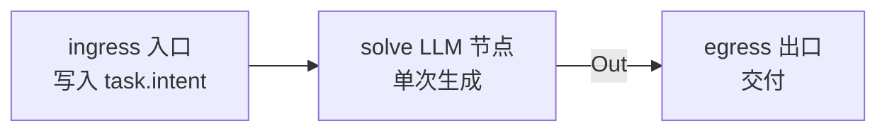

图 5-1 Single Agent：无分支、无回边的最短链路。

**数据流与状态流转**：`task.intent`（ingress 写入）→ `solve` 读取意图与记忆中的相关笔记，生成结果写入 `result.draft` → egress 交付。黑板状态只经历一次写入一轮读取，无中间态。

**终止条件**：`solve` 返回 `Done` 即终局；唯一失败面是 LLM 调用异常（Retryable 重试后仍 Fatal 则终局）。

**VibeCoding 示例**：

> 「写一个正则，匹配中国大陆手机号，兼容 166 号段，输出 Rust 测试」——意图单一、验收即测试通过，单次调用足够。类似场景：小工具函数、docstring 生成、commit message、配置片段。

**trait 实现要点**：`SingleAgentNode` 实现 `OrchestratorNode`，`outputs()` 返回 `[Out, Fatal]`；`execute` 内一次 `ctx.llm.complete(req)`，把回复写入黑板后返回 `Port::Done`。无状态，继承默认 `snapshot`。

```rust
pub struct SingleAgentNode {
    id: NodeId,
    meta: NodeMeta,
    prompt_spec: PromptSpec,   // system/user 模板与变量源
}

#[async_trait::async_trait]
impl OrchestratorNode for SingleAgentNode {
    fn outputs(&self) -> &[Port] { &[Port::Out, Port::Fatal("llm".into())] }

    async fn execute(&self, ctx: &mut NodeCtx) -> Result<NodeResult, NodeError> {
        let prompt = self.prompt_spec.render(&ctx.state)?;
        let resp = ctx.llm.complete(Request::new(prompt)).await?;   // 唯一一次调用
        ctx.state.append("result.draft", resp.text.clone());
        Ok(NodeResult { port: Port::Done, usage: resp.usage, progress: None })
    }
}
```

### 5.2 ReAct 推理与行动

**任务画像**：交互排障——需要「看现场 → 提假设 → 验证 → 再看」的循环，信息分散在环境（代码库、日志、构建输出）里，无法一次性掌握。

**表 5-2 节点组成**

| 节点 | 类型 | 职责 |
|---|---|---|
| `ingress` | 入口 | 写入 `task.intent`（含故障现象） |
| `reason` | LLM 节点 | 思考：基于轨迹提出下一步假设/行动 |
| `act` | Action 节点 | 执行工具调用（读码/查日志/跑测试） |
| `observe` | 观察写入 | 把工具结果追加到 `react.trace` |
| `gate.loop` | 判定门 | 结论足够/轮次上限？决定回边或出口 |
| `egress` | 出口 | 交付根因与修复 |

**图结构**：

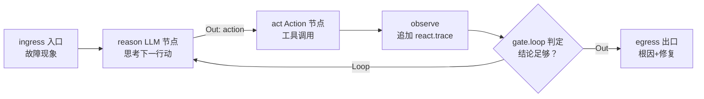

图 5-2 ReAct：思考—行动—观察三元组 + 回边。`gate.loop` 是回边路由门。

**数据流与状态流转**：核心状态是 `react.trace`（思考/行动/观察条目的只追加序列）。每轮：`reason` 读全部轨迹 → 产出一条 Thought + 一个 Action（含工具名与参数）→ `act` 执行 → `observe` 追加 Observation → `gate.loop` 判定。判定依据两类信号：`reason` 显式给出最终答案（自然终止），或轮次达到上限（治理终止，输出当前最佳假设）。

**终止条件**：① `reason` 标记 final answer → `Done`；② 轮次上限 → 治理终止；③ 工具连续 N 次失败 → `Fatal`。

**VibeCoding 示例**：

> 「CI 里这个测试时绿时红，帮我定位」——需要看测试代码、看日志、提假设（并发？时间依赖？）再用最小复现验证，信息逐步释放，ReAct 的观察反馈循环正是为此设计。类似场景：构建失败排错、运行时异常定位、环境问题排查。

**trait 实现要点**：黑盒部署时 `ReActLoopNode` 一个节点装下整个循环，`outputs()` 返回 `[Loop, Out, Fatal]`，每轮边界产快照（轨迹可恢复）；白盒部署时 reason/act/observe 拆为子图节点，回边经 `Edge(from: gate.loop, from_port: Loop)` 表达——两种形态用 `CompositeNode` 互转。

```rust
pub struct ReActLoopNode {
    id: NodeId,
    meta: NodeMeta,
    max_turns: u32,             // 治理终止闸门
    tools: ToolSpecSet,         // 本链路可用的工具集
}

#[async_trait::async_trait]
impl OrchestratorNode for ReActLoopNode {
    fn outputs(&self) -> &[Port] {
        &[Port::Loop, Port::Out, Port::Fatal("tool".into())]
    }

    async fn execute(&self, ctx: &mut NodeCtx) -> Result<NodeResult, NodeError> {
        let mut usage = Usage::default();
        for turn in 0..self.max_turns {
            // 1. 思考：携带全部轨迹请求下一步
            let step = ctx.llm.react_step(&ctx.state.read("react.trace")?, &self.tools).await?;
            usage += step.usage;
            if let Some(answer) = step.final_answer {
                ctx.state.append("result.draft", answer);
                return Ok(NodeResult { port: Port::Done, usage, progress: None });
            }
            // 2. 行动：执行工具并把观察追加回黑板
            let obs = ctx.tools.invoke(&step.action).await?;
            ctx.state.append("react.trace", TraceEntry::ActObs(step.action, obs));
            // 3. 快照：轮次边界可恢复
            self.persist_turn_snapshot(turn)?;
        }
        Ok(NodeResult { port: Port::Done, usage, progress: Some(ProgressNote::max_turns()) })
    }
}
```

> 注：`ctx.tools` 为 `NodeCtx` 上工具调用的便利视图，底层仍走 Tool Use 协议（5.6）与 `ctx.llm`。

### 5.3 Plan-and-Execute 计划与执行

**任务画像**：多步工程——任务有依赖序、步骤明确，先规划后执行比边走边看更可控；执行中允许按实情重规划。

**表 5-3 节点组成**

| 节点 | 类型 | 职责 |
|---|---|---|
| `ingress` | 入口 | 写入 `task.intent` |
| `plan` | LLM 节点 | 生成步骤化计划（含每步验收） |
| `execute` | Action/LLM 混合节点 | 按游标执行当前步（内部可为 ReAct） |
| `gate.replan` | 判定门 | 步完成且后续计划仍成立？否则重规划 |
| `egress` | 出口 | 交付全部工件 |

**图结构**：

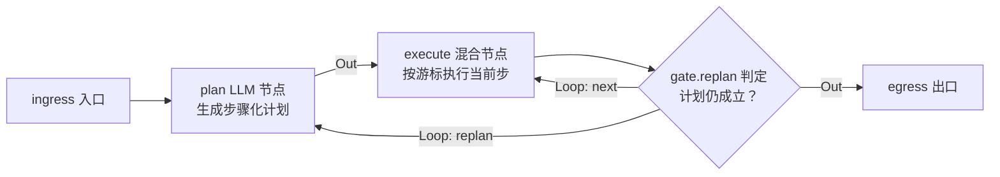

图 5-3 Plan-and-Execute：计划—执行—重规划三元循环。`gate.replan` 的两个 Loop 出口分别驱动「重规划」与「下一步」。

**数据流与状态流转**：`pne.plan`（步骤数组，每步含意图与验收）与 `pne.cursor`（当前步游标）是核心状态。执行循环：`execute` 取当前步 → 执行（可内嵌 ReAct 子循环排障）→ 验收 → `gate.replan` 判定：验收不过且计划需要调整 → 回 `plan`（携带已完成步与失败原因）；验收过且还有下一步 → 游标 +1 回 `execute`；全部完成 → 出口。

**终止条件**：① 游标越过末步且全部验收过 → `Done`；② 重规划次数上限 → 治理终止（输出已完成工件）；③ 某步连续失败且重规划无改善 → `Fatal`。

**VibeCoding 示例**：

> 「把这个 CLI 工具从 clap 3 迁到 clap 4，保持所有子命令行为不变」——需要先拆步（依赖升级 → API 重命名 → derive 语法迁移 → 帮助文本比对 → 回归测试），执行中一旦发现不兼容点需要重规划后续步骤。类似场景：大型重构、新功能多模块落地、跨文件 API 改造。

**trait 实现要点**：黑盒 `PlanExecuteNode` 内持 `pne.plan` + `pne.cursor`，`outputs()` 返回 `[Loop, Out, Fatal]`，每步边界产快照；白盒展开时，若计划被实时展开为多节点子图（每步一个节点、依赖为边），即升级为「Plan-and-Execute + 动态子图」组合形态，由执行器 4.4 的 `Spawn` 通道调度——这也是它常作为 Supervisor 工人内循环的原因。

```rust
pub struct PlanExecuteNode {
    id: NodeId,
    meta: NodeMeta,
    max_replans: u32,
    executor: Box<dyn OrchestratorNode>,   // 每步的执行器（常为 ReAct 黑盒）
}

#[async_trait::async_trait]
impl OrchestratorNode for PlanExecuteNode {
    fn outputs(&self) -> &[Port] { &[Port::Loop, Port::Out, Port::Fatal("replan".into())] }

    async fn execute(&self, ctx: &mut NodeCtx) -> Result<NodeResult, NodeError> {
        let mut usage = Usage::default();
        let mut replans = 0;
        let plan = ctx.llm.make_plan(ctx.state.read("task.intent")?).await?;
        ctx.state.write("pne.plan", plan.clone());
        let mut cursor = 0;
        while cursor < plan.steps.len() {
            let step = &plan.steps[cursor];
            let r = self.executor.execute(ctx).await?;      // 内嵌 ReAct 等循环
            usage += r.usage;
            ctx.state.write("pne.cursor", cursor);
            match ctx.llm.assess_step(step, &ctx.state).await? {
                StepOutcome::Passed => cursor += 1,
                StepOutcome::NeedsReplan(reason) if replans < self.max_replans => {
                    replans += 1;
                    let new_plan = ctx.llm.replan(&plan, cursor, reason).await?;
                    ctx.state.write("pne.plan", new_plan);
                }
                StepOutcome::NeedsReplan(_) => {
                    return Ok(NodeResult { port: Port::Fatal("replan".into()), usage, progress: None })
                }
            }
            self.persist_step_snapshot(cursor, replans)?;
        }
        Ok(NodeResult { port: Port::Done, usage, progress: None })
    }
}
```

### 5.4 Reflection 反思

**任务画像**：质量收敛——有明确验收信号但首稿难以一次到位，需要「执行者产出 → 评估者挑刺 → 执行者修订」的双视角外部循环。

**表 5-4 节点组成**

| 节点 | 类型 | 职责 |
|---|---|---|
| `ingress` | 入口 | 写入 `task.intent` 与验收标准 |
| `actor` | LLM 节点 | 执行者：产出/修订稿件 |
| `critic` | LLM 节点 | 评估者：对照验收标准产出结构化反馈 |
| `gate.refine` | 判定门 | 反馈为空或轮次上限则出口 |
| `egress` | 出口 | 交付终稿与评估报告 |

**图结构**：

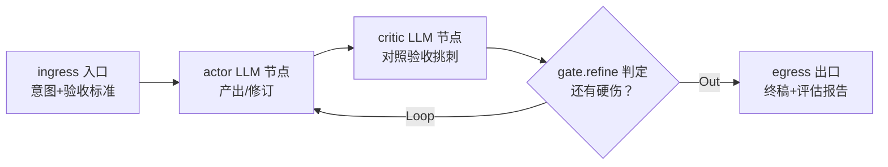

图 5-4 Reflection：actor–critic 双节点交替，回边驱动修订。

**数据流与状态流转**：`reflect.review`（评估者反馈）是循环的驱动信号。首轮 actor 读意图产初稿写 `result.draft`；critic 读稿 + 验收标准，产出结构化反馈（问题列表 + 严重度）写入 `reflect.review`；若存在高严重度问题，actor 读反馈修订，循环；否则出口。

**终止条件**：① critic 反馈无高严重度问题 → `Done`；② 轮次上限 → 治理终止（输出终稿附未解决问题清单）；③ 反馈与修订在同一问题上震荡（检测连续两轮反馈相同）→ 提前出口防死循环。

**VibeCoding 示例**：

> 「给这个支付模块补齐单元测试，边界条件要覆盖完」——执行者写测试，评估者对照边界清单（金额溢出、币种、幂等、并发）挑出遗漏，修订循环至收敛。类似场景：代码审查修订、安全合规检查、文档与代码一致性校对。

**trait 实现要点**：与 Self-Refine 的区别在节点数：Reflection 是**双节点双角色**（actor 与 critic 分离，critic 用独立 prompt 与独立评分 rubric），Self-Refine 是**单节点自评**。黑盒 `ReflectionNode` 内持双角色循环，`outputs()` 返回 `[Loop, Out, Fatal]`。

```rust
pub struct ReflectionNode {
    id: NodeId,
    meta: NodeMeta,
    max_rounds: u32,
    actor_spec: PromptSpec,
    critic_spec: PromptSpec,    // 独立 rubric：问题列表 + 严重度分级
}

#[async_trait::async_trait]
impl OrchestratorNode for ReflectionNode {
    fn outputs(&self) -> &[Port] { &[Port::Loop, Port::Out, Port::Fatal("oscillate".into())] }

    async fn execute(&self, ctx: &mut NodeCtx) -> Result<NodeResult, NodeError> {
        let mut usage = Usage::default();
        let mut draft = ctx.llm.complete(self.actor_spec.render_initial(ctx.state)?).await?;
        usage += draft.usage;
        let mut last_review = None;
        for round in 0..self.max_rounds {
            let review = ctx.llm.review(&self.critic_spec, &draft.text).await?;
            usage += review.usage;
            if review.severe_issues().is_empty() { break; }
            if Some(&review) == last_review.as_ref() {
                return Ok(NodeResult { port: Port::Fatal("oscillate".into()), usage, progress: None });
            }
            last_review = Some(review.clone());
            draft = ctx.llm.complete(self.actor_spec.render_revision(&draft.text, &review)?).await?;
            usage += draft.usage;
            ctx.state.append("reflect.review", review);
            self.persist_round_snapshot(round)?;
        }
        ctx.state.append("result.draft", draft.text);
        Ok(NodeResult { port: Port::Done, usage, progress: None })
    }
}
```

### 5.5 Self-Refine 自我精炼

**任务画像**：单角色精炼——没有独立评估者视角，由同一角色自评自改，适合有客观可对照目标的逐步打磨；成本低于 Reflection，但缺少外部视角，收敛上限依赖自评质量。

**表 5-5 节点组成**

| 节点 | 类型 | 职责 |
|---|---|---|
| `ingress` | 入口 | 写入 `task.intent` 与目标（如风格指南） |
| `refine` | LLM 节点 | 自评（对照目标找差距）→ 自改（产新稿）一体 |
| `gate.self` | 判定门 | 差距足够小或轮次上限则出口 |
| `egress` | 出口 | 交付终稿与版本链 |

**图结构**：

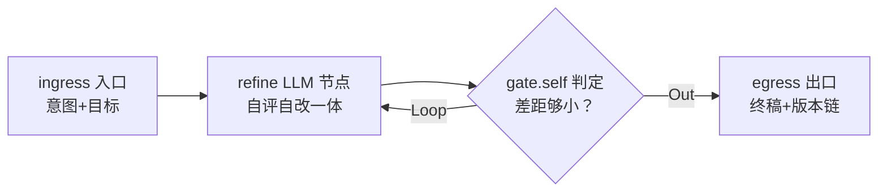

图 5-5 Self-Refine：单节点自循环。版本链 `refine.draft@k` 保留全部迭代稿。

**数据流与状态流转**：`refine.draft` 写入新版本键（`refine.draft@k`，黑板只追加原则），每轮携带前稿 + 目标，产出「差距分析 + 新稿」。收敛信号优先用客观指标（如 lint 通过数、测试通过率——由工具观察提供），自评分数作兜底。

**终止条件**：① 客观指标达标或自评差距低于阈值 → `Done`；② 轮次上限 → 治理终止；③ 连续两轮指标无改善 → 提前出口（防收益递减）。

**VibeCoding 示例**：

> 「把这段 Rust 代码按 clippy 最高标准打磨一遍」——clippy 输出是客观差距信号，同一角色看警告改代码循环到干净。类似场景：性能微观优化（benchmark 指标驱动）、文案/注释风格统一、日志格式规范化。

**trait 实现要点**：`SelfRefineNode` 是最简单的有状态循环节点，`outputs()` 返回 `[Loop, Out, Fatal]`；与 Reflection 的关键差异：无独立 critic prompt，收敛信号优先来自工具观察（客观），自评仅兜底（主观）。

```rust
pub struct SelfRefineNode {
    id: NodeId,
    meta: NodeMeta,
    max_rounds: u32,
    refine_spec: PromptSpec,       // 自评+自改一体的模板
    objective: ObjectiveSignal,    // 工具观察（lint/test/bench）或自评分
}

#[async_trait::async_trait]
impl OrchestratorNode for SelfRefineNode {
    fn outputs(&self) -> &[Port] { &[Port::Loop, Port::Out, Port::Fatal("stalled".into())] }

    async fn execute(&self, ctx: &mut NodeCtx) -> Result<NodeResult, NodeError> {
        let mut usage = Usage::default();
        let mut k = 0;
        let mut draft = ctx.llm.complete(self.refine_spec.render_initial(ctx.state)?).await?;
        usage += draft.usage;
        let mut prev_score = None;
        loop {
            let score = self.objective.measure(&draft.text).await?;   // 客观指标优先
            if score.acceptable() { break; }
            if let Some(p) = prev_score {
                if !score.improved_over(&p) {
                    return Ok(NodeResult { port: Port::Fatal("stalled".into()), usage, progress: None });
                }
            }
            prev_score = Some(score.clone());
            k += 1;
            if k > self.max_rounds { break; }
            draft = ctx.llm.complete(self.refine_spec.render_next(&draft.text, &score)?).await?;
            usage += draft.usage;
            ctx.state.write(format!("refine.draft@{k}"), draft.text.clone());
            self.persist_round_snapshot(k)?;
        }
        ctx.state.append("result.draft", draft.text);
        Ok(NodeResult { port: Port::Done, usage, progress: None })
    }
}
```

### 5.6 Tool Use 工具调用

**任务画像**：一切需要越出模型边界的动作——读代码库、跑命令、查文档。Tool Use 不是独立业务链路，而是构造 ReAct/Plan-and-Execute 等循环的**协议底座**：LLM 按工具 schema 产出调用意图，宿主执行并回填结果。

**表 5-6 节点组成**

| 节点 | 类型 | 职责 |
|---|---|---|
| `ingress` | 入口 | 写入任务与可用工具清单（schema） |
| `propose` | LLM 节点 | 按工具 schema 产出调用意图（或直接回答） |
| `invoke` | Action 节点 | 沙箱内执行工具，采集 stdout/stderr/文件变更 |
| `feedback` | 观察写入 | 结果回填为下一轮上下文，记入 `tool.calls` |
| `gate.tool` | 判定门 | 调用链完成则出口 |
| `egress` | 出口 | 交付最终回答与调用记录 |

**图结构**：

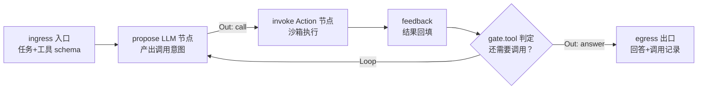

图 5-6 Tool Use：协议循环。propose 可直接出口（无需工具时）或发起多轮调用。

**数据流与状态流转**：`tool.calls`（每次调用的意图、参数、结果摘要、耗时）只追加。每轮：`propose` 读任务 + 工具 schema + 已有调用记录 → 产出「工具调用意图」或「最终回答」；`invoke` 在沙箱执行（超时/权限控制）；`feedback` 把结构化结果回填。与 ReAct 的分工：ReAct 的 reason 节点每轮显式思考并选择工具（策略层），Tool Use 的 propose 是无策略的协议层——ReAct 建立在 Tool Use 之上。

**终止条件**：① `propose` 直接给出最终回答 → `Done`；② 单工具调用失败超过重试上限 → `Fatal`；③ 总调用数上限 → 治理终止。

**VibeCoding 示例**：

> 「看下这个仓库的依赖树里有没有已知漏洞」——LLM 需要调 `cargo audit`、读 `Cargo.lock`、查 CVE 数据库，多轮工具调用后汇总结论。几乎一切 VibeCoding 链路都以它为底座（读码/写文件/跑测试都是工具）。

**trait 实现要点**：工具以 `ToolSpec`（JSON schema）声明，经 genai 适配层转换为 Provider 各自的 function calling 格式（8.3）；`invoke` 在沙箱内执行，工具结果以结构化 `Observation` 回填。`ToolUseNode` 黑盒实现协议循环，`outputs()` 返回 `[Loop, Out, Fatal]`。

```rust
pub struct ToolUseNode {
    id: NodeId,
    meta: NodeMeta,
    tools: ToolSpecSet,          // JSON schema 声明，经 genai 转换
    max_calls: u32,
    sandbox: SandboxPolicy,      // 超时/文件系统/网络权限
}

#[async_trait::async_trait]
impl OrchestratorNode for ToolUseNode {
    fn outputs(&self) -> &[Port] { &[Port::Loop, Port::Out, Port::Fatal("tool".into())] }

    async fn execute(&self, ctx: &mut NodeCtx) -> Result<NodeResult, NodeError> {
        let mut usage = Usage::default();
        let mut history = Vec::new();
        loop {
            let step = ctx.llm.propose_tool_call(&ctx.state.read("task.intent")?,
                                                 &self.tools, &history).await?;
            usage += step.usage;
            match step.decision {
                Decision::Answer(text) => {
                    ctx.state.append("result.draft", text);
                    return Ok(NodeResult { port: Port::Done, usage, progress: None });
                }
                Decision::Call(call) => {
                    let obs = ctx.tools.invoke_sandboxed(&call, &self.sandbox).await?;
                    ctx.state.append("tool.calls", CallRecord::new(&call, &obs));
                    history.push((call, obs));
                }
            }
            if history.len() as u32 >= self.max_calls {
                return Ok(NodeResult { port: Port::Done, usage,
                                       progress: Some(ProgressNote::max_calls()) });
            }
        }
    }
}
```

---

## 6. 编排框架层：六种图编排模式

编排框架层的六个模式是调度器级能力：它们的图结构依赖运行时动态拓扑（展开、合并、派发、分发、治理）。每节结构与第 5 章一致，额外增加「组合示例」说明框架模式如何内嵌 loop 层循环。

### 6.1 TOT 思维树

**任务画像**：方案探索——解空间大、单次推理易陷入局部最优，需要「多路展开 → 评分 → 剪枝 → 深挖」的树形搜索。适合没有唯一正确答案、但质量可比较的开放式问题。

**表 6-1 节点组成**

| 节点 | 类型 | 职责 |
|---|---|---|
| `ingress` | 入口 | 写入 `task.intent` 与评价维度 |
| `root` | 容器节点 | 初始化思维树，锚定根问题 |
| `expand` | 容器/LLM 节点 | 对叶子节点生成 k 个候选分支（每分支可内嵌 Self-Refine） |
| `evaluate` | LLM 节点 | 对候选分支按维度打分（可多维度加权） |
| `prune` | 判定门 | 按分数与宽度上限剪枝，选出保留集 |
| `select` | 判定门 | 收敛判定：最深/最优叶子胜出，或继续展开 |
| `egress` | 出口 | 交付胜出方案 + 树形探索报告 |

**图结构**：

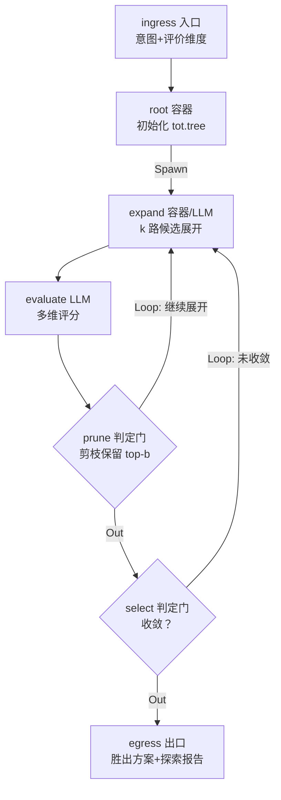

图 6-1 TOT：expand → evaluate → prune → select 的树形搜索循环。`Spawn` 端口在运行时把 k 路候选挂为并发车道。

**数据流与状态流转**：核心状态是 `tot.tree`（思维树：节点=候选方案，边=细化关系，节点带分数）。一轮搜索：`expand` 读当前保留集的每个叶子 → 每叶子生成 k 个候选（经 `Spawn` 变成并发车道，每车道内可跑 Self-Refine 把候选打磨成形）→ `evaluate` 对新候选打分写回 `tot.tree` → `prune` 保留 top-b、剪掉其余 → `select` 判定是否已达深度上限或分数饱和：未收敛则下一轮展开，收敛则选出最优叶子。

**终止条件**：① 达到深度上限且选出最优叶子 → `Done`；② 分数饱和（最优候选连续两轮无提升）→ 提前收敛；③ 预算耗尽 → 治理终止（交付当前最优叶子 + 已探索树）。

**VibeCoding 示例**：

> 「为这个高并发网关设计限流中间件，给出架构方案」——限流算法（令牌桶/漏桶/滑动窗口）、存储（本地/Redis 集群）、拒绝对策（同步拒绝/排队/降级）组合出大解空间，TOT 三层展开每层 3 候选、评分剪枝，最后深挖胜出方案成详细设计。类似场景：技术选型、API 设计探索、复杂算法方案比稿。

**组合示例**：expand 的每条候选车道内嵌 `SelfRefineNode`（把粗想法打磨成完整方案再参与评分），是「框架层图 + loop 层循环」的典型组合。

**trait 实现要点**：`TotNode` 是容器节点，`outputs()` 返回 `[Spawn, Loop, Out, Fatal]`；树状态存 `tot.tree`，`snapshot()` 序列化整棵树（含分数与剪枝历史），恢复后从当前保留集继续展开。评分器是独立 LLM 节点，与展开器用不同 prompt（避免自我偏好）。

```rust
pub struct TotNode {
    id: NodeId,
    meta: NodeMeta,
    branching_k: usize,          // 每叶子展开的候选数
    keep_top_b: usize,           // 剪枝后保留宽度
    max_depth: u32,              // 树深上限（治理终止）
    expand_spec: PromptSpec,     // 展开器 prompt
    evaluate_spec: PromptSpec,   // 评分器 prompt（独立，避免自我偏好）
    candidate_refiner: Option<Box<dyn OrchestratorNode>>,  // 常为 SelfRefine 黑盒
}

#[async_trait::async_trait]
impl OrchestratorNode for TotNode {
    fn outputs(&self) -> &[Port] { &[Port::Spawn, Port::Loop, Port::Out, Port::Fatal("budget".into())] }

    async fn execute(&self, ctx: &mut NodeCtx) -> Result<NodeResult, NodeError> {
        let mut usage = Usage::default();
        let mut tree: ThoughtTree = ctx.state.read("tot.tree").unwrap_or_default();
        loop {
            // 1. 展开：对保留集每个叶子生成 k 个候选
            let leaves = tree.frontier();
            if leaves.is_empty() || tree.depth() >= self.max_depth { break; }
            let mut candidates = Vec::new();
            for leaf in leaves {
                let raw = ctx.llm.expand(&self.expand_spec, leaf).await?;
                usage += raw.usage;
                for idea in raw.candidates {
                    // 候选打磨：可选内嵌 Self-Refine 车道
                    let refined = match &self.candidate_refiner {
                        Some(r) => { let rr = r.execute(ctx).await?; usage += rr.usage; rr }
                        None => NodeResult::passthrough(),
                    };
                    candidates.push(Candidate { idea, refined: refined.into(), depth: leaf.depth + 1 });
                }
            }
            // 2. 评分：独立评分器对每个候选打分
            for c in &mut candidates {
                let s = ctx.llm.evaluate(&self.evaluate_spec, c).await?;
                usage += s.usage;
                c.score = s.score;
            }
            // 3. 剪枝：保留 top-b
            tree.extend(candidates);
            tree.prune_to(self.keep_top_b);
            ctx.state.write("tot.tree", &tree);
            // 4. 收敛判定
            if tree.best_score_saturated(2) { break; }   // 连续两轮无提升
            self.persist_search_snapshot(&tree)?;
        }
        let best = tree.best_leaf().ok_or(NodeError::fatal("empty tree"))?;
        ctx.state.append("result.draft", best.content);
        Ok(NodeResult { port: Port::Done, usage, progress: None })
    }
}
```

### 6.2 GoT 思维图

**任务画像**：复杂问题的多视角拆解与聚合——子问题之间不是树形的父子细化，而是网状关系（split 出的支路可以 merge），需要把不同视角的部分解合并成全解。适合「先拆视角、各自求解、再融合」的大问题。

**表 6-2 节点组成**

| 节点 | 类型 | 职责 |
|---|---|---|
| `ingress` | 入口 | 写入 `task.intent` |
| `split` | 容器节点 | 把问题拆成 n 个视角/子问题（运行时挂并发车道） |
| `solve.v*` | LLM 节点 | 各视角独立求解（每车道一个，可内嵌不同 loop 模式） |
| `merge` | 容器节点 | 把多个部分解融合为全解（等待集 = 各车道终点） |
| `evaluate` | LLM 节点 | 对合并结果整体评估 |
| `gate.got` | 判定门 | 融合质量不足则回 split/merge 再来 |
| `egress` | 出口 | 交付全解 + 思维图报告 |

**图结构**：

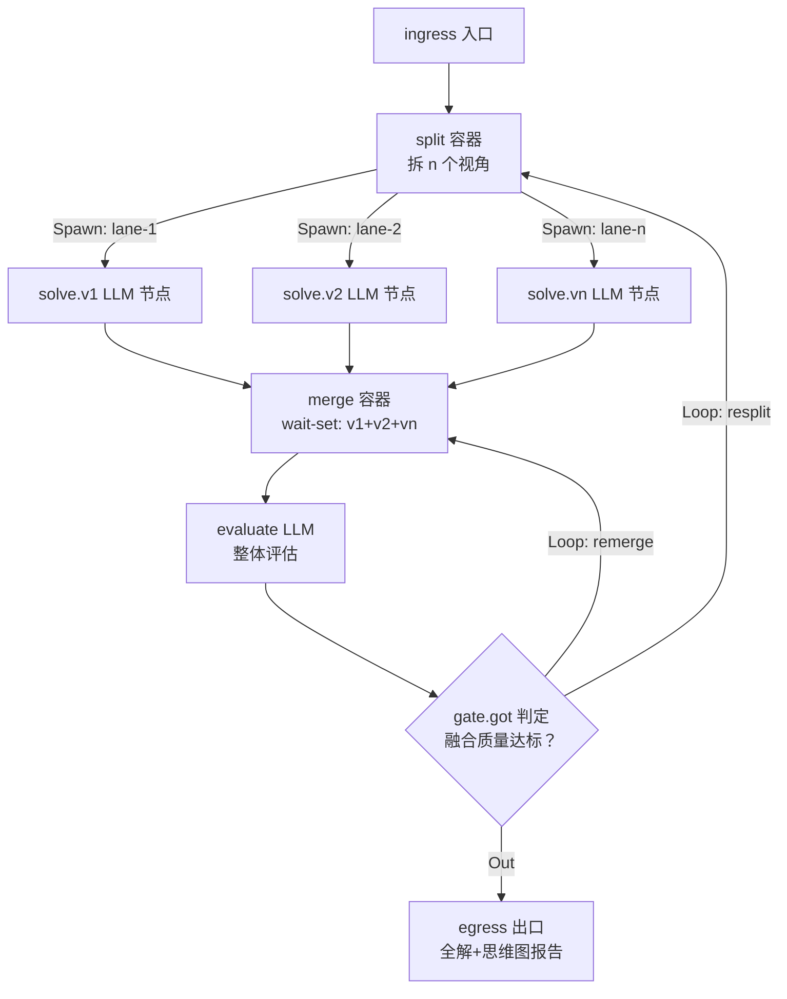

图 6-2 GoT：split 并发求解 → merge 汇聚 → 评估回边。merge 的 wait-set 是执行器并发调度的汇合点（4.4）。

**数据流与状态流转**：核心状态是 `got.graph`（思维图：节点=思维单元，边=细化/合并关系）。`split` 产出视角划分写 `got.graph` 并经 `Spawn` 挂 n 条车道；每车道解写入 `ma.results.<lane>`（复用 Multi-Agent 的车道命名空间）；`merge` 等待集就绪后读全部车道结果，产出融合解写 `got.graph` 的合并节点；`evaluate` 评估融合质量；不达标可回 `split`（视角划分本身有问题）或 `merge`（融合策略有问题）。

**终止条件**：① 融合评估达标 → `Done`；② resplit/remerge 轮次上限 → 治理终止；③ 某车道 Fatal（如工具不可用）→ 整图降级（剔除该车道，标注视角缺失）或 Fatal。

**VibeCoding 示例**：

> 「重构这个单体服务：性能、可测性、可演进性三个视角分别给方案，再融合成统一重构路线图」——三个视角独立求解（每条车道内可各自跑 ReAct 排障验证假设），merge 把三份部分解对齐冲突、融合成统一路线图。类似场景：大型架构重构、多目标优化问题、跨模块 API 设计。

**组合示例**：solve 车道内嵌 ReAct（需要查证假设的视角），merge 后接 Reflection 收敛融合质量——三层模式在一张图里叠加。

**trait 实现要点**：`GotNode` 的 `outputs()` 返回 `[Spawn, Loop, Out, Fatal]`；merge 的等待集声明在边构造时（wait-set = 车道终节点集合），执行器保证全部就绪才调度 merge；`got.graph` 全量入快照。

```rust
pub struct GotNode {
    id: NodeId,
    meta: NodeMeta,
    split_spec: PromptSpec,
    merge_spec: PromptSpec,
    evaluate_spec: PromptSpec,
    lane_solvers: HashMap<LaneId, Box<dyn OrchestratorNode>>,  // 各视角求解器
    max_rounds: u32,            // resplit/remerge 上限
}

#[async_trait::async_trait]
impl OrchestratorNode for GotNode {
    fn outputs(&self) -> &[Port] { &[Port::Spawn, Port::Loop, Port::Out, Port::Fatal("merge".into())] }

    async fn execute(&self, ctx: &mut NodeCtx) -> Result<NodeResult, NodeError> {
        let mut usage = Usage::default();
        let mut graph: ThoughtGraph = ctx.state.read("got.graph").unwrap_or_default();
        for round in 0..self.max_rounds {
            // 1. 拆视角：写 got.graph + 请求挂接 n 条车道
            let views = ctx.llm.split(&self.split_spec, ctx.state.read("task.intent")?).await?;
            usage += views.usage;
            graph.add_split(views.views.clone());
            ctx.state.write("got.graph", &graph);
            // 2. 各车道独立求解（Spawn 并发车道，等待集在边侧声明）
            for (lane, solver) in &self.lane_solvers {
                let r = solver.execute(ctx).await?;
                usage += r.usage;
                ctx.state.write(format!("ma.results.{lane}"), r.summary());
            }
            // 3. 汇聚融合：读全部车道结果，产出全解
            let merged = ctx.llm.merge(&self.merge_spec, &ctx.state.lane_results()).await?;
            usage += merged.usage;
            graph.add_merge(merged.parts.clone());
            ctx.state.write("got.graph", &graph);
            // 4. 整体评估：决定 resplit / remerge / 出口
            let verdict = ctx.llm.evaluate(&self.evaluate_spec, &merged).await?;
            usage += verdict.usage;
            match verdict {
                Verdict::Accept => break,
                Verdict::ReMerge if round + 1 < self.max_rounds => continue,
                Verdict::ReSplit if round + 1 < self.max_rounds => continue,
                _ => break,
            }
        }
        ctx.state.append("result.draft", graph.merged_solution());
        Ok(NodeResult { port: Port::Done, usage, progress: None })
    }
}
```

### 6.3 Multi-Agent 多智能体协作

**任务画像**：可并行切分的协作任务——任务能拆成互不阻塞的独立子任务（按工件切：码/测/文档；按模块切：服务 A/B），多车道并跑可显著缩短墙钟时间，且各子任务质量标准独立。

**表 6-3 节点组成**

| 节点 | 类型 | 职责 |
|---|---|---|
| `ingress` | 入口 | 写入 `task.intent` 与切分策略 |
| `decompose` | LLM 节点 | 把任务切成 n 个独立子任务（静态切分） |
| `worker.v*` | 复合节点 | 各车道工人（每车道内嵌自己的 loop 模式） |
| `aggregate` | 聚合节点 | 等待集 = 全部车道终点，汇总对齐 |
| `gate.ma` | 判定门 | 汇总质量不足则定向重跑差车道 |
| `egress` | 出口 | 交付合并工件集 |

**图结构**：

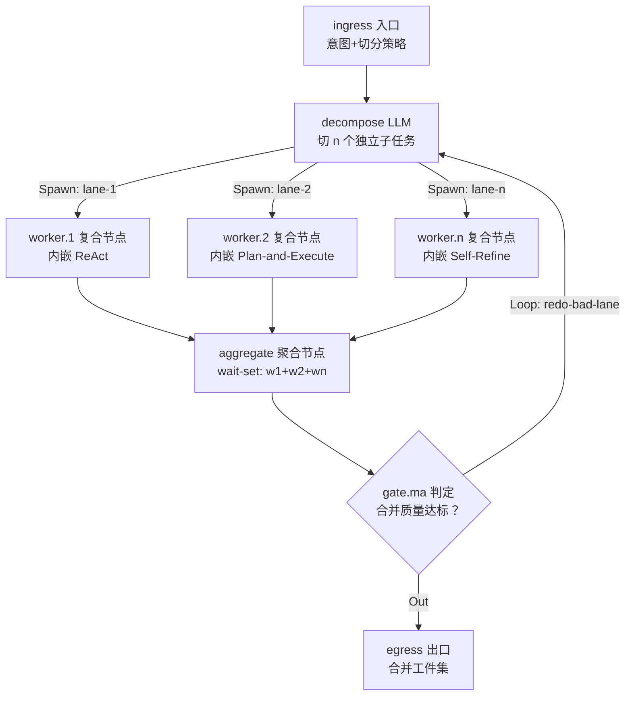

图 6-3 Multi-Agent：静态切分 → 并发车道 → 聚合。与 GoT 的区别：Multi-Agent 的车道图是**静态切分**（构图时已知车道数），GoT 的车道图是**运行时动态拆分**（split 结果决定）。

**数据流与状态流转**：`ma.results.<lane>`（每车道的工件摘要与验收结果）是核心状态。`decompose` 静态切分后，各车道独立执行（车道间无共享可变状态，黑板键按车道命名空间隔离），`aggregate` 等待集就绪后做合并（对齐接口、统一风格、消解冲突），`gate.ma` 质量不足时**定向重跑**差车道（只重跑验收不过的车道，非全量重跑）。

**终止条件**：① 全部车道通过且合并验收过 → `Done`；② 重跑轮次上限 → 治理终止（交付已过车道 + 缺口说明）；③ 过半车道 Fatal → 整图 Fatal。

**VibeCoding 示例**：

> 「给这个订单服务补充完整交付物：实现层补错误处理代码、测试层补集成测试、文档层补 API 文档」——三个工件天然独立，三车道并跑，聚合时对齐错误码表。类似场景：多模块并行开发、按文件分组的批量修改、多语言 SDK 同步生成。

**组合示例**：每条车道是 `CompositeNode(ReAct)` 或 `CompositeNode(Plan-and-Execute)`，聚合后可再接一轮 Reflection 做整体审校——「分—聚—审」三层结构。

**trait 实现要点**：`MultiAgentNode` 的 `outputs()` 返回 `[Spawn, Loop, Out, Fatal]`；车道工人在**构图时静态注册**（与 GoT 的运行时动态拆分相区分）；`aggregate` 是唯一汇合点，重跑策略是「定向重跑」而非全量。

```rust
pub struct MultiAgentNode {
    id: NodeId,
    meta: NodeMeta,
    decompose_spec: PromptSpec,
    workers: Vec<WorkerSpec>,     // 静态注册：lane-id + 角色 + 内嵌节点
    aggregate_spec: PromptSpec,
    max_redo_rounds: u32,
}

pub struct WorkerSpec {
    pub lane: LaneId,
    pub role: RoleSpec,                       // 职责描述 + 工具集 + 黑板键
    pub node: Box<dyn OrchestratorNode>,      // 常为 CompositeNode(loop 模式)
}

#[async_trait::async_trait]
impl OrchestratorNode for MultiAgentNode {
    fn outputs(&self) -> &[Port] { &[Port::Spawn, Port::Loop, Port::Out, Port::Fatal("lanes".into())] }

    async fn execute(&self, ctx: &mut NodeCtx) -> Result<NodeResult, NodeError> {
        let mut usage = Usage::default();
        let mut redo_rounds = 0;
        // 1. 静态切分：decompose 产出子任务并分配给车道（车道集合固定）
        let split = ctx.llm.decompose(&self.decompose_spec, ctx.state.read("task.intent")?).await?;
        usage += split.usage;
        let assign: HashMap<LaneId, SubTask> = self.assign_lanes(&split)?;
        loop {
            // 2. 并发车道：每车道执行内嵌节点，结果写命名空间键
            for (lane, task) in &assign {
                let worker = self.worker_of(lane);
                ctx.state.write(format!("ma.task.{lane}"), task);
                let r = worker.execute(ctx).await?;      // Spawn 并发调度
                usage += r.usage;
                ctx.state.write(format!("ma.results.{lane}"), r.summary());
            }
            // 3. 聚合：等待集就绪后合并，对齐接口与冲突
            let agg = ctx.llm.aggregate(&self.aggregate_spec, &ctx.state.lane_results()).await?;
            usage += agg.usage;
            // 4. 质量门：定向重跑差车道
            let bad: Vec<LaneId> = agg.failed_lanes();
            if bad.is_empty() || redo_rounds >= self.max_redo_rounds {
                ctx.state.append("result.draft", agg.merged);
                return Ok(NodeResult { port: Port::Done, usage, progress: None });
            }
            redo_rounds += 1;
            self.persist_round_snapshot(redo_rounds)?;
            // 仅重跑差车道：assign 保留 good lanes 的结果
        }
    }
}
```

### 6.4 Supervisor 主管调度

**任务画像**：需要运行时决策的流水线——任务序列不能预先确定（下一步做什么取决于上一步结果），需要「主管看全局、动态派发、验收回收」的星型调度。与 Multi-Agent 的关键差异：**车道图是否运行时决定**。

**表 6-4 节点组成**

| 节点 | 类型 | 职责 |
|---|---|---|
| `ingress` | 入口 | 写入 `task.intent` 与角色目录 |
| `supervisor` | 容器节点 | 维护 `sup.queue`，逐项派发，验收回收 |
| `worker.*` | 复合节点 | 被派发的工人（按角色从目录解析，内嵌 loop 模式）按需展开 |
| `gate.sup` | 判定门 | 队列空且全部验收过 → 出口 |
| `egress` | 出口 | 交付全部工件 |

**图结构**：

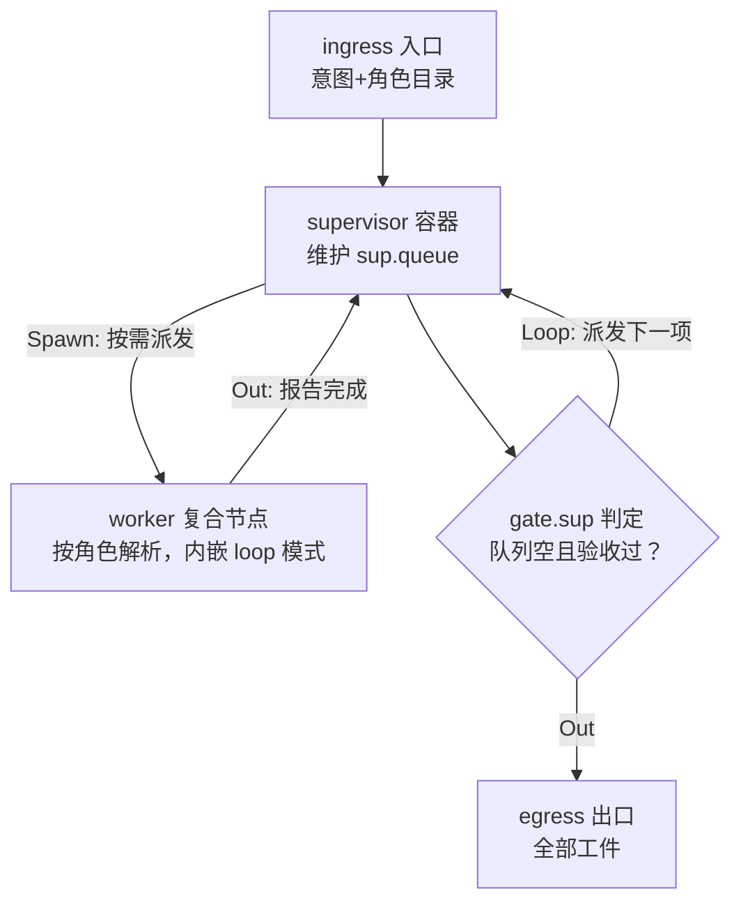

图 6-4 Supervisor：星型调度。主管与工人之间的回边构成派发—回收循环。

**数据流与状态流转**：核心状态是 `sup.queue`（待办任务项，含角色、意图、验收标准）。每轮：`supervisor` 读队列 + 已回收结果 → 决定下一项派发（或补充新任务项——运行时发现的新工作直接入队）→ 经 `Spawn` 挂工人子图 → 工人完成后结果与验收报告回写 → 主管验收：不过则定向重派（可能换角色），过则出队。队列动态增删是它与 Multi-Agent 静态切分的本质区别。

**终止条件**：① 队列空且全部验收过 → `Done`；② 派发轮次上限 → 治理终止；③ 同一任务重派超过 2 次仍不过 → `Fatal`（防无限重派）。

**VibeCoding 示例**：

> 「把这个 Web 服务从 Express 迁到 Axum」——主管先派「摸底工人」梳理路由清单，回收后按清单逐个派「迁移工人」（每路由一个任务项），中途发现中间件依赖再入队「中间件改造」任务，最后派「回归工人」跑全量测试。任务序列在运行时才完全确定。类似场景：端到端特性交付（码+测+文档+CI 适配）、探索性大型迁移、需要多角色接力的人工审核流。

**组合示例**：工人是 `CompositeNode(ReAct)` 或 `CompositeNode(Plan-and-Execute)`；主管自身也可被 Loop Engineering 包装做预算治理（见 6.6）。

**trait 实现要点**：`SupervisorNode` 的 `outputs()` 返回 `[Spawn, Loop, Out, Fatal]`；`sup.queue` 全量入快照（恢复后队列不丢）；工人按角色从目录（registry）解析，同一角色多实例用实例后缀区分（`NodeId` 纪律，3.2）。

```rust
pub struct SupervisorNode {
    id: NodeId,
    meta: NodeMeta,
    dispatch_spec: PromptSpec,    // 派发决策 prompt（读队列+回收结果）
    role_registry: RoleRegistry,  // 角色 → 工人节点工厂
    max_dispatches: u32,          // 派发轮次上限
    max_retries_per_task: u32,    // 同任务重派上限
}

#[async_trait::async_trait]
impl OrchestratorNode for SupervisorNode {
    fn outputs(&self) -> &[Port] { &[Port::Spawn, Port::Loop, Port::Out, Port::Fatal("dispatch".into())] }

    async fn execute(&self, ctx: &mut NodeCtx) -> Result<NodeResult, NodeError> {
        let mut usage = Usage::default();
        let mut queue: VecDeque<TaskItem> = ctx.state.read("sup.queue").unwrap_or_default();
        let mut dispatches = 0;
        while !queue.is_empty() {
            if dispatches >= self.max_dispatches {
                return Ok(NodeResult { port: Port::Done, usage,
                                       progress: Some(ProgressNote::budget()) });
            }
            // 1. 派发决策：读队列 + 已回收结果，选下一项（可动态入队新任务）
            let decision = ctx.llm.dispatch(&self.dispatch_spec, &queue, &ctx.state).await?;
            usage += decision.usage;
            for extra in decision.new_tasks { queue.push_back(extra); }   // 运行时入队
            let item = queue.pop_front().ok_or(NodeError::fatal("empty"))?;
            // 2. 解析工人并派发（Spawn 挂子图）
            let mut worker = self.role_registry.resolve(&item.role)?;
            let r = worker.execute(ctx).await?;
            usage += r.usage;
            // 3. 验收：不过则定向重派（计入重派上限）
            match ctx.llm.accept(&item, &r).await? {
                Acceptance::Passed => { ctx.state.append("sup.done", item.summary()); }
                Acceptance::Failed(reason) if item.retries < self.max_retries_per_task => {
                    queue.push_front(item.retried(reason));               // 换策略重派
                }
                Acceptance::Failed(_) => {
                    return Ok(NodeResult { port: Port::Fatal("dispatch".into()), usage, progress: None })
                }
            }
            dispatches += 1;
            ctx.state.write("sup.queue", &queue);
            self.persist_dispatch_snapshot(&queue)?;
        }
        Ok(NodeResult { port: Port::Done, usage, progress: None })
    }
}
```

### 6.5 Router 智能路由

**任务画像**：入口分流——同一入口要服务多种任务形态，先分类再进各自最优链路。Router 是链路之间的分发器，不是任务执行者；其质量决定全局效率（路由错误 = 整条链路白跑）。

**表 6-5 节点组成**

| 节点 | 类型 | 职责 |
|---|---|---|
| `ingress` | 入口 | 写入 `task.intent` |
| `classify` | LLM 节点 | 意图分类 + 置信度 + 理由（可带 few-shot 示例库） |
| `fallback` | LLM 节点 | 低置信度兜底：澄清问题或走安全默认链路 |
| `route.*` | 链路入口 | 目标链路（每条是完整的模式图，常为 CompositeNode 黑盒） |
| `egress` | 出口 | 各链路终点汇合交付 |

**图结构**：

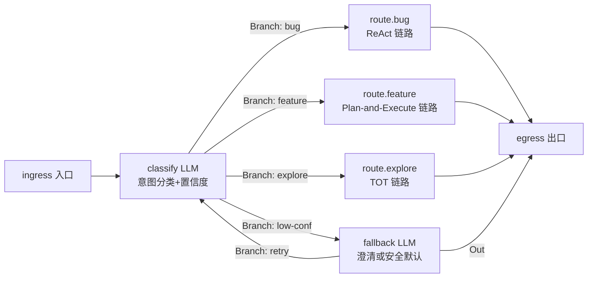

图 6-5 Router：分类分发。`Branch` 端口携带标签，执行器按边表路由到目标链路。

**数据流与状态流转**：`route.choice`（分类结果 + 置信度 + 理由）是核心状态。`classify` 读 `task.intent` 产出决策；高置信度走 `Branch(label)` 进目标链路；低置信度走 `fallback`：或生成澄清问题（回用户，下一轮重分类），或走保守默认链路（Single Agent 直通，避免高成本链路误入）。路由决策全量记录（审计与路由质量优化）。

**终止条件**：① 分类即路由，链路自身终止即整链终止（Router 无自身循环）→ `Done`；② 分类器异常 → `Fatal`；③ 澄清重试次数上限 → 走安全默认链路。

**VibeCoding 示例**：

> VibeCoding 助手的统一入口：「修个 Bug」→ ReAct 链路；「加个新功能」→ Plan-and-Execute 链路；「评估两种架构」→ TOT 链路；意图模糊（「帮我看下这个服务」）→ fallback 澄清「你想排查问题还是想了解结构？」。Router 是 13 种模式中唯一以「分类分发」为唯一职责的模式。

**trait 实现要点**：`RouterNode` 的 `outputs()` 返回 `[Branch(..), Out, Fatal]`——**无 `Loop` 端口**（路由是单步决策，循环属于目标链路）；分类器与目标链路解耦（路由表可热更新）；few-shot 示例库从 Memory 的程序性记忆加载（7.3），随路由质量数据持续优化。

```rust
pub struct RouterNode {
    id: NodeId,
    meta: NodeMeta,
    classify_spec: PromptSpec,       // 分类 prompt（含 few-shot 槽位）
    route_table: RouteTable,         // label → 目标链路（CompositeNode 黑盒）
    confidence_threshold: f64,       // 低置信度触发 fallback
    max_clarify_rounds: u32,
}

#[async_trait::async_trait]
impl OrchestratorNode for RouterNode {
    fn outputs(&self) -> &[Port] {
        // Branch 标签集来自路由表；无 Loop 端口：路由是单步决策
        &[Port::Branch("bug".into()), Port::Branch("feature".into()),
          Port::Branch("explore".into()), Port::Branch("low-conf".into()),
          Port::Out, Port::Fatal("classify".into())]
    }

    async fn execute(&self, ctx: &mut NodeCtx) -> Result<NodeResult, NodeError> {
        let intent = ctx.state.read("task.intent")?;
        let few_shot = ctx.memory.recall_procedural("router.few_shot");   // 程序性记忆
        let cls = ctx.llm.classify(&self.classify_spec, &intent, &few_shot).await?;
        ctx.state.write("route.choice", &cls);                            // 审计留痕
        if cls.confidence >= self.confidence_threshold {
            Ok(NodeResult { port: Port::Branch(cls.label.clone()), usage: cls.usage, progress: None })
        } else {
            Ok(NodeResult { port: Port::Branch("low-conf".into()), usage: cls.usage, progress: None })
        }
    }
}
```

### 6.6 Loop Engineering 循环工程

**任务画像**：长循环治理——任何内层链路跑得太久、太贵或上下文过载时，用一层显式治理包装它：预算控制、收敛判定、上下文压缩、失败退避。它不是新链路，而是「链路的循环策略层」。

**表 6-6 节点组成**

| 节点 | 类型 | 职责 |
|---|---|---|
| `ingress` | 入口 | 写入 `task.intent` 与治理配置 |
| `budget` | 治理门 | token/调用数/墙钟时间预算台账 |
| `converge` | 判定门 | 收敛信号判定（指标 + 趋势 + 平台期检测） |
| `compact` | LLM 节点 | 上下文压缩（轨迹摘要、黑板瘦身） |
| `backoff` | 治理门 | 失败退避（指数退避 + 策略降级） |
| `inner` | 复合节点 | 被治理的内层链路（任意模式图） |
| `egress` | 出口 | 交付结果 + 治理台账 |

**图结构**：

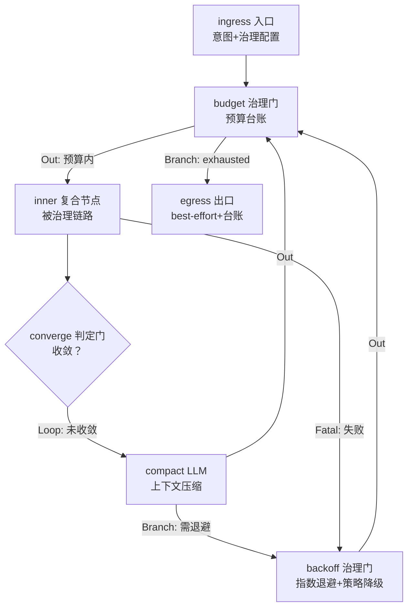

图 6-6 Loop Engineering：预算—收敛—压缩—退避四闸门包住任意内层链路。`inner` 经 `CompositeNode` 包装。

**数据流与状态流转**：核心状态是 `gov.budget_ledger`（全链路用量台账，随每次节点执行后累计，见 4.2 第 5 步）。治理循环：`budget` 检查预算 → 预算内放行 `inner` 执行一轮 → `converge` 判定收敛信号（客观指标优先，趋势次之，平台期检测兜底）→ 未收敛则 `compact` 压缩上下文（摘要轨迹、清理黑板低价值键）后回到 `budget` 进入下一轮；`inner` 失败则 `backoff` 退避后重试（策略降级：如降并发、换小模型），退避次数上限后 best-effort 出口。

**终止条件**：① `converge` 判定收敛 → `Done`；② 预算耗尽 → 治理终止（best-effort：交付当前最好结果 + 台账）；③ 退避上限 → 治理终止；④ 收到用户取消 → 治理终止。

**VibeCoding 示例**：

> 「让 Agent 用 ReAct 修这个 intermittently failing 的测试，但 token 预算不超过 50k、最多跑 40 分钟」——ReAct 循环可能无限打转（同一假设反复验证），Loop Engineering 包装后：每轮检查预算、检测到平台期（连续 3 轮观察无新信息）就压缩轨迹重新进入、退避重试，超限则带着「已排除的假设清单」best-effort 退出。类似场景：夜间无人值守批处理任务、成本敏感的批量代码任务、上下文易爆的长排障。

**组合示例**：`inner` 常为 `CompositeNode(ReAct)`、`CompositeNode(Supervisor)` 等；Loop Engineering 是最外层包装器，任何模式图都可以被它治理——包括 Router 分发出的整条链路。

**trait 实现要点**：`LoopEngineeringNode` 的 `outputs()` 返回 `[Loop, Branch(..), Out, Fatal]`；它自身就是 `CompositeNode` 的特化（包住 inner + 四闸门）；台账 `gov.budget_ledger` 与执行器的预算门（4.2）共用数据源；收敛判定、压缩策略、退避策略都是可插拔配置。

```rust
pub struct LoopEngineeringNode {
    id: NodeId,
    meta: NodeMeta,
    inner: Graph,                     // 被治理的内层链路（任意模式图）
    budget_policy: BudgetPolicy,      // token/调用数/墙钟上限
    converge_policy: ConvergePolicy,  // 指标阈值/趋势/平台期检测
    compact_spec: PromptSpec,         // 上下文压缩模板
    backoff_policy: BackoffPolicy,    // 指数退避 + 策略降级链
}

#[async_trait::async_trait]
impl OrchestratorNode for LoopEngineeringNode {
    fn outputs(&self) -> &[Port] {
        &[Port::Loop, Port::Branch("exhausted".into()), Port::Out, Port::Fatal("backoff".into())]
    }

    async fn execute(&self, ctx: &mut NodeCtx) -> Result<NodeResult, NodeError> {
        let mut usage = Usage::default();
        let mut attempt = 0;
        loop {
            // 1. 预算门：台账累计（与执行器预算门共用数据源）
            if self.budget_policy.exceeded(&ctx.state.read("gov.budget_ledger")?) {
                return Ok(NodeResult { port: Port::Branch("exhausted".into()),   // best-effort 出口
                                       usage, progress: Some(ProgressNote::budget()) });
            }
            // 2. 内层执行：跑一轮 inner（CompositeNode 语义）
            match DefaultOrchestrator::run(&self.inner, ctx.derive()).await {
                Ok(report) => { usage += report.usage; }
                Err(e) if e.is_retryable() => {
                    // 3. 退避门：指数退避 + 策略降级
                    attempt += 1;
                    if attempt > self.backoff_policy.max_attempts {
                        return Ok(NodeResult { port: Port::Fatal("backoff".into()), usage, progress: None });
                    }
                    self.backoff_policy.sleep(attempt).await;
                    self.backoff_policy.downgrade(ctx)?;    // 降并发/换小模型
                    continue;
                }
                Err(e) => return Err(e),                    // Fatal 直接上抛
            }
            // 4. 收敛门：客观指标 → 趋势 → 平台期
            if self.converge_policy.converged(&ctx.state) { break; }
            // 5. 压缩门：摘要轨迹、清理低价值黑板键后进入下一轮
            let compacted = ctx.llm.complete(self.compact_spec.render(ctx.state)?).await?;
            usage += compacted.usage;
            ctx.state.compact(&compacted);
        }
        Ok(NodeResult { port: Port::Done, usage, progress: None })
    }
}
```

---

## 7. Memory：横切所有层

### 7.1 定位：为什么是横切而不是一层

Memory 不构成独立链路，也不属于任何一层——它是**注入到每个节点执行上下文里的读写能力**（`ctx.memory`），由执行器在节点前后统一挂钩子（4.2 第 2/4 步）。三个理由：

1. **使用者是所有层**：loop 层的 ReAct 需要轨迹记忆，框架层的 Router 需要路由质量数据，通信层的 genai 适配需要用户偏好（如默认输出语言）；把 Memory 塞进任何一层都会让其它层反向依赖它，破坏分层。
2. **记忆写入点是节点边界**：before 钩子取回相关记忆、after 钩子沉淀增量——挂钩点在执行器的调度循环里，天然横切。
3. **记忆结构是统一的**：无论上层跑什么模式，四层记忆的写入/检索协议一致；模式差异只体现在「记忆什么」，不体现在「怎么记忆」。

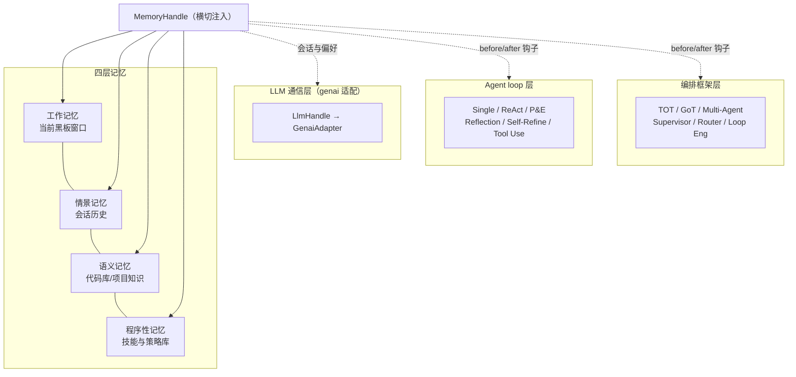

图 7-1 Memory 横切注入：一个 `MemoryHandle`、四层记忆、三层挂钩子。

### 7.2 四层记忆模型

**表 7-1 四层记忆定义**

| 层 | 内容 | 生命周期 | 写入时机 | 典型消费者 |
|---|---|---|---|---|
| 工作记忆 | 当前任务的黑板窗口（计划、轨迹、中间工件） | 单任务 | 节点执行中随时 | 当前链路所有节点 |
| 情景记忆 | 会话历史（任务意图、结果、用户反馈） | 单会话 | 任务终局时归档 | 下一任务的规划类节点 |
| 语义记忆 | 代码库与项目知识（模块地图、API 约定、惯用法） | 跨会话 | 发现新知识时 | 所有需要读码的节点 |
| 程序性记忆 | 技能与策略（few-shot 示例、路由先例、踩坑记录） | 跨会话 | 链路终局复盘时 | Router 的分类器、各模式的 prompt 组装 |

四层按「生命周期从短到长、抽象度从低到高」排列：工作记忆最短最具体，程序性记忆最长最抽象。检索按任务相关性召回，不按层级隔离——一个 ReAct 节点可以同时召回「昨天改过这个文件」（情景）+「该项目的错误码规范」（语义）+「上次类似 Bug 的排查路径」（程序性）。

### 7.3 与统一抽象的集成

```rust
/// 记忆统一入口：所有节点经 ctx.memory 访问，禁止直连存储。
pub trait MemoryHandle: Send + Sync {
    /// before 钩子（执行器调用）：按节点画像取回相关记忆，注入节点视图
    async fn before(&self, node: &NodeId, ctx: &mut NodeCtx) -> Result<(), MemoryError>;
    /// after 钩子（执行器调用）：沉淀节点产出中有长期价值的增量
    async fn after(&self, note: MemNote, ctx: &NodeCtx) -> Result<(), MemoryError>;
    /// 主动检索：按查询召回跨层相关条目（节点内直接调用）
    async fn recall(&self, query: &RecallQuery) -> Result<Vec<MemEntry>, MemoryError>;
    /// 主动写入：节点内直接写入指定层
    async fn store(&self, layer: MemLayer, entry: MemEntry) -> Result<(), MemoryError>;
}

/// 四层记忆的层标识
pub enum MemLayer { Working, Episodic, Semantic, Procedural }
```

集成纪律（与 3.5 呼应）：

- **钩子统一挂**：`before`/`after` 由执行器调用，节点不自调钩子；节点内主动读写走 `recall`/`store`。
- **情景记忆的归档点**：任务终局（RunReport 产出时）把本次任务意图、链路选择、结果质量归档为情景记忆——这是「下次遇到类似任务能想起来」的机制。
- **程序性记忆的写入点**：Loop Engineering 的治理台账、Router 的路由决策记录，在链路复盘时提炼为 few-shot 示例与策略偏好，反哺下一代链路（Router 的 few-shot 示例库即从此加载，见 6.5）。
- **记忆不改变路由**：记忆只影响 prompt 组装与检索增强，不改变图结构——图结构变化永远是节点的 `Spawn` 请求（纪律见 3.5 第 1 条）。这条边界防止「记忆变成隐藏的控制流」。

### 7.4 各模式记忆什么

**表 7-2 模式 × 记忆矩阵**

| 模式 | 工作记忆 | 情景记忆（读） | 情景记忆（写） | 语义记忆（读/写） | 程序性记忆（读/写） |
|---|---|---|---|---|---|
| Single Agent | 意图+初稿 | 相似任务先例 | 任务摘要 | 领域惯用法（读） | prompt 模板偏好（读） |
| ReAct | 轨迹 | 同文件历史改动 | 排障结论 | 模块地图（读写） | 排障路径（写） |
| Plan-and-Execute | 计划+游标 | 相似工程先例 | 计划模板 | 架构约束（读写） | 步骤拆分策略（写） |
| Reflection | 稿件+反馈 | 验收标准演变 | 评审 rubric | 编码规范（读） | rubric 调整（写） |
| Self-Refine | 版本链 | — | 打磨策略 | 风格指南（读） | 收敛信号配置（写） |
| Tool Use | 调用记录 | — | — | 工具目录（读） | 工具选择策略（写） |
| TOT | 思维树 | 相似探索先例 | 探索结论 | 评价维度库（读） | 分支/剪枝参数（写） |
| GoT | 思维图 | 协作先例 | 融合结论 | 视角模板库（读） | 拆分策略（写） |
| Multi-Agent | 车道结果槽 | 分工先例 | 协作模板 | 接口约定（读写） | 切分策略（写） |
| Supervisor | 派发队列 | 角色履职先例 | 派发记录 | 角色目录（读写） | 派发策略（写） |
| Router | 路由决策 | — | — | — | few-shot 示例库（读写） |
| Loop Engineering | 治理台账 | — | — | — | 退避/收敛策略（写） |
| Memory（自身） | 记忆笔记 | 全量（读） | 全量（写） | 全量（读写） | 全量（读写） |

**VibeCoding 示例**（横切机制的完整闭环）：

> 用户上午说「给订单服务加一个幂等键」，下午说「这个幂等键在重试时冲突了，修一下」。第二条消息进来时，情景记忆召回上午的任务（含生成的文件清单与幂等键设计），语义记忆提供该服务的错误码规范——下午的 ReAct 排障链路不需要从零理解上下文。任务结束后，「幂等键并发冲突的排查路径」沉淀进程序性记忆，下次类似问题直接召回。

**trait 实现要点**：`MemoryHandle` 本身不是 `OrchestratorNode`——它没有端口、不参与路由，是注入执行上下文的能力句柄。这保证了「横切」的纯度：Memory 模式在 13 种模式中唯一不实现统一 trait，但它覆盖其余 12 种模式的所有节点。

---

## 8. LLM 通信层与 genai 适配

### 8.1 边界与设计约束

LLM 通信层是三层中最底下的一层，只做一件事：**把「一次 LLM 调用」这件事做到位**——选路、转换、流式、重试、降级、计量。它不含任何编排模式，genai 适配**只影响这一层**，对上暴露的 `LlmHandle` 接口保持稳定，上层链路（第 5—7 章）的所有设计不变。

**表 8-1 通信层职责边界**

| 职责 | 在通信层 | 不在通信层 |
|---|---|---|
| Provider/模型选路 | ✔（按策略矩阵） | — |
| 工具 schema ↔ Provider 格式转换 | ✔ | — |
| 流式响应归一化 | ✔ | — |
| 重试/退避/降级 | ✔（传输层语义） | 编排层语义的退避在 Loop Engineering |
| 用量计量 | ✔（每次调用） | 预算判定在执行器/治理层 |
| 决定「调几次、何时调」 | — | 编排语义，属于上层模式 |

### 8.2 架构

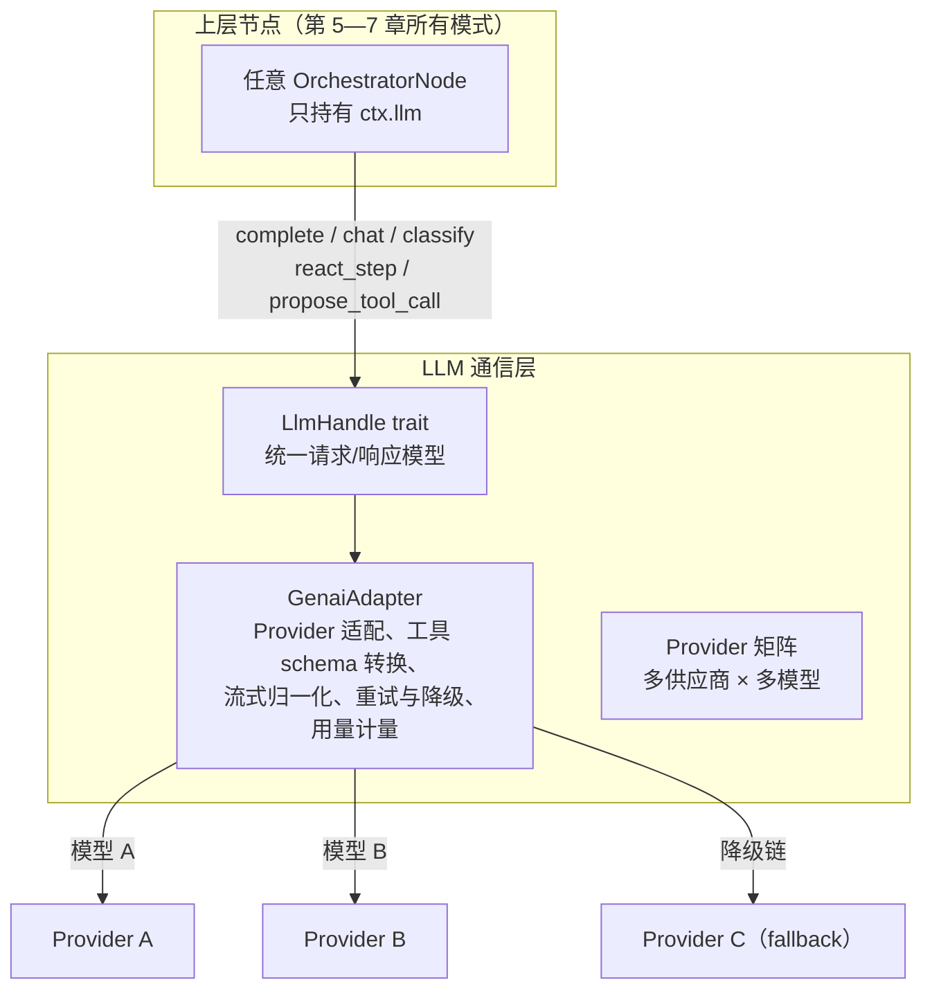

图 8-1 通信层架构：上层只见 `LlmHandle`，genai 适配封装一切 Provider 差异。

### 8.3 genai 适配的五个职责

1. **Provider 适配**：同一请求模型（`Request`/`Response`）映射到不同 Provider 的 API 形态（消息结构、system prompt 位置、工具调用协议、温度等参数名）。
2. **工具 schema 转换**：`ToolSpec`（JSON schema 声明）→ 各 Provider 的 function calling 格式。Tool Use 模式（5.6）的工具调用循环因此与 Provider 无关。
3. **流式归一化**：各 Provider 的流式分片（delta、tool_call 增量）归一化为统一事件流，供上层节点增量消费（如 ReAct 边思考边渲染）。
4. **重试与降级**：传输层语义的重试（429/5xx 指数退避）与模型降级链（主模型不可用 → 次选 → 本地小模型）；编排语义的退避（策略降级、收敛重试）仍在 Loop Engineering（6.6），两者不混淆。
5. **用量计量**：每次调用的 token 用量/成本统一计量，回填 `NodeResult.usage`——这是执行器预算门（4.2）与治理台账的原始数据源。

### 8.4 对上层的影响面

**表 8-2 genai 适配的影响面分析**

| 影响维度 | 影响方式 | 波及的上层 |
|---|---|---|
| 接口稳定性 | 无影响：`LlmHandle` 不变，上层节点零改动 | 无 |
| 能力差异（如某 Provider 不支持原生 function calling） | 适配层用 prompt 模拟工具调用（ReAct 风格文本协议）补齐；上层 Tool Use 协议不变 | Tool Use、ReAct 的实现需标注「模拟模式」的观测差异 |
| 流式粒度差异 | 归一化事件流抹平；节点按事件消费，无需感知分片边界 | 所有渲染类节点（可选消费） |
| 限流与并发 | 适配层的限流窗口与执行器的 `max_concurrency`（4.4）配合——适配层保护 Provider，执行器保护黑板写入秩序 | Multi-Agent、GoT 的车道并发度配置 |
| 成本差异 | 计量口径统一后，预算门与选型表（第 9 章）的成本维度可跨 Provider 比较 | Loop Engineering 的预算策略 |
| 模型降级链 | 降级发生时上层无感（同一 `LlmHandle`），但质量衰减反映在收敛速度上 | 依赖收敛判定的模式（TOT 评分饱和、Self-Refine 平台期） |

一句话总结：**genai 适配改变的是「同一件事做得好不好、多少钱」，不改变「链路怎么走」**。上层链路的图结构、黑板契约、终止条件全部不受影响——这正是分层解耦的验收标准。

### 8.5 trait 定义

```rust
/// 上层节点看到的 LLM 统一入口（通信层对上的唯一界面）。
#[async_trait::async_trait]
pub trait LlmHandle: Send + Sync {
    /// 单轮补全（Single Agent、Reflection 的 actor/critic 等）
    async fn complete(&self, req: Request) -> Result<Response, LlmError>;
    /// 多轮对话（带历史）
    async fn chat(&self, session: &ChatSession, req: Request) -> Result<Response, LlmError>;
    /// 意图分类（Router 的 classify、Supervisor 的 dispatch 决策）
    async fn classify(&self, spec: &PromptSpec, intent: &str, few_shot: &[Example])
        -> Result<Classification, LlmError>;
    /// ReAct 单步（思考 + 行动选择）
    async fn react_step(&self, trace: &[TraceEntry], tools: &ToolSpecSet)
        -> Result<ReactStep, LlmError>;
    /// 工具调用意图（Tool Use 协议循环的 propose）
    async fn propose_tool_call(&self, intent: &str, tools: &ToolSpecSet,
                               history: &[(ToolCall, Observation)])
        -> Result<ToolProposal, LlmError>;
    /// 流式补全（事件流归一化）
    async fn complete_stream(&self, req: Request)
        -> Result<impl Stream<Item = StreamEvent>, LlmError>;
}

/// 通信层内部：genai 适配器实现 LlmHandle。
/// Provider 差异、schema 转换、流式归一、重试降级、用量计量全部封装于此。
pub struct GenaiAdapter {
    provider_matrix: ProviderMatrix,   // 主/次/本地降级链
    tool_schema_converter: ToolSchemaConverter,
    stream_normalizer: StreamNormalizer,
    retry_policy: TransportRetryPolicy,   // 传输层退避（区别于编排层）
    meter: UsageMeter,                    // 回填 NodeResult.usage
}
```

设计说明：`LlmHandle` 的方法集按**上层实际用法**抽象（complete/chat/classify/react_step/propose_tool_call），而不是按 Provider 能力抽象——这是「接口属于使用者」原则的落地。genai 适配层新增 Provider 时只改 `GenaiAdapter` 内部，上层 12 种模式的所有节点零改动。

---

## 9. VibeCoding 模式选型对照

### 9.1 选型主表

按 VibeCoding 任务族给出链路选择建议。维度：任务复杂度（低/中/高）、相对成本（以 Single Agent 单次调用为 1 个单位）、确定性（链路输出质量的方差）、首次可交付速度（从接到任务到首个可用产出的时间）。

**表 9-1 任务族 × 推荐链路**

| 任务族 | 典型任务 | 首选链路 | 组合建议 | 复杂度 | 相对成本 | 确定性 | 首速 |
|---|---|---|---|---|---|---|---|
| 即席生成 | 单函数、正则、docstring、commit msg | Single Agent | — | 低 | 1× | 高 | 最快 |
| 交互排障 | Bug 定位、CI 失败、环境排错 | ReAct | 外包 Loop Engineering（预算治理） | 中 | 3-8× | 中 | 快 |
| 多步工程 | 大型重构、迁移、新功能落地 | Plan-and-Execute | 步内嵌 ReAct；外包 Loop Engineering | 高 | 5-15× | 中高 | 中 |
| 质量收敛（有客观信号） | clippy 打磨、perf 微优化、测试补全 | Self-Refine | 客观指标驱动收敛 | 中 | 2-5× | 高 | 中 |
| 质量收敛（有验收 rubric） | 代码评审修订、安全检查、覆盖补齐 | Reflection | critic 用独立 rubric | 中 | 3-6× | 高 | 中 |
| 方案探索（可比选项） | 架构选型、算法比稿、API 设计 | TOT | 候选车道内嵌 Self-Refine | 高 | 8-20× | 中 | 慢 |
| 方案探索（多视角融合） | 单体重构路线图、多目标优化 | GoT | 车道内嵌 ReAct；merge 后接 Reflection | 高 | 10-25× | 中 | 慢 |
| 并行协作（可静态切分） | 码+测+文档三线交付、批量修改 | Multi-Agent | 车道按子任务特征选 loop 模式 | 高 | 6-12×（墙钟约 1/3） | 中高 | 中 |
| 动态流水线（运行时定序） | 端到端迁移、探索性大工程 | Supervisor | 工人内嵌 ReAct/P&E；主管外包治理 | 高 | 8-20× | 中 | 慢 |
| 入口分流 | 统一助手入口、混合任务流 | Router | 路由表指向各模式图 | 低 | 1-2×（分类开销） | 高（取决于目标链路） | 快 |
| 任意长循环 | 无人值守批处理、成本敏感任务 | Loop Engineering | 包住任意上述链路 | — | 可控（预算封顶） | — | — |
| 越出模型边界 | 一切需要读码/跑命令的链路 | Tool Use | 作为一切链路的协议底座 | 低 | 1×（含在链路内） | 高 | 快 |

### 9.2 按维度的快速决策

**按复杂度**：

```text
复杂度低（单步可述）        → Single Agent
复杂度中（需探索或迭代）    → ReAct / Self-Refine / Reflection（按有无外部视角需求）
复杂度高（多步或多解空间）  → Plan-and-Execute / TOT / GoT / Supervisor（按任务形态）
```

**按确定性要求**（输出方差容忍度）：

```text
要稳定可审计   → Self-Refine（客观指标） > Reflection（rubric） > Single Agent
                > Plan-and-Execute > ReAct > TOT/GoT/Multi-Agent（发散型，方差天然大）
```

**按成本预算**（相对 Single Agent 的倍数见 9.1；同预算下优先选可治理链路）：

```text
预算紧张       → 避开 TOT/GoT；ReAct + Loop Engineering 硬预算封顶
预算充足       → 质量优先选 TOT（探索类）或 Supervisor（工程类）
```

**按首速要求**（首个可用产物出现的时间）：

```text
要最快         → Single Agent > Router+直通 > ReAct > Reflection/Self-Refine
                > Multi-Agent > Plan-and-Execute > Supervisor > TOT/GoT
```

### 9.3 组合范式速查

**表 9-2 常用组合范式**

| 组合 | 结构 | 适用 |
|---|---|---|
| 排障兜底 | `LoopEng( ReAct )` | 无人值守排障，预算封顶 |
| 工程主力 | `LoopEng( P&E( step: ReAct ) )` | 大型重构：计划可控 + 步内排障 + 全局治理 |
| 探索收敛 | `TOT( candidate: Self-Refine )` + 末端 `Reflection` | 架构选型：展开打磨评分，胜出方案终审 |
| 车间流水线 | `Supervisor( worker: P&E / ReAct )` | 端到端迁移：主管定序，工人干活 |
| 三线交付 | `Multi-Agent( lanes: 码/测/档 )` + 末端 `Reflection` | 特性交付：并行产出，聚合终审 |
| 统一入口 | `Router → { ReAct, P&E, TOT, SingleAgent }` | VibeCoding 助手入口分流 |

### 9.4 选型决策树

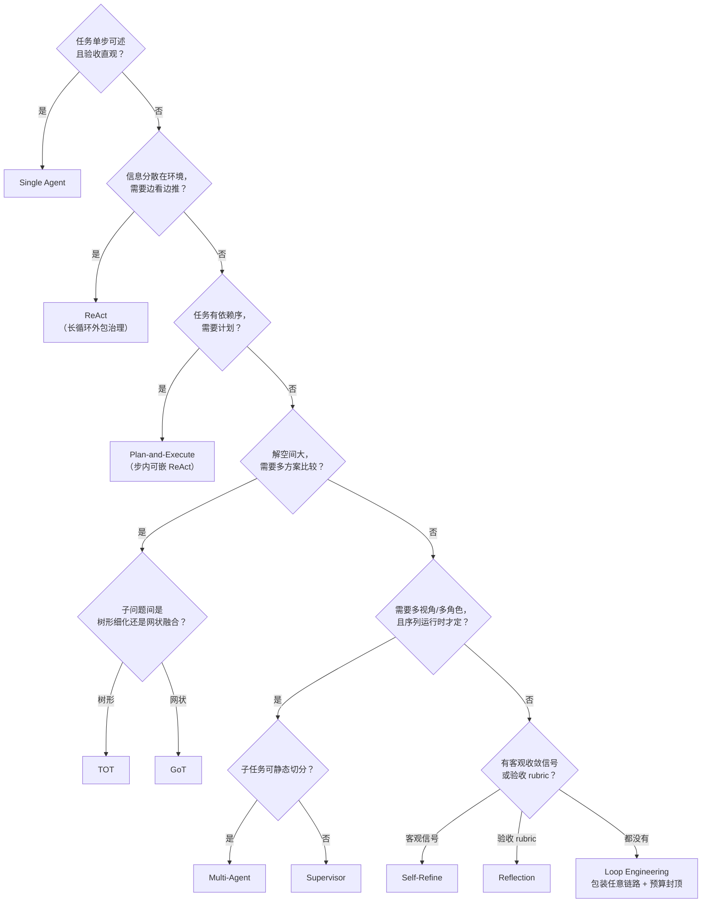

图 9-1 选型决策树。入口分流场景（统一入口服务多任务形态）直接选 Router，再由路由表指向本树各结论链路。

### 9.5 反模式提示

- **「上来就 Multi-Agent」**：任务不可静态切分时并发车道互相等待，墙钟不降反升；先问 q7（9.4），不可切分就走 Supervisor。
- **「TOT 解决一切」**：解空间小的问题用 TOT 是浪费（成本 8-20×）；单步可述的任务走 Single Agent。
- **「无治理的长循环」**：ReAct/TOT 不加预算门，遇平台期会原地打转；任何预期超过 10 分钟的链路都应外包 Loop Engineering。
- **「Memory 当数据库用」**：往情景记忆塞大段代码快照（应走语义记忆的结构化知识沉淀）；记忆检索是增强不是存储，大工件走黑板与文件系统。

---

## 10. 落地路线图

**表 10-1 分阶段落地建议**

| 阶段 | 内容 | 验收 |
|---|---|---|
| M1 骨架 | `OrchestratorNode` / `Port` / `NodeResult` / `Blackboard` / `DefaultOrchestrator` 调度循环（含端口路由、预算门、快照） | Single Agent 链路端到端跑通（最小验证） |
| M2 循环层 | ReAct / Tool Use / Self-Refine / Reflection / Plan-and-Execute（按此依赖序：Tool Use → ReAct → 其它） | 每模式一个 VibeCoding 示例任务通过（5 章各节示例） |
| M3 框架层 | CompositeNode → Multi-Agent → Router → Supervisor → TOT → GoT → Loop Engineering | 组合范式（9.3 表）各跑通一个 |
| M4 横切 | MemoryHandle 四层记忆 + before/after 钩子 + 归档点 | 跨会话记忆示例（7.4 幂等键案例）通过 |
| M5 通信层 | GenaiAdapter：Provider 矩阵、schema 转换、流式归一、降级链、计量 | 换 Provider 上层零改动的回归验证 |

依赖关系说明：M2 依赖 M1 的执行器；M3 依赖 M2 的循环节点（作工人/车道）；M4 可与 M2 并行（钩子点在 M1 已留）；M5 可最后接入（上层一直用测试桩 `LlmHandle`）。

---

## 附录 A. 术语表

**表 A-1 术语**

| 术语 | 定义 | 首次出现 |
|---|---|---|
| VibeCoding | 以自然语言为主要输入、由 LLM 驱动的编码工作流 | 1.1 |
| 编排框架层 | 三层架构的最上层：决定节点如何组成图（6 种模式，100% 自研） | 2.1 |
| Agent loop 层 | 三层架构的中层：节点内部运行的基础循环（6 种模式） | 2.1 |
| LLM 通信层 | 三层架构的最下层：genai 适配，只影响最下层，不含模式 | 2.1 |
| Memory 横切 | 以 `MemoryHandle` 注入所有层节点的记忆能力，不构成独立链路 | 2.1 |
| `OrchestratorNode` | 统一节点 trait：13 种模式的全部可调度单元实现它 | 3.2 |
| `Port` | 节点出口端口枚举：Out / Loop / Branch / Spawn / Done / Fatal | 3.2 |
| `NodeResult` | 节点执行结果：只携带路由端口与用量元信息，数据走黑板 | 3.2 |
| 黑板（Blackboard） | 跨节点共享的任务状态存储，键按模式命名空间隔离，只追加优先 | 3.3 |
| `CompositeNode` | 把子图包装为单节点的组合器，白盒/黑盒对偶的粘合剂 | 3.4 |
| `DefaultOrchestrator` | 唯一图执行器：拓扑推进、端口路由、并发调度、动态子图、治理 | 4.1 |
| `Spawn` | 容器节点请求挂接动态子图的端口；并发车道的挂接通道 | 4.4 |
| 车道（lane） | 并发调度的分支单位，车道内顺序、车道间并发，黑板键按车道隔离 | 4.4 |
| 治理终止 | 预算耗尽/轮次上限/取消触发的终止，区别于自然终止与 Fatal | 2.3 |
| 快照（Snapshot） | 节点可恢复状态的序列化；断点续跑的基础 | 3.2 |
| `LlmHandle` | 通信层对上暴露的统一 LLM 调用接口，genai 适配不改变它 | 8.5 |
| `GenaiAdapter` | `LlmHandle` 的实现：Provider 适配、schema 转换、流式归一、降级、计量 | 8.3 |
| 四层记忆 | 工作记忆/情景记忆/语义记忆/程序性记忆，按生命周期与抽象度分层 | 7.2 |
| wait-set | 聚合节点声明的等待集：全部车道终节点就绪才调度（汇合点） | 4.4 |
| RunReport | 终局输出的全链路报告：步序、端口、用量台账、终局原因 | 4.3 |
| 平台期检测 | 收敛判定的兜底信号：连续 N 轮指标无改善则判定停滞 | 6.6 |

## 附录 B. 模式速查索引

**表 B-1 13 种模式速查**

| # | 模式 | 层 | 核心结构 | 一句话场景 | 章节 |
|---|---|---|---|---|---|
| 1 | Single Agent | loop | 直通链 | 单步即席生成（正则/函数/docstring） | 5.1 |
| 2 | ReAct | loop | 思考—行动—观察回边 | Bug 定位、CI 排错 | 5.2 |
| 3 | Plan-and-Execute | loop | 计划—执行—重规划 | 大型重构、迁移 | 5.3 |
| 4 | Reflection | loop | actor–critic 交替 | 按 rubric 的评审修订 | 5.4 |
| 5 | Self-Refine | loop | 单节点自循环 | 客观指标驱动的打磨 | 5.5 |
| 6 | TOT | 框架 | 展开—评分—剪枝树 | 架构选型、方案比稿 | 6.1 |
| 7 | GoT | 框架 | split—merge 思维图 | 多视角融合的重构路线图 | 6.2 |
| 8 | Multi-Agent | 框架 | 静态车道—聚合 | 码测档三线并行交付 | 6.3 |
| 9 | Supervisor | 框架 | 星型派发—回收 | 运行时定序的端到端迁移 | 6.4 |
| 10 | Router | 框架 | 分类—分发 | 统一入口分流 | 6.5 |
| 11 | Tool Use | loop | 协议循环 | 一切越出模型边界的动作 | 5.6 |
| 12 | Memory | 横切 | 四层记忆句柄 | 跨任务/跨会话的上下文延续 | 7 |
| 13 | Loop Engineering | 框架 | 四闸门治理包装 | 长循环的预算与收敛治理 | 6.6 |

---

> 文档结束 ｜ V1.0 ｜ 2026-08-29 ｜ 全文 13 模式 × 3 层架构 × 统一 trait × 图执行器调度，链路设计自包含成稿

## 11. 前端界面映射：三栏布局与模式入口

### 11.1 设计原则：用户选任务，不选模式

VibeCoding 的「vibe」在于用户表达意图而非操控架构。13 种模式若以 13 个并列按钮暴露，等于把编排复杂度转嫁给用户——那是传统工作流编辑器的形态，不是 Agent 界面的形态。正确姿态是**可见性分级**：

- **L0 无感（材料层）**：Single Agent、Tool Use——链路的组成材料，UI 上表现为普通回复与工具调用卡片，用户不选择、也不感知其「模式身份」。
- **L1 可观测（过程层）**：ReAct、Plan-and-Execute、Reflection、Self-Refine、TOT、GoT、Multi-Agent、Supervisor——运行时在观测面展开为实时视图，用户能看、能有限干预，但默认由 Router 自动选择。
- **L2 可交互（控制层）**：Router（入口与换道）、Loop Engineering（预算与治理）、Memory（上下文管理）——拥有常驻或直接的 UI 控件。

注意：可见性分级与架构三层**不一一对应**（Tool Use 在 loop 层但 UI 无感；Loop Engineering 在框架层但控件常驻）——可见性由「用户是否需要与之交互」决定，而非架构位置。

### 11.2 三栏职责划分

**表 11-1 三栏职责**

| 栏 | 尺寸 | 角色 | 承载内容 |
|---|---|---|---|
| 左短栏 | 64–240px，可收起为图标栏 | 导航与偏好 | 会话/任务列表、新建任务、模式偏好（自动/手动）、链路手册入口 |
| 中对话区 | 自适应主区 | **叙事面（唯一入口在此）** | 输入框、路由 chip、消息流（计划卡/工具卡/轨迹卡/交付卡）、澄清对话 |
| 右面板 | 320–400px，可折叠 | **观测面** | 图视图（链路实时高亮）、治理视图（预算/轮次/事件）、记忆视图、RunReport |

中栏是「链路对用户说话的地方」，右栏是「链路自我暴露的地方」。左栏为什么短：它只承载任务维度（会话与偏好），**不承载模式选择**——模式选择的默认位置是 Router 自动 + chip 确认，手动档收进偏好设置。


图 11-1 三栏信息架构线框。虚线连接表示并置关系（无数据流）。

### 11.3 入口设计：单一入口 + 路由确认 + 手动档

入口只有一个：中栏输入框。Router 在背后工作，UI 上分三步呈现：

1. **提交意图** → Router 分类（用户无感）。
2. **高置信度**：输入框上方浮现路由 chip「本任务走 Plan-and-Execute」。点击展开理由（`route.choice` 的分类依据），再点「换链路」手动 override——chip 是路由的**确认面**，不是必经操作。
3. **低置信度**：fallback 以对话消息出现在中栏（「你想排查问题，还是想了解结构？」），用户回答后重分类；澄清超限自动走安全默认（Single Agent 直通）。

**手动档**：左栏「模式偏好」切到手动后，输入框旁出现链路选择器，分组即架构分层——基础循环 6 项（互斥单选）/ 编排框架 6 项（互斥单选）/ Memory 横切（独立开关，默认开）+ Loop Engineering（治理开关与预算参数）。界面分组 = 表 2-1 的层级归属，降低心智映射成本。

### 11.4 13 模式的 UI 呈现矩阵

**表 11-2 模式 × 界面呈现**

| 模式 | 可见性 | 主要位置 | UI 形态 | 用户可做的事 |
|---|---|---|---|---|
| Router | L2 | 输入框上方 + 中栏 | 路由 chip（含理由 popover）；澄清消息 | 查看理由 / 换链路 / 回答澄清 |
| Single Agent | L0 | 中栏 | 普通回复（无特殊 UI） | — |
| ReAct | L1 | 中栏内联 | 可折叠轨迹卡：Thought → Action → Observation，每轮一条 | 展开 / 收起、收藏某轮观察 |
| Plan-and-Execute | L1 | 中栏 + 右栏 | 计划清单卡（checkbox 进度）；重规划时 diff 高亮 | 勾选跳过某步、编辑步骤验收 |
| Reflection | L1 | 中栏内联 | 轮次徽标 v1 → v2 → v3 + critic 摘要气泡 | 查看 critic 的 rubric |
| Self-Refine | L1 | 右栏 | 版本链指示器 + 客观指标曲线 | 设定目标阈值 |
| TOT | L1 | 右栏图视图 | 思维树实时生长（展开 / 剪枝动画），胜出路径高亮 | 展开被剪分支看理由、钉住某候选 |
| GoT | L1 | 右栏图视图 | split / merge 的 DAG，车道按色区分 | 同上 |
| Multi-Agent | L1 | 右栏 | 车道泳道视图 + 各车道进度条 | 给某车道追加指令 |
| Supervisor | L1 | 右栏 | 任务队列看板（待派 / 执行中 / 已验收 / 重派） | 插队、取消任务项 |
| Tool Use | L0 | 中栏内联 | 工具调用卡（工具名 + 参数 + 结果摘要，可展开） | 敏感工具的 diff 预览与授权放行 |
| Memory | L2 | 输入区上方 + 右栏 | 召回 chips（「已带入：上午的幂等键任务」）+ 记忆浏览器 | 剔除某条召回、固定常驻条目 |
| Loop Engineering | L2 | 顶栏常驻 + 右栏 | 预算用量计（token / 时间 / 轮次）+ 治理事件 toast | 追加预算、暂停、降级确认 |

「用户可做的事」一列是设计的关键约束：**观测面默认只读，每种模式只开放 1–2 个高价值干预点**——界面复杂度与模式数量解耦。13 种模式在界面上同时运行时，用户心智负担上限是：1 个 chip + 若干内联卡 + 1 张右栏图 + 1 根预算条。

### 11.5 一条链路的完整界面走线

以「clap 3 → 4 迁移」为例（Plan-and-Execute + Loop Engineering 治理，对应 9.3 组合范式「工程主力」）：

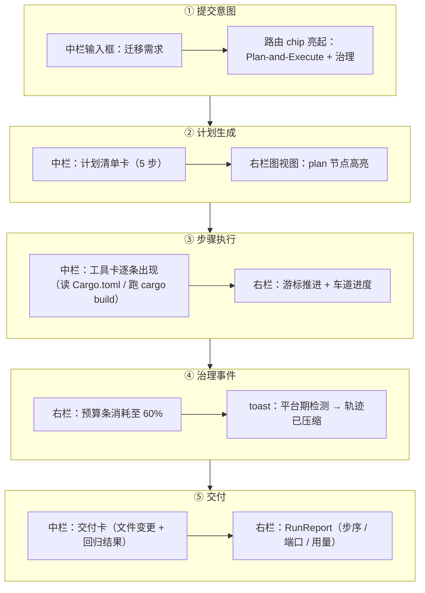

图 11-2 界面走线：叙事面（中栏）与观测面（右栏）双轨同步，治理事件以 toast 不打断叙事。

### 11.6 前后端契约对应

**表 11-3 UI 组件 ← 后端状态来源**

| UI 组件 | 后端来源 |
|---|---|
| 路由 chip / 澄清消息 | `route.choice`（含置信度与理由） |
| 计划清单卡 / 游标 | `pne.plan` + `pne.cursor` |
| ReAct 轨迹卡 | `react.trace` |
| 版本链 / 指标曲线 | `refine.draft@k` + ObjectiveSignal |
| TOT 树 / GoT 图 | `tot.tree` / `got.graph` |
| Supervisor 看板 | `sup.queue` + 派发记录 |
| 车道泳道 | `ma.results.<lane>` |
| 预算条 / 治理 toast | `gov.budget_ledger` + 治理事件流 |
| 记忆 chips | before 钩子的召回集（7.3） |
| 图视图实时高亮 | 步序号 + 端口路由事件（RunReport 的流式化） |

一句话总结：**前端是黑板的投影 + 执行器事件的流**。所有 UI 状态都有后端键来源，前端不私自发明状态——这保证界面展示与链路真实状态严格一致，「所见即所跑」，也让界面天然可审计。

---
